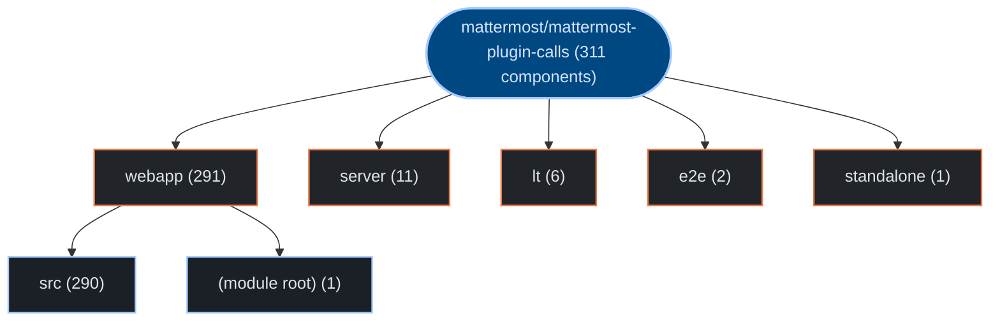
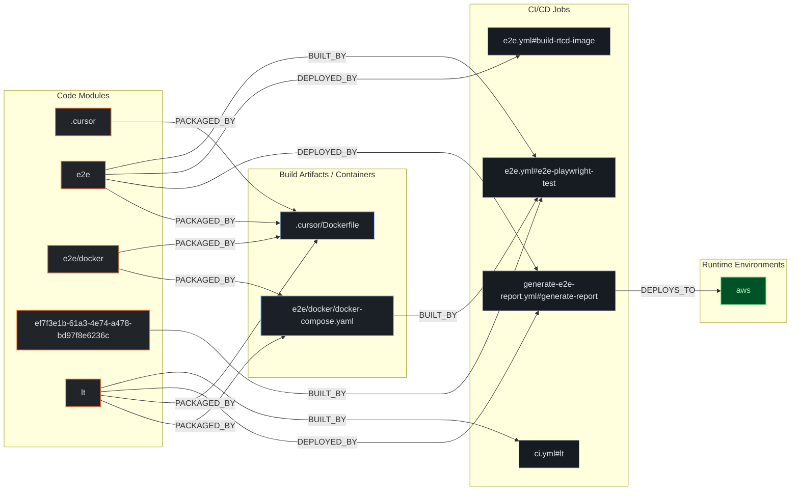

# Repository Architecture Analysis: mattermost/mattermost-plugin-calls

## Metadata
- **SHA**: `8471c9814ce905bb42851bbf197716a8e3df5488`
- **Primary Ecosystem**: JavaScript/TypeScript

## Quality Metrics
- **ast_engine**: tree-sitter
- **avg_cognitive_complexity**: 2.96
- **avg_cyclomatic_complexity**: 3.21
- **component_count**: 311
- **dead_code_count**: 75
- **dead_code_symbols**: 50 entry(ies)
- **duplication_pct**: 87.16
- **file_complexities**: 25 entry(ies)
- **files_analyzed**: 323
- **fitness_passed**: False
- **fitness_violation_count**: 3
- **framework**: React (Vite)
- **import_edges**: 100 entry(ies)
- **loc**: 51084
- **max_cognitive_complexity**: 172
- **max_cyclomatic_complexity**: 110
- **sloc**: 41339
- **test_file_count**: 221

# Architecture: mattermost/mattermost-plugin-calls

## Context
- **Repository**: `mattermost/mattermost-plugin-calls`
- **SHA**: `8471c9814ce905bb42851bbf197716a8e3df5488`
- **Ecosystem**: JavaScript/TypeScript
- **Framework**: React (Vite)

## Building Block View

## Component Details

Showing top 60 representative components out of 311 across 5 module group(s):

- **Module `webapp`** (291 components — UI_COMPONENT: 288, SERVICE: 2, MODULE: 1)
- **Module `server`** (11 components — module: 11)
- **Module `lt`** (6 components — module: 6)
- **Module `e2e`** (2 components — MODULE: 1, module: 1)
- **Module `standalone`** (1 components — MODULE: 1)

- **CallSettings** (`webapp/src/components/expanded_view/call_settings.tsx`): UI_COMPONENT (deps: CallThreadIcon, ControlsButton, MentionsCounter, UnreadDot)
- **CallSettingsButton** (`webapp/src/components/expanded_view/call_settings.tsx`): UI_COMPONENT (deps: CallThreadIcon, ControlsButton, MentionsCounter, UnreadDot)
- **ParticipantsGrid** (`webapp/src/components/expanded_view/participants_grid.tsx`): UI_COMPONENT (deps: ParticipantCell, ParticipantTile, ParticipantTileLoading)
- **RecordingInfoPrompt** (`webapp/src/components/expanded_view/recording_info_prompt.tsx`): UI_COMPONENT (deps: DefaultLeftButton, DefaultRightButton, InCallPrompt)
- **CallParticipantAvatar** (`webapp/src/components/call_widget/call_participant_avatar.tsx`): UI_COMPONENT (deps: ParticipantAvatar, SpeakerAvatar)
- **CallStatusText** (`webapp/src/components/call_widget/call_status_text.tsx`): UI_COMPONENT (deps: ParticipantName, SpeakerName)
- **AudioInputMissingError** (`webapp/src/client.ts`): UI_COMPONENT (deps: WebSocketClient)
- **AudioInputPermissionsError** (`webapp/src/client.ts`): UI_COMPONENT (deps: WebSocketClient)
- **CallStatusTimer** (`webapp/src/components/call_status_timer/index.tsx`): UI_COMPONENT (deps: ElapsedTimer)
- **CallsClient** (`webapp/src/client.ts`): SERVICE (deps: WebSocketClient)
- **DefaultVideoTrackOptions** (`webapp/src/client.ts`): UI_COMPONENT (deps: WebSocketClient)
- **ParticipantTile** (`webapp/src/components/expanded_view/participant_tile.tsx`): UI_COMPONENT (deps: ParticipantCell)
- **ParticipantTileLoading** (`webapp/src/components/expanded_view/participant_tile_loading.tsx`): UI_COMPONENT (deps: ParticipantCell)
- **VideoInputMissingError** (`webapp/src/client.ts`): UI_COMPONENT (deps: WebSocketClient)
- **VideoInputPermissionsError** (`webapp/src/client.ts`): UI_COMPONENT (deps: WebSocketClient)
- **WidgetButton** (`webapp/src/components/call_widget/widget_button.tsx`): UI_COMPONENT (deps: UnavailableIconWrapper)
- **ADD_INCOMING_CALL** (`webapp/src/action_types.ts`): UI_COMPONENT
- **ActiveCallIcon** (`webapp/src/components/icons/active_call_icon.tsx`): UI_COMPONENT
- **AllowScreenSharing** (`webapp/src/components/admin_console_settings/allow_screen_sharing.tsx`): UI_COMPONENT
- **AudioDevicesSettingsSection** (`webapp/src/components/user_settings/audio_devices_settings_section.tsx`): UI_COMPONENT
- **Badge** (`webapp/src/components/badge.tsx`): UI_COMPONENT
- **Button** (`webapp/src/components/buttons/index.tsx`): UI_COMPONENT
- **CALL_END** (`webapp/src/action_types.ts`): UI_COMPONENT
- **CALL_EVENT_POST_TYPE** (`webapp/src/constants.ts`): UI_COMPONENT
- **CALL_HOST** (`webapp/src/action_types.ts`): UI_COMPONENT
- **CALL_LIVE_CAPTIONS_STATE** (`webapp/src/action_types.ts`): UI_COMPONENT
- **CALL_RECORDING_POST_TYPE** (`webapp/src/constants.ts`): UI_COMPONENT
- **CALL_RECORDING_STATE** (`webapp/src/action_types.ts`): UI_COMPONENT
- **CALL_REC_PROMPT_DISMISSED** (`webapp/src/action_types.ts`): UI_COMPONENT
- **CALL_STATE** (`webapp/src/action_types.ts`): UI_COMPONENT
- **CALL_TRANSCRIPTION_POST_TYPE** (`webapp/src/constants.ts`): UI_COMPONENT
- **CCIcon** (`webapp/src/components/icons/cc_icon.tsx`): UI_COMPONENT
- **CLIENT_CONNECTING** (`webapp/src/action_types.ts`): UI_COMPONENT
- **CallAlertConfigs** (`webapp/src/constants.ts`): UI_COMPONENT
- **CallAlertStatesDefault** (`webapp/src/types/types.ts`): UI_COMPONENT
- **CallErrorModal** (`webapp/src/components/call_error_modal.tsx`): UI_COMPONENT
- **CallErrorModalID** (`webapp/src/components/call_error_modal.tsx`): UI_COMPONENT
- **CallIcon** (`webapp/src/components/icons/call_icon.tsx`): UI_COMPONENT
- **CallIncoming** (`webapp/src/components/incoming_calls/call_incoming.tsx`): UI_COMPONENT
- **CallIncomingCondensed** (`webapp/src/components/incoming_calls/call_incoming_condensed.tsx`): UI_COMPONENT
- **CallLiveCaptionsSection** (`webapp/src/components/admin_console_settings/sections/call_live_captions.tsx`): UI_COMPONENT
- **CallRecordingDisclaimerStrings** (`webapp/src/constants.ts`): UI_COMPONENT
- **CallRecordingsSection** (`webapp/src/components/admin_console_settings/sections/call_recordings.tsx`): UI_COMPONENT
- **CallThreadIcon** (`webapp/src/components/expanded_view/controls_button.tsx`): UI_COMPONENT
- **CallTranscribingDisclaimerStrings** (`webapp/src/constants.ts`): UI_COMPONENT
- **CallTranscriptionsSection** (`webapp/src/components/admin_console_settings/sections/call_transcriptions.tsx`): UI_COMPONENT
- **CallsConfigDefault** (`webapp/src/types/types.ts`): UI_COMPONENT
- **CallsInTestModeModal** (`webapp/src/components/modals/index.tsx`): UI_COMPONENT
- **CallsUserPreferencesDefault** (`webapp/src/types/types.ts`): UI_COMPONENT
- **ChatThreadIcon** (`webapp/src/components/icons/chat_thread.tsx`): UI_COMPONENT
- **CloudFreeTrialModalAdmin** (`webapp/src/cloud_pricing/modals.tsx`): UI_COMPONENT
- **CloudFreeTrialModalUser** (`webapp/src/cloud_pricing/modals.tsx`): UI_COMPONENT
- **CollapseIcon** (`webapp/src/components/icons/collapse.tsx`): UI_COMPONENT
- **ColumnContainer** (`webapp/src/components/generic_error_modal.tsx`): UI_COMPONENT
- **CompassIcon** (`webapp/src/components/icons/compassIcon.tsx`): UI_COMPONENT
- **ControlsButton** (`webapp/src/components/expanded_view/controls_button.tsx`): UI_COMPONENT
- **CurrentCallDataDefault** (`webapp/src/types/types.ts`): UI_COMPONENT
- **CustomPostButtonRow** (`webapp/src/components/custom_post_types/custom_post_styles.tsx`): UI_COMPONENT
- **CustomPostContainer** (`webapp/src/components/custom_post_types/custom_post_styles.tsx`): UI_COMPONENT
- **CustomPostContent** (`webapp/src/components/custom_post_types/custom_post_styles.tsx`): UI_COMPONENT

## 6-Dimension Repository Scorecard

- **Overall Grade**: `F` (53.43/100)
- **Technical Debt Score**: 46.57
- **Estimated Remediation Effort**: 87.32h

| Dimension | Grade | Score | Weight | Details |
| :--- | :---: | :---: | :---: | :--- |
| Code Quality | `F` | 29.16 | 0.20 | avg_cc=3.21, max_cc=110, duplication=87.16%, dead_code=75 |
| Dependency Health | `A` | 100.00 | 0.15 | dependencies=3980, outdated=0, vulnerable=0, has_lockfile=True |
| Maintainability | `F` | 37.00 | 0.15 | avg_cognitive=2.96, max_cognitive=172, fitness_violations=3, oversized_files=13 |
| Pipeline Health | `F` | 49.00 | 0.15 | workflows=5, operational_antipatterns=12, parallel_branches=True |
| Security | `F` | 46.00 | 0.20 | vulnerabilities=0, secrets=0, pipeline_security_findings=6 |
| Test Coverage | `C` | 70.00 | 0.15 | coverage=unavailable, ci_test_job=True, test_files_detected=True |

## Architecture Fitness & Workspace Boundaries

- **[MEDIUM] `ATRUSS-ARCH-005` (COMPLEXITY_THRESHOLD)**: Repository duplication_pct (87.16) exceeds policy threshold (15.0).
- **[MEDIUM] `ATRUSS-ARCH-005` (COMPLEXITY_THRESHOLD)**: Repository max_cognitive_complexity (172.0) exceeds policy threshold (25.0).
- **[MEDIUM] `ATRUSS-ARCH-005` (COMPLEXITY_THRESHOLD)**: Repository max_cyclomatic_complexity (110.0) exceeds policy threshold (20.0).

## Supply Chain Dependencies, Vulnerabilities & Secrets

- **Dependencies Parsed**: 3980 | **Vulnerabilities**: 0 | **Secrets**: 0

### Inventory Sample
- `github.com/Masterminds/semver` `1.5.0` (golang, `go.mod`)
- `github.com/aws/aws-sdk-go` `1.50.3` (golang, `lt/go.mod`)
- `github.com/gorilla/mux` `1.8.1` (golang, `go.mod`)
- `github.com/grafana/pyroscope-go/godeltaprof` `0.1.8` (golang, `go.mod`)
- `github.com/hajimehoshi/go-mp3` `0.3.4` (golang, `lt/go.mod`)
- `github.com/jmoiron/sqlx` `1.3.5` (golang, `go.mod`)
- `github.com/lib/pq` `1.12.3` (golang, `go.mod`)
- `github.com/mattermost/calls-offloader` `0.9.4` (golang, `go.mod`)
- `github.com/mattermost/calls-recorder` `0.8.8` (golang, `go.mod`)
- `github.com/mattermost/calls-transcriber` `0.7.1` (golang, `go.mod`)
- `github.com/mattermost/logr/v2` `2.0.22` (golang, `go.mod`)
- `github.com/mattermost/mattermost-plugin-calls/server/public` `0.0.3` (golang, `go.mod`)
- `github.com/mattermost/mattermost/server/public` `0.1.10` (golang, `lt/go.mod`)
- `github.com/mattermost/mattermost/server/public` `0.4.2` (golang, `go.mod`)
- `github.com/mattermost/morph` `1.1.0` (golang, `go.mod`)
- `github.com/mattermost/rtcd` `1.2.2` (golang, `lt/go.mod`)
- `github.com/mattermost/rtcd` `1.2.6` (golang, `go.mod`)
- `github.com/mattermost/squirrel` `0.2.0` (golang, `go.mod`)
- `github.com/pion/rtp` `1.10.1` (golang, `lt/go.mod`)
- `github.com/pion/webrtc/v4` `4.2.6` (golang, `lt/go.mod`)
- `github.com/pkg/errors` `0.9.1` (golang, `go.mod`)
- `github.com/prometheus/client_golang` `1.16.0` (golang, `go.mod`)
- `github.com/stretchr/testify` `1.11.1` (golang, `go.mod`)
- `github.com/stretchr/testify` `1.8.4` (golang, `server/public/go.mod`)
- `github.com/testcontainers/testcontainers-go` `0.34.0` (golang, `go.mod`)
- `github.com/testcontainers/testcontainers-go/modules/postgres` `0.34.0` (golang, `go.mod`)
- `golang.org/x/time` `0.10.0` (golang, `go.mod`)
- `gopkg.in/hraban/opus.v2` `2.0.0-20230925203106-0188a62cb302` (golang, `lt/go.mod`)
- `gopkg.in/yaml.v3` `3.0.1` (golang, `go.mod`)
- `@babel/core` `7.16.0` (npm, `standalone/package-lock.json`)
- ... (+3950 more dependencies)

## Section 7: Code-to-Cloud Deployment Traceability

- `generate-e2e-report.yml#generate-report` (ci_job) --[DEPLOYS_TO]--> `aws` (environment)
- `.cursor` (code_module) --[PACKAGED_BY]--> `.cursor/Dockerfile` (container)
- `e2e` (code_module) --[BUILT_BY]--> `e2e.yml#e2e-playwright-test` (ci_job)
- `e2e` (code_module) --[DEPLOYED_BY]--> `e2e.yml#build-rtcd-image` (ci_job)
- `e2e` (code_module) --[DEPLOYED_BY]--> `generate-e2e-report.yml#generate-report` (ci_job)
- `e2e` (code_module) --[PACKAGED_BY]--> `.cursor/Dockerfile` (container)
- `e2e/docker` (code_module) --[PACKAGED_BY]--> `.cursor/Dockerfile` (container)
- `e2e/docker` (code_module) --[PACKAGED_BY]--> `e2e/docker/docker-compose.yaml` (container)
- `ef7f3e1b-61a3-4e74-a478-bd97f8e6236c` (code_module) --[BUILT_BY]--> `e2e.yml#e2e-playwright-test` (ci_job)
- `lt` (code_module) --[BUILT_BY]--> `ci.yml#lt` (ci_job)
- `lt` (code_module) --[DEPLOYED_BY]--> `generate-e2e-report.yml#generate-report` (ci_job)
- `lt` (code_module) --[PACKAGED_BY]--> `.cursor/Dockerfile` (container)
- `lt` (code_module) --[PACKAGED_BY]--> `e2e/docker/docker-compose.yaml` (container)
- `e2e/docker/docker-compose.yaml` (container) --[BUILT_BY]--> `e2e.yml#e2e-playwright-test` (ci_job)

## CI/CD Pipeline Topology

```mermaid
graph TD;
  classDef atlasRoot fill:#004882,stroke:#a3c9ff,stroke-width:2px,color:#d3e4ff
  classDef atlasCategory fill:#212428,stroke:#E87A48,stroke-width:1.5px,color:#dfe3eb
  classDef atlasWorkflow fill:#1b2026,stroke:#a3c9ff,stroke-width:1.5px,color:#dfe3eb
  classDef atlasJob fill:#171c22,stroke:#8d9199,stroke-width:1px,color:#dfe3eb
  classDef atlasTarget fill:#005227,stroke:#8bd99b,stroke-width:1.5px,color:#a7f6b6
  classDef atlasAlert fill:#93000a,stroke:#ffb4ab,stroke-width:1.5px,color:#ffdad6
  classDef atlasMore fill:#252a31,stroke:#8d9199,stroke-dasharray:4 4,color:#c3c6cf
  pipeline_root(["mattermost/mattermost-plugin-calls (5 workflows)"]):::atlasRoot
  grp_0_CI___Verification["CI & Verification (3 workflows · 8 jobs)"]:::atlasCategory
  pipeline_root --> grp_0_CI___Verification
  wf_0_ci["ci (3 jobs)"]:::atlasWorkflow
  grp_0_CI___Verification --> wf_0_ci
  job_0_plugin_ci["plugin-ci"]:::atlasJob
  job_0_code_coverage["code-coverage"]:::atlasJob
  job_0_lt["lt"]:::atlasJob
  wf_0_ci --> job_0_plugin_ci
  wf_0_ci --> job_0_code_coverage
  wf_0_ci --> job_0_lt
  wf_1_E2E_Testing["E2E Testing (4 jobs)"]:::atlasWorkflow
  grp_0_CI___Verification --> wf_1_E2E_Testing
  job_1_build_mattermost_plugin_calls["build-mattermost-plugin-calls"]:::atlasJob
  job_1_build_rtcd_image["build-rtcd-image"]:::atlasJob
  job_1_generate_matrix["generate-matrix"]:::atlasJob
  wf_1_E2E_Testing --> job_1_build_mattermost_plugin_calls
  wf_1_E2E_Testing --> job_1_build_rtcd_image
  wf_1_E2E_Testing --> job_1_generate_matrix
  wf_3_PR_Test_Analysis_Override["PR Test Analysis Override (1 jobs)"]:::atlasWorkflow
  grp_0_CI___Verification --> wf_3_PR_Test_Analysis_Override
  job_3_override["override"]:::atlasJob
  wf_3_PR_Test_Analysis_Override --> job_3_override
  grp_1_Automation___Other["Automation & Other (1 workflows · 1 jobs)"]:::atlasCategory
  pipeline_root --> grp_1_Automation___Other
  wf_2_E2E_Report_Generation["E2E Report Generation (1 jobs)"]:::atlasWorkflow
  grp_1_Automation___Other --> wf_2_E2E_Report_Generation
  job_2_generate_report["generate-report"]:::atlasJob
  wf_2_E2E_Report_Generation --> job_2_generate_report
  grp_2_Scheduled___Manual["Scheduled & Manual (1 workflows · 1 jobs)"]:::atlasCategory
  pipeline_root --> grp_2_Scheduled___Manual
  wf_4_PR_Test_Analysis["PR Test Analysis (1 jobs)"]:::atlasWorkflow
  grp_2_Scheduled___Manual --> wf_4_PR_Test_Analysis
  job_4_analyze["analyze"]:::atlasJob
  wf_4_PR_Test_Analysis --> job_4_analyze
```

