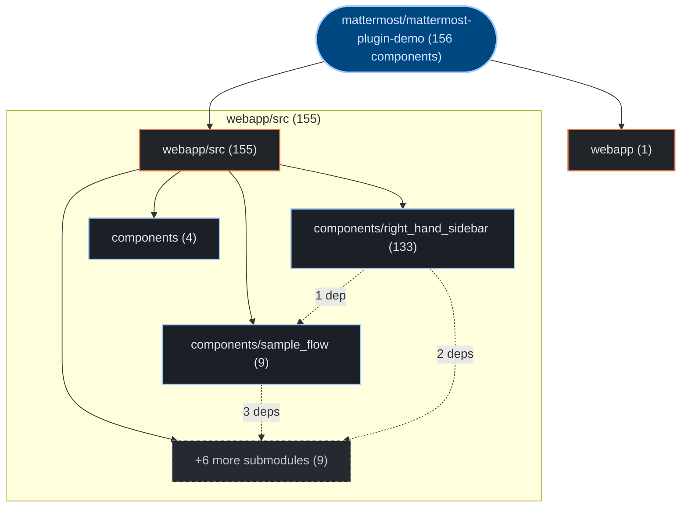
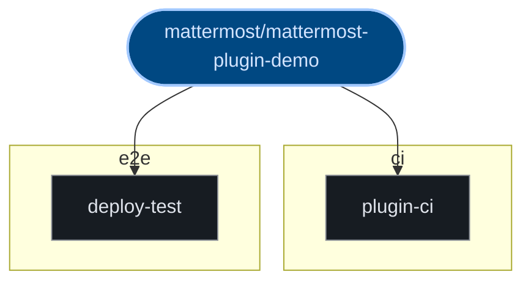

# Repository Architecture Analysis: mattermost/mattermost-plugin-demo

## Metadata
- **SHA**: `a427ec72a7433037b44e77417d6399c90c1664c4`
- **Primary Ecosystem**: JavaScript/TypeScript

## Quality Metrics
- **ast_engine**: tree-sitter
- **avg_cognitive_complexity**: 0.73
- **avg_cyclomatic_complexity**: 1.64
- **component_count**: 156
- **dead_code_count**: 0
- **dead_code_symbols**: 0 entry(ies)
- **duplication_pct**: 76.77
- **file_complexities**: 25 entry(ies)
- **files_analyzed**: 74
- **fitness_passed**: False
- **fitness_violation_count**: 1
- **framework**: React (Vite)
- **import_edges**: 100 entry(ies)
- **loc**: 6334
- **max_cognitive_complexity**: 18
- **max_cyclomatic_complexity**: 14
- **sloc**: 5634
- **test_file_count**: 14

# Architecture: mattermost/mattermost-plugin-demo

## Context
- **Repository**: `mattermost/mattermost-plugin-demo`
- **SHA**: `a427ec72a7433037b44e77417d6399c90c1664c4`
- **Ecosystem**: JavaScript/TypeScript
- **Framework**: React (Vite)

## Building Block View

## Component Details

Showing top 60 representative components out of 156 across 2 module group(s):

- **Module `webapp/src`** (155 components — UI_COMPONENT: 155)
- **Module `webapp`** (1 components — MODULE: 1)

- **AdminConsoleHeaderDetail** (`webapp/src/components/right_hand_sidebar/components_tab/specimens/chrome.tsx`): UI_COMPONENT (deps: EmojiDetail, EmojiPreview, Excerpt, IconDetail, IconPreview, IllustrationDetail (+12 more))
- **AdminConsoleHeaderPreview** (`webapp/src/components/right_hand_sidebar/components_tab/specimens/chrome.tsx`): UI_COMPONENT (deps: EmojiDetail, EmojiPreview, Excerpt, IconDetail, IconPreview, IllustrationDetail (+12 more))
- **DividerDetail** (`webapp/src/components/right_hand_sidebar/components_tab/specimens/layout.tsx`): UI_COMPONENT (deps: EmojiDetail, EmojiPreview, Excerpt, IconDetail, IconPreview, IllustrationDetail (+12 more))
- **DividerPreview** (`webapp/src/components/right_hand_sidebar/components_tab/specimens/layout.tsx`): UI_COMPONENT (deps: EmojiDetail, EmojiPreview, Excerpt, IconDetail, IconPreview, IllustrationDetail (+12 more))
- **EmptyStateDetail** (`webapp/src/components/right_hand_sidebar/components_tab/specimens/layout.tsx`): UI_COMPONENT (deps: EmojiDetail, EmojiPreview, Excerpt, IconDetail, IconPreview, IllustrationDetail (+12 more))
- **EmptyStatePreview** (`webapp/src/components/right_hand_sidebar/components_tab/specimens/layout.tsx`): UI_COMPONENT (deps: EmojiDetail, EmojiPreview, Excerpt, IconDetail, IconPreview, IllustrationDetail (+12 more))
- **FeatureDiscoveryPanelDetail** (`webapp/src/components/right_hand_sidebar/components_tab/specimens/chrome.tsx`): UI_COMPONENT (deps: EmojiDetail, EmojiPreview, Excerpt, IconDetail, IconPreview, IllustrationDetail (+12 more))
- **FeatureDiscoveryPanelPreview** (`webapp/src/components/right_hand_sidebar/components_tab/specimens/chrome.tsx`): UI_COMPONENT (deps: EmojiDetail, EmojiPreview, Excerpt, IconDetail, IconPreview, IllustrationDetail (+12 more))
- **RightSidebarHeaderDetail** (`webapp/src/components/right_hand_sidebar/components_tab/specimens/chrome.tsx`): UI_COMPONENT (deps: EmojiDetail, EmojiPreview, Excerpt, IconDetail, IconPreview, IllustrationDetail (+12 more))
- **RightSidebarHeaderPreview** (`webapp/src/components/right_hand_sidebar/components_tab/specimens/chrome.tsx`): UI_COMPONENT (deps: EmojiDetail, EmojiPreview, Excerpt, IconDetail, IconPreview, IllustrationDetail (+12 more))
- **ScrollbarDetail** (`webapp/src/components/right_hand_sidebar/components_tab/specimens/layout.tsx`): UI_COMPONENT (deps: EmojiDetail, EmojiPreview, Excerpt, IconDetail, IconPreview, IllustrationDetail (+12 more))
- **ScrollbarPreview** (`webapp/src/components/right_hand_sidebar/components_tab/specimens/layout.tsx`): UI_COMPONENT (deps: EmojiDetail, EmojiPreview, Excerpt, IconDetail, IconPreview, IllustrationDetail (+12 more))
- **TabsDetail** (`webapp/src/components/right_hand_sidebar/components_tab/specimens/layout.tsx`): UI_COMPONENT (deps: EmojiDetail, EmojiPreview, Excerpt, IconDetail, IconPreview, IllustrationDetail (+12 more))
- **TabsPreview** (`webapp/src/components/right_hand_sidebar/components_tab/specimens/layout.tsx`): UI_COMPONENT (deps: EmojiDetail, EmojiPreview, Excerpt, IconDetail, IconPreview, IllustrationDetail (+12 more))
- **TicketFlowPage** (`webapp/src/components/sample_flow/ticket_flow_page.tsx`): UI_COMPONENT (deps: Facts, LABEL_OPTIONS, PRIORITY_OPTIONS, PluginPage, Reported, STATUS_OPTIONS (+2 more))
- **ModalDetail** (`webapp/src/components/right_hand_sidebar/components_tab/specimens/patterns.tsx`): UI_COMPONENT (deps: Excerpt, LiveMenu, LiveModal, Note, Row, Variant (+1 more))
- **ModalPreview** (`webapp/src/components/right_hand_sidebar/components_tab/specimens/patterns.tsx`): UI_COMPONENT (deps: Excerpt, LiveMenu, LiveModal, Note, Row, Variant (+1 more))
- **PopoverMenuDetail** (`webapp/src/components/right_hand_sidebar/components_tab/specimens/patterns.tsx`): UI_COMPONENT (deps: Excerpt, LiveMenu, LiveModal, Note, Row, Variant (+1 more))
- **PopoverMenuPreview** (`webapp/src/components/right_hand_sidebar/components_tab/specimens/patterns.tsx`): UI_COMPONENT (deps: Excerpt, LiveMenu, LiveModal, Note, Row, Variant (+1 more))
- **ProfilePopoverDetail** (`webapp/src/components/right_hand_sidebar/components_tab/specimens/patterns.tsx`): UI_COMPONENT (deps: Excerpt, LiveMenu, LiveModal, Note, Row, Variant (+1 more))
- **ProfilePopoverPreview** (`webapp/src/components/right_hand_sidebar/components_tab/specimens/patterns.tsx`): UI_COMPONENT (deps: Excerpt, LiveMenu, LiveModal, Note, Row, Variant (+1 more))
- **TicketFlowModal** (`webapp/src/components/sample_flow/ticket_flow_modal.tsx`): UI_COMPONENT (deps: LABEL_OPTIONS, ModalLayer, PRIORITY_OPTIONS, Reported, STATUS_OPTIONS, TicketForm (+1 more))
- **TicketFlowRhs** (`webapp/src/components/sample_flow/ticket_flow_rhs.tsx`): UI_COMPONENT (deps: LABEL_OPTIONS, PRIORITY_OPTIONS, Reported, STATUS_OPTIONS, TicketFlowModal, TicketForm (+1 more))
- **TourPointDetail** (`webapp/src/components/right_hand_sidebar/components_tab/specimens/patterns.tsx`): UI_COMPONENT (deps: Excerpt, LiveMenu, LiveModal, Note, Row, Variant (+1 more))
- **TourPointPreview** (`webapp/src/components/right_hand_sidebar/components_tab/specimens/patterns.tsx`): UI_COMPONENT (deps: Excerpt, LiveMenu, LiveModal, Note, Row, Variant (+1 more))
- **ActionButtonDetail** (`webapp/src/components/right_hand_sidebar/components_tab/specimens/actions.tsx`): UI_COMPONENT (deps: Excerpt, Note, Row, Variant, WidePreview)
- **ActionButtonPreview** (`webapp/src/components/right_hand_sidebar/components_tab/specimens/actions.tsx`): UI_COMPONENT (deps: Excerpt, Note, Row, Variant, WidePreview)
- **AttachmentCardDetail** (`webapp/src/components/right_hand_sidebar/components_tab/specimens/cards.tsx`): UI_COMPONENT (deps: Excerpt, Note, Row, Variant, WidePreview)
- **AttachmentCardPreview** (`webapp/src/components/right_hand_sidebar/components_tab/specimens/cards.tsx`): UI_COMPONENT (deps: Excerpt, Note, Row, Variant, WidePreview)
- **ButtonDetail** (`webapp/src/components/right_hand_sidebar/components_tab/specimens/actions.tsx`): UI_COMPONENT (deps: Excerpt, Note, Row, Variant, WidePreview)
- **ButtonPreview** (`webapp/src/components/right_hand_sidebar/components_tab/specimens/actions.tsx`): UI_COMPONENT (deps: Excerpt, Note, Row, Variant, WidePreview)
- **ChannelSidebarItemDetail** (`webapp/src/components/right_hand_sidebar/components_tab/specimens/navigation.tsx`): UI_COMPONENT (deps: Excerpt, Note, Row, Variant, WidePreview)
- **ChannelSidebarItemPreview** (`webapp/src/components/right_hand_sidebar/components_tab/specimens/navigation.tsx`): UI_COMPONENT (deps: Excerpt, Note, Row, Variant, WidePreview)
- **CheckboxDetail** (`webapp/src/components/right_hand_sidebar/components_tab/specimens/forms.tsx`): UI_COMPONENT (deps: Excerpt, Note, Row, Variant, WidePreview)
- **CheckboxPreview** (`webapp/src/components/right_hand_sidebar/components_tab/specimens/forms.tsx`): UI_COMPONENT (deps: Excerpt, Note, Row, Variant, WidePreview)
- **ChipDetail** (`webapp/src/components/right_hand_sidebar/components_tab/specimens/forms.tsx`): UI_COMPONENT (deps: Excerpt, Note, Row, Variant, WidePreview)
- **ChipPreview** (`webapp/src/components/right_hand_sidebar/components_tab/specimens/forms.tsx`): UI_COMPONENT (deps: Excerpt, Note, Row, Variant, WidePreview)
- **ComboboxDetail** (`webapp/src/components/right_hand_sidebar/components_tab/specimens/forms.tsx`): UI_COMPONENT (deps: Excerpt, Note, Row, Variant, WidePreview)
- **ComboboxPreview** (`webapp/src/components/right_hand_sidebar/components_tab/specimens/forms.tsx`): UI_COMPONENT (deps: Excerpt, Note, Row, Variant, WidePreview)
- **DateRangePickerDetail** (`webapp/src/components/right_hand_sidebar/components_tab/specimens/forms.tsx`): UI_COMPONENT (deps: Excerpt, Note, Row, Variant, WidePreview)
- **DateRangePickerPreview** (`webapp/src/components/right_hand_sidebar/components_tab/specimens/forms.tsx`): UI_COMPONENT (deps: Excerpt, Note, Row, Variant, WidePreview)
- **DropdownDetail** (`webapp/src/components/right_hand_sidebar/components_tab/specimens/forms.tsx`): UI_COMPONENT (deps: Excerpt, Note, Row, Variant, WidePreview)
- **DropdownPreview** (`webapp/src/components/right_hand_sidebar/components_tab/specimens/forms.tsx`): UI_COMPONENT (deps: Excerpt, Note, Row, Variant, WidePreview)
- **EmojiDetail** (`webapp/src/components/right_hand_sidebar/components_tab/specimens/images.tsx`): UI_COMPONENT (deps: Excerpt, Note, Row, Variant, WidePreview)
- **EmojiPreview** (`webapp/src/components/right_hand_sidebar/components_tab/specimens/images.tsx`): UI_COMPONENT (deps: Excerpt, Note, Row, Variant, WidePreview)
- **ErrorMessageDetail** (`webapp/src/components/right_hand_sidebar/components_tab/specimens/feedback.tsx`): UI_COMPONENT (deps: Excerpt, Note, Row, Variant, WidePreview)
- **ErrorMessagePreview** (`webapp/src/components/right_hand_sidebar/components_tab/specimens/feedback.tsx`): UI_COMPONENT (deps: Excerpt, Note, Row, Variant, WidePreview)
- **GlobalBannerDetail** (`webapp/src/components/right_hand_sidebar/components_tab/specimens/banners.tsx`): UI_COMPONENT (deps: Excerpt, Note, Row, Variant, WidePreview)
- **GlobalBannerPreview** (`webapp/src/components/right_hand_sidebar/components_tab/specimens/banners.tsx`): UI_COMPONENT (deps: Excerpt, Note, Row, Variant, WidePreview)
- **IconButtonDetail** (`webapp/src/components/right_hand_sidebar/components_tab/specimens/actions.tsx`): UI_COMPONENT (deps: Excerpt, Note, Row, Variant, WidePreview)
- **IconButtonPreview** (`webapp/src/components/right_hand_sidebar/components_tab/specimens/actions.tsx`): UI_COMPONENT (deps: Excerpt, Note, Row, Variant, WidePreview)
- **IconDetail** (`webapp/src/components/right_hand_sidebar/components_tab/specimens/images.tsx`): UI_COMPONENT (deps: Excerpt, Note, Row, Variant, WidePreview)
- **IconPreview** (`webapp/src/components/right_hand_sidebar/components_tab/specimens/images.tsx`): UI_COMPONENT (deps: Excerpt, Note, Row, Variant, WidePreview)
- **IllustrationDetail** (`webapp/src/components/right_hand_sidebar/components_tab/specimens/images.tsx`): UI_COMPONENT (deps: Excerpt, Note, Row, Variant, WidePreview)
- **IllustrationMark** (`webapp/src/components/right_hand_sidebar/components_tab/specimens/images.tsx`): UI_COMPONENT (deps: Excerpt, Note, Row, Variant, WidePreview)
- **IllustrationPreview** (`webapp/src/components/right_hand_sidebar/components_tab/specimens/images.tsx`): UI_COMPONENT (deps: Excerpt, Note, Row, Variant, WidePreview)
- **ImagePreviewDetail** (`webapp/src/components/right_hand_sidebar/components_tab/specimens/cards.tsx`): UI_COMPONENT (deps: Excerpt, Note, Row, Variant, WidePreview)
- **ImagePreviewPreview** (`webapp/src/components/right_hand_sidebar/components_tab/specimens/cards.tsx`): UI_COMPONENT (deps: Excerpt, Note, Row, Variant, WidePreview)
- **LinkPreviewDetail** (`webapp/src/components/right_hand_sidebar/components_tab/specimens/cards.tsx`): UI_COMPONENT (deps: Excerpt, Note, Row, Variant, WidePreview)
- **LinkPreviewPreview** (`webapp/src/components/right_hand_sidebar/components_tab/specimens/cards.tsx`): UI_COMPONENT (deps: Excerpt, Note, Row, Variant, WidePreview)

## 6-Dimension Repository Scorecard

- **Overall Grade**: `B` (81.70/100)
- **Technical Debt Score**: 18.30
- **Estimated Remediation Effort**: 26.43h

| Dimension | Grade | Score | Weight | Details |
| :--- | :---: | :---: | :---: | :--- |
| Code Quality | `C` | 75.00 | 0.20 | avg_cc=1.64, max_cc=14, duplication=76.77%, dead_code=0 |
| Dependency Health | `A` | 100.00 | 0.15 | dependencies=1124, outdated=0, vulnerable=0, has_lockfile=True |
| Maintainability | `A` | 94.00 | 0.15 | avg_cognitive=0.73, max_cognitive=18, fitness_violations=1, oversized_files=0 |
| Pipeline Health | `C` | 74.00 | 0.15 | workflows=2, operational_antipatterns=3, parallel_branches=False |
| Security | `B` | 80.00 | 0.20 | vulnerabilities=0, secrets=0, pipeline_security_findings=1 |
| Test Coverage | `C` | 70.00 | 0.15 | coverage=unavailable, ci_test_job=True, test_files_detected=True |

## Architecture Fitness & Workspace Boundaries

- **[MEDIUM] `ATRUSS-ARCH-005` (COMPLEXITY_THRESHOLD)**: Repository duplication_pct (76.77) exceeds policy threshold (15.0).

## Supply Chain Dependencies, Vulnerabilities & Secrets

- **Dependencies Parsed**: 1124 | **Vulnerabilities**: 0 | **Secrets**: 0

### Inventory Sample
- `github.com/gorilla/mux` `1.8.1` (golang, `go.mod`)
- `github.com/mattermost/mattermost-plugin-agents` `1.14.1-0.20260519141957-379b06b188d9` (golang, `go.mod`)
- `github.com/mattermost/mattermost/server/public` `0.5.1-0.20261020214916-926f347bd52f` (golang, `go.mod`)
- `github.com/modelcontextprotocol/go-sdk` `1.4.1` (golang, `go.mod`)
- `github.com/pkg/errors` `0.9.1` (golang, `go.mod`)
- `github.com/stretchr/testify` `1.12.1` (golang, `go.mod`)
- `@babel/cli` `7.23.4` (npm, `webapp/package-lock.json`)
- `@babel/cli` `7.23.4` (npm, `webapp/package.json`)
- `@babel/core` `7.23.5` (npm, `webapp/package-lock.json`)
- `@babel/core` `7.23.5` (npm, `webapp/package.json`)
- `@babel/eslint-parser` `7.23.3` (npm, `webapp/package-lock.json`)
- `@babel/eslint-parser` `7.23.3` (npm, `webapp/package.json`)
- `@babel/preset-env` `7.23.5` (npm, `webapp/package-lock.json`)
- `@babel/preset-env` `7.23.5` (npm, `webapp/package.json`)
- `@babel/preset-react` `7.23.3` (npm, `webapp/package-lock.json`)
- `@babel/preset-react` `7.23.3` (npm, `webapp/package.json`)
- `@babel/preset-typescript` `7.23.3` (npm, `webapp/package-lock.json`)
- `@babel/preset-typescript` `7.23.3` (npm, `webapp/package.json`)
- `@babel/runtime` `7.23.5` (npm, `webapp/package-lock.json`)
- `@babel/runtime` `7.23.5` (npm, `webapp/package.json`)
- `@mattermost/client` `11.1.0` (npm, `webapp/package-lock.json`)
- `@mattermost/client` `11.1.0` (npm, `webapp/package.json`)
- `@mattermost/compass-icons` `0.1.63` (npm, `webapp/package-lock.json`)
- `@mattermost/compass-icons` `0.1.63` (npm, `webapp/package.json`)
- `@mattermost/compass-ui` `0.1.0-alpha.19` (npm, `webapp/package-lock.json`)
- `@mattermost/compass-ui` `0.1.0-alpha.19` (npm, `webapp/package.json`)
- `@mattermost/types` `11.1.0` (npm, `webapp/package-lock.json`)
- `@mattermost/types` `11.1.0` (npm, `webapp/package.json`)
- `@testing-library/dom` `10.4.2` (npm, `webapp/package-lock.json`)
- `@testing-library/dom` `10.4.2` (npm, `webapp/package.json`)
- ... (+1094 more dependencies)

## CI/CD Pipeline Topology

