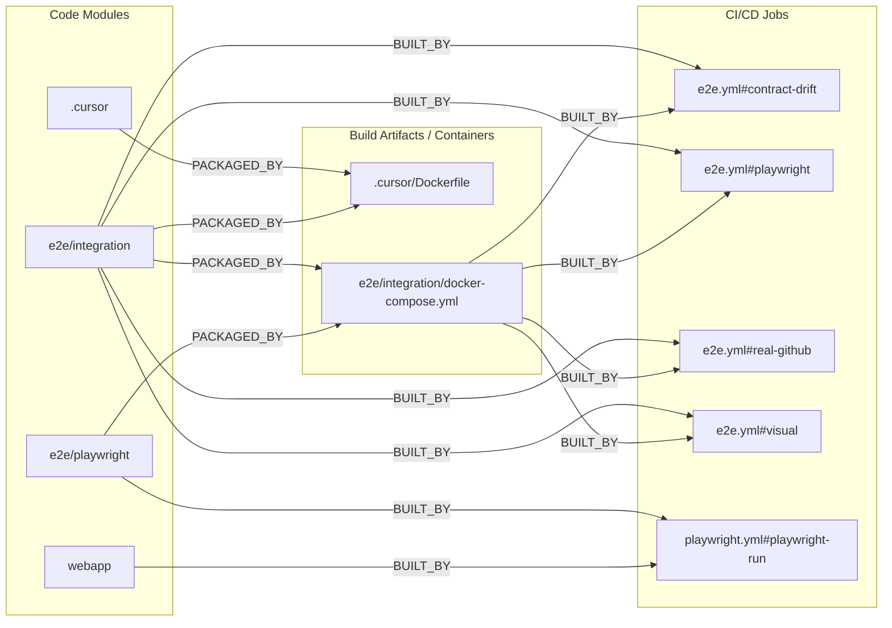
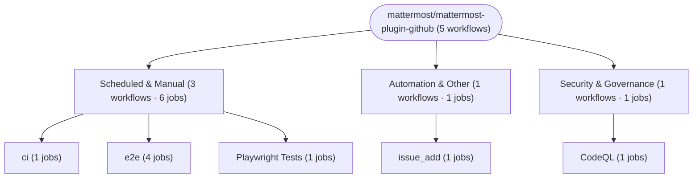

# Repository Architecture Analysis: mattermost/mattermost-plugin-github

## Metadata
- **SHA**: `bcbfe137f48b42f0cc929aa6ee0af78470cfd274`
- **Primary Ecosystem**: JavaScript/TypeScript

## Quality Metrics
- **ast_engine**: tree-sitter
- **avg_cognitive_complexity**: 3.16
- **avg_cyclomatic_complexity**: 3.62
- **component_count**: 12
- **dead_code_count**: 2
- **dead_code_symbols**: 2 entry(ies)
- **duplication_pct**: 66.49
- **file_complexities**: 25 entry(ies)
- **files_analyzed**: 123
- **fitness_passed**: False
- **fitness_violation_count**: 3
- **framework**: React (Vite)
- **import_edges**: 100 entry(ies)
- **loc**: 12187
- **max_cognitive_complexity**: 318
- **max_cyclomatic_complexity**: 194
- **sloc**: 9380
- **test_file_count**: 66

# Architecture: mattermost/mattermost-plugin-github

## Context
- **Repository**: `mattermost/mattermost-plugin-github`
- **SHA**: `bcbfe137f48b42f0cc929aa6ee0af78470cfd274`
- **Ecosystem**: JavaScript/TypeScript
- **Framework**: React (Vite)

## Building Block View

```mermaid
graph TD;
    mattermost_plugin_github_e2e["mattermost-plugin-github-e2e : MODULE"]
    plugin_e2e_tests["plugin-e2e-tests : MODULE"]
    webapp["webapp : MODULE"]
    Client["Client : SERVICE"]
    LinkTooltip["LinkTooltip : UI_COMPONENT"]
    CreateIssuePostMenuAction["CreateIssuePostMenuAction : UI_COMPONENT"]
    AttachCommentToIssuePostMenuAction["AttachCommentToIssuePostMenuAction : UI_COMPONENT"]
    UserAttribute["UserAttribute : UI_COMPONENT"]
    Tooltip["Tooltip : UI_COMPONENT"]
    Badge["Badge : UI_COMPONENT"]
    OverlayTrigger["OverlayTrigger : UI_COMPONENT"]
    Modal["Modal : UI_COMPONENT"]
    repo_root(["mattermost/mattermost-plugin-github"])
    repo_root --> AttachCommentToIssuePostMenuAction
    repo_root --> Badge
    repo_root --> Client
    repo_root --> CreateIssuePostMenuAction
    repo_root --> LinkTooltip
    repo_root --> Modal
    repo_root --> OverlayTrigger
    repo_root --> Tooltip
    repo_root --> UserAttribute
    repo_root --> mattermost_plugin_github_e2e
    repo_root --> plugin_e2e_tests
    repo_root --> webapp
```

## Component Details
- **mattermost-plugin-github-e2e** (`e2e/integration/package.json`): MODULE
- **plugin-e2e-tests** (`e2e/playwright/package.json`): MODULE
- **webapp** (`webapp/package.json`): MODULE
- **Client** (`webapp/src/client/client.ts`): SERVICE
- **LinkTooltip** (`webapp/src/components/link_tooltip/link_tooltip.jsx`): UI_COMPONENT
- **CreateIssuePostMenuAction** (`webapp/src/components/post_menu_action/create_issue/create_issue.jsx`): UI_COMPONENT
- **AttachCommentToIssuePostMenuAction** (`webapp/src/components/post_menu_actions/attach_comment_to_issue/attach_comment_to_issue.jsx`): UI_COMPONENT
- **UserAttribute** (`webapp/src/components/user_attribute/user_attribute.tsx`): UI_COMPONENT
- **Tooltip** (`webapp/src/types/react-bootstrap.d.ts`): UI_COMPONENT
- **Badge** (`webapp/src/types/react-bootstrap.d.ts`): UI_COMPONENT
- **OverlayTrigger** (`webapp/src/types/react-bootstrap.d.ts`): UI_COMPONENT
- **Modal** (`webapp/src/types/react-bootstrap.d.ts`): UI_COMPONENT

## 6-Dimension Repository Scorecard

- **Overall Grade**: `F` (56.80/100)
- **Technical Debt Score**: 43.20
- **Estimated Remediation Effort**: 45.10h

| Dimension | Grade | Score | Weight | Details |
| :--- | :---: | :---: | :---: | :--- |
| Code Quality | `F` | 43.52 | 0.20 | avg_cc=3.62, max_cc=194, duplication=66.49%, dead_code=2 |
| Dependency Health | `A` | 100.00 | 0.15 | dependencies=1959, outdated=0, vulnerable=0, has_lockfile=True |
| Maintainability | `F` | 47.00 | 0.15 | avg_cognitive=3.16, max_cognitive=318, fitness_violations=3, oversized_files=2 |
| Pipeline Health | `A` | 93.00 | 0.15 | workflows=5, operational_antipatterns=4, parallel_branches=True |
| Security | `F` | 8.00 | 0.20 | vulnerabilities=0, secrets=1, pipeline_security_findings=6 |
| Test Coverage | `C` | 70.00 | 0.15 | coverage=unavailable, ci_test_job=False, test_files_detected=True |

## Architecture Fitness & Workspace Boundaries

- **[MEDIUM] `ATRUSS-ARCH-005` (COMPLEXITY_THRESHOLD)**: Repository duplication_pct (66.49) exceeds policy threshold (15.0).
- **[MEDIUM] `ATRUSS-ARCH-005` (COMPLEXITY_THRESHOLD)**: Repository max_cognitive_complexity (318.0) exceeds policy threshold (25.0).
- **[MEDIUM] `ATRUSS-ARCH-005` (COMPLEXITY_THRESHOLD)**: Repository max_cyclomatic_complexity (194.0) exceeds policy threshold (20.0).

## Supply Chain Dependencies, Vulnerabilities & Secrets

- **Dependencies Parsed**: 1959 | **Vulnerabilities**: 0 | **Secrets**: 1

### Secret Findings (Redacted)
- **[HIGH] `ATRUSS-SEC-005`** at `e2e/playwright/support/init_test.ts:102` (`webhooksecret: 'w7Hf***REDACTED***',`)

### Inventory Sample
- `github.com/Masterminds/sprig/v3` `3.2.2` (golang, `go.mod`)
- `github.com/golang/mock` `1.6.0` (golang, `go.mod`)
- `github.com/google/go-github/v54` `54.0.0` (golang, `go.mod`)
- `github.com/gorilla/mux` `1.8.1` (golang, `go.mod`)
- `github.com/hashicorp/go-multierror` `1.1.1` (golang, `go.mod`)
- `github.com/mattermost/mattermost/server/public` `0.3.0` (golang, `go.mod`)
- `github.com/microcosm-cc/bluemonday` `1.0.27` (golang, `go.mod`)
- `github.com/pkg/errors` `0.9.1` (golang, `go.mod`)
- `github.com/shurcooL/githubv4` `0.0.0-20230424031643-6cea62ecd5a9` (golang, `go.mod`)
- `github.com/stretchr/testify` `1.11.1` (golang, `go.mod`)
- `golang.org/x/oauth2` `0.36.0` (golang, `go.mod`)
- `gopkg.in/yaml.v3` `3.0.1` (golang, `go.mod`)
- `@babel/cli` `7.20.7` (npm, `webapp/package-lock.json`)
- `@babel/cli` `7.20.7` (npm, `webapp/package.json`)
- `@babel/core` `7.29.6` (npm, `webapp/package-lock.json`)
- `@babel/core` `7.29.6` (npm, `webapp/package.json`)
- `@babel/eslint-parser` `7.25.9` (npm, `webapp/package-lock.json`)
- `@babel/eslint-parser` `7.25.9` (npm, `webapp/package.json`)
- `@babel/plugin-syntax-dynamic-import` `7.8.3` (npm, `webapp/package-lock.json`)
- `@babel/plugin-syntax-dynamic-import` `7.8.3` (npm, `webapp/package.json`)
- `@babel/plugin-transform-class-properties` `7.25.9` (npm, `webapp/package-lock.json`)
- `@babel/plugin-transform-class-properties` `7.25.9` (npm, `webapp/package.json`)
- `@babel/plugin-transform-object-rest-spread` `7.25.9` (npm, `webapp/package-lock.json`)
- `@babel/plugin-transform-object-rest-spread` `7.25.9` (npm, `webapp/package.json`)
- `@babel/plugin-transform-optional-chaining` `7.25.9` (npm, `webapp/package-lock.json`)
- `@babel/plugin-transform-optional-chaining` `7.25.9` (npm, `webapp/package.json`)
- `@babel/preset-env` `7.26.0` (npm, `webapp/package-lock.json`)
- `@babel/preset-env` `7.26.0` (npm, `webapp/package.json`)
- `@babel/preset-react` `7.26.3` (npm, `webapp/package-lock.json`)
- `@babel/preset-react` `7.26.3` (npm, `webapp/package.json`)
- ... (+1929 more dependencies)

## Section 7: Code-to-Cloud Deployment Traceability

- `.cursor` (code_module) --[PACKAGED_BY]--> `.cursor/Dockerfile` (container)
- `e2e/integration` (code_module) --[BUILT_BY]--> `e2e.yml#contract-drift` (ci_job)
- `e2e/integration` (code_module) --[BUILT_BY]--> `e2e.yml#playwright` (ci_job)
- `e2e/integration` (code_module) --[BUILT_BY]--> `e2e.yml#real-github` (ci_job)
- `e2e/integration` (code_module) --[BUILT_BY]--> `e2e.yml#visual` (ci_job)
- `e2e/integration` (code_module) --[PACKAGED_BY]--> `.cursor/Dockerfile` (container)
- `e2e/integration` (code_module) --[PACKAGED_BY]--> `e2e/integration/docker-compose.yml` (container)
- `e2e/playwright` (code_module) --[BUILT_BY]--> `playwright.yml#playwright-run` (ci_job)
- `e2e/playwright` (code_module) --[PACKAGED_BY]--> `e2e/integration/docker-compose.yml` (container)
- `webapp` (code_module) --[BUILT_BY]--> `playwright.yml#playwright-run` (ci_job)
- `e2e/integration/docker-compose.yml` (container) --[BUILT_BY]--> `e2e.yml#contract-drift` (ci_job)
- `e2e/integration/docker-compose.yml` (container) --[BUILT_BY]--> `e2e.yml#playwright` (ci_job)
- `e2e/integration/docker-compose.yml` (container) --[BUILT_BY]--> `e2e.yml#real-github` (ci_job)
- `e2e/integration/docker-compose.yml` (container) --[BUILT_BY]--> `e2e.yml#visual` (ci_job)

## CI/CD Pipeline Topology

