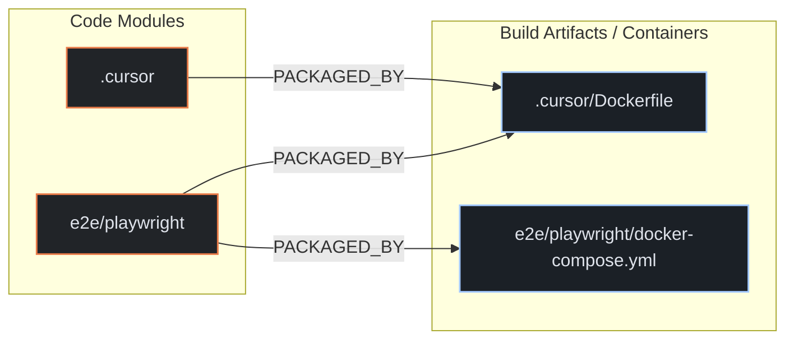
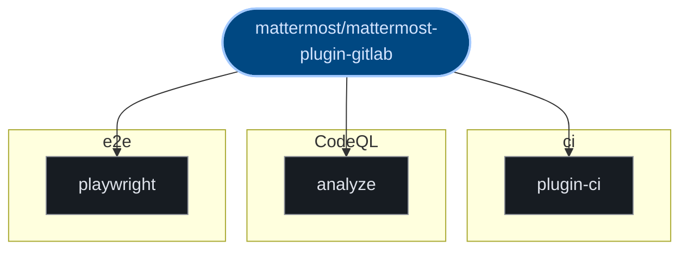

# Repository Architecture Analysis: mattermost/mattermost-plugin-gitlab

## Metadata
- **SHA**: `20ce1556aab0370e79d5b35918b830307801db1e`
- **Primary Ecosystem**: JavaScript/TypeScript

## Quality Metrics
- **ast_engine**: tree-sitter
- **avg_cognitive_complexity**: 1.58
- **avg_cyclomatic_complexity**: 2.24
- **component_count**: 12
- **dead_code_count**: 6
- **dead_code_symbols**: 6 entry(ies)
- **duplication_pct**: 70.62
- **file_complexities**: 25 entry(ies)
- **files_analyzed**: 96
- **fitness_passed**: False
- **fitness_violation_count**: 3
- **framework**: React (Vite)
- **import_edges**: 100 entry(ies)
- **loc**: 8711
- **max_cognitive_complexity**: 33
- **max_cyclomatic_complexity**: 33
- **sloc**: 6772
- **test_file_count**: 51

# Architecture: mattermost/mattermost-plugin-gitlab

## Context
- **Repository**: `mattermost/mattermost-plugin-gitlab`
- **SHA**: `20ce1556aab0370e79d5b35918b830307801db1e`
- **Ecosystem**: JavaScript/TypeScript
- **Framework**: React (Vite)

## Building Block View

```mermaid
graph TD;
  classDef atlasRoot fill:#004882,stroke:#a3c9ff,stroke-width:2px,color:#d3e4ff
  classDef atlasCategory fill:#212428,stroke:#E87A48,stroke-width:1.5px,color:#dfe3eb
  classDef atlasWorkflow fill:#1b2026,stroke:#a3c9ff,stroke-width:1.5px,color:#dfe3eb
  classDef atlasJob fill:#171c22,stroke:#8d9199,stroke-width:1px,color:#dfe3eb
  classDef atlasTarget fill:#005227,stroke:#8bd99b,stroke-width:1.5px,color:#a7f6b6
  classDef atlasAlert fill:#93000a,stroke:#ffb4ab,stroke-width:1.5px,color:#ffdad6
  classDef atlasMore fill:#252a31,stroke:#8d9199,stroke-dasharray:4 4,color:#c3c6cf
    mattermost_plugin_gitlab_e2e["mattermost-plugin-gitlab-e2e : MODULE"]:::atlasJob
    gitlab["gitlab : MODULE"]:::atlasJob
    Client["Client : SERVICE"]:::atlasJob
    CreateIssuePostMenuAction["CreateIssuePostMenuAction : UI_COMPONENT"]:::atlasJob
    GitLabIssuesIcon["GitLabIssuesIcon : UI_COMPONENT"]:::atlasJob
    GitLabMergeRequestIcon["GitLabMergeRequestIcon : UI_COMPONENT"]:::atlasJob
    GitLabReviewsIcon["GitLabReviewsIcon : UI_COMPONENT"]:::atlasJob
    GitLabTodosIcon["GitLabTodosIcon : UI_COMPONENT"]:::atlasJob
    GitLabMergeRequestClosedIcon["GitLabMergeRequestClosedIcon : UI_COMPONENT"]:::atlasJob
    GitLabMergedIcon["GitLabMergedIcon : UI_COMPONENT"]:::atlasJob
    GitLabIssueClosedIcon["GitLabIssueClosedIcon : UI_COMPONENT"]:::atlasJob
    GitLabIssueOpenIcon["GitLabIssueOpenIcon : UI_COMPONENT"]:::atlasJob
    repo_root(["mattermost/mattermost-plugin-gitlab"]):::atlasRoot
    repo_root --> Client
    repo_root --> CreateIssuePostMenuAction
    repo_root --> GitLabIssueClosedIcon
    repo_root --> GitLabIssueOpenIcon
    repo_root --> GitLabIssuesIcon
    repo_root --> GitLabMergeRequestClosedIcon
    repo_root --> GitLabMergeRequestIcon
    repo_root --> GitLabMergedIcon
    repo_root --> GitLabReviewsIcon
    repo_root --> GitLabTodosIcon
    repo_root --> gitlab
    repo_root --> mattermost_plugin_gitlab_e2e
```

## Component Details
- **mattermost-plugin-gitlab-e2e** (`e2e/playwright/package.json`): MODULE
- **gitlab** (`webapp/package.json`): MODULE
- **Client** (`webapp/src/client/client.ts`): SERVICE
- **CreateIssuePostMenuAction** (`webapp/src/components/post_options/create_issue.tsx`): UI_COMPONENT
- **GitLabIssuesIcon** (`webapp/src/utils/icons.tsx`): UI_COMPONENT
- **GitLabMergeRequestIcon** (`webapp/src/utils/icons.tsx`): UI_COMPONENT
- **GitLabReviewsIcon** (`webapp/src/utils/icons.tsx`): UI_COMPONENT
- **GitLabTodosIcon** (`webapp/src/utils/icons.tsx`): UI_COMPONENT
- **GitLabMergeRequestClosedIcon** (`webapp/src/utils/icons.tsx`): UI_COMPONENT
- **GitLabMergedIcon** (`webapp/src/utils/icons.tsx`): UI_COMPONENT
- **GitLabIssueClosedIcon** (`webapp/src/utils/icons.tsx`): UI_COMPONENT
- **GitLabIssueOpenIcon** (`webapp/src/utils/icons.tsx`): UI_COMPONENT

## 6-Dimension Repository Scorecard

- **Overall Grade**: `D` (69.38/100)
- **Technical Debt Score**: 30.62
- **Estimated Remediation Effort**: 33.28h

| Dimension | Grade | Score | Weight | Details |
| :--- | :---: | :---: | :---: | :--- |
| Code Quality | `F` | 38.00 | 0.20 | avg_cc=2.24, max_cc=33, duplication=70.62%, dead_code=6 |
| Dependency Health | `A` | 100.00 | 0.15 | dependencies=1372, outdated=0, vulnerable=0, has_lockfile=True |
| Maintainability | `D` | 62.50 | 0.15 | avg_cognitive=1.58, max_cognitive=33, fitness_violations=3, oversized_files=0 |
| Pipeline Health | `A` | 94.00 | 0.15 | workflows=3, operational_antipatterns=2, parallel_branches=False |
| Security | `D` | 64.00 | 0.20 | vulnerabilities=0, secrets=0, pipeline_security_findings=3 |
| Test Coverage | `C` | 70.00 | 0.15 | coverage=unavailable, ci_test_job=True, test_files_detected=True |

## Architecture Fitness & Workspace Boundaries

- **[MEDIUM] `ATRUSS-ARCH-005` (COMPLEXITY_THRESHOLD)**: Repository duplication_pct (70.62) exceeds policy threshold (15.0).
- **[MEDIUM] `ATRUSS-ARCH-005` (COMPLEXITY_THRESHOLD)**: Repository max_cognitive_complexity (33.0) exceeds policy threshold (25.0).
- **[MEDIUM] `ATRUSS-ARCH-005` (COMPLEXITY_THRESHOLD)**: Repository max_cyclomatic_complexity (33.0) exceeds policy threshold (20.0).

## Supply Chain Dependencies, Vulnerabilities & Secrets

- **Dependencies Parsed**: 1372 | **Vulnerabilities**: 0 | **Secrets**: 0

### Inventory Sample
- `github.com/Masterminds/semver/v3` `3.4.0` (golang, `go.mod`)
- `github.com/gorilla/mux` `1.8.1` (golang, `go.mod`)
- `github.com/hashicorp/go-multierror` `1.1.1` (golang, `go.mod`)
- `github.com/mattermost/mattermost-plugin-agents` `1.14.1-0.20260508173910-8219eb13bd4e` (golang, `go.mod`)
- `github.com/mattermost/mattermost/server/public` `0.3.1-0.20260402155910-d9d71af83e3f` (golang, `go.mod`)
- `github.com/microcosm-cc/bluemonday` `1.0.27` (golang, `go.mod`)
- `github.com/modelcontextprotocol/go-sdk` `1.4.1` (golang, `go.mod`)
- `github.com/pkg/errors` `0.9.1` (golang, `go.mod`)
- `github.com/stretchr/testify` `1.11.1` (golang, `go.mod`)
- `github.com/xanzy/go-gitlab` `0.97.0` (golang, `go.mod`)
- `go.uber.org/mock` `0.4.0` (golang, `go.mod`)
- `golang.org/x/oauth2` `0.36.0` (golang, `go.mod`)
- `golang.org/x/sync` `0.22.0` (golang, `go.mod`)
- `gopkg.in/yaml.v3` `3.0.1` (golang, `go.mod`)
- `@babel/cli` `7.28.3` (npm, `webapp/package-lock.json`)
- `@babel/cli` `7.28.3` (npm, `webapp/package.json`)
- `@babel/core` `7.26.0` (npm, `webapp/package-lock.json`)
- `@babel/core` `7.26.0` (npm, `webapp/package.json`)
- `@babel/eslint-parser` `7.25.9` (npm, `webapp/package-lock.json`)
- `@babel/eslint-parser` `7.25.9` (npm, `webapp/package.json`)
- `@babel/plugin-syntax-dynamic-import` `7.8.3` (npm, `webapp/package-lock.json`)
- `@babel/plugin-syntax-dynamic-import` `7.8.3` (npm, `webapp/package.json`)
- `@babel/plugin-transform-class-properties` `7.25.9` (npm, `webapp/package-lock.json`)
- `@babel/plugin-transform-class-properties` `7.25.9` (npm, `webapp/package.json`)
- `@babel/plugin-transform-object-rest-spread` `7.25.9` (npm, `webapp/package-lock.json`)
- `@babel/plugin-transform-object-rest-spread` `7.25.9` (npm, `webapp/package.json`)
- `@babel/preset-env` `7.26.0` (npm, `webapp/package-lock.json`)
- `@babel/preset-env` `7.26.0` (npm, `webapp/package.json`)
- `@babel/preset-react` `7.26.3` (npm, `webapp/package-lock.json`)
- `@babel/preset-react` `7.26.3` (npm, `webapp/package.json`)
- ... (+1342 more dependencies)

## Section 7: Code-to-Cloud Deployment Traceability

- `.cursor` (code_module) --[PACKAGED_BY]--> `.cursor/Dockerfile` (container)
- `e2e/playwright` (code_module) --[PACKAGED_BY]--> `.cursor/Dockerfile` (container)
- `e2e/playwright` (code_module) --[PACKAGED_BY]--> `e2e/playwright/docker-compose.yml` (container)

## CI/CD Pipeline Topology

