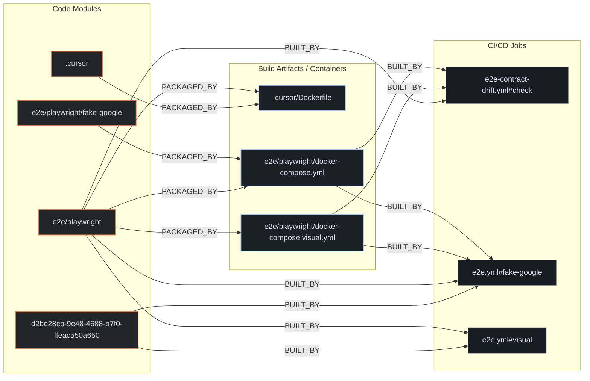
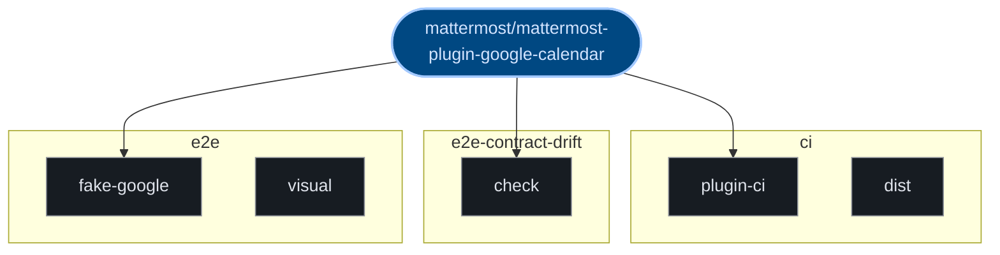

# Repository Architecture Analysis: mattermost/mattermost-plugin-google-calendar

## Metadata
- **SHA**: `0f0ebad546016d43e9be4a10fb745337385907d9`
- **Primary Ecosystem**: JavaScript/TypeScript

## Quality Metrics
- **ast_engine**: tree-sitter
- **avg_cognitive_complexity**: 3.45
- **avg_cyclomatic_complexity**: 3.7
- **component_count**: 13
- **dead_code_count**: 1
- **dead_code_symbols**: 1 entry(ies)
- **duplication_pct**: 62.88
- **file_complexities**: 25 entry(ies)
- **files_analyzed**: 91
- **fitness_passed**: False
- **fitness_violation_count**: 3
- **framework**: React (Vite)
- **import_edges**: 100 entry(ies)
- **loc**: 10722
- **max_cognitive_complexity**: 98
- **max_cyclomatic_complexity**: 62
- **sloc**: 8086
- **test_file_count**: 23

# Architecture: mattermost/mattermost-plugin-google-calendar

## Context
- **Repository**: `mattermost/mattermost-plugin-google-calendar`
- **SHA**: `0f0ebad546016d43e9be4a10fb745337385907d9`
- **Ecosystem**: JavaScript/TypeScript
- **Framework**: React (Vite)

## Building Block View

```mermaid
graph TD;
  classDef atlasRoot fill:#004882,stroke:#a3c9ff,stroke-width:2px,color:#d3e4ff
  classDef atlasCategory fill:#212428,stroke:#E87A48,stroke-width:1.5px,color:#dfe3eb
  classDef atlasWorkflow fill:#1b2026,stroke:#a3c9ff,stroke-width:1.5px,color:#dfe3eb
  classDef atlasJob fill:#171c22,stroke:#8d9199,stroke-width:1px,color:#dfe3eb
  classDef atlasTarget fill:#005227,stroke:#8bd99b,stroke-width:1.5px,color:#a7f6b6
  classDef atlasAlert fill:#93000a,stroke:#ffb4ab,stroke-width:1.5px,color:#ffdad6
  classDef atlasMore fill:#252a31,stroke:#8d9199,stroke-dasharray:4 4,color:#c3c6cf
    fake_google["fake-google : MODULE"]:::atlasJob
    mattermost_plugin_google_calendar_e2e["mattermost-plugin-google-calendar-e2e : MODULE"]:::atlasJob
    webapp["webapp : MODULE"]:::atlasJob
    AttendeeSelector["AttendeeSelector : UI_COMPONENT"]:::atlasJob
    ChannelSelector["ChannelSelector : UI_COMPONENT"]:::atlasJob
    DateInput["DateInput : UI_COMPONENT"]:::atlasJob
    Setting["Setting : UI_COMPONENT"]:::atlasJob
    TimeSelector["TimeSelector : UI_COMPONENT"]:::atlasJob
    CreateEventForm["CreateEventForm : UI_COMPONENT"]:::atlasJob
    CreateEventModal["CreateEventModal : UI_COMPONENT"]:::atlasJob
    Z_INDEX_BACKDROP["Z_INDEX_BACKDROP : UI_COMPONENT"]:::atlasJob
    Z_INDEX_TOOLTIP["Z_INDEX_TOOLTIP : UI_COMPONENT"]:::atlasJob
    Z_INDEX_MENU_PORTAL["Z_INDEX_MENU_PORTAL : UI_COMPONENT"]:::atlasJob
    repo_root(["mattermost/mattermost-plugin-google-calendar"]):::atlasRoot
    repo_root --> AttendeeSelector
    repo_root --> DateInput
    repo_root --> Setting
    repo_root --> TimeSelector
    repo_root --> Z_INDEX_BACKDROP
    repo_root --> Z_INDEX_MENU_PORTAL
    repo_root --> Z_INDEX_TOOLTIP
    repo_root --> fake_google
    repo_root --> mattermost_plugin_google_calendar_e2e
    repo_root --> webapp
    CreateEventForm --> ChannelSelector
    CreateEventModal --> CreateEventForm
```

## Component Details
- **fake-google** (`e2e/playwright/fake-google/package.json`): MODULE
- **mattermost-plugin-google-calendar-e2e** (`e2e/playwright/package.json`): MODULE
- **webapp** (`webapp/package.json`): MODULE
- **AttendeeSelector** (`webapp/src/components/attendee_selector.tsx`): UI_COMPONENT
- **ChannelSelector** (`webapp/src/components/channel_selector.tsx`): UI_COMPONENT
- **DateInput** (`webapp/src/components/date_input.tsx`): UI_COMPONENT
- **Setting** (`webapp/src/components/setting.tsx`): UI_COMPONENT
- **TimeSelector** (`webapp/src/components/time_selector.tsx`): UI_COMPONENT
- **CreateEventForm** (`webapp/src/components/modals/create_event_form.tsx`): UI_COMPONENT (deps: ChannelSelector)
- **CreateEventModal** (`webapp/src/components/modals/create_event_modal.tsx`): UI_COMPONENT (deps: CreateEventForm)
- **Z_INDEX_BACKDROP** (`webapp/src/utils/styles.ts`): UI_COMPONENT
- **Z_INDEX_TOOLTIP** (`webapp/src/utils/styles.ts`): UI_COMPONENT
- **Z_INDEX_MENU_PORTAL** (`webapp/src/utils/styles.ts`): UI_COMPONENT

## 6-Dimension Repository Scorecard

- **Overall Grade**: `C` (77.19/100)
- **Technical Debt Score**: 22.81
- **Estimated Remediation Effort**: 25.53h

| Dimension | Grade | Score | Weight | Details |
| :--- | :---: | :---: | :---: | :--- |
| Code Quality | `F` | 45.20 | 0.20 | avg_cc=3.70, max_cc=62, duplication=62.88%, dead_code=1 |
| Dependency Health | `A` | 100.00 | 0.15 | dependencies=1315, outdated=0, vulnerable=0, has_lockfile=True |
| Maintainability | `F` | 52.00 | 0.15 | avg_cognitive=3.45, max_cognitive=98, fitness_violations=3, oversized_files=1 |
| Pipeline Health | `A` | 99.00 | 0.15 | workflows=3, operational_antipatterns=2, parallel_branches=True |
| Security | `A` | 100.00 | 0.20 | vulnerabilities=0, secrets=0, pipeline_security_findings=0 |
| Test Coverage | `C` | 70.00 | 0.15 | coverage=unavailable, ci_test_job=True, test_files_detected=True |

## Architecture Fitness & Workspace Boundaries

- **[MEDIUM] `ATRUSS-ARCH-005` (COMPLEXITY_THRESHOLD)**: Repository duplication_pct (62.88) exceeds policy threshold (15.0).
- **[MEDIUM] `ATRUSS-ARCH-005` (COMPLEXITY_THRESHOLD)**: Repository max_cognitive_complexity (98.0) exceeds policy threshold (25.0).
- **[MEDIUM] `ATRUSS-ARCH-005` (COMPLEXITY_THRESHOLD)**: Repository max_cyclomatic_complexity (62.0) exceeds policy threshold (20.0).

## Supply Chain Dependencies, Vulnerabilities & Secrets

- **Dependencies Parsed**: 1315 | **Vulnerabilities**: 0 | **Secrets**: 0

### Inventory Sample
- `github.com/mattermost/mattermost-plugin-mscalendar` `1.7.0` (golang, `go.mod`)
- `github.com/mattermost/mattermost/server/public` `0.3.0` (golang, `go.mod`)
- `github.com/pkg/errors` `0.9.1` (golang, `go.mod`)
- `github.com/stretchr/testify` `1.11.1` (golang, `go.mod`)
- `golang.org/x/oauth2` `0.36.0` (golang, `go.mod`)
- `google.golang.org/api` `0.266.0` (golang, `go.mod`)
- `@babel/cli` `7.20.7` (npm, `webapp/package-lock.json`)
- `@babel/cli` `7.20.7` (npm, `webapp/package.json`)
- `@babel/core` `7.29.6` (npm, `webapp/package-lock.json`)
- `@babel/core` `7.29.6` (npm, `webapp/package.json`)
- `@babel/eslint-parser` `7.25.9` (npm, `webapp/package-lock.json`)
- `@babel/eslint-parser` `7.25.9` (npm, `webapp/package.json`)
- `@babel/plugin-syntax-dynamic-import` `7.8.3` (npm, `webapp/package-lock.json`)
- `@babel/plugin-syntax-dynamic-import` `7.8.3` (npm, `webapp/package.json`)
- `@babel/plugin-transform-class-properties` `7.25.9` (npm, `webapp/package-lock.json`)
- `@babel/plugin-transform-class-properties` `7.25.9` (npm, `webapp/package.json`)
- `@babel/plugin-transform-object-rest-spread` `7.25.9` (npm, `webapp/package-lock.json`)
- `@babel/plugin-transform-object-rest-spread` `7.25.9` (npm, `webapp/package.json`)
- `@babel/plugin-transform-optional-chaining` `7.25.9` (npm, `webapp/package-lock.json`)
- `@babel/plugin-transform-optional-chaining` `7.25.9` (npm, `webapp/package.json`)
- `@babel/preset-env` `7.26.0` (npm, `webapp/package-lock.json`)
- `@babel/preset-env` `7.26.0` (npm, `webapp/package.json`)
- `@babel/preset-react` `7.26.3` (npm, `webapp/package-lock.json`)
- `@babel/preset-react` `7.26.3` (npm, `webapp/package.json`)
- `@babel/preset-typescript` `7.26.0` (npm, `webapp/package-lock.json`)
- `@babel/preset-typescript` `7.26.0` (npm, `webapp/package.json`)
- `@babel/runtime` `7.28.4` (npm, `webapp/package-lock.json`)
- `@babel/runtime` `7.28.4` (npm, `webapp/package.json`)
- `@emotion/babel-preset-css-prop` `11.12.0` (npm, `webapp/package-lock.json`)
- `@emotion/babel-preset-css-prop` `11.12.0` (npm, `webapp/package.json`)
- ... (+1285 more dependencies)

## Section 7: Code-to-Cloud Deployment Traceability

- `.cursor` (code_module) --[PACKAGED_BY]--> `.cursor/Dockerfile` (container)
- `d2be28cb-9e48-4688-b7f0-ffeac550a650` (code_module) --[BUILT_BY]--> `e2e.yml#fake-google` (ci_job)
- `d2be28cb-9e48-4688-b7f0-ffeac550a650` (code_module) --[BUILT_BY]--> `e2e.yml#visual` (ci_job)
- `e2e/playwright` (code_module) --[BUILT_BY]--> `e2e-contract-drift.yml#check` (ci_job)
- `e2e/playwright` (code_module) --[BUILT_BY]--> `e2e.yml#fake-google` (ci_job)
- `e2e/playwright` (code_module) --[BUILT_BY]--> `e2e.yml#visual` (ci_job)
- `e2e/playwright` (code_module) --[PACKAGED_BY]--> `.cursor/Dockerfile` (container)
- `e2e/playwright` (code_module) --[PACKAGED_BY]--> `e2e/playwright/docker-compose.visual.yml` (container)
- `e2e/playwright` (code_module) --[PACKAGED_BY]--> `e2e/playwright/docker-compose.yml` (container)
- `e2e/playwright/fake-google` (code_module) --[PACKAGED_BY]--> `e2e/playwright/docker-compose.yml` (container)
- `e2e/playwright/docker-compose.visual.yml` (container) --[BUILT_BY]--> `e2e-contract-drift.yml#check` (ci_job)
- `e2e/playwright/docker-compose.visual.yml` (container) --[BUILT_BY]--> `e2e.yml#fake-google` (ci_job)
- `e2e/playwright/docker-compose.yml` (container) --[BUILT_BY]--> `e2e-contract-drift.yml#check` (ci_job)
- `e2e/playwright/docker-compose.yml` (container) --[BUILT_BY]--> `e2e.yml#fake-google` (ci_job)

## CI/CD Pipeline Topology

