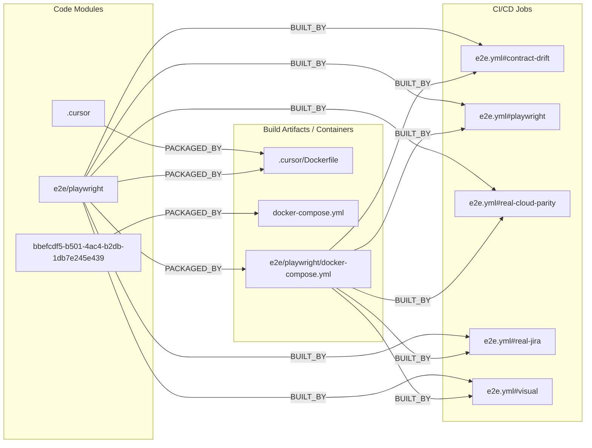
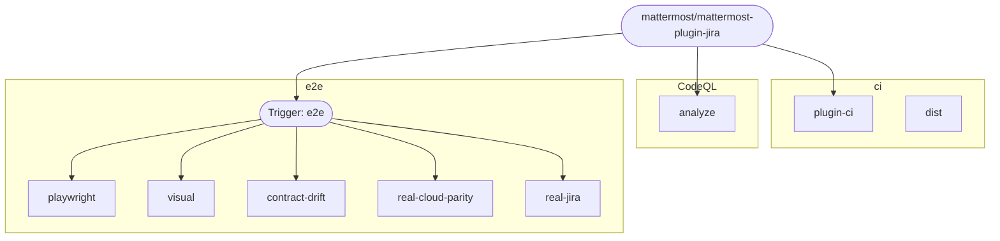

# Repository Architecture Analysis: mattermost/mattermost-plugin-jira

## Metadata
- **SHA**: `c0cd5548ca04a7288b99c7fca7eb76a5ce269657`
- **Primary Ecosystem**: JavaScript/TypeScript

## Quality Metrics
- **ast_engine**: tree-sitter
- **avg_cognitive_complexity**: 2.14
- **avg_cyclomatic_complexity**: 2.81
- **component_count**: 11
- **dead_code_count**: 1
- **dead_code_symbols**: 1 entry(ies)
- **duplication_pct**: 75.41
- **file_complexities**: 25 entry(ies)
- **files_analyzed**: 136
- **fitness_passed**: False
- **fitness_violation_count**: 3
- **framework**: React (Vite)
- **import_edges**: 100 entry(ies)
- **loc**: 16192
- **max_cognitive_complexity**: 51
- **max_cyclomatic_complexity**: 36
- **sloc**: 13045
- **test_file_count**: 77

# Architecture: mattermost/mattermost-plugin-jira

## Context
- **Repository**: `mattermost/mattermost-plugin-jira`
- **SHA**: `c0cd5548ca04a7288b99c7fca7eb76a5ce269657`
- **Ecosystem**: JavaScript/TypeScript
- **Framework**: React (Vite)

## Building Block View

```mermaid
graph TD;
    mattermost_plugin_jira_e2e["mattermost-plugin-jira-e2e : MODULE"]
    webapp["webapp : MODULE"]
    AttachCommentToIssueModal["AttachCommentToIssueModal : UI_COMPONENT"]
    EmptyChannelSubscriptionFilter["EmptyChannelSubscriptionFilter : UI_COMPONENT"]
    ConnectModal["ConnectModal : UI_COMPONENT"]
    CreateIssueModal["CreateIssueModal : UI_COMPONENT"]
    DisconnectModal["DisconnectModal : UI_COMPONENT"]
    SVGIcons["SVGIcons : UI_COMPONENT"]
    AttachCommentToIssuePostMenuAction["AttachCommentToIssuePostMenuAction : UI_COMPONENT"]
    CreateIssuePostMenuAction["CreateIssuePostMenuAction : UI_COMPONENT"]
    FIELD_KEY_STATUS["FIELD_KEY_STATUS : UI_COMPONENT"]
    repo_root(["mattermost/mattermost-plugin-jira"])
    repo_root --> AttachCommentToIssueModal
    repo_root --> AttachCommentToIssuePostMenuAction
    repo_root --> ConnectModal
    repo_root --> CreateIssueModal
    repo_root --> CreateIssuePostMenuAction
    repo_root --> DisconnectModal
    repo_root --> EmptyChannelSubscriptionFilter
    repo_root --> FIELD_KEY_STATUS
    repo_root --> SVGIcons
    repo_root --> mattermost_plugin_jira_e2e
    repo_root --> webapp
```

## Component Details
- **mattermost-plugin-jira-e2e** (`e2e/playwright/package.json`): MODULE
- **webapp** (`webapp/package.json`): MODULE
- **AttachCommentToIssueModal** (`webapp/src/components/modals/attach_comment_modal/attach_comment_modal.tsx`): UI_COMPONENT
- **EmptyChannelSubscriptionFilter** (`webapp/src/components/modals/channel_subscriptions/channel_subscription_filter.tsx`): UI_COMPONENT
- **ConnectModal** (`webapp/src/components/modals/connect_modal/connect_modal.tsx`): UI_COMPONENT
- **CreateIssueModal** (`webapp/src/components/modals/create_issue/create_issue_modal.tsx`): UI_COMPONENT
- **DisconnectModal** (`webapp/src/components/modals/disconnect_modal/disconnect_modal.tsx`): UI_COMPONENT
- **SVGIcons** (`webapp/src/components/plugin_constants/icons.tsx`): UI_COMPONENT
- **AttachCommentToIssuePostMenuAction** (`webapp/src/components/post_menu_actions/attach_comment_to_issue/attach_comment_to_issue.tsx`): UI_COMPONENT
- **CreateIssuePostMenuAction** (`webapp/src/components/post_menu_actions/create_issue/create_issue.tsx`): UI_COMPONENT
- **FIELD_KEY_STATUS** (`webapp/src/utils/jira_issue_metadata.tsx`): UI_COMPONENT

## 6-Dimension Repository Scorecard

- **Overall Grade**: `D` (67.85/100)
- **Technical Debt Score**: 32.15
- **Estimated Remediation Effort**: 39.87h

| Dimension | Grade | Score | Weight | Details |
| :--- | :---: | :---: | :---: | :--- |
| Code Quality | `F` | 48.00 | 0.20 | avg_cc=2.81, max_cc=36, duplication=75.41%, dead_code=1 |
| Dependency Health | `A` | 100.00 | 0.15 | dependencies=1332, outdated=0, vulnerable=0, has_lockfile=True |
| Maintainability | `F` | 37.00 | 0.15 | avg_cognitive=2.14, max_cognitive=51, fitness_violations=3, oversized_files=4 |
| Pipeline Health | `A` | 96.00 | 0.15 | workflows=3, operational_antipatterns=3, parallel_branches=True |
| Security | `D` | 64.00 | 0.20 | vulnerabilities=0, secrets=0, pipeline_security_findings=3 |
| Test Coverage | `C` | 70.00 | 0.15 | coverage=unavailable, ci_test_job=False, test_files_detected=True |

## Architecture Fitness & Workspace Boundaries

- **[MEDIUM] `ATRUSS-ARCH-005` (COMPLEXITY_THRESHOLD)**: Repository duplication_pct (75.41) exceeds policy threshold (15.0).
- **[MEDIUM] `ATRUSS-ARCH-005` (COMPLEXITY_THRESHOLD)**: Repository max_cognitive_complexity (51.0) exceeds policy threshold (25.0).
- **[MEDIUM] `ATRUSS-ARCH-005` (COMPLEXITY_THRESHOLD)**: Repository max_cyclomatic_complexity (36.0) exceeds policy threshold (20.0).

## Supply Chain Dependencies, Vulnerabilities & Secrets

- **Dependencies Parsed**: 1332 | **Vulnerabilities**: 0 | **Secrets**: 0

### Inventory Sample
- `github.com/andygrunwald/go-jira` `1.16.0` (golang, `go.mod`)
- `github.com/blang/semver/v4` `4.0.0` (golang, `go.mod`)
- `github.com/dghubble/oauth1` `0.5.0` (golang, `go.mod`)
- `github.com/gorilla/mux` `1.8.1` (golang, `go.mod`)
- `github.com/hashicorp/go-multierror` `1.1.1` (golang, `go.mod`)
- `github.com/jarcoal/httpmock` `1.0.8` (golang, `go.mod`)
- `github.com/mattermost-community/mattermost-plugin-autolink` `1.4.1-0.20241105205450-79c240cde7d6` (golang, `go.mod`)
- `github.com/mattermost/mattermost/server/public` `0.3.0` (golang, `go.mod`)
- `github.com/pkg/errors` `0.9.1` (golang, `go.mod`)
- `github.com/rudderlabs/analytics-go` `3.3.3+incompatible` (golang, `go.mod`)
- `github.com/stretchr/testify` `1.11.1` (golang, `go.mod`)
- `github.com/trivago/tgo` `1.0.7` (golang, `go.mod`)
- `golang.org/x/oauth2` `0.36.0` (golang, `go.mod`)
- `golang.org/x/text` `0.41.0` (golang, `go.mod`)
- `gopkg.in/yaml.v3` `3.0.1` (golang, `go.mod`)
- `@babel/cli` `7.28.3` (npm, `webapp/package-lock.json`)
- `@babel/cli` `7.28.3` (npm, `webapp/package.json`)
- `@babel/core` `7.26.0` (npm, `webapp/package-lock.json`)
- `@babel/core` `7.26.0` (npm, `webapp/package.json`)
- `@babel/eslint-parser` `7.25.9` (npm, `webapp/package-lock.json`)
- `@babel/eslint-parser` `7.25.9` (npm, `webapp/package.json`)
- `@babel/plugin-syntax-dynamic-import` `7.8.3` (npm, `webapp/package-lock.json`)
- `@babel/plugin-syntax-dynamic-import` `7.8.3` (npm, `webapp/package.json`)
- `@babel/plugin-transform-class-properties` `7.25.9` (npm, `webapp/package-lock.json`)
- `@babel/plugin-transform-class-properties` `7.25.9` (npm, `webapp/package.json`)
- `@babel/plugin-transform-object-rest-spread` `7.25.9` (npm, `webapp/package-lock.json`)
- `@babel/plugin-transform-object-rest-spread` `7.25.9` (npm, `webapp/package.json`)
- `@babel/preset-env` `7.26.0` (npm, `webapp/package-lock.json`)
- `@babel/preset-env` `7.26.0` (npm, `webapp/package.json`)
- `@babel/preset-react` `7.26.3` (npm, `webapp/package-lock.json`)
- ... (+1302 more dependencies)

## Section 7: Code-to-Cloud Deployment Traceability

- `.cursor` (code_module) --[PACKAGED_BY]--> `.cursor/Dockerfile` (container)
- `bbefcdf5-b501-4ac4-b2db-1db7e245e439` (code_module) --[PACKAGED_BY]--> `docker-compose.yml` (container)
- `e2e/playwright` (code_module) --[BUILT_BY]--> `e2e.yml#contract-drift` (ci_job)
- `e2e/playwright` (code_module) --[BUILT_BY]--> `e2e.yml#playwright` (ci_job)
- `e2e/playwright` (code_module) --[BUILT_BY]--> `e2e.yml#real-cloud-parity` (ci_job)
- `e2e/playwright` (code_module) --[BUILT_BY]--> `e2e.yml#real-jira` (ci_job)
- `e2e/playwright` (code_module) --[BUILT_BY]--> `e2e.yml#visual` (ci_job)
- `e2e/playwright` (code_module) --[PACKAGED_BY]--> `.cursor/Dockerfile` (container)
- `e2e/playwright` (code_module) --[PACKAGED_BY]--> `e2e/playwright/docker-compose.yml` (container)
- `e2e/playwright/docker-compose.yml` (container) --[BUILT_BY]--> `e2e.yml#contract-drift` (ci_job)
- `e2e/playwright/docker-compose.yml` (container) --[BUILT_BY]--> `e2e.yml#playwright` (ci_job)
- `e2e/playwright/docker-compose.yml` (container) --[BUILT_BY]--> `e2e.yml#real-cloud-parity` (ci_job)
- `e2e/playwright/docker-compose.yml` (container) --[BUILT_BY]--> `e2e.yml#real-jira` (ci_job)
- `e2e/playwright/docker-compose.yml` (container) --[BUILT_BY]--> `e2e.yml#visual` (ci_job)

## CI/CD Pipeline Topology

