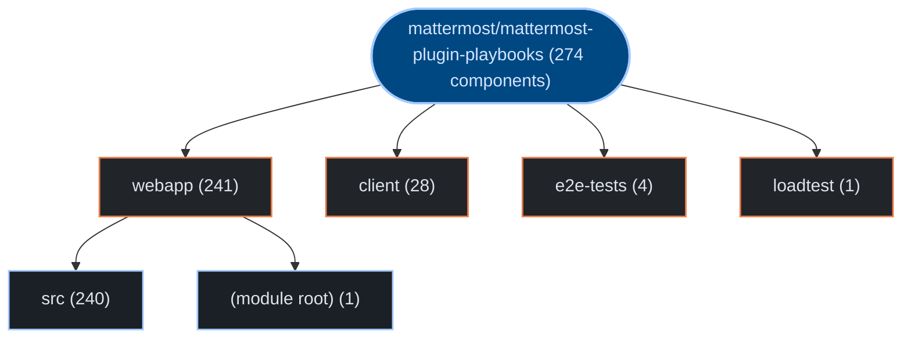
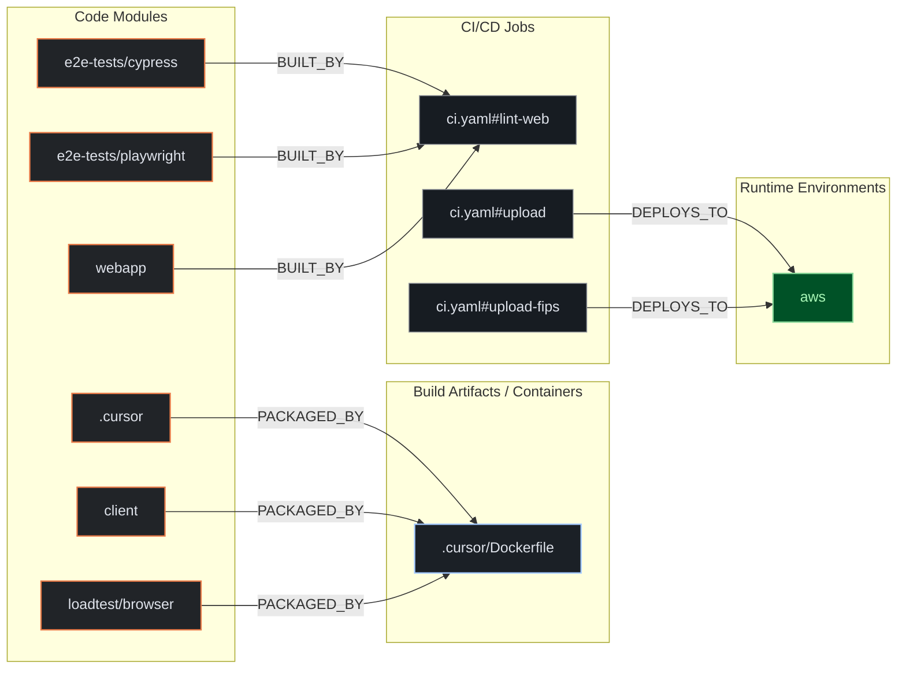
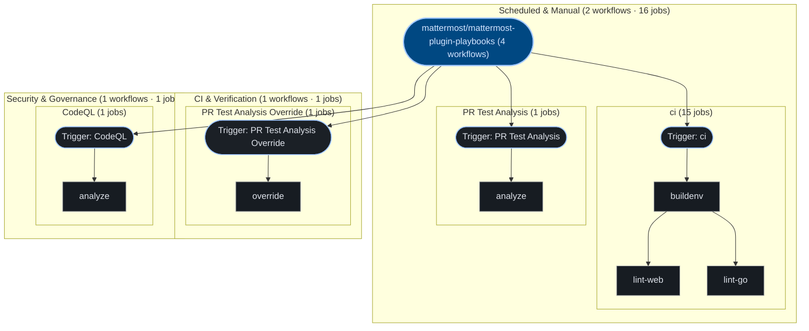

# Repository Architecture Analysis: mattermost/mattermost-plugin-playbooks

## Metadata
- **SHA**: `e2ad0b6892c29001a03dda9f35bbe9a8363105b4`
- **Primary Ecosystem**: JavaScript/TypeScript

## Quality Metrics
- **ast_engine**: tree-sitter
- **avg_cognitive_complexity**: 3.36
- **avg_cyclomatic_complexity**: 3.36
- **component_count**: 274
- **dead_code_count**: 2
- **dead_code_symbols**: 2 entry(ies)
- **duplication_pct**: 87.08
- **file_complexities**: 25 entry(ies)
- **files_analyzed**: 761
- **fitness_passed**: False
- **fitness_violation_count**: 3
- **framework**: React (Vite)
- **import_edges**: 100 entry(ies)
- **loc**: 132611
- **max_cognitive_complexity**: 227
- **max_cyclomatic_complexity**: 187
- **sloc**: 100309
- **test_file_count**: 556

# Architecture: mattermost/mattermost-plugin-playbooks

## Context
- **Repository**: `mattermost/mattermost-plugin-playbooks`
- **SHA**: `e2ad0b6892c29001a03dda9f35bbe9a8363105b4`
- **Ecosystem**: JavaScript/TypeScript
- **Framework**: React (Vite)

## Building Block View

## Component Details

Showing top 60 representative components out of 274 across 4 module group(s):

- **Module `webapp`** (241 components — UI_COMPONENT: 240, MODULE: 1)
- **Module `client`** (28 components — module: 28)
- **Module `e2e-tests`** (4 components — MODULE: 2, SERVICE: 1, API_ROUTE: 1)
- **Module `loadtest`** (1 components — MODULE: 1)

- **ArchiveIcon** (`webapp/src/components/backstage/playbook_list_row.tsx`): UI_COMPONENT (deps: AutoFollowToggle, AutomationCard, AutomationCardSetting, AutomationCardTitle, AutomationHeader, AutomationLabel (+50 more))
- **RetrospectivePost** (`webapp/src/components/retrospective_post.tsx`): UI_COMPONENT (deps: AnchorLinkTitle, AutomationCard, AutomationCardSetting, AutomationCardTitle, AutomationHeader, AutomationLabel (+42 more))
- **LHSRunDotMenu** (`webapp/src/components/backstage/lhs_run_dot_menu.tsx`): UI_COMPONENT (deps: AnchorLinkTitle, AutoFollowToggle, Back, Badge, CONTEXT_MENU_LOCATION, ChecklistHoverMenuButton (+38 more))
- **LHSPlaybookDotMenu** (`webapp/src/components/backstage/lhs_playbook_dot_menu.tsx`): UI_COMPONENT (deps: AnchorLinkTitle, AutoFollowToggle, Back, Badge, ChecklistHoverMenuButton, Content (+36 more))
- **StarButton** (`webapp/src/components/backstage/playbook_editor/playbook_editor.tsx`): UI_COMPONENT (deps: AutoFollowToggle, Back, CopyPlaybook, CopyPlaybookLinkMenuItem, CopyRunLinkMenuItem, ExportChannelLogsMenuItem (+21 more))
- **CONTEXT_MENU_LOCATION** (`webapp/src/components/backstage/playbook_runs/playbook_run/context_menu.tsx`): UI_COMPONENT (deps: AutoFollowToggle, Back, CopyPlaybook, CopyPlaybookLinkMenuItem, CopyRunLinkMenuItem, ExportChannelLogsMenuItem (+19 more))
- **CheckboxContainer** (`webapp/src/components/checklist_item/checklist_item.tsx`): UI_COMPONENT (deps: AssignToContainer, BaseInput, BaseTextArea, CancelSaveButtons, CancelSaveContainer, CheckBoxButton (+19 more))
- **ChecklistItem** (`webapp/src/components/checklist_item/checklist_item.tsx`): UI_COMPONENT (deps: AssignToContainer, BaseInput, BaseTextArea, CancelSaveButtons, CancelSaveContainer, CheckBoxButton (+19 more))
- **ContextMenu** (`webapp/src/components/backstage/playbook_runs/playbook_run/context_menu.tsx`): UI_COMPONENT (deps: AutoFollowToggle, Back, CopyPlaybook, CopyPlaybookLinkMenuItem, CopyRunLinkMenuItem, ExportChannelLogsMenuItem (+19 more))
- **SelectionCheckbox** (`webapp/src/components/checklist_item/checklist_item.tsx`): UI_COMPONENT (deps: AssignToContainer, BaseInput, BaseTextArea, CancelSaveButtons, CancelSaveContainer, CheckBoxButton (+19 more))
- **RenderedText** (`webapp/src/components/markdown_edit.tsx`): UI_COMPONENT (deps: BaseInput, BaseTextArea, ButtonIcon, CancelSaveButtons, CancelSaveContainer, CheckBoxButton (+7 more))
- **RenderedText** (`webapp/src/components/text_edit.tsx`): UI_COMPONENT (deps: BaseInput, BaseTextArea, ButtonIcon, CancelSaveButtons, CancelSaveContainer, CheckBoxButton (+7 more))
- **PlaybooksCategoryName** (`webapp/src/components/sidebar/playbooks_sidebar.tsx`): UI_COMPONENT (deps: CheckboxContainer, ChecklistItem, Icon, ItemContainer, ItemDisplayLabel, MetaItem (+3 more))
- **RunsCategoryName** (`webapp/src/components/sidebar/playbooks_sidebar.tsx`): UI_COMPONENT (deps: CheckboxContainer, ChecklistItem, Icon, ItemContainer, ItemDisplayLabel, MetaItem (+3 more))
- **RetrospectiveFirstReminder** (`webapp/src/components/retrospective_reminder_posts.tsx`): UI_COMPONENT (deps: ButtonIcon, DestructiveButton, FutureTimeSpec, PastTimeSpec, PrimaryButton, SecondaryButton (+2 more))
- **RetrospectiveReminder** (`webapp/src/components/retrospective_reminder_posts.tsx`): UI_COMPONENT (deps: ButtonIcon, DestructiveButton, FutureTimeSpec, PastTimeSpec, PrimaryButton, SecondaryButton (+2 more))
- **ChecklistInputComponent** (`webapp/src/components/checklist/collapsible_checklist.tsx`): UI_COMPONENT (deps: DotMenuIcon, DropdownIcon, DropdownIconRed, StyledDotMenuButton, StyledDropdownMenu, StyledDropdownMenuItem (+1 more))
- **HorizontalBG** (`webapp/src/components/checklist/collapsible_checklist.tsx`): UI_COMPONENT (deps: DotMenuIcon, DropdownIcon, DropdownIconRed, StyledDotMenuButton, StyledDropdownMenu, StyledDropdownMenuItem (+1 more))
- **TitleHelpTextWrapper** (`webapp/src/components/checklist/collapsible_checklist.tsx`): UI_COMPONENT (deps: DotMenuIcon, DropdownIcon, DropdownIconRed, StyledDotMenuButton, StyledDropdownMenu, StyledDropdownMenuItem (+1 more))
- **HoverMenu** (`webapp/src/components/checklist_item/hover_menu.tsx`): UI_COMPONENT (deps: AssignToContainer, DropdownArrow, DueDateButton, DueDateHoverMenuButton, EXTRA_OPTION_PREFIX_PROPERTY_USER, EXTRA_OPTION_PREFIX_ROLE)
- **ExpandRight** (`webapp/src/components/backstage/rhs/rhs.tsx`): UI_COMPONENT (deps: StyledDropdownMenu, StyledDropdownMenuItem, TaskInboxTitle)
- **ParticipantStatusUpdate** (`webapp/src/components/backstage/playbook_runs/playbook_run/status_update.tsx`): UI_COMPONENT (deps: ExpandRight, HeaderSubtitle, HeaderVerticalDivider)
- **ViewerStatusUpdate** (`webapp/src/components/backstage/playbook_runs/playbook_run/status_update.tsx`): UI_COMPONENT (deps: ExpandRight, HeaderSubtitle, HeaderVerticalDivider)
- **AssignToContainer** (`webapp/src/components/checklist_item/assign_to.tsx`): UI_COMPONENT (deps: AssigneeOnlyCompleteControl)
- **BackstageID** (`webapp/src/components/backstage/backstage.tsx`): UI_COMPONENT (deps: ToastProvider)
- **DropdownArrow** (`webapp/src/components/checklist_item/assign_to.tsx`): UI_COMPONENT (deps: AssigneeOnlyCompleteControl)
- **EXTRA_OPTION_PREFIX_PROPERTY_USER** (`webapp/src/components/checklist_item/assign_to.tsx`): UI_COMPONENT (deps: AssigneeOnlyCompleteControl)
- **EXTRA_OPTION_PREFIX_ROLE** (`webapp/src/components/checklist_item/assign_to.tsx`): UI_COMPONENT (deps: AssigneeOnlyCompleteControl)
- **Participants** (`webapp/src/components/backstage/playbook_runs/playbook_run/rhs_participants.tsx`): UI_COMPONENT (deps: SendMessageButton)
- **Placeholder** (`webapp/src/components/backstage/playbook_editor/outline/section_status_updates.tsx`): UI_COMPONENT (deps: WebhooksInput)
- **ScrollNav** (`webapp/src/components/backstage/playbook_editor/outline/outline.tsx`): UI_COMPONENT (deps: Placeholder)
- **Sections** (`webapp/src/components/backstage/playbook_editor/outline/outline.tsx`): UI_COMPONENT (deps: Placeholder)
- **TemplateDropdown** (`webapp/src/components/templates/template_selector.tsx`): UI_COMPONENT (deps: PresetTemplates)
- **ToastProvider** (`webapp/src/components/backstage/toast_banner.tsx`): UI_COMPONENT (deps: Toast)
- **API_api_index** (`e2e-tests/cypress/tests/support/api/index.js`): API_ROUTE
- **ActionsContainer** (`webapp/src/components/actions_modal.tsx`): UI_COMPONENT
- **AltHeading** (`webapp/src/components/backstage/playbook_list.tsx`): UI_COMPONENT
- **AnchorLinkTitle** (`webapp/src/components/backstage/playbook_runs/shared.tsx`): UI_COMPONENT
- **ApolloWrapper** (`webapp/src/graphql/apollo.tsx`): UI_COMPONENT
- **AssigneeOnlyCompleteControl** (`webapp/src/components/checklist_item/assignee_only_complete_control.tsx`): UI_COMPONENT
- **AssigneeTypeCreator** (`webapp/src/types/playbook.ts`): UI_COMPONENT
- **AssigneeTypeOwner** (`webapp/src/types/playbook.ts`): UI_COMPONENT
- **AssigneeTypePropertyUser** (`webapp/src/types/playbook.ts`): UI_COMPONENT
- **AttachToPlaybookRunPostMenuText** (`webapp/src/components/post_menu.tsx`): UI_COMPONENT
- **AutoAssignOwner** (`webapp/src/components/backstage/playbook_edit/automation/auto_assign_owner.tsx`): UI_COMPONENT
- **AutoFollowToggle** (`webapp/src/components/backstage/playbook_editor/controls.tsx`): UI_COMPONENT
- **AutomationCard** (`webapp/src/components/backstage/playbook_edit/automation/styles.tsx`): UI_COMPONENT
- **AutomationCardSetting** (`webapp/src/components/backstage/playbook_edit/automation/styles.tsx`): UI_COMPONENT
- **AutomationCardTitle** (`webapp/src/components/backstage/playbook_edit/automation/styles.tsx`): UI_COMPONENT
- **AutomationHeader** (`webapp/src/components/backstage/playbook_edit/automation/styles.tsx`): UI_COMPONENT
- **AutomationLabel** (`webapp/src/components/backstage/playbook_edit/automation/styles.tsx`): UI_COMPONENT
- **AutomationTitle** (`webapp/src/components/backstage/playbook_edit/automation/styles.tsx`): UI_COMPONENT
- **Back** (`webapp/src/components/backstage/playbook_editor/controls.tsx`): UI_COMPONENT
- **BackstageSubheader** (`webapp/src/components/backstage/styles.tsx`): UI_COMPONENT
- **BackstageSubheaderDescription** (`webapp/src/components/backstage/styles.tsx`): UI_COMPONENT
- **Badge** (`webapp/src/components/backstage/playbook_runs/shared.tsx`): UI_COMPONENT
- **Banner** (`webapp/src/components/backstage/styles.tsx`): UI_COMPONENT
- **BarButton** (`webapp/src/components/checklist/multi_select_action_bar.tsx`): UI_COMPONENT
- **BaseInput** (`webapp/src/components/assets/inputs.tsx`): UI_COMPONENT
- **BaseTextArea** (`webapp/src/components/assets/inputs.tsx`): UI_COMPONENT

## 6-Dimension Repository Scorecard

- **Overall Grade**: `F` (44.01/100)
- **Technical Debt Score**: 55.99
- **Estimated Remediation Effort**: 110.41h

| Dimension | Grade | Score | Weight | Details |
| :--- | :---: | :---: | :---: | :--- |
| Code Quality | `F` | 44.56 | 0.20 | avg_cc=3.36, max_cc=187, duplication=87.08%, dead_code=2 |
| Dependency Health | `A` | 100.00 | 0.15 | dependencies=3170, outdated=0, vulnerable=0, has_lockfile=True |
| Maintainability | `F` | 37.00 | 0.15 | avg_cognitive=3.36, max_cognitive=227, fitness_violations=3, oversized_files=10 |
| Pipeline Health | `F` | 27.00 | 0.15 | workflows=4, operational_antipatterns=20, parallel_branches=True |
| Security | `F` | 0.00 | 0.20 | vulnerabilities=0, secrets=2, pipeline_security_findings=27 |
| Test Coverage | `C` | 70.00 | 0.15 | coverage=unavailable, ci_test_job=True, test_files_detected=True |

## Architecture Fitness & Workspace Boundaries

- **[MEDIUM] `ATRUSS-ARCH-005` (COMPLEXITY_THRESHOLD)**: Repository duplication_pct (87.08) exceeds policy threshold (15.0).
- **[MEDIUM] `ATRUSS-ARCH-005` (COMPLEXITY_THRESHOLD)**: Repository max_cognitive_complexity (227.0) exceeds policy threshold (25.0).
- **[MEDIUM] `ATRUSS-ARCH-005` (COMPLEXITY_THRESHOLD)**: Repository max_cyclomatic_complexity (187.0) exceeds policy threshold (20.0).

## Supply Chain Dependencies, Vulnerabilities & Secrets

- **Dependencies Parsed**: 3170 | **Vulnerabilities**: 0 | **Secrets**: 2

### Secret Findings (Redacted)
- **[HIGH] `ATRUSS-SEC-005`** at `e2e-tests/cypress/package.json:36` (`"client-oauth2": "gith***REDACTED***",`)
- **[HIGH] `ATRUSS-SEC-005`** at `e2e-tests/cypress/tests/support/api/keycloak_realm.json:558` (`"saml.signing.private.key" : "MIIE***REDACTED***",`)

### Inventory Sample
- `github.com/Masterminds/squirrel` `1.5.4` (golang, `go.mod`)
- `github.com/MicahParks/jwkset` `0.11.0` (golang, `go.mod`)
- `github.com/MicahParks/keyfunc/v3` `3.3.3` (golang, `go.mod`)
- `github.com/blang/semver` `3.5.1+incompatible` (golang, `go.mod`)
- `github.com/golang-jwt/jwt/v5` `5.3.1` (golang, `go.mod`)
- `github.com/golang/mock` `1.6.0` (golang, `go.mod`)
- `github.com/google/go-querystring` `1.1.0` (golang, `client/go.mod`)
- `github.com/google/uuid` `1.6.0` (golang, `go.mod`)
- `github.com/gorilla/mux` `1.8.1` (golang, `go.mod`)
- `github.com/graph-gophers/dataloader/v7` `7.1.0` (golang, `go.mod`)
- `github.com/graph-gophers/graphql-go` `1.8.0` (golang, `go.mod`)
- `github.com/hashicorp/go-multierror` `1.1.1` (golang, `go.mod`)
- `github.com/jmoiron/sqlx` `1.4.0` (golang, `go.mod`)
- `github.com/lib/pq` `1.12.3` (golang, `go.mod`)
- `github.com/mattermost/mattermost-load-test-ng` `1.31.1-0.20260126111505-259c9598ea05` (golang, `go.mod`)
- `github.com/mattermost/mattermost-plugin-agents` `1.14.1-0.20260501175157-27e12955f081` (golang, `go.mod`)
- `github.com/mattermost/mattermost-plugin-playbooks/client` `0.8.0` (golang, `go.mod`)
- `github.com/mattermost/mattermost/server/public` `0.1.12` (golang, `client/go.mod`)
- `github.com/mattermost/mattermost/server/public` `0.4.3` (golang, `go.mod`)
- `github.com/mattermost/mattermost/server/v8` `8.0.0-20260626143749-f31c2869bad3` (golang, `go.mod`)
- `github.com/mattermost/morph` `1.1.0` (golang, `go.mod`)
- `github.com/mitchellh/mapstructure` `1.5.0` (golang, `go.mod`)
- `github.com/modelcontextprotocol/go-sdk` `1.5.0` (golang, `go.mod`)
- `github.com/pkg/errors` `0.9.1` (golang, `client/go.mod`)
- `github.com/pkg/errors` `0.9.1` (golang, `go.mod`)
- `github.com/prometheus/client_golang` `1.23.2` (golang, `go.mod`)
- `github.com/sirupsen/logrus` `1.9.4` (golang, `go.mod`)
- `github.com/stretchr/testify` `1.10.0` (golang, `client/go.mod`)
- `github.com/stretchr/testify` `1.11.1` (golang, `go.mod`)
- `github.com/writeas/go-strip-markdown` `2.0.1+incompatible` (golang, `go.mod`)
- ... (+3140 more dependencies)

## Section 7: Code-to-Cloud Deployment Traceability

- `ci.yaml#upload` (ci_job) --[DEPLOYS_TO]--> `aws` (environment)
- `ci.yaml#upload-fips` (ci_job) --[DEPLOYS_TO]--> `aws` (environment)
- `.cursor` (code_module) --[PACKAGED_BY]--> `.cursor/Dockerfile` (container)
- `client` (code_module) --[PACKAGED_BY]--> `.cursor/Dockerfile` (container)
- `e2e-tests/cypress` (code_module) --[BUILT_BY]--> `ci.yaml#lint-web` (ci_job)
- `e2e-tests/playwright` (code_module) --[BUILT_BY]--> `ci.yaml#lint-web` (ci_job)
- `loadtest/browser` (code_module) --[PACKAGED_BY]--> `.cursor/Dockerfile` (container)
- `webapp` (code_module) --[BUILT_BY]--> `ci.yaml#lint-web` (ci_job)

## CI/CD Pipeline Topology

