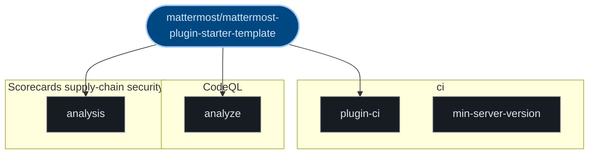

# Repository Architecture Analysis: mattermost/mattermost-plugin-starter-template

## Metadata
- **SHA**: `0bb75c86fa1126fd24815278f72fc629c1ef78ca`
- **Primary Ecosystem**: Go

## Quality Metrics
- **ast_engine**: tree-sitter
- **avg_cognitive_complexity**: 1.09
- **avg_cyclomatic_complexity**: 2.08
- **component_count**: 17
- **dead_code_count**: 1
- **dead_code_symbols**: 1 entry(ies)
- **duplication_pct**: 32.75
- **file_complexities**: 17 entry(ies)
- **files_analyzed**: 30
- **fitness_passed**: False
- **fitness_violation_count**: 1
- **framework**: Go Service
- **import_edges**: 100 entry(ies)
- **loc**: 3661
- **max_cognitive_complexity**: 10
- **max_cyclomatic_complexity**: 11
- **sloc**: 2486
- **test_file_count**: 10

# Architecture: mattermost/mattermost-plugin-starter-template

## Context
- **Repository**: `mattermost/mattermost-plugin-starter-template`
- **SHA**: `0bb75c86fa1126fd24815278f72fc629c1ef78ca`
- **Ecosystem**: Go
- **Framework**: Go Service

## Building Block View

```mermaid
graph TD;
  classDef atlasRoot fill:#004882,stroke:#a3c9ff,stroke-width:2px,color:#d3e4ff
  classDef atlasCategory fill:#212428,stroke:#E87A48,stroke-width:1.5px,color:#dfe3eb
  classDef atlasWorkflow fill:#1b2026,stroke:#a3c9ff,stroke-width:1.5px,color:#dfe3eb
  classDef atlasJob fill:#171c22,stroke:#8d9199,stroke-width:1px,color:#dfe3eb
  classDef atlasTarget fill:#005227,stroke:#8bd99b,stroke-width:1.5px,color:#a7f6b6
  classDef atlasAlert fill:#93000a,stroke:#ffb4ab,stroke-width:1.5px,color:#ffdad6
  classDef atlasMore fill:#252a31,stroke:#8d9199,stroke-dasharray:4 4,color:#c3c6cf
    configuration["configuration : module"]:::atlasJob
    job["job : module"]:::atlasJob
    main["main : module"]:::atlasJob
    plugin["plugin : module"]:::atlasJob
    api["api : module"]:::atlasJob
    api_test["api_test : module"]:::atlasJob
    channelstatus["channelstatus : module"]:::atlasJob
    channelstatus_test["channelstatus_test : module"]:::atlasJob
    command["command : module"]:::atlasJob
    command_test["command_test : module"]:::atlasJob
    mock_commands["mock_commands : module"]:::atlasJob
    kvstore["kvstore : module"]:::atlasJob
    mock_kvstore["mock_kvstore : module"]:::atlasJob
    webapp["webapp : MODULE"]:::atlasJob
    STATUS_OPTIONS["STATUS_OPTIONS : UI_COMPONENT"]:::atlasJob
    ChannelStatusSidebar["ChannelStatusSidebar : UI_COMPONENT"]:::atlasJob
    ChannelStatusTag["ChannelStatusTag : UI_COMPONENT"]:::atlasJob
    repo_root(["mattermost/mattermost-plugin-starter-template"]):::atlasRoot
    repo_root --> ChannelStatusSidebar
    repo_root --> ChannelStatusTag
    repo_root --> STATUS_OPTIONS
    repo_root --> api
    repo_root --> api_test
    repo_root --> channelstatus
    repo_root --> channelstatus_test
    repo_root --> command
    repo_root --> command_test
    repo_root --> configuration
    repo_root --> job
    repo_root --> kvstore
    repo_root --> main
    repo_root --> mock_commands
    repo_root --> mock_kvstore
    repo_root --> plugin
    repo_root --> webapp
```

## Component Details
- **configuration** (`server/configuration.go`): module
- **job** (`server/job.go`): module
- **main** (`server/main.go`): module
- **plugin** (`server/plugin.go`): module
- **api** (`server/api/api.go`): module
- **api_test** (`server/api/api_test.go`): module
- **channelstatus** (`server/channelstatus/channelstatus.go`): module
- **channelstatus_test** (`server/channelstatus/channelstatus_test.go`): module
- **command** (`server/command/command.go`): module
- **command_test** (`server/command/command_test.go`): module
- **mock_commands** (`server/command/mocks/mock_commands.go`): module
- **kvstore** (`server/store/kvstore/kvstore.go`): module
- **mock_kvstore** (`server/store/kvstore/mocks/mock_kvstore.go`): module
- **webapp** (`webapp/package.json`): MODULE
- **STATUS_OPTIONS** (`webapp/src/channel_status/statuses.ts`): UI_COMPONENT
- **ChannelStatusSidebar** (`webapp/src/components/channel_status_sidebar/channel_status_sidebar.tsx`): UI_COMPONENT
- **ChannelStatusTag** (`webapp/src/components/channel_status_tag/channel_status_tag.tsx`): UI_COMPONENT

## 6-Dimension Repository Scorecard

- **Overall Grade**: `B` (87.40/100)
- **Technical Debt Score**: 12.60
- **Estimated Remediation Effort**: 14.95h

| Dimension | Grade | Score | Weight | Details |
| :--- | :---: | :---: | :---: | :--- |
| Code Quality | `C` | 73.00 | 0.20 | avg_cc=2.08, max_cc=11, duplication=32.75%, dead_code=1 |
| Dependency Health | `A` | 100.00 | 0.15 | dependencies=1019, outdated=0, vulnerable=0, has_lockfile=True |
| Maintainability | `B` | 89.00 | 0.15 | avg_cognitive=1.09, max_cognitive=10, fitness_violations=1, oversized_files=1 |
| Pipeline Health | `A` | 93.00 | 0.15 | workflows=3, operational_antipatterns=4, parallel_branches=True |
| Security | `A` | 100.00 | 0.20 | vulnerabilities=0, secrets=0, pipeline_security_findings=0 |
| Test Coverage | `C` | 70.00 | 0.15 | coverage=unavailable, ci_test_job=True, test_files_detected=True |

## Architecture Fitness & Workspace Boundaries

- **[MEDIUM] `ATRUSS-ARCH-005` (COMPLEXITY_THRESHOLD)**: Repository duplication_pct (32.75) exceeds policy threshold (15.0).

## Supply Chain Dependencies, Vulnerabilities & Secrets

- **Dependencies Parsed**: 1019 | **Vulnerabilities**: 0 | **Secrets**: 0

### Inventory Sample
- `github.com/gorilla/mux` `1.8.1` (golang, `go.mod`)
- `github.com/mattermost/mattermost/server/public` `0.6.0` (golang, `go.mod`)
- `github.com/pkg/errors` `0.9.1` (golang, `go.mod`)
- `github.com/stretchr/testify` `1.12.1` (golang, `go.mod`)
- `go.uber.org/mock` `0.6.0` (golang, `go.mod`)
- `@babel/core` `7.29.7` (npm, `webapp/package-lock.json`)
- `@babel/core` `7.29.7` (npm, `webapp/package.json`)
- `@babel/preset-env` `7.29.7` (npm, `webapp/package-lock.json`)
- `@babel/preset-env` `7.29.7` (npm, `webapp/package.json`)
- `@babel/preset-react` `7.29.7` (npm, `webapp/package-lock.json`)
- `@babel/preset-react` `7.29.7` (npm, `webapp/package.json`)
- `@babel/preset-typescript` `7.29.7` (npm, `webapp/package-lock.json`)
- `@babel/preset-typescript` `7.29.7` (npm, `webapp/package.json`)
- `@mattermost/client` `11.9.0` (npm, `webapp/package-lock.json`)
- `@mattermost/client` `11.9.0` (npm, `webapp/package.json`)
- `@mattermost/compass-icons` `0.1.63` (npm, `webapp/package-lock.json`)
- `@mattermost/compass-icons` `0.1.63` (npm, `webapp/package.json`)
- `@mattermost/compass-ui` `0.1.0-alpha.15` (npm, `webapp/package-lock.json`)
- `@mattermost/compass-ui` `0.1.0-alpha.15` (npm, `webapp/package.json`)
- `@mattermost/eslint-plugin` `1.1.0-0` (npm, `webapp/package-lock.json`)
- `@mattermost/eslint-plugin` `1.1.0-0` (npm, `webapp/package.json`)
- `@mattermost/types` `11.9.0` (npm, `webapp/package-lock.json`)
- `@mattermost/types` `11.9.0` (npm, `webapp/package.json`)
- `@testing-library/dom` `10.4.2` (npm, `webapp/package-lock.json`)
- `@testing-library/dom` `10.4.2` (npm, `webapp/package.json`)
- `@testing-library/jest-dom` `6.10.0` (npm, `webapp/package-lock.json`)
- `@testing-library/jest-dom` `6.10.0` (npm, `webapp/package.json`)
- `@testing-library/react` `16.3.3` (npm, `webapp/package-lock.json`)
- `@testing-library/react` `16.3.3` (npm, `webapp/package.json`)
- `@testing-library/user-event` `14.6.8` (npm, `webapp/package-lock.json`)
- ... (+989 more dependencies)

## CI/CD Pipeline Topology

