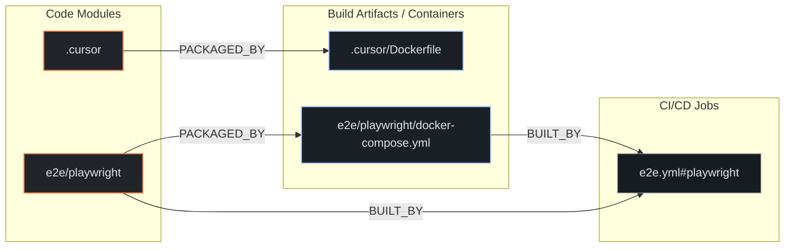
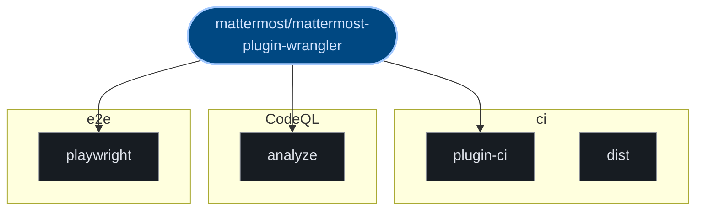

# Repository Architecture Analysis: mattermost/mattermost-plugin-wrangler

## Metadata
- **SHA**: `e3292206c5b103457800ca23c0ad18fdcff79fd2`
- **Primary Ecosystem**: JavaScript/TypeScript

## Quality Metrics
- **ast_engine**: tree-sitter
- **avg_cognitive_complexity**: 0.88
- **avg_cyclomatic_complexity**: 1.74
- **component_count**: 3
- **dead_code_count**: 0
- **dead_code_symbols**: 0 entry(ies)
- **duplication_pct**: 72.0
- **file_complexities**: 25 entry(ies)
- **files_analyzed**: 58
- **fitness_passed**: False
- **fitness_violation_count**: 1
- **framework**: React (Vite)
- **import_edges**: 100 entry(ies)
- **loc**: 3694
- **max_cognitive_complexity**: 11
- **max_cyclomatic_complexity**: 9
- **sloc**: 2626
- **test_file_count**: 20

# Architecture: mattermost/mattermost-plugin-wrangler

## Context
- **Repository**: `mattermost/mattermost-plugin-wrangler`
- **SHA**: `e3292206c5b103457800ca23c0ad18fdcff79fd2`
- **Ecosystem**: JavaScript/TypeScript
- **Framework**: React (Vite)

## Building Block View

## Component Details
- **mattermost-plugin-wrangler-e2e** (`e2e/playwright/package.json`): MODULE
- **webapp** (`webapp/package.json`): MODULE
- **Client** (`webapp/src/client/client.ts`): SERVICE

## 6-Dimension Repository Scorecard

- **Overall Grade**: `C` (79.40/100)
- **Technical Debt Score**: 20.60
- **Estimated Remediation Effort**: 28.55h

| Dimension | Grade | Score | Weight | Details |
| :--- | :---: | :---: | :---: | :--- |
| Code Quality | `C` | 75.00 | 0.20 | avg_cc=1.74, max_cc=9, duplication=72.00%, dead_code=0 |
| Dependency Health | `A` | 100.00 | 0.15 | dependencies=1076, outdated=0, vulnerable=0, has_lockfile=True |
| Maintainability | `A` | 94.00 | 0.15 | avg_cognitive=0.88, max_cognitive=11, fitness_violations=1, oversized_files=0 |
| Pipeline Health | `A` | 96.00 | 0.15 | workflows=3, operational_antipatterns=3, parallel_branches=True |
| Security | `F` | 52.00 | 0.20 | vulnerabilities=0, secrets=0, pipeline_security_findings=4 |
| Test Coverage | `C` | 70.00 | 0.15 | coverage=unavailable, ci_test_job=False, test_files_detected=True |

## Architecture Fitness & Workspace Boundaries

- **[MEDIUM] `ATRUSS-ARCH-005` (COMPLEXITY_THRESHOLD)**: Repository duplication_pct (72.0) exceeds policy threshold (15.0).

## Supply Chain Dependencies, Vulnerabilities & Secrets

- **Dependencies Parsed**: 1076 | **Vulnerabilities**: 0 | **Secrets**: 0

### Inventory Sample
- `github.com/mattermost/mattermost/server/public` `0.2.1` (golang, `go.mod`)
- `github.com/mholt/archiver/v3` `3.5.1` (golang, `go.mod`)
- `github.com/pkg/errors` `0.9.1` (golang, `go.mod`)
- `github.com/spf13/pflag` `1.0.10` (golang, `go.mod`)
- `github.com/stretchr/testify` `1.11.1` (golang, `go.mod`)
- `@babel/core` `7.26.0` (npm, `webapp/package-lock.json`)
- `@babel/core` `7.26.0` (npm, `webapp/package.json`)
- `@babel/eslint-parser` `7.25.9` (npm, `webapp/package-lock.json`)
- `@babel/eslint-parser` `7.25.9` (npm, `webapp/package.json`)
- `@babel/plugin-syntax-dynamic-import` `7.8.3` (npm, `webapp/package-lock.json`)
- `@babel/plugin-syntax-dynamic-import` `7.8.3` (npm, `webapp/package.json`)
- `@babel/plugin-transform-class-properties` `7.25.9` (npm, `webapp/package-lock.json`)
- `@babel/plugin-transform-class-properties` `7.25.9` (npm, `webapp/package.json`)
- `@babel/plugin-transform-object-rest-spread` `7.25.9` (npm, `webapp/package-lock.json`)
- `@babel/plugin-transform-object-rest-spread` `7.25.9` (npm, `webapp/package.json`)
- `@babel/preset-env` `7.26.0` (npm, `webapp/package-lock.json`)
- `@babel/preset-env` `7.26.0` (npm, `webapp/package.json`)
- `@babel/preset-react` `7.26.3` (npm, `webapp/package-lock.json`)
- `@babel/preset-react` `7.26.3` (npm, `webapp/package.json`)
- `@babel/preset-typescript` `7.26.0` (npm, `webapp/package-lock.json`)
- `@babel/preset-typescript` `7.26.0` (npm, `webapp/package.json`)
- `@babel/runtime` `7.28.4` (npm, `webapp/package-lock.json`)
- `@babel/runtime` `7.28.4` (npm, `webapp/package.json`)
- `@fortawesome/fontawesome-svg-core` `6.6.0` (npm, `webapp/package-lock.json`)
- `@fortawesome/fontawesome-svg-core` `6.6.0` (npm, `webapp/package.json`)
- `@fortawesome/free-regular-svg-icons` `6.6.0` (npm, `webapp/package-lock.json`)
- `@fortawesome/free-regular-svg-icons` `6.6.0` (npm, `webapp/package.json`)
- `@fortawesome/free-solid-svg-icons` `6.6.0` (npm, `webapp/package-lock.json`)
- `@fortawesome/free-solid-svg-icons` `6.6.0` (npm, `webapp/package.json`)
- `@fortawesome/react-fontawesome` `0.2.2` (npm, `webapp/package-lock.json`)
- ... (+1046 more dependencies)

## Section 7: Code-to-Cloud Deployment Traceability

- `.cursor` (code_module) --[PACKAGED_BY]--> `.cursor/Dockerfile` (container)
- `e2e/playwright` (code_module) --[BUILT_BY]--> `e2e.yml#playwright` (ci_job)
- `e2e/playwright` (code_module) --[PACKAGED_BY]--> `e2e/playwright/docker-compose.yml` (container)
- `e2e/playwright/docker-compose.yml` (container) --[BUILT_BY]--> `e2e.yml#playwright` (ci_job)

## CI/CD Pipeline Topology

