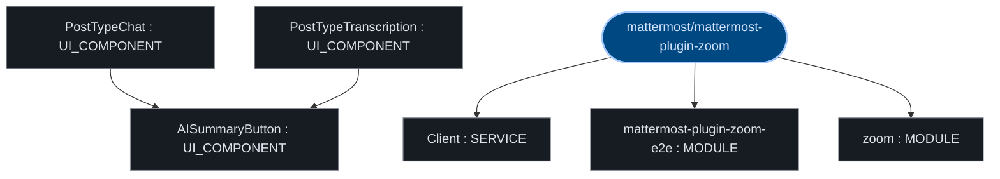
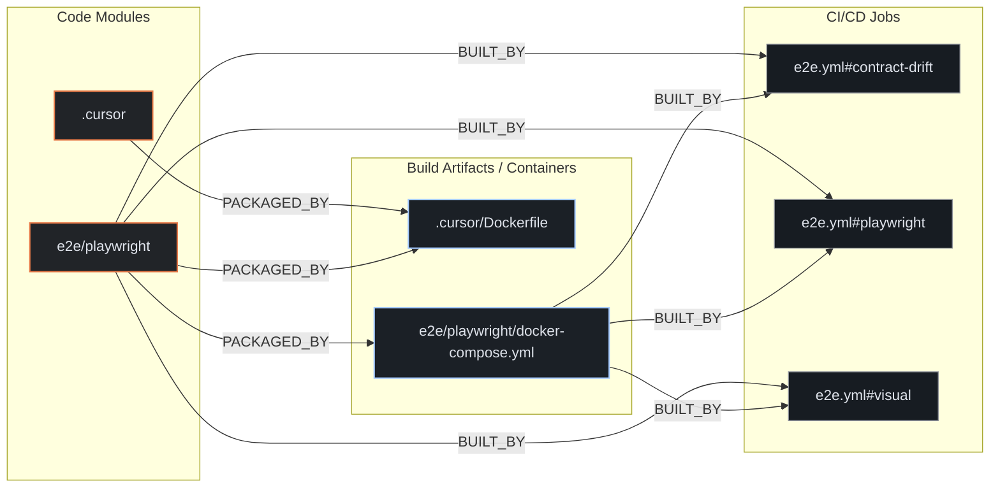
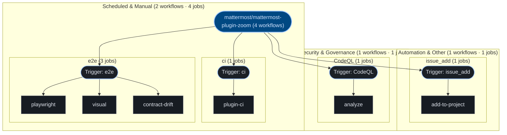

# Repository Architecture Analysis: mattermost/mattermost-plugin-zoom

## Metadata
- **SHA**: `ac5e95c34d690ce5e1fe710da19f880e9de10e2c`
- **Primary Ecosystem**: JavaScript/TypeScript

## Quality Metrics
- **ast_engine**: tree-sitter
- **avg_cognitive_complexity**: 1.8
- **avg_cyclomatic_complexity**: 2.55
- **component_count**: 6
- **dead_code_count**: 1
- **dead_code_symbols**: 1 entry(ies)
- **duplication_pct**: 57.79
- **file_complexities**: 25 entry(ies)
- **files_analyzed**: 50
- **fitness_passed**: False
- **fitness_violation_count**: 2
- **framework**: React (Vite)
- **import_edges**: 100 entry(ies)
- **loc**: 3991
- **max_cognitive_complexity**: 27
- **max_cyclomatic_complexity**: 16
- **sloc**: 2784
- **test_file_count**: 33

# Architecture: mattermost/mattermost-plugin-zoom

## Context
- **Repository**: `mattermost/mattermost-plugin-zoom`
- **SHA**: `ac5e95c34d690ce5e1fe710da19f880e9de10e2c`
- **Ecosystem**: JavaScript/TypeScript
- **Framework**: React (Vite)

## Building Block View

## Component Details
- **mattermost-plugin-zoom-e2e** (`e2e/playwright/package.json`): MODULE
- **zoom** (`webapp/package.json`): MODULE
- **Client** (`webapp/src/client/client.js`): SERVICE
- **AISummaryButton** (`webapp/src/components/ai_summary_button.tsx`): UI_COMPONENT
- **PostTypeChat** (`webapp/src/components/post_type_chat.tsx`): UI_COMPONENT (deps: AISummaryButton)
- **PostTypeTranscription** (`webapp/src/components/post_type_transcription.tsx`): UI_COMPONENT (deps: AISummaryButton)

## 6-Dimension Repository Scorecard

- **Overall Grade**: `D` (67.82/100)
- **Technical Debt Score**: 32.18
- **Estimated Remediation Effort**: 34.85h

| Dimension | Grade | Score | Weight | Details |
| :--- | :---: | :---: | :---: | :--- |
| Code Quality | `C` | 71.50 | 0.20 | avg_cc=2.55, max_cc=16, duplication=57.79%, dead_code=1 |
| Dependency Health | `A` | 100.00 | 0.15 | dependencies=1172, outdated=0, vulnerable=0, has_lockfile=True |
| Maintainability | `C` | 77.50 | 0.15 | avg_cognitive=1.80, max_cognitive=27, fitness_violations=2, oversized_files=0 |
| Pipeline Health | `A` | 96.00 | 0.15 | workflows=4, operational_antipatterns=3, parallel_branches=True |
| Security | `F` | 10.00 | 0.20 | vulnerabilities=0, secrets=3, pipeline_security_findings=3 |
| Test Coverage | `C` | 70.00 | 0.15 | coverage=unavailable, ci_test_job=False, test_files_detected=True |

## Architecture Fitness & Workspace Boundaries

- **[MEDIUM] `ATRUSS-ARCH-005` (COMPLEXITY_THRESHOLD)**: Repository duplication_pct (57.79) exceeds policy threshold (15.0).
- **[MEDIUM] `ATRUSS-ARCH-005` (COMPLEXITY_THRESHOLD)**: Repository max_cognitive_complexity (27.0) exceeds policy threshold (25.0).

## Supply Chain Dependencies, Vulnerabilities & Secrets

- **Dependencies Parsed**: 1172 | **Vulnerabilities**: 0 | **Secrets**: 3

### Secret Findings (Redacted)
- **[HIGH] `ATRUSS-SEC-005`** at `server/http_test.go:177` (`EncryptionKey:     "4Su-***REDACTED***",`)
- **[HIGH] `ATRUSS-SEC-005`** at `server/plugin_test.go:224` (`EncryptionKey:           "4Su-***REDACTED***",`)
- **[HIGH] `ATRUSS-SEC-005`** at `server/plugin_test.go:327` (`EncryptionKey:     "4Su-***REDACTED***",`)

### Inventory Sample
- `github.com/mattermost/mattermost/server/public` `0.3.0` (golang, `go.mod`)
- `github.com/pkg/errors` `0.9.1` (golang, `go.mod`)
- `github.com/stretchr/testify` `1.11.1` (golang, `go.mod`)
- `golang.org/x/oauth2` `0.36.0` (golang, `go.mod`)
- `@babel/cli` `7.26.4` (npm, `webapp/package-lock.json`)
- `@babel/cli` `7.26.4` (npm, `webapp/package.json`)
- `@babel/core` `7.29.6` (npm, `webapp/package-lock.json`)
- `@babel/core` `7.29.6` (npm, `webapp/package.json`)
- `@babel/eslint-parser` `7.26.5` (npm, `webapp/package-lock.json`)
- `@babel/eslint-parser` `7.26.5` (npm, `webapp/package.json`)
- `@babel/plugin-syntax-dynamic-import` `7.8.3` (npm, `webapp/package-lock.json`)
- `@babel/plugin-syntax-dynamic-import` `7.8.3` (npm, `webapp/package.json`)
- `@babel/plugin-transform-class-properties` `7.25.9` (npm, `webapp/package-lock.json`)
- `@babel/plugin-transform-class-properties` `7.25.9` (npm, `webapp/package.json`)
- `@babel/plugin-transform-object-rest-spread` `7.25.9` (npm, `webapp/package-lock.json`)
- `@babel/plugin-transform-object-rest-spread` `7.25.9` (npm, `webapp/package.json`)
- `@babel/plugin-transform-optional-chaining` `7.25.9` (npm, `webapp/package-lock.json`)
- `@babel/plugin-transform-optional-chaining` `7.25.9` (npm, `webapp/package.json`)
- `@babel/preset-env` `7.26.9` (npm, `webapp/package-lock.json`)
- `@babel/preset-env` `7.26.9` (npm, `webapp/package.json`)
- `@babel/preset-react` `7.26.3` (npm, `webapp/package-lock.json`)
- `@babel/preset-react` `7.26.3` (npm, `webapp/package.json`)
- `@babel/preset-typescript` `7.26.0` (npm, `webapp/package-lock.json`)
- `@babel/preset-typescript` `7.26.0` (npm, `webapp/package.json`)
- `@babel/runtime` `7.27.1` (npm, `webapp/package-lock.json`)
- `@babel/runtime` `7.27.1` (npm, `webapp/package.json`)
- `@emotion/babel-preset-css-prop` `11.12.0` (npm, `webapp/package-lock.json`)
- `@emotion/babel-preset-css-prop` `11.12.0` (npm, `webapp/package.json`)
- `@emotion/react` `11.14.0` (npm, `webapp/package-lock.json`)
- `@emotion/react` `11.14.0` (npm, `webapp/package.json`)
- ... (+1142 more dependencies)

## Section 7: Code-to-Cloud Deployment Traceability

- `.cursor` (code_module) --[PACKAGED_BY]--> `.cursor/Dockerfile` (container)
- `e2e/playwright` (code_module) --[BUILT_BY]--> `e2e.yml#contract-drift` (ci_job)
- `e2e/playwright` (code_module) --[BUILT_BY]--> `e2e.yml#playwright` (ci_job)
- `e2e/playwright` (code_module) --[BUILT_BY]--> `e2e.yml#visual` (ci_job)
- `e2e/playwright` (code_module) --[PACKAGED_BY]--> `.cursor/Dockerfile` (container)
- `e2e/playwright` (code_module) --[PACKAGED_BY]--> `e2e/playwright/docker-compose.yml` (container)
- `e2e/playwright/docker-compose.yml` (container) --[BUILT_BY]--> `e2e.yml#contract-drift` (ci_job)
- `e2e/playwright/docker-compose.yml` (container) --[BUILT_BY]--> `e2e.yml#playwright` (ci_job)
- `e2e/playwright/docker-compose.yml` (container) --[BUILT_BY]--> `e2e.yml#visual` (ci_job)

## CI/CD Pipeline Topology

