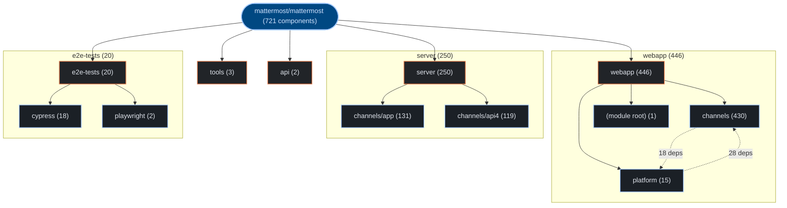

# Repository Architecture Analysis: mattermost/mattermost

## Metadata
- **SHA**: `9878ab425a41496d5d30c788219d643414843231`
- **Primary Ecosystem**: JavaScript/TypeScript

## Quality Metrics
- **ast_engine**: tree-sitter
- **avg_cognitive_complexity**: 1.51
- **avg_cyclomatic_complexity**: 2.14
- **component_count**: 721
- **dead_code_count**: 34
- **dead_code_symbols**: 34 entry(ies)
- **duplication_pct**: 47.85
- **file_complexities**: 25 entry(ies)
- **files_analyzed**: 5693
- **fitness_passed**: False
- **fitness_violation_count**: 10
- **framework**: React (Vite)
- **import_edges**: 100 entry(ies)
- **loc**: 1165949
- **max_cognitive_complexity**: 195
- **max_cyclomatic_complexity**: 136
- **sloc**: 928322
- **test_file_count**: 3008

# Architecture: mattermost/mattermost

## Context
- **Repository**: `mattermost/mattermost`
- **SHA**: `9878ab425a41496d5d30c788219d643414843231`
- **Ecosystem**: JavaScript/TypeScript
- **Framework**: React (Vite)

## Building Block View

## Component Details

Showing top 60 representative components out of 721 across 5 module group(s):

- **Module `webapp`** (446 components — UI_COMPONENT: 433, MODULE: 6, API_ROUTE: 5)
- **Module `server`** (250 components — module: 250)
- **Module `e2e-tests`** (20 components — API_ROUTE: 16, MODULE: 2, SERVICE: 2)
- **Module `tools`** (3 components — module: 3)
- **Module `api`** (2 components — MODULE: 1, module: 1)

- **SelfHostedPurchaseModal** (`webapp/channels/src/components/self_hosted_purchases/self_hosted_purchase_modal/index.tsx`): UI_COMPONENT (deps: A11yAttributeNames, A11yClassNames, A11yCustomEventTypes, AboutLinks, AcceptedProfileImageTypes, ActionTypes (+96 more))
- **SelfHostedExpansionModal** (`webapp/channels/src/components/self_hosted_purchases/self_hosted_expansion_modal/index.tsx`): UI_COMPONENT (deps: A11yAttributeNames, A11yClassNames, A11yCustomEventTypes, AboutLinks, AcceptedProfileImageTypes, ActionTypes (+90 more))
- **CompleteYourProfileTour** (`webapp/channels/src/components/onboarding_tasks/complete_your_profile_tour_tip.tsx`): UI_COMPONENT (deps: A11yAttributeNames, A11yClassNames, A11yCustomEventTypes, AboutLinks, AcceptedProfileImageTypes, ActionTypes (+87 more))
- **MAX_LIST_HEIGHT** (`webapp/channels/src/components/user_group_popover/group_member_list/group_member_list.tsx`): UI_COMPONENT (deps: A11yAttributeNames, A11yClassNames, A11yCustomEventTypes, AboutLinks, AcceptedProfileImageTypes, ActionTypes (+87 more))
- **StartTrialTour** (`webapp/channels/src/components/onboarding_tasks/start_trial_tour_tip.tsx`): UI_COMPONENT (deps: A11yAttributeNames, A11yClassNames, A11yCustomEventTypes, AboutLinks, AcceptedProfileImageTypes, ActionTypes (+87 more))
- **VIEWPORT_SCALE_FACTOR** (`webapp/channels/src/components/user_group_popover/group_member_list/group_member_list.tsx`): UI_COMPONENT (deps: A11yAttributeNames, A11yClassNames, A11yCustomEventTypes, AboutLinks, AcceptedProfileImageTypes, ActionTypes (+87 more))
- **VisitSystemConsoleTour** (`webapp/channels/src/components/onboarding_tasks/visit_system_console_tour_tip.tsx`): UI_COMPONENT (deps: A11yAttributeNames, A11yClassNames, A11yCustomEventTypes, AboutLinks, AcceptedProfileImageTypes, ActionTypes (+87 more))
- **ChannelNotificationsModal** (`webapp/channels/src/components/channel_notifications_modal/channel_notifications_modal.tsx`): UI_COMPONENT (deps: ActivatedUserCard, AirGappedSelfHostedPurhcaseModal, BannerPreferenceName, CenterMessageLock, ChannelHeaderDropdown, ChannelHeaderDropdownItems (+26 more))
- **FileAttachment** (`webapp/channels/src/components/file_attachment/file_attachment.tsx`): UI_COMPONENT (deps: ActivatedUserCard, AirGappedSelfHostedPurhcaseModal, ArchivedTooltip, BannerPreferenceName, CenterMessageLock, ChannelHeaderDropdown (+24 more))
- **FileAttachmentList** (`webapp/channels/src/components/file_attachment_list/file_attachment_list.tsx`): UI_COMPONENT (deps: ActivatedUserCard, AirGappedSelfHostedPurhcaseModal, BannerPreferenceName, CenterMessageLock, ChannelHeaderDropdown, ChannelHeaderDropdownItems (+23 more))
- **LHSNearingLimitsModal** (`webapp/channels/src/components/cloud_usage_modal/lhs_nearing_limit_modal.tsx`): UI_COMPONENT (deps: ActivatedUserCard, AirGappedSelfHostedPurhcaseModal, BannerPreferenceName, CenterMessageLock, ChannelHeaderDropdown, ChannelHeaderDropdownItems (+23 more))
- **MobileViewWatcher** (`webapp/channels/src/components/mobile_view_watcher/mobile_view_watcher.tsx`): UI_COMPONENT (deps: ActivatedUserCard, AirGappedSelfHostedPurhcaseModal, BannerPreferenceName, CenterMessageLock, ChannelHeaderDropdown, ChannelHeaderDropdownItems (+23 more))
- **PerformanceDebuggingSection** (`webapp/channels/src/components/user_settings/advanced/performance_debugging_section/performance_debugging_section.tsx`): UI_COMPONENT (deps: ActivatedUserCard, AirGappedSelfHostedPurhcaseModal, BannerPreferenceName, CenterMessageLock, ChannelHeaderDropdown, ChannelHeaderDropdownItems (+23 more))
- **DEFAULT_LIMIT_AFTER** (`webapp/platform/client/src/client4.ts`): UI_COMPONENT (deps: BASE_EVENT, INPUT, NeedDomainsError, NeedGroupsError, OUTPUT_APPEND, OUTPUT_REPLACE (+1 more))
- **DEFAULT_LIMIT_BEFORE** (`webapp/platform/client/src/client4.ts`): UI_COMPONENT (deps: BASE_EVENT, INPUT, NeedDomainsError, NeedGroupsError, OUTPUT_APPEND, OUTPUT_REPLACE (+1 more))
- **HEADER_X_CLUSTER_ID** (`webapp/platform/client/src/client4.ts`): UI_COMPONENT (deps: BASE_EVENT, INPUT, NeedDomainsError, NeedGroupsError, OUTPUT_APPEND, OUTPUT_REPLACE (+1 more))
- **HEADER_X_VERSION_ID** (`webapp/platform/client/src/client4.ts`): UI_COMPONENT (deps: BASE_EVENT, INPUT, NeedDomainsError, NeedGroupsError, OUTPUT_APPEND, OUTPUT_REPLACE (+1 more))
- **ChannelMembersRHS** (`webapp/channels/src/components/channel_members_rhs/channel_members_rhs.tsx`): UI_COMPONENT (deps: MAX_LIST_HEIGHT, MobileSidebarHeader, SidebarCategoryHeader, SidebarCategoryHeaderStatic, VIEWPORT_SCALE_FACTOR)
- **View** (`webapp/channels/src/components/invitation_modal/invitation_modal.tsx`): UI_COMPONENT (deps: InviteAs, InviteType, InviteView, NoPermissionsView, ResultView)
- **ChannelMentionSuggestion** (`webapp/channels/src/components/suggestion/channel_mention_provider.tsx`): UI_COMPONENT (deps: EMOJI_CATEGORY_SUGGESTION_BLOCKLIST, MIN_EMOTICON_LENGTH, RootProvider, StripeElementsProvider)
- **EMOJI_CATEGORY_SUGGESTION_BLOCKLIST** (`webapp/channels/src/components/suggestion/emoticon_provider.tsx`): UI_COMPONENT (deps: ChannelMentionSuggestion, MIN_CHANNEL_LINK_LENGTH, RootProvider, StripeElementsProvider)
- **FILTER_STORAGE_KEY** (`webapp/channels/src/components/threading/global_threads/thread_list/thread_list.tsx`): UI_COMPONENT (deps: CallButton, DeleteEmojiButton, EditPostTimeLimitButton, ProfilePopoverCallButton)
- **MIN_CHANNEL_LINK_LENGTH** (`webapp/channels/src/components/suggestion/channel_mention_provider.tsx`): UI_COMPONENT (deps: EMOJI_CATEGORY_SUGGESTION_BLOCKLIST, MIN_EMOTICON_LENGTH, RootProvider, StripeElementsProvider)
- **MIN_EMOTICON_LENGTH** (`webapp/channels/src/components/suggestion/emoticon_provider.tsx`): UI_COMPONENT (deps: ChannelMentionSuggestion, MIN_CHANNEL_LINK_LENGTH, RootProvider, StripeElementsProvider)
- **SubMenu** (`webapp/channels/src/components/menu/sub_menu.tsx`): UI_COMPONENT (deps: MenuContext, MenuItem, MuiMenuStyled, SubMenuContext)
- **ChannelRow** (`webapp/channels/src/components/audit_table/channel_row/channel_row.tsx`): UI_COMPONENT (deps: AuditRow, ChannelCreateDirectRow, ChannelDefaultRow)
- **ChannelsTourTip** (`webapp/channels/src/components/tours/channels_tour_tip.tsx`): UI_COMPONENT (deps: FileSizes, KeyCodes, REACTION_PATTERN)
- **DeleteWorkspaceModal** (`webapp/channels/src/components/admin_console/billing/delete_workspace/delete_workspace_modal.tsx`): UI_COMPONENT (deps: DeleteWorkspaceFailureModal, DeleteWorkspaceSuccessModal, StartTrialFormModalResult)
- **FormatAudit** (`webapp/channels/src/components/audit_table/format_audit.tsx`): UI_COMPONENT (deps: AuditRow, ChannelRow, UserRow)
- **HFRoute** (`webapp/channels/src/components/header_footer_route/header_footer_route.tsx`): UI_COMPONENT (deps: MobileSidebarHeader, SidebarCategoryHeader, SidebarCategoryHeaderStatic)
- **ITEMS_PER_PAGE** (`webapp/channels/src/components/plugin_marketplace/marketplace_list/marketplace_list.tsx`): UI_COMPONENT (deps: UpdateConfirmationModal, UpdateDetails, UpdateVersion)
- **InviteView** (`webapp/channels/src/components/invitation_modal/invite_view.tsx`): UI_COMPONENT (deps: AddToChannels, InviteAs, InviteType)
- **LAUNCHING_WORKSPACE_FULLSCREEN_Z_INDEX** (`webapp/channels/src/components/preparing_workspace/launching_workspace.tsx`): UI_COMPONENT (deps: Animations, PLUGIN_NAME_TO_ID_MAP, WizardSteps)
- **Menu** (`webapp/channels/src/components/menu/menu.tsx`): UI_COMPONENT (deps: MenuContext, MuiMenuStyled, SubMenuContext)
- **Progress** (`webapp/channels/src/components/preparing_workspace/progress.tsx`): UI_COMPONENT (deps: Animations, PLUGIN_NAME_TO_ID_MAP, WizardSteps)
- **ResultView** (`webapp/channels/src/components/invitation_modal/result_view.tsx`): UI_COMPONENT (deps: InviteAs, InviteType, ResultTable)
- **START_TRANSITIONING_OUT** (`webapp/channels/src/components/preparing_workspace/launching_workspace.tsx`): UI_COMPONENT (deps: Animations, PLUGIN_NAME_TO_ID_MAP, WizardSteps)
- **TransitionedProgress** (`webapp/channels/src/components/preparing_workspace/progress.tsx`): UI_COMPONENT (deps: Animations, PLUGIN_NAME_TO_ID_MAP, WizardSteps)
- **AddToChannels** (`webapp/channels/src/components/invitation_modal/add_to_channels.tsx`): UI_COMPONENT (deps: InviteAs, InviteType)
- **DeleteWorkspaceFailureModal** (`webapp/channels/src/components/admin_console/billing/delete_workspace/failure_modal.tsx`): UI_COMPONENT (deps: DeleteWorkspaceModal, ResultModal)
- **GatherIntent** (`webapp/channels/src/components/payment_form/gather_intent/gather_intent.tsx`): UI_COMPONENT (deps: GatherIntentModal, GatherIntentSubmittedModal)
- **MenuItem** (`webapp/channels/src/components/menu/menu_item.tsx`): UI_COMPONENT (deps: MenuContext, SubMenuContext)
- **UnreadChannels** (`webapp/channels/src/components/sidebar/unread_channels.tsx`): UI_COMPONENT (deps: SidebarCategoryHeader, SidebarCategoryHeaderStatic)
- **UserRow** (`webapp/channels/src/components/audit_table/user_row/user_row.tsx`): UI_COMPONENT (deps: AuditRow, UserUpdateActiveSessionRow)
- **BillingHistoryModal** (`webapp/channels/src/components/admin_console/billing/billing_history_modal.tsx`): UI_COMPONENT (deps: BillingHistoryTable)
- **BillingHistoryTable** (`webapp/channels/src/components/admin_console/billing/billing_history_table.tsx`): UI_COMPONENT (deps: InvoiceUserCount)
- **Card** (`webapp/channels/src/components/purchase_modal/purchase_modal.tsx`): UI_COMPONENT (deps: IconMessage)
- **ChannelCreateDirectRow** (`webapp/channels/src/components/audit_table/channel_row/channel_create_direct_row.tsx`): UI_COMPONENT (deps: AuditRow)
- **ChannelDefaultRow** (`webapp/channels/src/components/audit_table/channel_row/channel_default_row.tsx`): UI_COMPONENT (deps: AuditRow)
- **CloudUsageModal** (`webapp/channels/src/components/cloud_usage_modal/index.tsx`): UI_COMPONENT (deps: WorkspaceLimitsPanel)
- **DeleteWorkspaceCTA** (`webapp/channels/src/components/admin_console/billing/delete_workspace/delete_workspace_cta.tsx`): UI_COMPONENT (deps: DeleteWorkspaceModal)
- **DeleteWorkspaceSuccessModal** (`webapp/channels/src/components/admin_console/billing/delete_workspace/success_modal.tsx`): UI_COMPONENT (deps: ResultModal)
- **FormattingBarSpacer** (`webapp/channels/src/components/advanced_text_editor/formatting_bar/formatting_bar.tsx`): UI_COMPONENT (deps: IconContainer)
- **LimitTypes** (`webapp/channels/src/utils/limits.tsx`): UI_COMPONENT (deps: FileSizes)
- **MenuItemActionImpl** (`webapp/channels/src/components/widgets/menu/menu_items/menu_item_action.tsx`): UI_COMPONENT (deps: MenuItem)
- **MenuItemExternalLinkImpl** (`webapp/channels/src/components/widgets/menu/menu_items/menu_item_external_link.tsx`): UI_COMPONENT (deps: MenuItem)
- **MenuItemLinkImpl** (`webapp/channels/src/components/widgets/menu/menu_items/menu_item_link.tsx`): UI_COMPONENT (deps: MenuItem)
- **MenuItemToggleModalReduxImpl** (`webapp/channels/src/components/widgets/menu/menu_items/menu_item_toggle_modal_redux.tsx`): UI_COMPONENT (deps: MenuItem)
- **MessagesOrFilesSelector** (`webapp/channels/src/components/search_results/messages_or_files_selector.tsx`): UI_COMPONENT (deps: FilesFilterMenu)
- **NoBillingHistorySection** (`webapp/channels/src/components/admin_console/billing/billing_history.tsx`): UI_COMPONENT (deps: BillingHistoryTable)

## 6-Dimension Repository Scorecard

- **Overall Grade**: `F` (31.50/100)
- **Technical Debt Score**: 68.50
- **Estimated Remediation Effort**: 174.19h

| Dimension | Grade | Score | Weight | Details |
| :--- | :---: | :---: | :---: | :--- |
| Code Quality | `F` | 30.00 | 0.20 | avg_cc=2.14, max_cc=136, duplication=47.85%, dead_code=34 |
| Dependency Health | `A` | 100.00 | 0.15 | dependencies=4377, outdated=0, vulnerable=0, has_lockfile=True |
| Maintainability | `F` | 0.00 | 0.15 | avg_cognitive=1.51, max_cognitive=195, fitness_violations=10, oversized_files=8 |
| Pipeline Health | `F` | 0.00 | 0.15 | workflows=22, operational_antipatterns=56, parallel_branches=True |
| Security | `F` | 0.00 | 0.20 | vulnerabilities=0, secrets=7, pipeline_security_findings=42 |
| Test Coverage | `C` | 70.00 | 0.15 | coverage=unavailable, ci_test_job=True, test_files_detected=True |

## Architecture Fitness & Workspace Boundaries

- **[HIGH] `ATRUSS-ARCH-004` (CIRCULAR_DEPENDENCY)**: Circular dependency detected between architectural components. (ChannelMentionSuggestion -> EMOJI_CATEGORY_SUGGESTION_BLOCKLIST -> ChannelMentionSuggestion)
- **[HIGH] `ATRUSS-ARCH-004` (CIRCULAR_DEPENDENCY)**: Circular dependency detected between architectural components. (ChannelMentionSuggestion -> EMOJI_CATEGORY_SUGGESTION_BLOCKLIST -> MIN_CHANNEL_LINK_LENGTH -> MIN_EMOTICON_LENGTH -> ChannelMentionSuggestion)
- **[HIGH] `ATRUSS-ARCH-004` (CIRCULAR_DEPENDENCY)**: Circular dependency detected between architectural components. (ChannelMentionSuggestion -> MIN_EMOTICON_LENGTH -> ChannelMentionSuggestion)
- **[HIGH] `ATRUSS-ARCH-004` (CIRCULAR_DEPENDENCY)**: Circular dependency detected between architectural components. (ChannelMentionSuggestion -> MIN_EMOTICON_LENGTH -> MIN_CHANNEL_LINK_LENGTH -> EMOJI_CATEGORY_SUGGESTION_BLOCKLIST -> ChannelMentionSuggestion)
- **[HIGH] `ATRUSS-ARCH-004` (CIRCULAR_DEPENDENCY)**: Circular dependency detected between architectural components. (DeleteWorkspaceFailureModal -> DeleteWorkspaceModal -> DeleteWorkspaceFailureModal)
- **[HIGH] `ATRUSS-ARCH-004` (CIRCULAR_DEPENDENCY)**: Circular dependency detected between architectural components. (EMOJI_CATEGORY_SUGGESTION_BLOCKLIST -> MIN_CHANNEL_LINK_LENGTH -> EMOJI_CATEGORY_SUGGESTION_BLOCKLIST)
- **[HIGH] `ATRUSS-ARCH-004` (CIRCULAR_DEPENDENCY)**: Circular dependency detected between architectural components. (MIN_CHANNEL_LINK_LENGTH -> MIN_EMOTICON_LENGTH -> MIN_CHANNEL_LINK_LENGTH)
- **[MEDIUM] `ATRUSS-ARCH-005` (COMPLEXITY_THRESHOLD)**: Repository duplication_pct (47.85) exceeds policy threshold (15.0).
- **[MEDIUM] `ATRUSS-ARCH-005` (COMPLEXITY_THRESHOLD)**: Repository max_cognitive_complexity (195.0) exceeds policy threshold (25.0).
- **[MEDIUM] `ATRUSS-ARCH-005` (COMPLEXITY_THRESHOLD)**: Repository max_cyclomatic_complexity (136.0) exceeds policy threshold (20.0).

## Supply Chain Dependencies, Vulnerabilities & Secrets

- **Dependencies Parsed**: 4377 | **Vulnerabilities**: 0 | **Secrets**: 7

### Secret Findings (Redacted)
- **[HIGH] `ATRUSS-SEC-005`** at `e2e-tests/.ci/dashboard.override.yml:9` (`JWT_SECRET: s8gG***REDACTED*** # Generated with e.g. `dd if=/dev/urandom count=24 bs=1 2>/dev/null | base64 -w0``)
- **[HIGH] `ATRUSS-SEC-005`** at `e2e-tests/cypress/package.json:34` (`"client-oauth2": "gith***REDACTED***",`)
- **[HIGH] `ATRUSS-SEC-005`** at `e2e-tests/cypress/tests/support/api/keycloak_realm.json:558` (`"saml.signing.private.key" : "MIIE***REDACTED***",`)
- **[CRITICAL] `ATRUSS-SEC-004`** at `server/channels/api4/ldap_test.go:17` (`-----BEGIN ... PRIVATE KEY----- [REDACTED]`)
- **[HIGH] `ATRUSS-SEC-005`** at `server/channels/api4/user_test.go:3312` (`passwordHash := "$2a$***REDACTED***"`)
- **[HIGH] `ATRUSS-SEC-005`** at `server/channels/app/import_utils.go:14` (`passwordUpperCaseLetters = "ABCD***REDACTED***"`)
- **[HIGH] `ATRUSS-SEC-005`** at `server/channels/app/import_utils.go:15` (`passwordLowerCaseLetters = "abcd***REDACTED***"`)

### Inventory Sample
- `code.sajari.com/docconv` `1.3.6` (golang, `server/go.mod`)
- `github.com/Masterminds/semver/v3` `3.2.1` (golang, `server/go.mod`)
- `github.com/avct/uasurfer` `0.0.0-20191028135549-26b5daa857f1` (golang, `server/go.mod`)
- `github.com/aws/aws-sdk-go` `1.44.293` (golang, `server/go.mod`)
- `github.com/blang/semver/v4` `4.0.0` (golang, `server/go.mod`)
- `github.com/blang/semver/v4` `4.0.0` (golang, `server/public/go.mod`)
- `github.com/blevesearch/bleve/v2` `2.3.8` (golang, `server/go.mod`)
- `github.com/cespare/xxhash/v2` `2.2.0` (golang, `server/go.mod`)
- `github.com/dgryski/dgoogauth` `0.0.0-20190221195224-5a805980a5f3` (golang, `server/go.mod`)
- `github.com/disintegration/imaging` `1.6.2` (golang, `server/go.mod`)
- `github.com/dyatlov/go-opengraph/opengraph` `0.0.0-20220524092352-606d7b1e5f8a` (golang, `server/go.mod`)
- `github.com/dyatlov/go-opengraph/opengraph` `0.0.0-20220524092352-606d7b1e5f8a` (golang, `server/public/go.mod`)
- `github.com/fatih/color` `1.15.0` (golang, `server/go.mod`)
- `github.com/francoispqt/gojay` `1.2.13` (golang, `server/public/go.mod`)
- `github.com/fsnotify/fsnotify` `1.6.0` (golang, `server/go.mod`)
- `github.com/getsentry/sentry-go` `0.22.0` (golang, `server/go.mod`)
- `github.com/go-sql-driver/mysql` `1.7.1` (golang, `server/go.mod`)
- `github.com/go-sql-driver/mysql` `1.7.1` (golang, `server/public/go.mod`)
- `github.com/golang-jwt/jwt/v5` `5.0.0` (golang, `server/go.mod`)
- `github.com/golang-migrate/migrate/v4` `4.16.2` (golang, `server/go.mod`)
- `github.com/golang/freetype` `0.0.0-20170609003504-e2365dfdc4a0` (golang, `server/go.mod`)
- `github.com/golang/mock` `1.6.0` (golang, `server/go.mod`)
- `github.com/golang/mock` `1.6.0` (golang, `server/public/go.mod`)
- `github.com/gorilla/handlers` `1.5.1` (golang, `server/go.mod`)
- `github.com/gorilla/mux` `1.8.0` (golang, `server/go.mod`)
- `github.com/gorilla/mux` `1.8.0` (golang, `server/public/go.mod`)
- `github.com/gorilla/schema` `1.2.0` (golang, `server/go.mod`)
- `github.com/gorilla/websocket` `1.5.0` (golang, `server/go.mod`)
- `github.com/gorilla/websocket` `1.5.0` (golang, `server/public/go.mod`)
- `github.com/h2non/go-is-svg` `0.0.0-20160927212452-35e8c4b0612c` (golang, `server/go.mod`)
- ... (+4347 more dependencies)

## Section 7: Code-to-Cloud Deployment Traceability

```mermaid
flowchart LR
    classDef atlasCategory fill:#212428,stroke:#E87A48,stroke-width:1.5px,color:#dfe3eb
    classDef atlasWorkflow fill:#1b2026,stroke:#a3c9ff,stroke-width:1.5px,color:#dfe3eb
    classDef atlasJob fill:#171c22,stroke:#8d9199,stroke-width:1px,color:#dfe3eb
    classDef atlasTarget fill:#005227,stroke:#8bd99b,stroke-width:1.5px,color:#a7f6b6
    subgraph code_modules["Code Modules"]
        mod_api["api"]:::atlasCategory
        mod_api_server["api/server"]:::atlasCategory
        mod_e2e_tests_cypress["e2e-tests/cypress"]:::atlasCategory
        mod_e2e_tests_playwright["e2e-tests/playwright"]:::atlasCategory
        mod_server["server"]:::atlasCategory
        mod_server_public["server/public"]:::atlasCategory
        mod_webapp["webapp"]:::atlasCategory
        mod_webapp_channels["webapp/channels"]:::atlasCategory
        mod_webapp_platform_client["webapp/platform/client"]:::atlasCategory
    end
    subgraph build_artifacts["Build Artifacts / Containers"]
        art_e2e_tests_cypress_Dockerfile_webhook["e2e-tests/cypress/Dockerfile.webhook"]:::atlasWorkflow
        art_server_docker_compose_makefile_m1_yml["server/docker-compose.makefile.m1.yml"]:::atlasWorkflow
        art_server_docker_compose_makefile_yml["server/docker-compose.makefile.yml"]:::atlasWorkflow
        art_server_docker_compose_yaml["server/docker-compose.yaml"]:::atlasWorkflow
    end
    subgraph ci_jobs["CI/CD Jobs"]
        job_api_yml_build["api.yml#build"]:::atlasJob
        job_codeql_analysis_yml_analyze["codeql-analysis.yml#analyze"]:::atlasJob
        job_docker_push_mirrored_yml_build_docker["docker-push-mirrored.yml#build-docker"]:::atlasJob
        job_e2e_tests_ci_yml_cypress_check["e2e-tests-ci.yml#cypress-check"]:::atlasJob
        job_e2e_tests_ci_yml_playwright_check["e2e-tests-ci.yml#playwright-check"]:::atlasJob
        job_e2e_tests_ci_yml_smoketests["e2e-tests-ci.yml#smoketests"]:::atlasJob
        job_esrupgrade_common_yml_esr_upgrade_diff["esrupgrade-common.yml#esr-upgrade-diff"]:::atlasJob
        job_esrupgrade_common_yml_esr_upgrade_script["esrupgrade-common.yml#esr-upgrade-script"]:::atlasJob
        job_esrupgrade_common_yml_esr_upgrade_server["esrupgrade-common.yml#esr-upgrade-server"]:::atlasJob
        job_migration_yml_test["migration.yml#test"]:::atlasJob
        job_mmctl_test_template_yml_test["mmctl-test-template.yml#test"]:::atlasJob
        job_performance_benchmarks_yml_cypress_run["performance-benchmarks.yml#cypress-run"]:::atlasJob
        job_server_ci_artifacts_yml_build_docker["server-ci-artifacts.yml#build-docker"]:::atlasJob
        job_server_ci_artifacts_yml_upload_artifacts["server-ci-artifacts.yml#upload-artifacts"]:::atlasJob
        job_server_ci_template_yml_build_mattermost_server["server-ci-template.yml#build-mattermost-server"]:::atlasJob
        job_server_ci_template_yml_check_app_layers["server-ci-template.yml#check-app-layers"]:::atlasJob
        job_server_ci_template_yml_check_email_templates["server-ci-template.yml#check-email-templates"]:::atlasJob
        job_server_ci_template_yml_check_gen_serialized["server-ci-template.yml#check-gen-serialized"]:::atlasJob
        job_server_ci_template_yml_check_go_mod_tidy["server-ci-template.yml#check-go-mod-tidy"]:::atlasJob
        job_server_ci_template_yml_check_mattermost_vet["server-ci-template.yml#check-mattermost-vet"]:::atlasJob
        job_server_ci_template_yml_check_mattermost_vet_api["server-ci-template.yml#check-mattermost-vet-api"]:::atlasJob
        job_server_ci_template_yml_check_migrations["server-ci-template.yml#check-migrations"]:::atlasJob
        job_server_ci_template_yml_check_mmctl_docs["server-ci-template.yml#check-mmctl-docs"]:::atlasJob
        job_server_ci_template_yml_check_mocks["server-ci-template.yml#check-mocks"]:::atlasJob
        job_server_ci_template_yml_check_store_layers["server-ci-template.yml#check-store-layers"]:::atlasJob
        job_server_ci_template_yml_golangci["server-ci-template.yml#golangci"]:::atlasJob
        job_server_test_template_yml_test["server-test-template.yml#test"]:::atlasJob
        job_tag_public_module_yaml_tag_public_module["tag-public-module.yaml#tag-public-module"]:::atlasJob
        job_webapp_ci_template_yml_build["webapp-ci-template.yml#build"]:::atlasJob
        job_webapp_ci_template_yml_check_i18n["webapp-ci-template.yml#check-i18n"]:::atlasJob
        job_webapp_ci_template_yml_check_lint["webapp-ci-template.yml#check-lint"]:::atlasJob
        job_webapp_ci_template_yml_check_types["webapp-ci-template.yml#check-types"]:::atlasJob
        job_webapp_ci_template_yml_test["webapp-ci-template.yml#test"]:::atlasJob
    end
    subgraph runtime_envs["Runtime Environments"]
        env_aws["aws"]:::atlasTarget
    end
    job_server_ci_artifacts_yml_upload_artifacts -->|DEPLOYS_TO| env_aws
    mod_api -->|BUILT_BY| job_api_yml_build
    mod_api -->|BUILT_BY| job_server_ci_template_yml_check_mattermost_vet_api
    mod_api -->|PACKAGED_BY| art_server_docker_compose_yaml
    mod_api_server -->|PACKAGED_BY| art_server_docker_compose_yaml
    mod_e2e_tests_cypress -->|BUILT_BY| job_e2e_tests_ci_yml_cypress_check
    mod_e2e_tests_cypress -->|BUILT_BY| job_e2e_tests_ci_yml_smoketests
    mod_e2e_tests_cypress -->|PACKAGED_BY| art_e2e_tests_cypress_Dockerfile_webhook
    mod_e2e_tests_playwright -->|BUILT_BY| job_e2e_tests_ci_yml_playwright_check
    mod_e2e_tests_playwright -->|BUILT_BY| job_e2e_tests_ci_yml_smoketests
    mod_server -->|BUILT_BY| job_codeql_analysis_yml_analyze
    mod_server -->|BUILT_BY| job_esrupgrade_common_yml_esr_upgrade_diff
    mod_server -->|BUILT_BY| job_esrupgrade_common_yml_esr_upgrade_script
    mod_server -->|BUILT_BY| job_esrupgrade_common_yml_esr_upgrade_server
    mod_server -->|BUILT_BY| job_migration_yml_test
    mod_server -->|BUILT_BY| job_mmctl_test_template_yml_test
    mod_server -->|BUILT_BY| job_performance_benchmarks_yml_cypress_run
    mod_server -->|BUILT_BY| job_server_ci_artifacts_yml_build_docker
    mod_server -->|BUILT_BY| job_server_ci_template_yml_build_mattermost_server
    mod_server -->|BUILT_BY| job_server_ci_template_yml_check_app_layers
    mod_server -->|BUILT_BY| job_server_ci_template_yml_check_email_templates
    mod_server -->|BUILT_BY| job_server_ci_template_yml_check_gen_serialized
    mod_server -->|BUILT_BY| job_server_ci_template_yml_check_go_mod_tidy
    mod_server -->|BUILT_BY| job_server_ci_template_yml_check_mattermost_vet
    mod_server -->|BUILT_BY| job_server_ci_template_yml_check_mattermost_vet_api
    mod_server -->|BUILT_BY| job_server_ci_template_yml_check_migrations
    mod_server -->|BUILT_BY| job_server_ci_template_yml_check_mmctl_docs
    mod_server -->|BUILT_BY| job_server_ci_template_yml_check_mocks
    mod_server -->|BUILT_BY| job_server_ci_template_yml_check_store_layers
    mod_server -->|BUILT_BY| job_server_ci_template_yml_golangci
    mod_server -->|BUILT_BY| job_server_test_template_yml_test
    mod_server -->|BUILT_BY| job_tag_public_module_yaml_tag_public_module
    mod_server -->|DEPLOYED_BY| job_docker_push_mirrored_yml_build_docker
    mod_server -->|DEPLOYED_BY| job_server_ci_artifacts_yml_upload_artifacts
    mod_server -->|PACKAGED_BY| art_server_docker_compose_makefile_m1_yml
    mod_server -->|PACKAGED_BY| art_server_docker_compose_makefile_yml
    mod_server -->|PACKAGED_BY| art_server_docker_compose_yaml
    mod_server_public -->|BUILT_BY| job_tag_public_module_yaml_tag_public_module
    mod_webapp -->|BUILT_BY| job_e2e_tests_ci_yml_playwright_check
    mod_webapp -->|BUILT_BY| job_performance_benchmarks_yml_cypress_run
    mod_webapp -->|BUILT_BY| job_webapp_ci_template_yml_build
    mod_webapp -->|BUILT_BY| job_webapp_ci_template_yml_check_i18n
    mod_webapp -->|BUILT_BY| job_webapp_ci_template_yml_check_lint
    mod_webapp -->|BUILT_BY| job_webapp_ci_template_yml_check_types
    mod_webapp -->|BUILT_BY| job_webapp_ci_template_yml_test
    mod_webapp_channels -->|BUILT_BY| job_webapp_ci_template_yml_check_i18n
    mod_webapp_platform_client -->|PACKAGED_BY| art_e2e_tests_cypress_Dockerfile_webhook
    art_server_docker_compose_makefile_m1_yml -->|BUILT_BY| job_esrupgrade_common_yml_esr_upgrade_diff
    art_server_docker_compose_makefile_m1_yml -->|BUILT_BY| job_esrupgrade_common_yml_esr_upgrade_script
    art_server_docker_compose_makefile_m1_yml -->|BUILT_BY| job_esrupgrade_common_yml_esr_upgrade_server
    art_server_docker_compose_makefile_m1_yml -->|BUILT_BY| job_mmctl_test_template_yml_test
    art_server_docker_compose_makefile_m1_yml -->|BUILT_BY| job_server_ci_artifacts_yml_build_docker
    art_server_docker_compose_makefile_m1_yml -->|BUILT_BY| job_server_test_template_yml_test
    art_server_docker_compose_makefile_m1_yml -->|BUILT_BY| job_tag_public_module_yaml_tag_public_module
    art_server_docker_compose_makefile_m1_yml -->|DEPLOYED_BY| job_docker_push_mirrored_yml_build_docker
    art_server_docker_compose_makefile_m1_yml -->|DEPLOYED_BY| job_server_ci_artifacts_yml_upload_artifacts
    art_server_docker_compose_makefile_yml -->|BUILT_BY| job_esrupgrade_common_yml_esr_upgrade_diff
    art_server_docker_compose_makefile_yml -->|BUILT_BY| job_esrupgrade_common_yml_esr_upgrade_script
    art_server_docker_compose_makefile_yml -->|BUILT_BY| job_esrupgrade_common_yml_esr_upgrade_server
    art_server_docker_compose_makefile_yml -->|BUILT_BY| job_mmctl_test_template_yml_test
    art_server_docker_compose_makefile_yml -->|BUILT_BY| job_server_ci_artifacts_yml_build_docker
    art_server_docker_compose_makefile_yml -->|BUILT_BY| job_server_test_template_yml_test
    art_server_docker_compose_makefile_yml -->|BUILT_BY| job_tag_public_module_yaml_tag_public_module
    art_server_docker_compose_makefile_yml -->|DEPLOYED_BY| job_docker_push_mirrored_yml_build_docker
    art_server_docker_compose_makefile_yml -->|DEPLOYED_BY| job_server_ci_artifacts_yml_upload_artifacts
    art_server_docker_compose_yaml -->|BUILT_BY| job_esrupgrade_common_yml_esr_upgrade_diff
    art_server_docker_compose_yaml -->|BUILT_BY| job_esrupgrade_common_yml_esr_upgrade_script
    art_server_docker_compose_yaml -->|BUILT_BY| job_esrupgrade_common_yml_esr_upgrade_server
    art_server_docker_compose_yaml -->|BUILT_BY| job_mmctl_test_template_yml_test
    art_server_docker_compose_yaml -->|BUILT_BY| job_server_ci_artifacts_yml_build_docker
    art_server_docker_compose_yaml -->|BUILT_BY| job_server_test_template_yml_test
    art_server_docker_compose_yaml -->|BUILT_BY| job_tag_public_module_yaml_tag_public_module
    art_server_docker_compose_yaml -->|DEPLOYED_BY| job_docker_push_mirrored_yml_build_docker
    art_server_docker_compose_yaml -->|DEPLOYED_BY| job_server_ci_artifacts_yml_upload_artifacts
```

- `server-ci-artifacts.yml#upload-artifacts` (ci_job) --[DEPLOYS_TO]--> `aws` (environment)
- `api` (code_module) --[BUILT_BY]--> `api.yml#build` (ci_job)
- `api` (code_module) --[BUILT_BY]--> `server-ci-template.yml#check-mattermost-vet-api` (ci_job)
- `api` (code_module) --[PACKAGED_BY]--> `server/docker-compose.yaml` (container)
- `api/server` (code_module) --[PACKAGED_BY]--> `server/docker-compose.yaml` (container)
- `e2e-tests/cypress` (code_module) --[BUILT_BY]--> `e2e-tests-ci.yml#cypress-check` (ci_job)
- `e2e-tests/cypress` (code_module) --[BUILT_BY]--> `e2e-tests-ci.yml#smoketests` (ci_job)
- `e2e-tests/cypress` (code_module) --[PACKAGED_BY]--> `e2e-tests/cypress/Dockerfile.webhook` (container)
- `e2e-tests/playwright` (code_module) --[BUILT_BY]--> `e2e-tests-ci.yml#playwright-check` (ci_job)
- `e2e-tests/playwright` (code_module) --[BUILT_BY]--> `e2e-tests-ci.yml#smoketests` (ci_job)
- `server` (code_module) --[BUILT_BY]--> `codeql-analysis.yml#analyze` (ci_job)
- `server` (code_module) --[BUILT_BY]--> `esrupgrade-common.yml#esr-upgrade-diff` (ci_job)
- `server` (code_module) --[BUILT_BY]--> `esrupgrade-common.yml#esr-upgrade-script` (ci_job)
- `server` (code_module) --[BUILT_BY]--> `esrupgrade-common.yml#esr-upgrade-server` (ci_job)
- `server` (code_module) --[BUILT_BY]--> `migration.yml#test` (ci_job)
- `server` (code_module) --[BUILT_BY]--> `mmctl-test-template.yml#test` (ci_job)
- `server` (code_module) --[BUILT_BY]--> `performance-benchmarks.yml#cypress-run` (ci_job)
- `server` (code_module) --[BUILT_BY]--> `server-ci-artifacts.yml#build-docker` (ci_job)
- `server` (code_module) --[BUILT_BY]--> `server-ci-template.yml#build-mattermost-server` (ci_job)
- `server` (code_module) --[BUILT_BY]--> `server-ci-template.yml#check-app-layers` (ci_job)
- `server` (code_module) --[BUILT_BY]--> `server-ci-template.yml#check-email-templates` (ci_job)
- `server` (code_module) --[BUILT_BY]--> `server-ci-template.yml#check-gen-serialized` (ci_job)
- `server` (code_module) --[BUILT_BY]--> `server-ci-template.yml#check-go-mod-tidy` (ci_job)
- `server` (code_module) --[BUILT_BY]--> `server-ci-template.yml#check-mattermost-vet` (ci_job)
- `server` (code_module) --[BUILT_BY]--> `server-ci-template.yml#check-mattermost-vet-api` (ci_job)
- `server` (code_module) --[BUILT_BY]--> `server-ci-template.yml#check-migrations` (ci_job)
- `server` (code_module) --[BUILT_BY]--> `server-ci-template.yml#check-mmctl-docs` (ci_job)
- `server` (code_module) --[BUILT_BY]--> `server-ci-template.yml#check-mocks` (ci_job)
- `server` (code_module) --[BUILT_BY]--> `server-ci-template.yml#check-store-layers` (ci_job)
- `server` (code_module) --[BUILT_BY]--> `server-ci-template.yml#golangci` (ci_job)
- `server` (code_module) --[BUILT_BY]--> `server-test-template.yml#test` (ci_job)
- `server` (code_module) --[BUILT_BY]--> `tag-public-module.yaml#tag-public-module` (ci_job)
- `server` (code_module) --[DEPLOYED_BY]--> `docker-push-mirrored.yml#build-docker` (ci_job)
- `server` (code_module) --[DEPLOYED_BY]--> `server-ci-artifacts.yml#upload-artifacts` (ci_job)
- `server` (code_module) --[PACKAGED_BY]--> `server/docker-compose.makefile.m1.yml` (container)
- `server` (code_module) --[PACKAGED_BY]--> `server/docker-compose.makefile.yml` (container)
- `server` (code_module) --[PACKAGED_BY]--> `server/docker-compose.yaml` (container)
- `server/public` (code_module) --[BUILT_BY]--> `tag-public-module.yaml#tag-public-module` (ci_job)
- `webapp` (code_module) --[BUILT_BY]--> `e2e-tests-ci.yml#playwright-check` (ci_job)
- `webapp` (code_module) --[BUILT_BY]--> `performance-benchmarks.yml#cypress-run` (ci_job)

## CI/CD Pipeline Topology

```mermaid
graph TD;
  classDef atlasRoot fill:#004882,stroke:#a3c9ff,stroke-width:2px,color:#d3e4ff
  classDef atlasCategory fill:#212428,stroke:#E87A48,stroke-width:1.5px,color:#dfe3eb
  classDef atlasWorkflow fill:#1b2026,stroke:#a3c9ff,stroke-width:1.5px,color:#dfe3eb
  classDef atlasJob fill:#171c22,stroke:#8d9199,stroke-width:1px,color:#dfe3eb
  classDef atlasTarget fill:#005227,stroke:#8bd99b,stroke-width:1.5px,color:#a7f6b6
  classDef atlasAlert fill:#93000a,stroke:#ffb4ab,stroke-width:1.5px,color:#ffdad6
  classDef atlasMore fill:#252a31,stroke:#8d9199,stroke-dasharray:4 4,color:#c3c6cf
  pipeline_root(["mattermost/mattermost (22 workflows)"]):::atlasRoot
  subgraph sg_grp_0_CI___Verification["CI & Verification (15 workflows · 41 jobs)"]
    direction TB
    subgraph sg_wf_12_Server_CI_Artifacts["Server CI Artifacts (5 jobs)"]
      direction TB
      wf_12_Server_CI_Artifacts(["Trigger: Server CI Artifacts"]):::atlasWorkflow
      job_12_update_initial_status["update-initial-status"]:::atlasJob
      job_12_upload_artifacts["upload-artifacts"]:::atlasJob
      job_12_build_docker["build-docker"]:::atlasJob
      wf_12_Server_CI_Artifacts --> job_12_update_initial_status
      job_12_update_initial_status --> job_12_upload_artifacts
      job_12_upload_artifacts --> job_12_build_docker
    end
    pipeline_root --> wf_12_Server_CI_Artifacts
    subgraph sg_wf_15_Server_CI_Template["Server CI Template (17 jobs)"]
      direction TB
      wf_15_Server_CI_Template(["Trigger: Server CI Template"]):::atlasWorkflow
      job_15_check_mocks["check-mocks"]:::atlasJob
      job_15_check_go_mod_tidy["check-go-mod-tidy"]:::atlasJob
      job_15_golangci["golangci"]:::atlasJob
      wf_15_Server_CI_Template --> job_15_check_mocks
      wf_15_Server_CI_Template --> job_15_check_go_mod_tidy
      wf_15_Server_CI_Template --> job_15_golangci
    end
    pipeline_root --> wf_15_Server_CI_Template
    subgraph sg_wf_20_Web_App_CI_Template["Web App CI Template (5 jobs)"]
      direction TB
      wf_20_Web_App_CI_Template(["Trigger: Web App CI Template"]):::atlasWorkflow
      job_20_check_lint["check-lint"]:::atlasJob
      job_20_check_i18n["check-i18n"]:::atlasJob
      job_20_check_types["check-types"]:::atlasJob
      wf_20_Web_App_CI_Template --> job_20_check_lint
      wf_20_Web_App_CI_Template --> job_20_check_i18n
      wf_20_Web_App_CI_Template --> job_20_check_types
    end
    pipeline_root --> wf_20_Web_App_CI_Template
  end
  subgraph sg_grp_1_Automation___Other["Automation & Other (3 workflows · 5 jobs)"]
    direction TB
    subgraph sg_wf_4_ESR_Upgrade["ESR Upgrade (3 jobs)"]
      direction TB
      wf_4_ESR_Upgrade(["Trigger: ESR Upgrade"]):::atlasWorkflow
      job_4_esr_upgrade_server["esr-upgrade-server"]:::atlasJob
      job_4_esr_upgrade_script["esr-upgrade-script"]:::atlasJob
      job_4_esr_upgrade_diff["esr-upgrade-diff"]:::atlasJob
      wf_4_ESR_Upgrade --> job_4_esr_upgrade_server
      wf_4_ESR_Upgrade --> job_4_esr_upgrade_script
      job_4_esr_upgrade_server --> job_4_esr_upgrade_diff
      job_4_esr_upgrade_script --> job_4_esr_upgrade_diff
    end
    pipeline_root --> wf_4_ESR_Upgrade
    subgraph sg_wf_11_Sentry_Upload["Sentry Upload (1 jobs)"]
      direction TB
      wf_11_Sentry_Upload(["Trigger: Sentry Upload"]):::atlasWorkflow
      job_11_sentry["sentry"]:::atlasJob
      wf_11_Sentry_Upload --> job_11_sentry
    end
    pipeline_root --> wf_11_Sentry_Upload
    subgraph sg_wf_21_Performance_Benchmarks["Performance Benchmarks (1 jobs)"]
      direction TB
      wf_21_Performance_Benchmarks(["Trigger: Performance Benchmarks"]):::atlasWorkflow
      job_21_cypress_run["cypress-run"]:::atlasJob
      wf_21_Performance_Benchmarks --> job_21_cypress_run
    end
    pipeline_root --> wf_21_Performance_Benchmarks
  end
  subgraph sg_grp_2_Security___Governance["Security & Governance (2 workflows · 2 jobs)"]
    direction TB
    subgraph sg_wf_1_CodeQL["CodeQL (1 jobs)"]
      direction TB
      wf_1_CodeQL(["Trigger: CodeQL"]):::atlasWorkflow
      job_1_analyze["analyze"]:::atlasJob
      wf_1_CodeQL --> job_1_analyze
    end
    pipeline_root --> wf_1_CodeQL
    subgraph sg_wf_10_Scorecards_supply_chain_security["Scorecards supply-chain security (1 jobs)"]
      direction TB
      wf_10_Scorecards_supply_chain_security(["Trigger: Scorecards supply-chain security"]):::atlasWorkflow
      job_10_analysis["analysis"]:::atlasJob
      wf_10_Scorecards_supply_chain_security --> job_10_analysis
    end
    pipeline_root --> wf_10_Scorecards_supply_chain_security
  end
  subgraph sg_grp_3_Release___Deploy["Release & Deploy (1 workflows · 1 jobs)"]
    direction TB
    wf_17_Tag_Public_Module["Tag Public Module (1 jobs)"]:::atlasWorkflow
    pipeline_root --> wf_17_Tag_Public_Module
  end
  subgraph sg_grp_4_Scheduled___Manual["Scheduled & Manual (1 workflows · 6 jobs)"]
    direction TB
    wf_3_E2E_Tests["E2E Tests (6 jobs)"]:::atlasWorkflow
    pipeline_root --> wf_3_E2E_Tests
  end
  wf_more["+12 more workflows"]:::atlasMore
  pipeline_root --> wf_more
```

