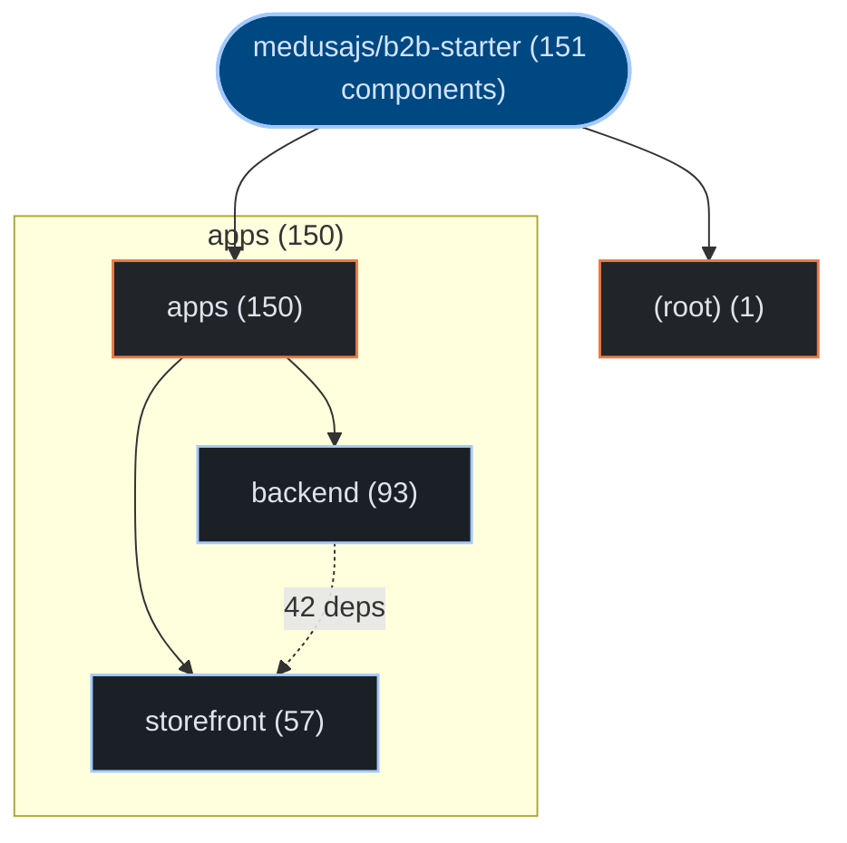
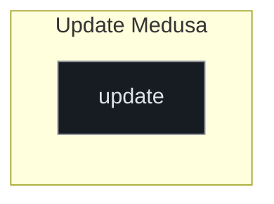

# Repository Architecture Analysis: medusajs/b2b-starter

## Metadata
- **SHA**: `1adccbfec3defd5a6be217eb83955d1fcbf82be9`
- **Primary Ecosystem**: JavaScript/TypeScript

## Quality Metrics
- **ast_engine**: tree-sitter
- **avg_cognitive_complexity**: 2.04
- **avg_cyclomatic_complexity**: 2.82
- **component_count**: 151
- **dead_code_count**: 3
- **dead_code_symbols**: 3 entry(ies)
- **duplication_pct**: 78.91
- **file_complexities**: 25 entry(ies)
- **files_analyzed**: 627
- **fitness_passed**: False
- **fitness_violation_count**: 3
- **framework**: Next.js
- **import_edges**: 100 entry(ies)
- **loc**: 38447
- **max_cognitive_complexity**: 56
- **max_cyclomatic_complexity**: 43
- **sloc**: 34012
- **test_file_count**: 3

# Architecture: medusajs/b2b-starter

## Context
- **Repository**: `medusajs/b2b-starter`
- **SHA**: `1adccbfec3defd5a6be217eb83955d1fcbf82be9`
- **Ecosystem**: JavaScript/TypeScript
- **Framework**: Next.js

## Building Block View

## Component Details

Showing top 60 representative components out of 151 across 2 module group(s):

- **Module `apps`** (150 components — UI_COMPONENT: 113, API_ROUTE: 32, SERVICE: 3)
- **Module `(root)`** (1 components — MODULE: 1)

- **CompanyActionsMenu** (`apps/backend/src/admin/routes/companies/components/company-actions-menu.tsx`): UI_COMPONENT (deps: API_[customerGroupId]_route, API_[employeeId]_route, API_[id]_route, API_accept_route, API_api_index, API_approval-settings_route (+113 more))
- **RouteFocusModal** (`apps/backend/src/admin/components/common/modals/route-focus-modal/route-focus-modal.tsx`): UI_COMPONENT (deps: RouteModalForm, RouteModalProvider, StackedModalProvider)
- **ManageItemsSection** (`apps/backend/src/admin/routes/quotes/components/quote-manage/manage-items-section.tsx`): UI_COMPONENT (deps: ManageItemsTable, RouteFocusModal)
- **ManageQuoteForm** (`apps/backend/src/admin/routes/quotes/components/quote-manage/manage-quote-form.tsx`): UI_COMPONENT (deps: ManageItemsSection, RouteFocusModal)
- **ManageQuoteFormSchema** (`apps/backend/src/admin/routes/quotes/components/quote-manage/manage-quote-form.tsx`): UI_COMPONENT (deps: ManageItemsSection, RouteFocusModal)
- **AmountCell** (`apps/backend/src/admin/components/common/table/table-cells/amount-cell.tsx`): UI_COMPONENT (deps: PlaceholderCell)
- **CompanyCreateDrawer** (`apps/backend/src/admin/routes/companies/components/company-create-drawer.tsx`): UI_COMPONENT (deps: CompanyForm)
- **CompanyUpdateDrawer** (`apps/backend/src/admin/routes/companies/components/company-update-drawer.tsx`): UI_COMPONENT (deps: CompanyForm)
- **DateCell** (`apps/backend/src/admin/components/common/table/table-cells/date-cell.tsx`): UI_COMPONENT (deps: PlaceholderCell)
- **DateHeader** (`apps/backend/src/admin/components/common/table/table-cells/date-cell.tsx`): UI_COMPONENT (deps: PlaceholderCell)
- **EmployeeCreateDrawer** (`apps/backend/src/admin/routes/companies/components/employees/employees-create-drawer.tsx`): UI_COMPONENT (deps: EmployeesCreateForm)
- **ProductCell** (`apps/backend/src/admin/components/common/table/table-cells/product-cell.tsx`): UI_COMPONENT (deps: Thumbnail)
- **ProductHeader** (`apps/backend/src/admin/components/common/table/table-cells/product-cell.tsx`): UI_COMPONENT (deps: Thumbnail)
- **QuoteDetailsHeader** (`apps/backend/src/admin/routes/quotes/components/quote-details/quote-details-header.tsx`): UI_COMPONENT (deps: QuoteStatusBadge)
- **RouteModalProvider** (`apps/backend/src/admin/components/common/modals/route-focus-modal/route-modal-provider.tsx`): UI_COMPONENT (deps: RouteModalProviderContext)
- **StackedModalProvider** (`apps/backend/src/admin/components/common/modals/route-focus-modal/stacked-modal-provider.tsx`): UI_COMPONENT (deps: StackedModalContext)
- **TextCell** (`apps/backend/src/admin/components/common/table/table-cells/text-cell.tsx`): UI_COMPONENT (deps: PlaceholderCell)
- **TextHeader** (`apps/backend/src/admin/components/common/table/table-cells/text-cell.tsx`): UI_COMPONENT (deps: PlaceholderCell)
- **@b2b-starter/backend** (`apps/backend/package.json`): MODULE
- **@b2b-starter/storefront** (`apps/storefront/package.json`): MODULE
- **API_[customerGroupId]_route** (`apps/backend/src/api/admin/companies/[id]/customer-group/[customerGroupId]/route.ts`): API_ROUTE
- **API_[employeeId]_route** (`apps/backend/src/api/admin/companies/[id]/employees/[employeeId]/route.ts`): API_ROUTE
- **API_[employeeId]_route** (`apps/backend/src/api/store/companies/[id]/employees/[employeeId]/route.ts`): API_ROUTE
- **API_[id]_route** (`apps/backend/src/api/admin/approvals/[id]/route.ts`): API_ROUTE
- **API_[id]_route** (`apps/backend/src/api/admin/companies/[id]/route.ts`): API_ROUTE
- **API_[id]_route** (`apps/backend/src/api/admin/quotes/[id]/route.ts`): API_ROUTE
- **API_[id]_route** (`apps/backend/src/api/store/approvals/[id]/route.ts`): API_ROUTE
- **API_[id]_route** (`apps/backend/src/api/store/companies/[id]/route.ts`): API_ROUTE
- **API_[id]_route** (`apps/backend/src/api/store/quotes/[id]/route.ts`): API_ROUTE
- **API_accept_route** (`apps/backend/src/api/store/quotes/[id]/accept/route.ts`): API_ROUTE
- **API_api_index** (`apps/backend/src/admin/hooks/api/index.ts`): API_ROUTE
- **API_approval-settings_route** (`apps/backend/src/api/admin/companies/[id]/approval-settings/route.ts`): API_ROUTE
- **API_approval-settings_route** (`apps/backend/src/api/store/companies/[id]/approval-settings/route.ts`): API_ROUTE
- **API_approvals_route** (`apps/backend/src/api/admin/approvals/route.ts`): API_ROUTE
- **API_approvals_route** (`apps/backend/src/api/store/approvals/route.ts`): API_ROUTE
- **API_approvals_route** (`apps/backend/src/api/store/carts/[id]/approvals/route.ts`): API_ROUTE
- **API_bulk_route** (`apps/backend/src/api/store/carts/[id]/line-items/bulk/route.ts`): API_ROUTE
- **API_companies_route** (`apps/backend/src/api/admin/companies/route.ts`): API_ROUTE
- **API_companies_route** (`apps/backend/src/api/store/companies/route.ts`): API_ROUTE
- **API_customer-group_route** (`apps/backend/src/api/admin/companies/[id]/customer-group/route.ts`): API_ROUTE
- **API_employees_route** (`apps/backend/src/api/admin/companies/[id]/employees/route.ts`): API_ROUTE
- **API_employees_route** (`apps/backend/src/api/store/companies/[id]/employees/route.ts`): API_ROUTE
- **API_messages_route** (`apps/backend/src/api/admin/quotes/[id]/messages/route.ts`): API_ROUTE
- **API_messages_route** (`apps/backend/src/api/store/quotes/[id]/messages/route.ts`): API_ROUTE
- **API_payment-return_route** (`apps/storefront/src/app/api/payment-return/route.ts`): API_ROUTE
- **API_preview_route** (`apps/backend/src/api/store/quotes/[id]/preview/route.ts`): API_ROUTE
- **API_prices_route** (`apps/backend/src/api/store/free-shipping/prices/route.ts`): API_ROUTE
- **API_quotes_route** (`apps/backend/src/api/admin/quotes/route.ts`): API_ROUTE
- **API_quotes_route** (`apps/backend/src/api/store/quotes/route.ts`): API_ROUTE
- **API_reject_route** (`apps/backend/src/api/admin/quotes/[id]/reject/route.ts`): API_ROUTE
- **API_reject_route** (`apps/backend/src/api/store/quotes/[id]/reject/route.ts`): API_ROUTE
- **API_send_route** (`apps/backend/src/api/admin/quotes/[id]/send/route.ts`): API_ROUTE
- **AccountButton** (`apps/storefront/src/modules/account/components/account-button/index.tsx`): UI_COMPONENT
- **ActionMenu** (`apps/backend/src/admin/components/common/action-menu.tsx`): UI_COMPONENT
- **AmountCell** (`apps/storefront/src/modules/common/components/amount-cell/index.tsx`): UI_COMPONENT
- **ApprovalActions** (`apps/backend/src/admin/routes/approvals/components/approval-actions.tsx`): UI_COMPONENT
- **ApprovalModuleService** (`apps/backend/src/modules/approval/service.ts`): SERVICE
- **ApprovalsTable** (`apps/backend/src/admin/routes/approvals/components/approvals-table.tsx`): UI_COMPONENT
- **CartButton** (`apps/storefront/src/modules/cart/components/cart-button/index.tsx`): UI_COMPONENT
- **CartProvider** (`apps/storefront/src/lib/context/cart-context.tsx`): UI_COMPONENT

## 6-Dimension Repository Scorecard

- **Overall Grade**: `C` (73.50/100)
- **Technical Debt Score**: 26.50
- **Estimated Remediation Effort**: 32.66h

| Dimension | Grade | Score | Weight | Details |
| :--- | :---: | :---: | :---: | :--- |
| Code Quality | `F` | 44.00 | 0.20 | avg_cc=2.82, max_cc=43, duplication=78.91%, dead_code=3 |
| Dependency Health | `A` | 100.00 | 0.15 | dependencies=1795, outdated=0, vulnerable=0, has_lockfile=True |
| Maintainability | `F` | 47.00 | 0.15 | avg_cognitive=2.04, max_cognitive=56, fitness_violations=3, oversized_files=2 |
| Pipeline Health | `A` | 97.00 | 0.15 | workflows=1, operational_antipatterns=1, parallel_branches=False |
| Security | `B` | 88.00 | 0.20 | vulnerabilities=0, secrets=0, pipeline_security_findings=1 |
| Test Coverage | `C` | 70.00 | 0.15 | coverage=unavailable, ci_test_job=False, test_files_detected=True |

## Architecture Fitness & Workspace Boundaries

- **[MEDIUM] `ATRUSS-ARCH-005` (COMPLEXITY_THRESHOLD)**: Repository duplication_pct (78.91) exceeds policy threshold (15.0).
- **[MEDIUM] `ATRUSS-ARCH-005` (COMPLEXITY_THRESHOLD)**: Repository max_cognitive_complexity (56.0) exceeds policy threshold (25.0).
- **[MEDIUM] `ATRUSS-ARCH-005` (COMPLEXITY_THRESHOLD)**: Repository max_cyclomatic_complexity (43.0) exceeds policy threshold (20.0).

### Workspace Packages
- **@b2b-starter/backend** (`apps/backend`, react_ts_js, pnpm)
- **@b2b-starter/storefront** (`apps/storefront`, react_ts_js, pnpm)

## Supply Chain Dependencies, Vulnerabilities & Secrets

- **Dependencies Parsed**: 1795 | **Vulnerabilities**: 0 | **Secrets**: 0

### Inventory Sample
- `@adyen/adyen-web` `6.46.0` (npm, `apps/storefront/package.json`)
- `@adyen/adyen-web` `6.48.0` (npm, `pnpm-lock.yaml`)
- `@babel/core` `7.17.5` (npm, `apps/storefront/package.json`)
- `@babel/core` `7.28.5` (npm, `pnpm-lock.yaml`)
- `@babel/core` `7.29.7` (npm, `pnpm-lock.yaml`)
- `@headlessui/react` `2.2.0` (npm, `apps/storefront/package.json`)
- `@headlessui/react` `2.2.9` (npm, `pnpm-lock.yaml`)
- `@hookform/resolvers` `3.10.0` (npm, `pnpm-lock.yaml`)
- `@hookform/resolvers` `3.9.0` (npm, `apps/storefront/package.json`)
- `@hookform/resolvers` `5.5.7` (npm, `apps/backend/package.json`)
- `@hookform/resolvers` `5.5.7` (npm, `pnpm-lock.yaml`)
- `@hookform/resolvers` `6.0.0` (npm, `pnpm-lock.yaml`)
- `@medusajs/admin-sdk` `2.22.7` (npm, `apps/backend/package.json`)
- `@medusajs/admin-sdk` `2.22.7` (npm, `pnpm-lock.yaml`)
- `@medusajs/admin-shared` `2.22.7` (npm, `apps/backend/package.json`)
- `@medusajs/admin-shared` `2.22.7` (npm, `pnpm-lock.yaml`)
- `@medusajs/cli` `2.22.7` (npm, `apps/backend/package.json`)
- `@medusajs/cli` `2.22.7` (npm, `pnpm-lock.yaml`)
- `@medusajs/dashboard` `2.22.7` (npm, `apps/backend/package.json`)
- `@medusajs/dashboard` `2.22.7` (npm, `pnpm-lock.yaml`)
- `@medusajs/eslint-plugin` `2.22.7` (npm, `package.json`)
- `@medusajs/eslint-plugin` `2.22.7` (npm, `pnpm-lock.yaml`)
- `@medusajs/framework` `2.22.7` (npm, `apps/backend/package.json`)
- `@medusajs/framework` `2.22.7` (npm, `pnpm-lock.yaml`)
- `@medusajs/icons` `2.22.2` (npm, `pnpm-lock.yaml`)
- `@medusajs/icons` `2.22.7` (npm, `apps/backend/package.json`)
- `@medusajs/icons` `2.22.7` (npm, `apps/storefront/package.json`)
- `@medusajs/icons` `2.22.7` (npm, `pnpm-lock.yaml`)
- `@medusajs/instantsearch-adapter` `2.22.7` (npm, `apps/storefront/package.json`)
- `@medusajs/instantsearch-adapter` `2.22.7` (npm, `pnpm-lock.yaml`)
- ... (+1765 more dependencies)

## CI/CD Pipeline Topology

