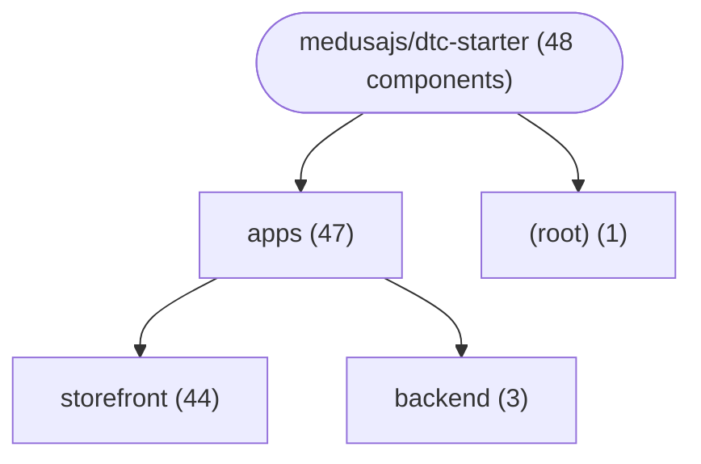
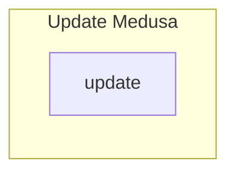

# Repository Architecture Analysis: medusajs/dtc-starter

## Metadata
- **SHA**: `44f2979627d8b9dac3336ee039a99a433f4c3123`
- **Primary Ecosystem**: JavaScript/TypeScript

## Quality Metrics
- **ast_engine**: tree-sitter
- **avg_cognitive_complexity**: 2.6
- **avg_cyclomatic_complexity**: 3.3
- **component_count**: 48
- **dead_code_count**: 1
- **dead_code_symbols**: 1 entry(ies)
- **duplication_pct**: 71.7
- **file_complexities**: 25 entry(ies)
- **files_analyzed**: 290
- **fitness_passed**: False
- **fitness_violation_count**: 3
- **framework**: Next.js
- **import_edges**: 100 entry(ies)
- **loc**: 20696
- **max_cognitive_complexity**: 46
- **max_cyclomatic_complexity**: 35
- **sloc**: 18116

# Architecture: medusajs/dtc-starter

## Context
- **Repository**: `medusajs/dtc-starter`
- **SHA**: `44f2979627d8b9dac3336ee039a99a433f4c3123`
- **Ecosystem**: JavaScript/TypeScript
- **Framework**: Next.js

## Building Block View

## Component Details
- **@dtc/backend** (`apps/backend/package.json`): MODULE
- **@dtc/storefront** (`apps/storefront/package.json`): MODULE
- **dtc-starter-monorepo** (`package.json`): MODULE
- **API_custom_route** (`apps/backend/src/api/admin/custom/route.ts`): API_ROUTE
- **API_custom_route** (`apps/backend/src/api/store/custom/route.ts`): API_ROUTE
- **RootLayout** (`apps/storefront/src/app/layout.tsx`): UI_COMPONENT
- **NotFound** (`apps/storefront/src/app/not-found.tsx`): UI_COMPONENT
- **CheckoutLayout** (`apps/storefront/src/app/[countryCode]/(checkout)/layout.tsx`): UI_COMPONENT
- **NotFound** (`apps/storefront/src/app/[countryCode]/(main)/not-found.tsx`): UI_COMPONENT
- **Loading** (`apps/storefront/src/app/[countryCode]/(main)/account/loading.tsx`): UI_COMPONENT
- **Default** (`apps/storefront/src/app/[countryCode]/(main)/account/@dashboard/default.tsx`): UI_COMPONENT
- **Loading** (`apps/storefront/src/app/[countryCode]/(main)/account/@dashboard/loading.tsx`): UI_COMPONENT
- **Login** (`apps/storefront/src/app/[countryCode]/(main)/account/@login/page.tsx`): UI_COMPONENT
- **Loading** (`apps/storefront/src/app/[countryCode]/(main)/cart/loading.tsx`): UI_COMPONENT
- **NotFound** (`apps/storefront/src/app/[countryCode]/(main)/cart/not-found.tsx`): UI_COMPONENT
- **ContactPage** (`apps/storefront/src/app/[countryCode]/(main)/contact/page.tsx`): UI_COMPONENT
- **Loading** (`apps/storefront/src/app/[countryCode]/(main)/order/[id]/confirmed/loading.tsx`): UI_COMPONENT
- **PrivacyPage** (`apps/storefront/src/app/[countryCode]/(main)/privacy/page.tsx`): UI_COMPONENT
- **TermsPage** (`apps/storefront/src/app/[countryCode]/(main)/terms/page.tsx`): UI_COMPONENT
- **VerifyAccountPage** (`apps/storefront/src/app/[countryCode]/(main)/verify-account/page.tsx`): UI_COMPONENT
- **API_payment-return_route** (`apps/storefront/src/app/api/payment-return/route.ts`): API_ROUTE
- **ModalProvider** (`apps/storefront/src/lib/context/modal-context.tsx`): UI_COMPONENT
- **TransferRequestForm** (`apps/storefront/src/modules/account/components/transfer-request-form/index.tsx`): UI_COMPONENT
- **CategoryTemplate** (`apps/storefront/src/modules/categories/templates/index.tsx`): UI_COMPONENT
- **StripePaymentContainer** (`apps/storefront/src/modules/checkout/components/payment-container/index.tsx`): UI_COMPONENT (deps: StripeContext)
- **StripeContext** (`apps/storefront/src/modules/checkout/components/payment-wrapper/stripe-wrapper.tsx`): UI_COMPONENT
- **SubmitButton** (`apps/storefront/src/modules/checkout/components/submit-button/index.tsx`): UI_COMPONENT
- **CollectionTemplate** (`apps/storefront/src/modules/collections/templates/index.tsx`): UI_COMPONENT
- **Text** (`apps/storefront/src/modules/common/components/ui/index.tsx`): UI_COMPONENT
- **Heading** (`apps/storefront/src/modules/common/components/ui/index.tsx`): UI_COMPONENT
- **Button** (`apps/storefront/src/modules/common/components/ui/index.tsx`): UI_COMPONENT
- **Container** (`apps/storefront/src/modules/common/components/ui/index.tsx`): UI_COMPONENT
- **Badge** (`apps/storefront/src/modules/common/components/ui/index.tsx`): UI_COMPONENT
- **IconBadge** (`apps/storefront/src/modules/common/components/ui/index.tsx`): UI_COMPONENT
- **IconButton** (`apps/storefront/src/modules/common/components/ui/index.tsx`): UI_COMPONENT
- **Label** (`apps/storefront/src/modules/common/components/ui/index.tsx`): UI_COMPONENT
- **Input** (`apps/storefront/src/modules/common/components/ui/index.tsx`): UI_COMPONENT
- **Table** (`apps/storefront/src/modules/common/components/ui/index.tsx`): UI_COMPONENT
- **RadioGroup** (`apps/storefront/src/modules/common/components/ui/index.tsx`): UI_COMPONENT
- **Checkbox** (`apps/storefront/src/modules/common/components/ui/index.tsx`): UI_COMPONENT
- **PolicyPage** (`apps/storefront/src/modules/policies/templates/index.tsx`): UI_COMPONENT
- **PoliciesUnavailable** (`apps/storefront/src/modules/policies/templates/index.tsx`): UI_COMPONENT
- **ShippingSummary** (`apps/storefront/src/modules/policies/templates/index.tsx`): UI_COMPONENT
- **PlaceholderNotice** (`apps/storefront/src/modules/policies/templates/index.tsx`): UI_COMPONENT
- **ProductActions** (`apps/storefront/src/modules/products/components/product-actions/index.tsx`): UI_COMPONENT
- **ProductPrice** (`apps/storefront/src/modules/products/components/product-price/index.tsx`): UI_COMPONENT
- **ShippingPriceNudge** (`apps/storefront/src/modules/shipping/components/free-shipping-price-nudge/index.tsx`): UI_COMPONENT
- **Pagination** (`apps/storefront/src/modules/store/components/pagination/index.tsx`): UI_COMPONENT

## 6-Dimension Repository Scorecard

- **Overall Grade**: `C` (70.31/100)
- **Technical Debt Score**: 29.69
- **Estimated Remediation Effort**: 30.01h

| Dimension | Grade | Score | Weight | Details |
| :--- | :---: | :---: | :---: | :--- |
| Code Quality | `F` | 46.80 | 0.20 | avg_cc=3.30, max_cc=35, duplication=71.70%, dead_code=1 |
| Dependency Health | `A` | 100.00 | 0.15 | dependencies=1730, outdated=0, vulnerable=0, has_lockfile=True |
| Maintainability | `F` | 52.00 | 0.15 | avg_cognitive=2.60, max_cognitive=46, fitness_violations=3, oversized_files=1 |
| Pipeline Health | `A` | 97.00 | 0.15 | workflows=1, operational_antipatterns=1, parallel_branches=False |
| Security | `B` | 88.00 | 0.20 | vulnerabilities=0, secrets=0, pipeline_security_findings=1 |
| Test Coverage | `F` | 40.00 | 0.15 | coverage=unavailable, ci_test_job=False, test_files_detected=False |

## Architecture Fitness & Workspace Boundaries

- **[MEDIUM] `ATRUSS-ARCH-005` (COMPLEXITY_THRESHOLD)**: Repository duplication_pct (71.7) exceeds policy threshold (15.0).
- **[MEDIUM] `ATRUSS-ARCH-005` (COMPLEXITY_THRESHOLD)**: Repository max_cognitive_complexity (46.0) exceeds policy threshold (25.0).
- **[MEDIUM] `ATRUSS-ARCH-005` (COMPLEXITY_THRESHOLD)**: Repository max_cyclomatic_complexity (35.0) exceeds policy threshold (20.0).

### Workspace Packages
- **@dtc/backend** (`apps/backend`, react_ts_js, pnpm)
- **@dtc/storefront** (`apps/storefront`, react_ts_js, pnpm)

## Supply Chain Dependencies, Vulnerabilities & Secrets

- **Dependencies Parsed**: 1730 | **Vulnerabilities**: 0 | **Secrets**: 0

### Inventory Sample
- `@adyen/adyen-web` `6.46.0` (npm, `apps/storefront/package.json`)
- `@adyen/adyen-web` `6.48.0` (npm, `pnpm-lock.yaml`)
- `@babel/core` `7.17.5` (npm, `apps/storefront/package.json`)
- `@babel/core` `7.29.7` (npm, `pnpm-lock.yaml`)
- `@headlessui/react` `2.2.0` (npm, `apps/storefront/package.json`)
- `@headlessui/react` `2.2.10` (npm, `pnpm-lock.yaml`)
- `@medusajs/admin-sdk` `2.22.7` (npm, `apps/backend/package.json`)
- `@medusajs/admin-sdk` `2.22.7` (npm, `pnpm-lock.yaml`)
- `@medusajs/admin-shared` `2.22.7` (npm, `apps/backend/package.json`)
- `@medusajs/admin-shared` `2.22.7` (npm, `pnpm-lock.yaml`)
- `@medusajs/caching` `2.22.7` (npm, `apps/backend/package.json`)
- `@medusajs/caching` `2.22.7` (npm, `pnpm-lock.yaml`)
- `@medusajs/cli` `2.22.7` (npm, `apps/backend/package.json`)
- `@medusajs/cli` `2.22.7` (npm, `pnpm-lock.yaml`)
- `@medusajs/dashboard` `2.22.7` (npm, `apps/backend/package.json`)
- `@medusajs/dashboard` `2.22.7` (npm, `pnpm-lock.yaml`)
- `@medusajs/draft-order` `2.22.7` (npm, `apps/backend/package.json`)
- `@medusajs/draft-order` `2.22.7` (npm, `pnpm-lock.yaml`)
- `@medusajs/eslint-plugin` `2.22.7` (npm, `package.json`)
- `@medusajs/eslint-plugin` `2.22.7` (npm, `pnpm-lock.yaml`)
- `@medusajs/framework` `2.22.7` (npm, `apps/backend/package.json`)
- `@medusajs/framework` `2.22.7` (npm, `pnpm-lock.yaml`)
- `@medusajs/icons` `2.22.2` (npm, `pnpm-lock.yaml`)
- `@medusajs/icons` `2.22.7` (npm, `apps/storefront/package.json`)
- `@medusajs/icons` `2.22.7` (npm, `pnpm-lock.yaml`)
- `@medusajs/instantsearch-adapter` `2.22.7` (npm, `apps/storefront/package.json`)
- `@medusajs/instantsearch-adapter` `2.22.7` (npm, `pnpm-lock.yaml`)
- `@medusajs/js-sdk` `2.22.7` (npm, `apps/storefront/package.json`)
- `@medusajs/js-sdk` `2.22.7` (npm, `pnpm-lock.yaml`)
- `@medusajs/medusa` `2.22.7` (npm, `apps/backend/package.json`)
- ... (+1700 more dependencies)

## CI/CD Pipeline Topology

