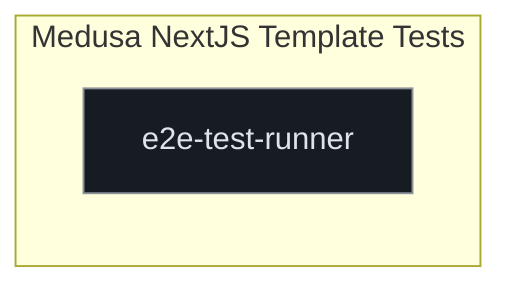

# Repository Architecture Analysis: medusajs/examples

## Metadata
- **SHA**: `aae76657952903750dfcaaaf28b6746f20ab1af5`
- **Primary Ecosystem**: JavaScript/TypeScript

## Quality Metrics
- **ast_engine**: tree-sitter
- **avg_cognitive_complexity**: 2.14
- **avg_cyclomatic_complexity**: 2.77
- **component_count**: 72
- **dead_code_count**: 0
- **dead_code_symbols**: 0 entry(ies)
- **duplication_pct**: 71.76
- **file_complexities**: 25 entry(ies)
- **files_analyzed**: 309
- **fitness_passed**: False
- **fitness_violation_count**: 3
- **framework**: Next.js
- **import_edges**: 100 entry(ies)
- **loc**: 23782
- **max_cognitive_complexity**: 66
- **max_cyclomatic_complexity**: 40
- **sloc**: 21581
- **test_file_count**: 56

# Architecture: medusajs/examples

## Context
- **Repository**: `medusajs/examples`
- **SHA**: `aae76657952903750dfcaaaf28b6746f20ab1af5`
- **Ecosystem**: JavaScript/TypeScript
- **Framework**: Next.js

## Building Block View

```mermaid
graph TD;
  classDef atlasRoot fill:#004882,stroke:#a3c9ff,stroke-width:2px,color:#d3e4ff
  classDef atlasCategory fill:#212428,stroke:#E87A48,stroke-width:1.5px,color:#dfe3eb
  classDef atlasWorkflow fill:#1b2026,stroke:#a3c9ff,stroke-width:1.5px,color:#dfe3eb
  classDef atlasJob fill:#171c22,stroke:#8d9199,stroke-width:1px,color:#dfe3eb
  classDef atlasTarget fill:#005227,stroke:#8bd99b,stroke-width:1.5px,color:#a7f6b6
  classDef atlasAlert fill:#93000a,stroke:#ffb4ab,stroke-width:1.5px,color:#ffdad6
  classDef atlasMore fill:#252a31,stroke:#8d9199,stroke-dasharray:4 4,color:#c3c6cf
    repo_root(["medusajs/examples (72 components)"]):::atlasRoot
    dir_0_customer_tiers["customer-tiers (11)"]:::atlasCategory
    repo_root --> dir_0_customer_tiers
    sub_0_0_src["src (10)"]:::atlasWorkflow
    dir_0_customer_tiers --> sub_0_0_src
    sub_0_1__module_root_["(module root) (1)"]:::atlasWorkflow
    dir_0_customer_tiers --> sub_0_1__module_root_
    dir_1_express_checkout_storefront["express-checkout-storefront (11)"]:::atlasCategory
    repo_root --> dir_1_express_checkout_storefront
    sub_1_0_components["components (7)"]:::atlasWorkflow
    dir_1_express_checkout_storefront --> sub_1_0_components
    sub_1_1_providers["providers (2)"]:::atlasWorkflow
    dir_1_express_checkout_storefront --> sub_1_1_providers
    sub_1_2__module_root_["(module root) (1)"]:::atlasWorkflow
    dir_1_express_checkout_storefront --> sub_1_2__module_root_
    sub_1_more["+1 more submodules (1)"]:::atlasMore
    dir_1_express_checkout_storefront --> sub_1_more
    dir_2_digital_product["digital-product (9)"]:::atlasCategory
    repo_root --> dir_2_digital_product
    sub_2_0_src["src (8)"]:::atlasWorkflow
    dir_2_digital_product --> sub_2_0_src
    sub_2_1__module_root_["(module root) (1)"]:::atlasWorkflow
    dir_2_digital_product --> sub_2_1__module_root_
    dir_3_category_images["category-images (8)"]:::atlasCategory
    repo_root --> dir_3_category_images
    dir_4_agentic_commerce["agentic-commerce (6)"]:::atlasCategory
    repo_root --> dir_4_agentic_commerce
    dir_other_modules["+7 more modules (27)"]:::atlasMore
    repo_root --> dir_other_modules
    sub_1_0_components -.->|"8 deps"| sub_1_1_providers
    sub_1_more -.->|"2 deps"| sub_1_1_providers
```

## Component Details

Showing top 60 representative components out of 72 across 12 module group(s):

- **Module `customer-tiers`** (11 components — UI_COMPONENT: 5, API_ROUTE: 4, MODULE: 1)
- **Module `express-checkout-storefront`** (11 components — UI_COMPONENT: 10, MODULE: 1)
- **Module `digital-product`** (9 components — API_ROUTE: 6, SERVICE: 2, MODULE: 1)
- **Module `category-images`** (8 components — UI_COMPONENT: 4, API_ROUTE: 2, MODULE: 1)
- **Module `agentic-commerce`** (6 components — API_ROUTE: 4, MODULE: 1, SERVICE: 1)
- **Module `bundled-products`** (6 components — API_ROUTE: 4, MODULE: 1, SERVICE: 1)
- **Module `invoice-generator`** (5 components — API_ROUTE: 3, MODULE: 1, SERVICE: 1)
- **Module `algolia-integration`** (4 components — API_ROUTE: 2, MODULE: 1, SERVICE: 1)
- **Module `abandoned-cart`** (3 components — API_ROUTE: 2, MODULE: 1)
- **Module `avalara-integration`** (3 components — API_ROUTE: 2, MODULE: 1)
- **Module `custom-item-price`** (3 components — MODULE: 1, API_ROUTE: 1, SERVICE: 1)
- **Module `first-purchase-discount`** (3 components — API_ROUTE: 2, MODULE: 1)

- **API_preview_route** (`digital-product/src/api/store/digital-products/[id]/preview/route.ts`): API_ROUTE (deps: DigitalProductFulfillmentService, DigitalProductModuleService)
- **Address** (`express-checkout-storefront/components/Address/index.tsx`): UI_COMPONENT (deps: CartProvider, RegionProvider)
- **CategoryMediaModal** (`category-images/src/admin/components/category-media/category-media-modal.tsx`): UI_COMPONENT (deps: CategoryImageGallery, CategoryImageUpload)
- **Layout** (`express-checkout-storefront/app/layout.tsx`): UI_COMPONENT (deps: CartProvider, RegionProvider)
- **Product** (`express-checkout-storefront/components/Product/index.tsx`): UI_COMPONENT (deps: CartProvider, RegionProvider)
- **API_search_route** (`algolia-integration/src/api/store/products/search/route.ts`): API_ROUTE (deps: AlgoliaModuleService)
- **CartProvider** (`express-checkout-storefront/providers/cart.tsx`): UI_COMPONENT (deps: RegionProvider)
- **CategoryImageGallery** (`category-images/src/admin/components/category-media/category-image-gallery.tsx`): UI_COMPONENT (deps: CategoryImageItem)
- **Payment** (`express-checkout-storefront/components/Payment/index.tsx`): UI_COMPONENT (deps: CartProvider)
- **Router** (`express-checkout-storefront/components/Router/index.tsx`): UI_COMPONENT (deps: CartProvider)
- **SecondCol** (`express-checkout-storefront/components/SecondCol/index.tsx`): UI_COMPONENT (deps: RegionProvider)
- **Shipping** (`express-checkout-storefront/components/Shipping/index.tsx`): UI_COMPONENT (deps: CartProvider)
- **TierDetailsSection** (`customer-tiers/src/admin/components/tier-details-section.tsx`): UI_COMPONENT (deps: EditTierDrawer)
- **API_[bundle_id]_route** (`bundled-products/src/api/store/carts/[id]/line-item-bundles/[bundle_id]/route.ts`): API_ROUTE
- **API_[id]_route** (`agentic-commerce/src/api/checkout_sessions/[id]/route.ts`): API_ROUTE
- **API_[id]_route** (`bundled-products/src/api/store/bundle-products/[id]/route.ts`): API_ROUTE
- **API_[id]_route** (`customer-tiers/src/api/admin/tiers/[id]/route.ts`): API_ROUTE
- **API_[type]_route** (`digital-product/src/api/admin/digital-products/upload/[type]/route.ts`): API_ROUTE
- **API_batch_route** (`category-images/src/api/admin/categories/[category_id]/images/batch/route.ts`): API_ROUTE
- **API_bundled-products_route** (`bundled-products/src/api/admin/bundled-products/route.ts`): API_ROUTE
- **API_cancel_route** (`agentic-commerce/src/api/checkout_sessions/[id]/cancel/route.ts`): API_ROUTE
- **API_checkout_sessions_route** (`agentic-commerce/src/api/checkout_sessions/route.ts`): API_ROUTE
- **API_complete-digital_route** (`digital-product/src/api/store/carts/[id]/complete-digital/route.ts`): API_ROUTE
- **API_complete_route** (`agentic-commerce/src/api/checkout_sessions/[id]/complete/route.ts`): API_ROUTE
- **API_custom_route** (`abandoned-cart/src/api/admin/custom/route.ts`): API_ROUTE
- **API_custom_route** (`abandoned-cart/src/api/store/custom/route.ts`): API_ROUTE
- **API_custom_route** (`avalara-integration/src/api/admin/custom/route.ts`): API_ROUTE
- **API_custom_route** (`avalara-integration/src/api/store/custom/route.ts`): API_ROUTE
- **API_custom_route** (`first-purchase-discount/src/api/admin/custom/route.ts`): API_ROUTE
- **API_custom_route** (`first-purchase-discount/src/api/store/custom/route.ts`): API_ROUTE
- **API_customers_route** (`customer-tiers/src/api/admin/tiers/[id]/customers/route.ts`): API_ROUTE
- **API_digital-products_route** (`digital-product/src/api/admin/digital-products/route.ts`): API_ROUTE
- **API_digital-products_route** (`digital-product/src/api/store/customers/me/digital-products/route.ts`): API_ROUTE
- **API_download_route** (`digital-product/src/api/store/customers/me/digital-products/[mediaId]/download/route.ts`): API_ROUTE
- **API_images_route** (`category-images/src/api/admin/categories/[category_id]/images/route.ts`): API_ROUTE
- **API_invoice-config_route** (`invoice-generator/src/api/admin/invoice-config/route.ts`): API_ROUTE
- **API_invoices_route** (`invoice-generator/src/api/admin/orders/[id]/invoices/route.ts`): API_ROUTE
- **API_invoices_route** (`invoice-generator/src/api/store/orders/[id]/invoices/route.ts`): API_ROUTE
- **API_line-item-bundles_route** (`bundled-products/src/api/store/carts/[id]/line-item-bundles/route.ts`): API_ROUTE
- **API_line-items-metals_route** (`custom-item-price/src/api/store/carts/[id]/line-items-metals/route.ts`): API_ROUTE
- **API_next-tier_route** (`customer-tiers/src/api/store/customers/me/next-tier/route.ts`): API_ROUTE
- **API_sync_route** (`algolia-integration/src/api/admin/algolia/sync/route.ts`): API_ROUTE
- **API_tiers_route** (`customer-tiers/src/api/admin/tiers/route.ts`): API_ROUTE
- **AgenticCommerceService** (`agentic-commerce/src/modules/agentic-commerce/service.ts`): SERVICE
- **AlgoliaModuleService** (`algolia-integration/src/modules/algolia/service.ts`): SERVICE
- **BundledProductModuleService** (`bundled-products/src/modules/bundled-product/service.ts`): SERVICE
- **Card** (`express-checkout-storefront/components/Card/index.tsx`): UI_COMPONENT
- **CategoryImageItem** (`category-images/src/admin/components/category-media/category-image-item.tsx`): UI_COMPONENT
- **CategoryImageUpload** (`category-images/src/admin/components/category-media/category-image-upload.tsx`): UI_COMPONENT
- **CreateTierModal** (`customer-tiers/src/admin/components/create-tier-modal.tsx`): UI_COMPONENT
- **DigitalProductFulfillmentService** (`digital-product/src/modules/digital-product-fulfillment/service.ts`): SERVICE
- **DigitalProductModuleService** (`digital-product/src/modules/digital-product/service.ts`): SERVICE
- **EditTierDrawer** (`customer-tiers/src/admin/components/edit-tier-drawer.tsx`): UI_COMPONENT
- **InvoiceGeneratorService** (`invoice-generator/src/modules/invoice-generator/service.ts`): SERVICE
- **MetalPricesModuleService** (`custom-item-price/src/modules/metal-prices/service.ts`): SERVICE
- **ProductMediaModuleService** (`category-images/src/modules/product-media/service.ts`): SERVICE
- **RegionProvider** (`express-checkout-storefront/providers/region.tsx`): UI_COMPONENT
- **TierCustomersTable** (`customer-tiers/src/admin/components/tier-customers-table.tsx`): UI_COMPONENT
- **TierModuleService** (`customer-tiers/src/modules/tier/service.ts`): SERVICE
- **TierRulesTable** (`customer-tiers/src/admin/components/tier-rules-table.tsx`): UI_COMPONENT

## 6-Dimension Repository Scorecard

- **Overall Grade**: `F` (55.90/100)
- **Technical Debt Score**: 44.10
- **Estimated Remediation Effort**: 47.38h

| Dimension | Grade | Score | Weight | Details |
| :--- | :---: | :---: | :---: | :--- |
| Code Quality | `F` | 50.00 | 0.20 | avg_cc=2.77, max_cc=40, duplication=71.76%, dead_code=0 |
| Dependency Health | `B` | 85.00 | 0.15 | dependencies=1147, outdated=0, vulnerable=0, has_lockfile=False |
| Maintainability | `F` | 57.00 | 0.15 | avg_cognitive=2.14, max_cognitive=66, fitness_violations=3, oversized_files=0 |
| Pipeline Health | `A` | 94.00 | 0.15 | workflows=1, operational_antipatterns=1, parallel_branches=False |
| Security | `F` | 0.00 | 0.20 | vulnerabilities=0, secrets=0, pipeline_security_findings=9 |
| Test Coverage | `C` | 70.00 | 0.15 | coverage=unavailable, ci_test_job=True, test_files_detected=True |

## Architecture Fitness & Workspace Boundaries

- **[MEDIUM] `ATRUSS-ARCH-005` (COMPLEXITY_THRESHOLD)**: Repository duplication_pct (71.76) exceeds policy threshold (15.0).
- **[MEDIUM] `ATRUSS-ARCH-005` (COMPLEXITY_THRESHOLD)**: Repository max_cognitive_complexity (66.0) exceeds policy threshold (25.0).
- **[MEDIUM] `ATRUSS-ARCH-005` (COMPLEXITY_THRESHOLD)**: Repository max_cyclomatic_complexity (40.0) exceeds policy threshold (20.0).

## Supply Chain Dependencies, Vulnerabilities & Secrets

- **Dependencies Parsed**: 1147 | **Vulnerabilities**: 0 | **Secrets**: 0

### Inventory Sample
- `@babel/core` `7.17.5` (npm, `order-gift-message/storefront/package.json`)
- `@babel/core` `7.17.5` (npm, `payload-integration/storefront/package.json`)
- `@babel/core` `7.17.5` (npm, `returns-storefront/package.json`)
- `@babel/core` `7.17.5` (npm, `sanity-integration/storefront/package.json`)
- `@babel/core` `7.17.5` (npm, `stripe-saved-payment/storefront/package.json`)
- `@babel/core` `7.17.5` (npm, `ticket-booking/storefront/package.json`)
- `@contentful/node-apps-toolkit` `3.13.0` (npm, `localization-contentful/package.json`)
- `@eslint/eslintrc` `3` (npm, `express-checkout-storefront/package.json`)
- `@expo/vector-icons` `15.0.3` (npm, `react-native-expo/package.json`)
- `@headlessui/react` `2.2.0` (npm, `order-gift-message/storefront/package.json`)
- `@headlessui/react` `2.2.0` (npm, `payload-integration/storefront/package.json`)
- `@headlessui/react` `2.2.0` (npm, `returns-storefront/package.json`)
- `@headlessui/react` `2.2.0` (npm, `sanity-integration/storefront/package.json`)
- `@headlessui/react` `2.2.0` (npm, `stripe-saved-payment/storefront/package.json`)
- `@headlessui/react` `2.2.0` (npm, `ticket-booking/storefront/package.json`)
- `@mailchimp/mailchimp_marketing` `3.0.80` (npm, `mailchimp-integration/package.json`)
- `@medusajs/admin-sdk` `2.13.5` (npm, `paypal-integration/package.json`)
- `@medusajs/admin-sdk` `2.13.5` (npm, `quotes-management/package.json`)
- `@medusajs/admin-sdk` `2.14.0` (npm, `abandoned-cart/package.json`)
- `@medusajs/admin-sdk` `2.14.0` (npm, `agentic-commerce/package.json`)
- `@medusajs/admin-sdk` `2.14.0` (npm, `algolia-integration/package.json`)
- `@medusajs/admin-sdk` `2.14.0` (npm, `avalara-integration/package.json`)
- `@medusajs/admin-sdk` `2.14.0` (npm, `bundled-products/package.json`)
- `@medusajs/admin-sdk` `2.14.0` (npm, `category-images/package.json`)
- `@medusajs/admin-sdk` `2.14.0` (npm, `customer-tiers/package.json`)
- `@medusajs/admin-sdk` `2.14.0` (npm, `digital-product/package.json`)
- `@medusajs/admin-sdk` `2.14.0` (npm, `first-purchase-discount/package.json`)
- `@medusajs/admin-sdk` `2.14.0` (npm, `invoice-generator/package.json`)
- `@medusajs/admin-sdk` `2.14.0` (npm, `localization-contentful/package.json`)
- `@medusajs/admin-sdk` `2.14.0` (npm, `loyalty-points/package.json`)
- ... (+1117 more dependencies)

## CI/CD Pipeline Topology

