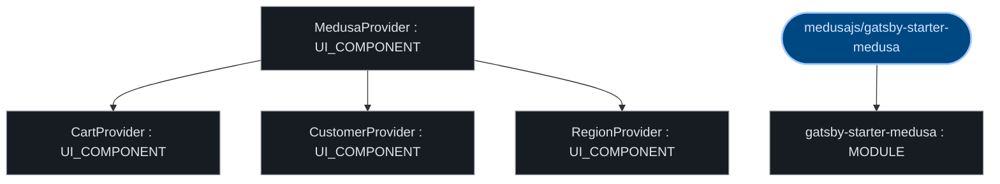

# Repository Architecture Analysis: medusajs/gatsby-starter-medusa

## Metadata
- **SHA**: `7646c316389d911d3e97f5b3f37ad5f6051f371e`
- **Primary Ecosystem**: JavaScript/TypeScript

## Quality Metrics
- **ast_engine**: tree-sitter
- **avg_cognitive_complexity**: 4.14
- **avg_cyclomatic_complexity**: 3.09
- **component_count**: 5
- **dead_code_count**: 0
- **dead_code_symbols**: 0 entry(ies)
- **duplication_pct**: 77.75
- **file_complexities**: 25 entry(ies)
- **files_analyzed**: 121
- **fitness_passed**: False
- **fitness_violation_count**: 3
- **framework**: React (Vite)
- **import_edges**: 100 entry(ies)
- **loc**: 6988
- **max_cognitive_complexity**: 39
- **max_cyclomatic_complexity**: 22
- **sloc**: 6283

# Architecture: medusajs/gatsby-starter-medusa

## Context
- **Repository**: `medusajs/gatsby-starter-medusa`
- **SHA**: `7646c316389d911d3e97f5b3f37ad5f6051f371e`
- **Ecosystem**: JavaScript/TypeScript
- **Framework**: React (Vite)

## Building Block View

## Component Details
- **gatsby-starter-medusa** (`package.json`): MODULE
- **CartProvider** (`src/context/cart-context.js`): UI_COMPONENT
- **CustomerProvider** (`src/context/customer-context.js`): UI_COMPONENT
- **MedusaProvider** (`src/context/medusa-context.js`): UI_COMPONENT (deps: CartProvider, CustomerProvider, RegionProvider)
- **RegionProvider** (`src/context/region-context.js`): UI_COMPONENT

## 6-Dimension Repository Scorecard

- **Overall Grade**: `D` (66.13/100)
- **Technical Debt Score**: 33.87
- **Estimated Remediation Effort**: 28.52h

| Dimension | Grade | Score | Weight | Details |
| :--- | :---: | :---: | :---: | :--- |
| Code Quality | `D` | 64.14 | 0.20 | avg_cc=3.09, max_cc=22, duplication=77.75%, dead_code=0 |
| Dependency Health | `B` | 85.00 | 0.15 | dependencies=30, outdated=0, vulnerable=0, has_lockfile=False |
| Maintainability | `F` | 57.00 | 0.15 | avg_cognitive=4.14, max_cognitive=39, fitness_violations=3, oversized_files=0 |
| Pipeline Health | `F` | 40.00 | 0.15 | workflows=0 |
| Security | `A` | 100.00 | 0.20 | vulnerabilities=0, secrets=0, pipeline_security_findings=0 |
| Test Coverage | `F` | 40.00 | 0.15 | coverage=unavailable, ci_test_job=False, test_files_detected=False |

## Architecture Fitness & Workspace Boundaries

- **[MEDIUM] `ATRUSS-ARCH-005` (COMPLEXITY_THRESHOLD)**: Repository duplication_pct (77.75) exceeds policy threshold (15.0).
- **[MEDIUM] `ATRUSS-ARCH-005` (COMPLEXITY_THRESHOLD)**: Repository max_cognitive_complexity (39.0) exceeds policy threshold (25.0).
- **[MEDIUM] `ATRUSS-ARCH-005` (COMPLEXITY_THRESHOLD)**: Repository max_cyclomatic_complexity (22.0) exceeds policy threshold (20.0).

## Supply Chain Dependencies, Vulnerabilities & Secrets

- **Dependencies Parsed**: 30 | **Vulnerabilities**: 0 | **Secrets**: 0

### Inventory Sample
- `@babel/core` `7.16.0` (npm, `package.json`)
- `@headlessui/react` `1.4.2` (npm, `package.json`)
- `@mdx-js/mdx` `1.6.22` (npm, `package.json`)
- `@mdx-js/react` `1.6.22` (npm, `package.json`)
- `@medusajs/medusa-js` `1.1.1` (npm, `package.json`)
- `@stripe/react-stripe-js` `1.7.0` (npm, `package.json`)
- `@stripe/stripe-js` `1.21.2` (npm, `package.json`)
- `@tailwindcss/forms` `0.4.0` (npm, `package.json`)
- `autoprefixer` `10.4.0` (npm, `package.json`)
- `babel-loader` `8.2.3` (npm, `package.json`)
- `formik` `2.2.9` (npm, `package.json`)
- `gatsby` `4.0.2` (npm, `package.json`)
- `gatsby-plugin-image` `2.0.0` (npm, `package.json`)
- `gatsby-plugin-mdx` `3.3.0` (npm, `package.json`)
- `gatsby-plugin-postcss` `5.0.0` (npm, `package.json`)
- `gatsby-plugin-purgecss` `6.1.0` (npm, `package.json`)
- `gatsby-plugin-react-helmet` `5.0.0` (npm, `package.json`)
- `gatsby-plugin-sharp` `4.0.1` (npm, `package.json`)
- `gatsby-source-filesystem` `4.0.0` (npm, `package.json`)
- `gatsby-source-medusa` `0.0.41` (npm, `package.json`)
- `gatsby-transformer-sharp` `4.0.0` (npm, `package.json`)
- `lodash` `4.17.21` (npm, `package.json`)
- `postcss` `8.4.5` (npm, `package.json`)
- `prettier` `2.4.1` (npm, `package.json`)
- `prop-types` `15.7.2` (npm, `package.json`)
- `react` `17.0.2` (npm, `package.json`)
- `react-dom` `17.0.2` (npm, `package.json`)
- `react-helmet` `6.1.0` (npm, `package.json`)
- `tailwindcss` `3.0.1` (npm, `package.json`)
- `yup` `0.32.11` (npm, `package.json`)

## CI/CD Pipeline Topology

