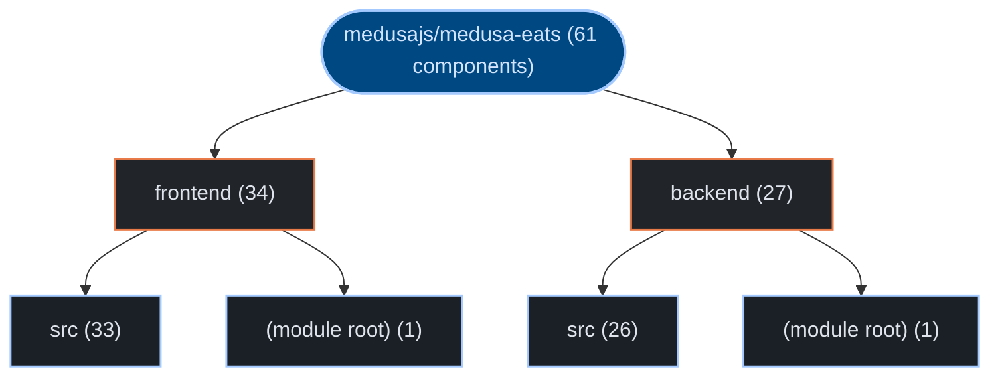

# Repository Architecture Analysis: medusajs/medusa-eats

## Metadata
- **SHA**: `734e7a2fb2d5e2671daaacf2b79fb72fd75073a7`
- **Primary Ecosystem**: JavaScript/TypeScript

## Quality Metrics
- **ast_engine**: tree-sitter
- **avg_cognitive_complexity**: 1.29
- **avg_cyclomatic_complexity**: 2.12
- **component_count**: 61
- **dead_code_count**: 2
- **dead_code_symbols**: 2 entry(ies)
- **duplication_pct**: 83.69
- **file_complexities**: 25 entry(ies)
- **files_analyzed**: 167
- **fitness_passed**: False
- **fitness_violation_count**: 1
- **framework**: Next.js
- **import_edges**: 100 entry(ies)
- **loc**: 9654
- **max_cognitive_complexity**: 17
- **max_cyclomatic_complexity**: 13
- **sloc**: 8625

# Architecture: medusajs/medusa-eats

## Context
- **Repository**: `medusajs/medusa-eats`
- **SHA**: `734e7a2fb2d5e2671daaacf2b79fb72fd75073a7`
- **Ecosystem**: JavaScript/TypeScript
- **Framework**: Next.js

## Building Block View

## Component Details

Showing top 60 representative components out of 61 across 2 module group(s):

- **Module `frontend`** (34 components — UI_COMPONENT: 32, MODULE: 1, API_ROUTE: 1)
- **Module `backend`** (27 components — API_ROUTE: 21, UI_COMPONENT: 3, SERVICE: 2)

- **CartButton** (`frontend/src/components/store/cart/cart-button.tsx`): UI_COMPONENT (deps: CartCounter, CartModal)
- **MenuActions** (`frontend/src/components/dashboard/menu/menu-actions.tsx`): UI_COMPONENT (deps: CreateCategoryDrawer, CreateProductDrawer)
- **CreateProductDrawer** (`frontend/src/components/dashboard/menu/create-product-drawer.tsx`): UI_COMPONENT (deps: CreateProductForm)
- **OrderStatus** (`frontend/src/components/store/order/order-status.tsx`): UI_COMPONENT (deps: LottiePlayer)
- **RestaurantCategories** (`frontend/src/components/store/restaurant/restaurant-categories.tsx`): UI_COMPONENT (deps: DishCard)
- **API_[id]_route** (`backend/src/api/store/deliveries/[id]/route.ts`): API_ROUTE
- **API_[id]_route** (`backend/src/api/store/drivers/[id]/route.ts`): API_ROUTE
- **API_[id]_route** (`backend/src/api/store/restaurants/[id]/route.ts`): API_ROUTE
- **API_accept_route** (`backend/src/api/store/deliveries/[id]/accept/route.ts`): API_ROUTE
- **API_admins_route** (`backend/src/api/store/restaurants/[id]/admins/route.ts`): API_ROUTE
- **API_claim_route** (`backend/src/api/store/deliveries/[id]/claim/route.ts`): API_ROUTE
- **API_complete_route** (`backend/src/api/store/deliveries/[id]/complete/route.ts`): API_ROUTE
- **API_decline_route** (`backend/src/api/store/deliveries/[id]/decline/route.ts`): API_ROUTE
- **API_deliveries_route** (`backend/src/api/store/deliveries/route.ts`): API_ROUTE
- **API_drivers_route** (`backend/src/api/store/drivers/route.ts`): API_ROUTE
- **API_me_route** (`backend/src/api/store/users/me/route.ts`): API_ROUTE
- **API_pass_route** (`backend/src/api/store/deliveries/[id]/pass/route.ts`): API_ROUTE
- **API_pick-up_route** (`backend/src/api/store/deliveries/[id]/pick-up/route.ts`): API_ROUTE
- **API_prepare_route** (`backend/src/api/store/deliveries/[id]/prepare/route.ts`): API_ROUTE
- **API_products_route** (`backend/src/api/store/restaurants/[id]/products/route.ts`): API_ROUTE
- **API_ready_route** (`backend/src/api/store/deliveries/[id]/ready/route.ts`): API_ROUTE
- **API_restaurants_route** (`backend/src/api/store/restaurants/route.ts`): API_ROUTE
- **API_status_route** (`backend/src/api/store/restaurants/[id]/status/route.ts`): API_ROUTE
- **API_subscribe_route** (`backend/src/api/store/deliveries/[id]/subscribe/route.ts`): API_ROUTE
- **API_subscribe_route** (`backend/src/api/store/deliveries/subscribe/route.ts`): API_ROUTE
- **API_subscribe_route** (`frontend/src/app/api/subscribe/route.ts`): API_ROUTE
- **API_users_route** (`backend/src/api/store/users/route.ts`): API_ROUTE
- **BikeIcon** (`backend/src/admin/components/icons.tsx`): UI_COMPONENT
- **BikeIcon** (`frontend/src/components/common/icons.tsx`): UI_COMPONENT
- **CartCounter** (`frontend/src/components/store/cart/cart-counter.tsx`): UI_COMPONENT
- **CartModal** (`frontend/src/components/store/cart/cart-modal.tsx`): UI_COMPONENT
- **CheckoutForm** (`frontend/src/components/store/checkout/checkout-form.tsx`): UI_COMPONENT
- **CreateCategoryDrawer** (`frontend/src/components/dashboard/driver/create-category-drawer.tsx`): UI_COMPONENT
- **CreateCategoryDrawer** (`frontend/src/components/dashboard/menu/create-category-drawer.tsx`): UI_COMPONENT
- **CreateProductForm** (`frontend/src/components/dashboard/menu/create-product-form.tsx`): UI_COMPONENT
- **DeliveryModuleService** (`backend/src/modules/delivery/service.ts`): SERVICE
- **DemoModal** (`frontend/src/components/common/demo-modal.tsx`): UI_COMPONENT
- **DishCard** (`frontend/src/components/store/restaurant/dish-card.tsx`): UI_COMPONENT
- **DriverDeliveryButtons** (`frontend/src/components/dashboard/driver/delivery-buttons.tsx`): UI_COMPONENT
- **Footer** (`frontend/src/components/common/footer.tsx`): UI_COMPONENT
- **LoginForm** (`frontend/src/components/dashboard/login-form.tsx`): UI_COMPONENT
- **LoginPage** (`frontend/src/app/(store)/login/page.tsx`): UI_COMPONENT
- **LottiePlayer** (`frontend/src/components/store/order/lottie-player.tsx`): UI_COMPONENT
- **MenuProductActions** (`frontend/src/components/dashboard/menu/menu-product-actions.tsx`): UI_COMPONENT
- **OrderStatusContentTab** (`frontend/src/components/store/order/order-status-content-tab.tsx`): UI_COMPONENT
- **PizzaIcon** (`backend/src/admin/components/icons.tsx`): UI_COMPONENT
- **PizzaIcon** (`frontend/src/components/common/icons.tsx`): UI_COMPONENT
- **ProfileBadge** (`frontend/src/components/common/profile-badge.tsx`): UI_COMPONENT
- **RealtimeClient** (`frontend/src/components/dashboard/realtime-client.tsx`): UI_COMPONENT
- **RestaurantCategory** (`frontend/src/components/store/restaurant/restaurant-category.tsx`): UI_COMPONENT
- **RestaurantDeliveryButtons** (`frontend/src/components/dashboard/restaurant/delivery-buttons.tsx`): UI_COMPONENT
- **RestaurantModuleService** (`backend/src/modules/restaurant/service.ts`): SERVICE
- **RestaurantStatus** (`frontend/src/components/dashboard/restaurant/restaurant-status.tsx`): UI_COMPONENT
- **RootLayout** (`frontend/src/app/(store)/login/layout.tsx`): UI_COMPONENT
- **RootLayout** (`frontend/src/app/(store)/signup/layout.tsx`): UI_COMPONENT
- **RootLayout** (`frontend/src/app/layout.tsx`): UI_COMPONENT
- **SignupForm** (`frontend/src/components/dashboard/signup-form.tsx`): UI_COMPONENT
- **StoreIcon** (`backend/src/admin/components/icons.tsx`): UI_COMPONENT
- **StoreIcon** (`frontend/src/components/common/icons.tsx`): UI_COMPONENT
- **medusa-eats** (`frontend/package.json`): MODULE

## 6-Dimension Repository Scorecard

- **Overall Grade**: `C` (73.05/100)
- **Technical Debt Score**: 26.95
- **Estimated Remediation Effort**: 25.48h

| Dimension | Grade | Score | Weight | Details |
| :--- | :---: | :---: | :---: | :--- |
| Code Quality | `C` | 71.00 | 0.20 | avg_cc=2.12, max_cc=13, duplication=83.69%, dead_code=2 |
| Dependency Health | `B` | 85.00 | 0.15 | dependencies=65, outdated=0, vulnerable=0, has_lockfile=False |
| Maintainability | `A` | 94.00 | 0.15 | avg_cognitive=1.29, max_cognitive=17, fitness_violations=1, oversized_files=0 |
| Pipeline Health | `F` | 40.00 | 0.15 | workflows=0 |
| Security | `A` | 100.00 | 0.20 | vulnerabilities=0, secrets=0, pipeline_security_findings=0 |
| Test Coverage | `F` | 40.00 | 0.15 | coverage=unavailable, ci_test_job=False, test_files_detected=False |

## Architecture Fitness & Workspace Boundaries

- **[MEDIUM] `ATRUSS-ARCH-005` (COMPLEXITY_THRESHOLD)**: Repository duplication_pct (83.69) exceeds policy threshold (15.0).

## Supply Chain Dependencies, Vulnerabilities & Secrets

- **Dependencies Parsed**: 65 | **Vulnerabilities**: 0 | **Secrets**: 0

### Inventory Sample
- `@dotlottie/react-player` `1.6.19` (npm, `frontend/package.json`)
- `@medusajs/admin-sdk` `2.0.0` (npm, `backend/package.json`)
- `@medusajs/cli` `2.0.0` (npm, `backend/package.json`)
- `@medusajs/framework` `2.0.0` (npm, `backend/package.json`)
- `@medusajs/icons` `1.2.2-preview-20240925090259` (npm, `frontend/package.json`)
- `@medusajs/js-sdk` `0.0.2-preview-20241008090600` (npm, `frontend/package.json`)
- `@medusajs/medusa` `2.0.0` (npm, `backend/package.json`)
- `@medusajs/test-utils` `2.0.0` (npm, `backend/package.json`)
- `@medusajs/types` `preview` (npm, `frontend/package.json`)
- `@medusajs/ui` `preview` (npm, `frontend/package.json`)
- `@medusajs/ui-preset` `preview` (npm, `frontend/package.json`)
- `@mikro-orm/cli` `5.9.7` (npm, `backend/package.json`)
- `@mikro-orm/core` `5.9.7` (npm, `backend/package.json`)
- `@mikro-orm/knex` `5.9.7` (npm, `backend/package.json`)
- `@mikro-orm/migrations` `5.9.7` (npm, `backend/package.json`)
- `@mikro-orm/postgresql` `5.9.7` (npm, `backend/package.json`)
- `@next/third-parties` `14.2.5` (npm, `frontend/package.json`)
- `@stdlib/number-float64-base-normalize` `0.0.8` (npm, `backend/package.json`)
- `@swc/core` `1.5.7` (npm, `backend/package.json`)
- `@swc/jest` `0.2.36` (npm, `backend/package.json`)
- `@types/eventsource` `1.1.15` (npm, `frontend/package.json`)
- `@types/express` `4.17.13` (npm, `backend/package.json`)
- `@types/jest` `29.5.13` (npm, `backend/package.json`)
- `@types/jsonwebtoken` `9.0.6` (npm, `backend/package.json`)
- `@types/jsonwebtoken` `9.0.6` (npm, `frontend/package.json`)
- `@types/mime` `1.3.5` (npm, `backend/package.json`)
- `@types/node` `20` (npm, `frontend/package.json`)
- `@types/node` `20.0.0` (npm, `backend/package.json`)
- `@types/react` `18` (npm, `frontend/package.json`)
- `@types/react` `18.3.2` (npm, `backend/package.json`)
- ... (+35 more dependencies)

## CI/CD Pipeline Topology

