# Repository Architecture Analysis: medusajs/medusa-express-nextjs

## Metadata
- **SHA**: `7939a8d6b6e677f25ba592b86935d281c2ef1cc3`
- **Primary Ecosystem**: JavaScript/TypeScript

## Quality Metrics
- **ast_engine**: tree-sitter
- **avg_cognitive_complexity**: 2.31
- **avg_cyclomatic_complexity**: 2.53
- **component_count**: 4
- **dead_code_count**: 0
- **dead_code_symbols**: 0 entry(ies)
- **duplication_pct**: 70.86
- **file_complexities**: 25 entry(ies)
- **files_analyzed**: 41
- **fitness_passed**: False
- **fitness_violation_count**: 2
- **framework**: Next.js
- **import_edges**: 100 entry(ies)
- **loc**: 2521
- **max_cognitive_complexity**: 26
- **max_cyclomatic_complexity**: 12
- **sloc**: 2323

# Architecture: medusajs/medusa-express-nextjs

## Context
- **Repository**: `medusajs/medusa-express-nextjs`
- **SHA**: `7939a8d6b6e677f25ba592b86935d281c2ef1cc3`
- **Ecosystem**: JavaScript/TypeScript
- **Framework**: Next.js

## Building Block View

```mermaid
graph TD;
  classDef atlasRoot fill:#004882,stroke:#a3c9ff,stroke-width:2px,color:#d3e4ff
  classDef atlasCategory fill:#212428,stroke:#E87A48,stroke-width:1.5px,color:#dfe3eb
  classDef atlasWorkflow fill:#1b2026,stroke:#a3c9ff,stroke-width:1.5px,color:#dfe3eb
  classDef atlasJob fill:#171c22,stroke:#8d9199,stroke-width:1px,color:#dfe3eb
  classDef atlasTarget fill:#005227,stroke:#8bd99b,stroke-width:1.5px,color:#a7f6b6
  classDef atlasAlert fill:#93000a,stroke:#ffb4ab,stroke-width:1.5px,color:#ffdad6
  classDef atlasMore fill:#252a31,stroke:#8d9199,stroke-dasharray:4 4,color:#c3c6cf
    medusa_express_nextjs["medusa-express-nextjs : MODULE"]:::atlasJob
    MedusaLogo["MedusaLogo : UI_COMPONENT"]:::atlasJob
    LogoText["LogoText : UI_COMPONENT"]:::atlasJob
    ProductProvider["ProductProvider : UI_COMPONENT"]:::atlasJob
```

## Component Details
- **medusa-express-nextjs** (`package.json`): MODULE
- **MedusaLogo** (`src/components/layout/logo.js`): UI_COMPONENT
- **LogoText** (`src/components/layout/logo.js`): UI_COMPONENT
- **ProductProvider** (`src/context/product-context.js`): UI_COMPONENT

## 6-Dimension Repository Scorecard

- **Overall Grade**: `C` (71.60/100)
- **Technical Debt Score**: 28.40
- **Estimated Remediation Effort**: 24.27h

| Dimension | Grade | Score | Weight | Details |
| :--- | :---: | :---: | :---: | :--- |
| Code Quality | `C` | 75.00 | 0.20 | avg_cc=2.53, max_cc=12, duplication=70.86%, dead_code=0 |
| Dependency Health | `B` | 85.00 | 0.15 | dependencies=24, outdated=0, vulnerable=0, has_lockfile=False |
| Maintainability | `C` | 79.00 | 0.15 | avg_cognitive=2.31, max_cognitive=26, fitness_violations=2, oversized_files=0 |
| Pipeline Health | `F` | 40.00 | 0.15 | workflows=0 |
| Security | `A` | 100.00 | 0.20 | vulnerabilities=0, secrets=0, pipeline_security_findings=0 |
| Test Coverage | `F` | 40.00 | 0.15 | coverage=unavailable, ci_test_job=False, test_files_detected=False |

## Architecture Fitness & Workspace Boundaries

- **[MEDIUM] `ATRUSS-ARCH-005` (COMPLEXITY_THRESHOLD)**: Repository duplication_pct (70.86) exceeds policy threshold (15.0).
- **[MEDIUM] `ATRUSS-ARCH-005` (COMPLEXITY_THRESHOLD)**: Repository max_cognitive_complexity (26.0) exceeds policy threshold (25.0).

## Supply Chain Dependencies, Vulnerabilities & Secrets

- **Dependencies Parsed**: 24 | **Vulnerabilities**: 0 | **Secrets**: 0

### Inventory Sample
- `@babel/core` `7.15.8` (npm, `package.json`)
- `@emotion/react` `11.7.1` (npm, `package.json`)
- `@medusajs/medusa-js` `1.0.1-canary.3` (npm, `package.json`)
- `@storybook/addon-actions` `6.3.12` (npm, `package.json`)
- `@storybook/addon-essentials` `6.3.12` (npm, `package.json`)
- `@storybook/addon-links` `6.3.12` (npm, `package.json`)
- `@storybook/react` `6.3.12` (npm, `package.json`)
- `@stripe/react-stripe-js` `1.7.0` (npm, `package.json`)
- `@stripe/stripe-js` `1.22.0` (npm, `package.json`)
- `axios` `0.23.0` (npm, `package.json`)
- `babel-loader` `8.2.2` (npm, `package.json`)
- `deepmerge` `4.2.2` (npm, `package.json`)
- `formik` `2.2.9` (npm, `package.json`)
- `medusa-react` `0.1.2` (npm, `package.json`)
- `moment` `2.29.1` (npm, `package.json`)
- `next` `12.0.7` (npm, `package.json`)
- `prettier` `2.5.1` (npm, `package.json`)
- `react` `17.0.1` (npm, `package.json`)
- `react-dom` `17.0.1` (npm, `package.json`)
- `react-helmet` `6.1.0` (npm, `package.json`)
- `react-query` `3.34.7` (npm, `package.json`)
- `sharp` `0.29.3` (npm, `package.json`)
- `theme-ui` `0.11.3` (npm, `package.json`)
- `yup` `0.32.11` (npm, `package.json`)

## CI/CD Pipeline Topology

