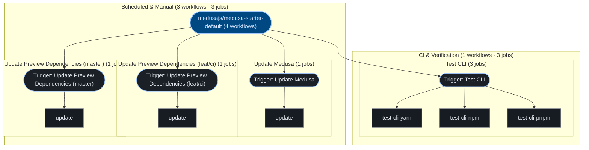

# Repository Architecture Analysis: medusajs/medusa-starter-default

## Metadata
- **SHA**: `9565d9d5487e470137c63824fe58c59a2098bde8`
- **Primary Ecosystem**: JavaScript/TypeScript

## Quality Metrics
- **ast_engine**: tree-sitter
- **avg_cognitive_complexity**: 1.1
- **avg_cyclomatic_complexity**: 2.1
- **component_count**: 3
- **dead_code_count**: 0
- **dead_code_symbols**: 0 entry(ies)
- **duplication_pct**: 81.5
- **file_complexities**: 10 entry(ies)
- **files_analyzed**: 10
- **fitness_passed**: False
- **fitness_violation_count**: 1
- **framework**: React (Vite)
- **import_edges**: 32 entry(ies)
- **loc**: 1025
- **max_cognitive_complexity**: 5
- **max_cyclomatic_complexity**: 6
- **sloc**: 959
- **test_file_count**: 1

# Architecture: medusajs/medusa-starter-default

## Context
- **Repository**: `medusajs/medusa-starter-default`
- **SHA**: `9565d9d5487e470137c63824fe58c59a2098bde8`
- **Ecosystem**: JavaScript/TypeScript
- **Framework**: React (Vite)

## Building Block View

## Component Details
- **medusa-starter-default** (`package.json`): MODULE
- **API_custom_route** (`src/api/admin/custom/route.ts`): API_ROUTE
- **API_custom_route** (`src/api/store/custom/route.ts`): API_ROUTE

## 6-Dimension Repository Scorecard

- **Overall Grade**: `D` (64.65/100)
- **Technical Debt Score**: 35.35
- **Estimated Remediation Effort**: 49.14h

| Dimension | Grade | Score | Weight | Details |
| :--- | :---: | :---: | :---: | :--- |
| Code Quality | `C` | 75.00 | 0.20 | avg_cc=2.10, max_cc=6, duplication=81.50%, dead_code=0 |
| Dependency Health | `B` | 85.00 | 0.15 | dependencies=19, outdated=0, vulnerable=0, has_lockfile=False |
| Maintainability | `B` | 89.00 | 0.15 | avg_cognitive=1.10, max_cognitive=5, fitness_violations=1, oversized_files=1 |
| Pipeline Health | `B` | 87.00 | 0.15 | workflows=4, operational_antipatterns=6, parallel_branches=True |
| Security | `F` | 0.00 | 0.20 | vulnerabilities=0, secrets=0, pipeline_security_findings=12 |
| Test Coverage | `C` | 70.00 | 0.15 | coverage=unavailable, ci_test_job=True, test_files_detected=True |

## Architecture Fitness & Workspace Boundaries

- **[MEDIUM] `ATRUSS-ARCH-005` (COMPLEXITY_THRESHOLD)**: Repository duplication_pct (81.5) exceeds policy threshold (15.0).

## Supply Chain Dependencies, Vulnerabilities & Secrets

- **Dependencies Parsed**: 19 | **Vulnerabilities**: 0 | **Secrets**: 0

### Inventory Sample
- `@medusajs/admin-sdk` `2.18.0` (npm, `package.json`)
- `@medusajs/cli` `2.18.0` (npm, `package.json`)
- `@medusajs/framework` `2.18.0` (npm, `package.json`)
- `@medusajs/medusa` `2.18.0` (npm, `package.json`)
- `@medusajs/test-utils` `2.18.0` (npm, `package.json`)
- `@swc/core` `1.7.28` (npm, `package.json`)
- `@swc/jest` `0.2.36` (npm, `package.json`)
- `@types/jest` `29.5.13` (npm, `package.json`)
- `@types/node` `20.12.11` (npm, `package.json`)
- `@types/react` `18.3.2` (npm, `package.json`)
- `@types/react-dom` `18.2.25` (npm, `package.json`)
- `jest` `29.7.0` (npm, `package.json`)
- `prop-types` `15.8.1` (npm, `package.json`)
- `react` `18.3.1` (npm, `package.json`)
- `react-dom` `18.3.1` (npm, `package.json`)
- `ts-node` `10.9.2` (npm, `package.json`)
- `typescript` `5.6.2` (npm, `package.json`)
- `vite` `5.4.14` (npm, `package.json`)
- `yalc` `1.0.0-pre.53` (npm, `package.json`)

## CI/CD Pipeline Topology

