# Repository Architecture Analysis: medusajs/nextjs-starter-medusa

## Metadata
- **SHA**: `9818886f06e493cb2249733d114d339aa216ef00`
- **Primary Ecosystem**: JavaScript/TypeScript

## Quality Metrics
- **ast_engine**: tree-sitter
- **avg_cognitive_complexity**: 2.56
- **avg_cyclomatic_complexity**: 3.17
- **component_count**: 23
- **dead_code_count**: 0
- **dead_code_symbols**: 0 entry(ies)
- **duplication_pct**: 75.93
- **file_complexities**: 25 entry(ies)
- **files_analyzed**: 207
- **fitness_passed**: False
- **fitness_violation_count**: 3
- **framework**: Next.js
- **import_edges**: 100 entry(ies)
- **loc**: 13670
- **max_cognitive_complexity**: 41
- **max_cyclomatic_complexity**: 35
- **sloc**: 12140

# Architecture: medusajs/nextjs-starter-medusa

## Context
- **Repository**: `medusajs/nextjs-starter-medusa`
- **SHA**: `9818886f06e493cb2249733d114d339aa216ef00`
- **Ecosystem**: JavaScript/TypeScript
- **Framework**: Next.js

## Building Block View

```mermaid
graph TD;
  classDef atlasRoot fill:#004882,stroke:#a3c9ff,stroke-width:2px,color:#d3e4ff
  classDef atlasCategory fill:#212428,stroke:#E87A48,stroke-width:1.5px,color:#dfe3eb
  classDef atlasWorkflow fill:#1b2026,stroke:#a3c9ff,stroke-width:1.5px,color:#dfe3eb
  classDef atlasJob fill:#171c22,stroke:#8d9199,stroke-width:1px,color:#dfe3eb
  classDef atlasTarget fill:#005227,stroke:#8bd99b,stroke-width:1.5px,color:#a7f6b6
  classDef atlasAlert fill:#93000a,stroke:#ffb4ab,stroke-width:1.5px,color:#ffdad6
  classDef atlasMore fill:#252a31,stroke:#8d9199,stroke-dasharray:4 4,color:#c3c6cf
    medusa_next["medusa-next : MODULE"]:::atlasJob
    RootLayout["RootLayout : UI_COMPONENT"]:::atlasJob
    NotFound["NotFound : UI_COMPONENT"]:::atlasJob
    CheckoutLayout["CheckoutLayout : UI_COMPONENT"]:::atlasJob
    Loading["Loading : UI_COMPONENT"]:::atlasJob
    Login["Login : UI_COMPONENT"]:::atlasJob
    PRODUCT_LIMIT["PRODUCT_LIMIT : UI_COMPONENT"]:::atlasJob
    ModalProvider["ModalProvider : UI_COMPONENT"]:::atlasJob
    TransferRequestForm["TransferRequestForm : UI_COMPONENT"]:::atlasJob
    CategoryTemplate["CategoryTemplate : UI_COMPONENT"]:::atlasJob
    StripeCardContainer["StripeCardContainer : UI_COMPONENT"]:::atlasJob
    StripeContext["StripeContext : UI_COMPONENT"]:::atlasJob
    SubmitButton["SubmitButton : UI_COMPONENT"]:::atlasJob
    CollectionTemplate["CollectionTemplate : UI_COMPONENT"]:::atlasJob
    ProductActions["ProductActions : UI_COMPONENT"]:::atlasJob
    ProductPrice["ProductPrice : UI_COMPONENT"]:::atlasJob
    ShippingPriceNudge["ShippingPriceNudge : UI_COMPONENT"]:::atlasJob
    Pagination["Pagination : UI_COMPONENT"]:::atlasJob
    repo_root(["medusajs/nextjs-starter-medusa"]):::atlasRoot
    repo_root --> CategoryTemplate
    repo_root --> CheckoutLayout
    repo_root --> CollectionTemplate
    repo_root --> Loading
    repo_root --> Login
    repo_root --> ModalProvider
    repo_root --> NotFound
    repo_root --> PRODUCT_LIMIT
    repo_root --> Pagination
    repo_root --> ProductActions
    repo_root --> ProductPrice
    repo_root --> RootLayout
    repo_root --> ShippingPriceNudge
    repo_root --> SubmitButton
    repo_root --> TransferRequestForm
    repo_root --> medusa_next
    StripeCardContainer --> StripeContext
```

## Component Details
- **medusa-next** (`package.json`): MODULE
- **RootLayout** (`src/app/layout.tsx`): UI_COMPONENT
- **NotFound** (`src/app/not-found.tsx`): UI_COMPONENT
- **CheckoutLayout** (`src/app/[countryCode]/(checkout)/layout.tsx`): UI_COMPONENT
- **NotFound** (`src/app/[countryCode]/(main)/not-found.tsx`): UI_COMPONENT
- **Loading** (`src/app/[countryCode]/(main)/account/loading.tsx`): UI_COMPONENT
- **Loading** (`src/app/[countryCode]/(main)/account/@dashboard/loading.tsx`): UI_COMPONENT
- **Login** (`src/app/[countryCode]/(main)/account/@login/page.tsx`): UI_COMPONENT
- **Loading** (`src/app/[countryCode]/(main)/cart/loading.tsx`): UI_COMPONENT
- **NotFound** (`src/app/[countryCode]/(main)/cart/not-found.tsx`): UI_COMPONENT
- **PRODUCT_LIMIT** (`src/app/[countryCode]/(main)/collections/[handle]/page.tsx`): UI_COMPONENT
- **Loading** (`src/app/[countryCode]/(main)/order/[id]/confirmed/loading.tsx`): UI_COMPONENT
- **ModalProvider** (`src/lib/context/modal-context.tsx`): UI_COMPONENT
- **TransferRequestForm** (`src/modules/account/components/transfer-request-form/index.tsx`): UI_COMPONENT
- **CategoryTemplate** (`src/modules/categories/templates/index.tsx`): UI_COMPONENT
- **StripeCardContainer** (`src/modules/checkout/components/payment-container/index.tsx`): UI_COMPONENT (deps: StripeContext)
- **StripeContext** (`src/modules/checkout/components/payment-wrapper/stripe-wrapper.tsx`): UI_COMPONENT
- **SubmitButton** (`src/modules/checkout/components/submit-button/index.tsx`): UI_COMPONENT
- **CollectionTemplate** (`src/modules/collections/templates/index.tsx`): UI_COMPONENT
- **ProductActions** (`src/modules/products/components/product-actions/index.tsx`): UI_COMPONENT
- **ProductPrice** (`src/modules/products/components/product-price/index.tsx`): UI_COMPONENT
- **ShippingPriceNudge** (`src/modules/shipping/components/free-shipping-price-nudge/index.tsx`): UI_COMPONENT
- **Pagination** (`src/modules/store/components/pagination/index.tsx`): UI_COMPONENT

## 6-Dimension Repository Scorecard

- **Overall Grade**: `D` (63.16/100)
- **Technical Debt Score**: 36.84
- **Estimated Remediation Effort**: 28.90h

| Dimension | Grade | Score | Weight | Details |
| :--- | :---: | :---: | :---: | :--- |
| Code Quality | `F` | 49.32 | 0.20 | avg_cc=3.17, max_cc=35, duplication=75.93%, dead_code=0 |
| Dependency Health | `B` | 85.00 | 0.15 | dependencies=35, outdated=0, vulnerable=0, has_lockfile=False |
| Maintainability | `F` | 57.00 | 0.15 | avg_cognitive=2.56, max_cognitive=41, fitness_violations=3, oversized_files=0 |
| Pipeline Health | `F` | 40.00 | 0.15 | workflows=0 |
| Security | `A` | 100.00 | 0.20 | vulnerabilities=0, secrets=0, pipeline_security_findings=0 |
| Test Coverage | `F` | 40.00 | 0.15 | coverage=unavailable, ci_test_job=False, test_files_detected=False |

## Architecture Fitness & Workspace Boundaries

- **[MEDIUM] `ATRUSS-ARCH-005` (COMPLEXITY_THRESHOLD)**: Repository duplication_pct (75.93) exceeds policy threshold (15.0).
- **[MEDIUM] `ATRUSS-ARCH-005` (COMPLEXITY_THRESHOLD)**: Repository max_cognitive_complexity (41.0) exceeds policy threshold (25.0).
- **[MEDIUM] `ATRUSS-ARCH-005` (COMPLEXITY_THRESHOLD)**: Repository max_cyclomatic_complexity (35.0) exceeds policy threshold (20.0).

## Supply Chain Dependencies, Vulnerabilities & Secrets

- **Dependencies Parsed**: 35 | **Vulnerabilities**: 0 | **Secrets**: 0

### Inventory Sample
- `@babel/core` `7.17.5` (npm, `package.json`)
- `@headlessui/react` `2.2.0` (npm, `package.json`)
- `@medusajs/icons` `*` (npm, `package.json`)
- `@medusajs/js-sdk` `*` (npm, `package.json`)
- `@medusajs/types` `*` (npm, `package.json`)
- `@medusajs/ui` `*` (npm, `package.json`)
- `@medusajs/ui-preset` `*` (npm, `package.json`)
- `@radix-ui/react-accordion` `1.2.1` (npm, `package.json`)
- `@stripe/react-stripe-js` `5.3.0` (npm, `package.json`)
- `@stripe/stripe-js` `8.2.0` (npm, `package.json`)
- `@types/lodash` `4.14.195` (npm, `package.json`)
- `@types/node` `17.0.21` (npm, `package.json`)
- `@types/pg` `8.11.0` (npm, `package.json`)
- `@types/react` `19.0.5` (npm, `package.json`)
- `@types/react-dom` `19.0.5` (npm, `package.json`)
- `@types/react-instantsearch-dom` `6.12.3` (npm, `package.json`)
- `ansi-colors` `4.1.3` (npm, `package.json`)
- `autoprefixer` `10.4.2` (npm, `package.json`)
- `babel-loader` `8.2.3` (npm, `package.json`)
- `eslint` `8.10.0` (npm, `package.json`)
- `eslint-config-next` `15.0.8` (npm, `package.json`)
- `lodash` `4.17.21` (npm, `package.json`)
- `next` `15.3.9` (npm, `package.json`)
- `pg` `8.11.3` (npm, `package.json`)
- `postcss` `8.4.8` (npm, `package.json`)
- `prettier` `2.8.8` (npm, `package.json`)
- `qs` `6.12.1` (npm, `package.json`)
- `react` `19.0.5` (npm, `package.json`)
- `react-country-flag` `3.1.0` (npm, `package.json`)
- `react-dom` `19.0.5` (npm, `package.json`)
- ... (+5 more dependencies)

## CI/CD Pipeline Topology

