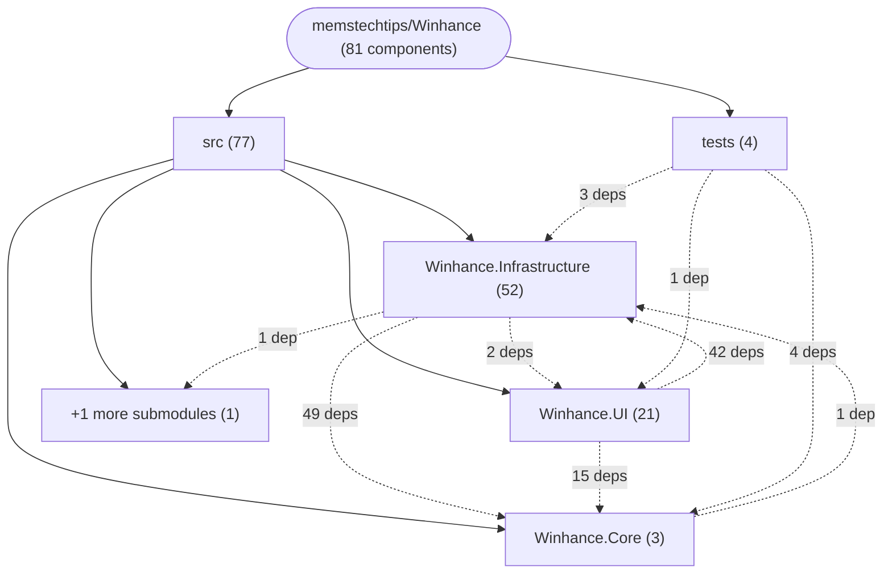

# Repository Architecture Analysis: memstechtips/Winhance

## Metadata
- **SHA**: `db80ecfcf6762a7b856860930d9f4ee17bf1e67c`
- **Primary Ecosystem**: .NET

## Quality Metrics
- **avg_cyclomatic_complexity**: 9.34
- **component_count**: 81
- **files_analyzed**: 1438
- **framework**: ASP.NET Core
- **loc**: 306990
- **max_cyclomatic_complexity**: 302
- **sloc**: 241958

# Architecture: memstechtips/Winhance

## Context
- **Repository**: `memstechtips/Winhance`
- **SHA**: `db80ecfcf6762a7b856860930d9f4ee17bf1e67c`
- **Ecosystem**: .NET
- **Framework**: Unknown

## Building Block View

## Component Details

Showing top 60 representative components out of 81 across 2 module group(s):

- **Module `src`** (77 components — SERVICE: 73, MODULE: 4)
- **Module `tests`** (4 components — MODULE: 4)

- **ConfigApplicationExecutionService** (`src/Winhance.UI/Features/Common/Services/ConfigApplicationExecutionService.cs`): SERVICE (deps: ChangeHistoryService, ConfigAppSelectionService, ConfigImportOverlayService, ConfigLoadService, ConfigurationApplicationBridgeService, DialogService (+5 more))
- **AppInstallationService** (`src/Winhance.Infrastructure/Features/SoftwareApps/Services/AppInstallationService.cs`): SERVICE (deps: BloatRemovalService, ChangeHistoryService, ExternalAppsService, FileSystemService, LegacyCapabilityService, LogService (+4 more))
- **ExternalAppsService** (`src/Winhance.Infrastructure/Features/SoftwareApps/Services/ExternalAppsService.cs`): SERVICE (deps: AppStatusDiscoveryService, ChangeHistoryService, ChocolateyService, DirectDownloadService, ExternalAppUninstallService, FileSystemService (+4 more))
- **ConfigReviewOrchestrationService** (`src/Winhance.UI/Features/Common/Services/ConfigReviewOrchestrationService.cs`): SERVICE (deps: ChangeHistoryService, ConfigAppSelectionService, ConfigApplicationExecutionService, ConfigImportOverlayService, ConfigLoadService, DialogService (+3 more))
- **WindowsAppsService** (`src/Winhance.Infrastructure/Features/SoftwareApps/Services/WindowsAppsService.cs`): SERVICE (deps: AppStatusDiscoveryService, DialogService, LocalizationService, LogService, SettingApplicationService, StoreDownloadService (+3 more))
- **ConfigExportService** (`src/Winhance.UI/Features/Common/Services/ConfigExportService.cs`): SERVICE (deps: AutounattendXmlGeneratorService, DialogService, FileSystemService, InteractiveUserService, LocalizationService, LogService (+1 more))
- **ConfigLoadService** (`src/Winhance.UI/Features/Common/Services/ConfigLoadService.cs`): SERVICE (deps: ConfigMigrationService, DialogService, FileSystemService, InteractiveUserService, LocalizationService, LogService (+1 more))
- **ConfigurationService** (`src/Winhance.UI/Features/Common/Services/ConfigurationService.cs`): SERVICE (deps: ConfigApplicationExecutionService, ConfigExportService, ConfigLoadService, ConfigReviewOrchestrationService, DialogService, LocalizationService (+1 more))
- **ExternalAppUninstallService** (`src/Winhance.Infrastructure/Features/SoftwareApps/Services/ExternalAppUninstallService.cs`): SERVICE (deps: AppStatusDiscoveryService, BloatRemovalService, ChocolateyService, InteractiveUserService, LogService, TaskProgressService)
- **SettingApplicationService** (`src/Winhance.Infrastructure/Features/Common/Services/SettingApplicationService.cs`): SERVICE (deps: ChangeHistoryService, HardwareDetectionService, LocalizationService, LogService, SettingLocalizationService, SystemSettingsDiscoveryService)
- **StartupNotificationService** (`src/Winhance.UI/Features/Common/Services/StartupNotificationService.cs`): SERVICE (deps: DialogService, LocalizationService, LogService, SystemBackupService, TaskProgressService, UserPreferencesService)
- **BulkSettingsActionService** (`src/Winhance.Infrastructure/Features/Common/Services/BulkSettingsActionService.cs`): SERVICE (deps: ChangeHistoryService, LocalizationService, LogService, SettingApplicationService, WindowsVersionService)
- **ConfigReviewService** (`src/Winhance.UI/Features/Common/Services/ConfigReviewService.cs`): SERVICE (deps: ComboBoxSetupService, LocalizationService, LogService, SystemSettingsDiscoveryService, WindowsVersionService)
- **PowerService** (`src/Winhance.Infrastructure/Features/Optimize/Services/PowerService.cs`): SERVICE (deps: FileSystemService, LogService, PowerPlanComboBoxService, PowerSettingsQueryService, SettingApplicationService)
- **ScriptMigrationService** (`src/Winhance.Infrastructure/Features/Common/Services/ScriptMigrationService.cs`): SERVICE (deps: FileSystemService, InteractiveUserService, LogService, ScheduledTaskService, UserPreferencesService)
- **SystemSettingsDiscoveryService** (`src/Winhance.Infrastructure/Features/Common/Services/SystemSettingsDiscoveryService.cs`): SERVICE (deps: LogService, PowerSettingsQueryService, ScheduledTaskService, SystemRestoreService, WindowsRegistryService)
- **UserPreferencesService** (`src/Winhance.Infrastructure/Features/Common/Services/UserPreferencesService.cs`): SERVICE (deps: FileSystemService, InteractiveUserService, LogService, NewBadgeService, ScriptMigrationService)
- **WindowsAppUninstallService** (`src/Winhance.Infrastructure/Features/SoftwareApps/Services/WindowsAppUninstallService.cs`): SERVICE (deps: BloatRemovalService, ChangeHistoryService, LogService, TaskProgressService, WindowsAppsService)
- **AppStatusDiscoveryService** (`src/Winhance.Infrastructure/Features/SoftwareApps/Services/AppStatusDiscoveryService.cs`): SERVICE (deps: ChocolateyService, InteractiveUserService, LogService, WinGetDetectionService)
- **ApplicationCloseService** (`src/Winhance.UI/Features/Common/Services/ApplicationCloseService.cs`): SERVICE (deps: DialogService, LogService, TaskProgressService, UserPreferencesService)
- **ChocolateyService** (`src/Winhance.Infrastructure/Features/SoftwareApps/Services/ChocolateyService.cs`): SERVICE (deps: FileSystemService, LocalizationService, LogService, TaskProgressService)
- **DialogService** (`src/Winhance.UI/Features/Common/Services/DialogService.cs`): SERVICE (deps: LocalizationService, LogService, SponsorsService, TaskProgressService)
- **DirectDownloadService** (`src/Winhance.Infrastructure/Features/SoftwareApps/Services/DirectDownloadService.cs`): SERVICE (deps: FileSystemService, InteractiveUserService, LocalizationService, LogService)
- **SettingsLoadingService** (`src/Winhance.UI/Features/Common/Services/SettingsLoadingService.cs`): SERVICE (deps: InitializationService, LogService, SystemSettingsDiscoveryService, UserPreferencesService)
- **StoreDownloadService** (`src/Winhance.Infrastructure/Features/SoftwareApps/Services/StoreDownloadService.cs`): SERVICE (deps: FileSystemService, LocalizationService, LogService, TaskProgressService)
- **UpdateService** (`src/Winhance.Infrastructure/Features/Optimize/Services/UpdateService.cs`): SERVICE (deps: FileSystemService, LogService, SettingApplicationService, WindowsRegistryService)
- **WallpaperService** (`src/Winhance.Infrastructure/Features/Customize/Services/WallpaperService.cs`): SERVICE (deps: InteractiveUserService, LogService, SystemParametersService, WindowsRegistryService)
- **WindowsVersionFilterService** (`src/Winhance.UI/Features/Common/Services/WindowsVersionFilterService.cs`): SERVICE (deps: DialogService, LocalizationService, LogService, UserPreferencesService)
- **BloatRemovalService** (`src/Winhance.Infrastructure/Features/SoftwareApps/Services/BloatRemovalService.cs`): SERVICE (deps: FileSystemService, LogService, ScheduledTaskService)
- **ChangeHistoryService** (`src/Winhance.Infrastructure/Features/Common/Services/ChangeHistoryService.cs`): SERVICE (deps: FileSystemService, LocalizationService, LogService)
- **ComboBoxSetupService** (`src/Winhance.Infrastructure/Features/Common/Services/ComboBoxSetupService.cs`): SERVICE (deps: LogService, PowerPlanComboBoxService, SystemSettingsDiscoveryService)
- **IsoService** (`src/Winhance.Infrastructure/Features/AdvancedTools/Services/IsoService.cs`): SERVICE (deps: FileSystemService, LocalizationService, LogService)
- **PowerSettingsValidationService** (`src/Winhance.Infrastructure/Features/Common/Services/PowerSettingsValidationService.cs`): SERVICE (deps: LogService, PowerSettingsQueryService, WindowsRegistryService)
- **RemovalScriptUpdateService** (`src/Winhance.Infrastructure/Features/Common/Services/RemovalScriptUpdateService.cs`): SERVICE (deps: FileSystemService, LogService, ScheduledTaskService)
- **SystemBackupService** (`src/Winhance.Infrastructure/Features/Common/Services/SystemBackupService.cs`): SERVICE (deps: LocalizationService, LogService, SystemRestoreService)
- **ThemeService** (`src/Winhance.UI/Features/Common/Services/ThemeService.cs`): SERVICE (deps: InteractiveUserService, UserPreferencesService, WindowsRegistryService)
- **TooltipDataService** (`src/Winhance.Infrastructure/Features/Common/Services/TooltipDataService.cs`): SERVICE (deps: LogService, PowerSettingsQueryService, WindowsRegistryService)
- **WimCustomizationService** (`src/Winhance.Infrastructure/Features/AdvancedTools/Services/WimCustomizationService.cs`): SERVICE (deps: FileSystemService, LocalizationService, LogService)
- **WimImageService** (`src/Winhance.Infrastructure/Features/AdvancedTools/Services/WimImageService.cs`): SERVICE (deps: FileSystemService, LocalizationService, LogService)
- **WinGetDetectionService** (`src/Winhance.Infrastructure/Features/SoftwareApps/Services/WinGet/WinGetDetectionService.cs`): SERVICE (deps: FileSystemService, InteractiveUserService, LogService)
- **Winhance.UI.Tests** (`tests/Winhance.UI.Tests/Winhance.UI.Tests.csproj`): MODULE (deps: Winhance.Core, Winhance.Infrastructure, Winhance.UI)
- **AutounattendXmlGeneratorService** (`src/Winhance.UI/Features/AdvancedTools/Services/AutounattendXmlGeneratorService.cs`): SERVICE (deps: LogService, SystemSettingsDiscoveryService)
- **ConfigurationApplicationBridgeService** (`src/Winhance.Infrastructure/Features/Common/Services/ConfigurationApplicationBridgeService.cs`): SERVICE (deps: LogService, SettingApplicationService)
- **NewBadgeService** (`src/Winhance.Infrastructure/Features/Common/Services/NewBadgeService.cs`): SERVICE (deps: LogService, UserPreferencesService)
- **PolicyCleanupService** (`src/Winhance.Infrastructure/Features/Common/Services/PolicyCleanupService.cs`): SERVICE (deps: LogService, WindowsRegistryService)
- **PowerPlanComboBoxService** (`src/Winhance.Infrastructure/Features/Common/Services/PowerPlanComboBoxService.cs`): SERVICE (deps: LogService, PowerSettingsQueryService)
- **ScheduledTaskService** (`src/Winhance.Infrastructure/Features/Common/Services/ScheduledTaskService.cs`): SERVICE (deps: FileSystemService, LogService)
- **TooltipRefreshEventHandler** (`src/Winhance.Infrastructure/Features/Common/EventHandlers/TooltipRefreshEventHandler.cs`): SERVICE (deps: LogService, TooltipDataService)
- **VersionService** (`src/Winhance.Infrastructure/Features/Common/Services/VersionService.cs`): SERVICE (deps: FileSystemService, LogService)
- **WindowsRegistryService** (`src/Winhance.Infrastructure/Features/Common/Services/WindowsRegistryService.cs`): SERVICE (deps: InteractiveUserService, LogService)
- **Winhance.Infrastructure** (`src/Winhance.Infrastructure/Winhance.Infrastructure.csproj`): MODULE (deps: WindowsPackageManager.Interop, Winhance.Core)
- **Winhance.Infrastructure.Tests** (`tests/Winhance.Infrastructure.Tests/Winhance.Infrastructure.Tests.csproj`): MODULE (deps: Winhance.Core, Winhance.Infrastructure)
- **Winhance.IntegrationTests** (`tests/Winhance.IntegrationTests/Winhance.IntegrationTests.csproj`): MODULE (deps: Winhance.Core, Winhance.Infrastructure)
- **Winhance.UI** (`src/Winhance.UI/Winhance.UI.csproj`): MODULE (deps: Winhance.Core, Winhance.Infrastructure)
- **ConfigAppSelectionService** (`src/Winhance.UI/Features/Common/Services/ConfigAppSelectionService.cs`): SERVICE (deps: LogService)
- **ConfigImportOverlayService** (`src/Winhance.UI/Features/Common/Services/ConfigImportOverlayService.cs`): SERVICE (deps: DispatcherService)
- **ConfigMigrationService** (`src/Winhance.Infrastructure/Features/Common/Services/ConfigMigrationService.cs`): SERVICE (deps: LogService)
- **HardwareDetectionService** (`src/Winhance.Infrastructure/Features/Common/Services/HardwareDetectionService.cs`): SERVICE (deps: LogService)
- **IconManifestService** (`src/Winhance.Infrastructure/Features/SoftwareApps/Services/IconManifestService.cs`): SERVICE (deps: LogService)
- **InitializationService** (`src/Winhance.Core/Features/Common/Services/InitializationService.cs`): SERVICE (deps: LogService)

## CI/CD Pipeline Topology

