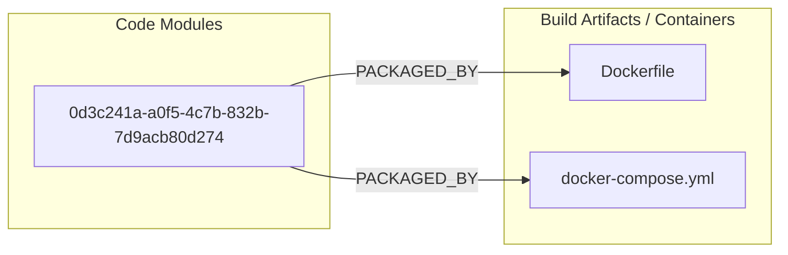

# Repository Architecture Analysis: metabase/dataset-generator

## Metadata
- **SHA**: `182a8f4e6c2800300ea17d41cdea5efecdd52f7e`
- **Primary Ecosystem**: JavaScript/TypeScript

## Quality Metrics
- **ast_engine**: tree-sitter
- **avg_cognitive_complexity**: 9.41
- **avg_cyclomatic_complexity**: 7.4
- **component_count**: 12
- **dead_code_count**: 2
- **dead_code_symbols**: 2 entry(ies)
- **duplication_pct**: 73.57
- **file_complexities**: 25 entry(ies)
- **files_analyzed**: 37
- **fitness_passed**: False
- **fitness_violation_count**: 3
- **framework**: Next.js
- **import_edges**: 100 entry(ies)
- **loc**: 7361
- **max_cognitive_complexity**: 84
- **max_cyclomatic_complexity**: 50
- **sloc**: 6367

# Architecture: metabase/dataset-generator

## Context
- **Repository**: `metabase/dataset-generator`
- **SHA**: `182a8f4e6c2800300ea17d41cdea5efecdd52f7e`
- **Ecosystem**: JavaScript/TypeScript
- **Framework**: Next.js

## Building Block View

```mermaid
graph TD;
    dataset_generator["dataset-generator : MODULE"]
    RootLayout["RootLayout : UI_COMPONENT"]
    Home["Home : UI_COMPONENT"]
    API_clear_route["API_clear_route : API_ROUTE"]
    API_stats_route["API_stats_route : API_ROUTE"]
    API_generate_route["API_generate_route : API_ROUTE"]
    API_start_route["API_start_route : API_ROUTE"]
    API_status_route["API_status_route : API_ROUTE"]
    API_stop_route["API_stop_route : API_ROUTE"]
    DataTable["DataTable : UI_COMPONENT"]
    ExportButtons["ExportButtons : UI_COMPONENT"]
    MultiSelect["MultiSelect : UI_COMPONENT"]
    repo_root(["metabase/dataset-generator"])
    repo_root --> API_clear_route
    repo_root --> API_generate_route
    repo_root --> API_start_route
    repo_root --> API_stats_route
    repo_root --> API_status_route
    repo_root --> API_stop_route
    repo_root --> DataTable
    repo_root --> ExportButtons
    repo_root --> Home
    repo_root --> MultiSelect
    repo_root --> RootLayout
    repo_root --> dataset_generator
```

## Component Details
- **dataset-generator** (`package.json`): MODULE
- **RootLayout** (`app/layout.tsx`): UI_COMPONENT
- **Home** (`app/page.tsx`): UI_COMPONENT
- **API_clear_route** (`app/api/cache/clear/route.ts`): API_ROUTE
- **API_stats_route** (`app/api/cache/stats/route.ts`): API_ROUTE
- **API_generate_route** (`app/api/generate/route.ts`): API_ROUTE
- **API_start_route** (`app/api/metabase/start/route.ts`): API_ROUTE
- **API_status_route** (`app/api/metabase/status/route.ts`): API_ROUTE
- **API_stop_route** (`app/api/metabase/stop/route.ts`): API_ROUTE
- **DataTable** (`components/DataTable.tsx`): UI_COMPONENT
- **ExportButtons** (`components/ExportButtons.tsx`): UI_COMPONENT
- **MultiSelect** (`components/ui/select.tsx`): UI_COMPONENT

## 6-Dimension Repository Scorecard

- **Overall Grade**: `F` (56.25/100)
- **Technical Debt Score**: 43.75
- **Estimated Remediation Effort**: 38.15h

| Dimension | Grade | Score | Weight | Details |
| :--- | :---: | :---: | :---: | :--- |
| Code Quality | `F` | 28.40 | 0.20 | avg_cc=7.40, max_cc=50, duplication=73.57%, dead_code=2 |
| Dependency Health | `A` | 100.00 | 0.15 | dependencies=568, outdated=0, vulnerable=0, has_lockfile=True |
| Maintainability | `F` | 23.77 | 0.15 | avg_cognitive=9.41, max_cognitive=84, fitness_violations=3, oversized_files=5 |
| Pipeline Health | `F` | 40.00 | 0.15 | workflows=0 |
| Security | `A` | 100.00 | 0.20 | vulnerabilities=0, secrets=0, pipeline_security_findings=0 |
| Test Coverage | `F` | 40.00 | 0.15 | coverage=unavailable, ci_test_job=False, test_files_detected=False |

## Architecture Fitness & Workspace Boundaries

- **[MEDIUM] `ATRUSS-ARCH-005` (COMPLEXITY_THRESHOLD)**: Repository duplication_pct (73.57) exceeds policy threshold (15.0).
- **[MEDIUM] `ATRUSS-ARCH-005` (COMPLEXITY_THRESHOLD)**: Repository max_cognitive_complexity (84.0) exceeds policy threshold (25.0).
- **[MEDIUM] `ATRUSS-ARCH-005` (COMPLEXITY_THRESHOLD)**: Repository max_cyclomatic_complexity (50.0) exceeds policy threshold (20.0).

## Supply Chain Dependencies, Vulnerabilities & Secrets

- **Dependencies Parsed**: 568 | **Vulnerabilities**: 0 | **Secrets**: 0

### Inventory Sample
- `@faker-js/faker` `9.8.0` (npm, `package.json`)
- `@faker-js/faker` `9.9.0` (npm, `package-lock.json`)
- `@radix-ui/react-select` `2.2.5` (npm, `package-lock.json`)
- `@radix-ui/react-select` `2.2.5` (npm, `package.json`)
- `@radix-ui/react-slot` `1.2.3` (npm, `package-lock.json`)
- `@radix-ui/react-slot` `1.2.3` (npm, `package.json`)
- `@types/node` `20` (npm, `package.json`)
- `@types/node` `20.19.4` (npm, `package-lock.json`)
- `@types/react` `19` (npm, `package.json`)
- `@types/react` `19.1.8` (npm, `package-lock.json`)
- `@types/react-dom` `19` (npm, `package.json`)
- `@types/react-dom` `19.1.6` (npm, `package-lock.json`)
- `@vercel/analytics` `1.5.0` (npm, `package-lock.json`)
- `@vercel/analytics` `1.5.0` (npm, `package.json`)
- `autoprefixer` `10.4.21` (npm, `package-lock.json`)
- `autoprefixer` `10.4.21` (npm, `package.json`)
- `axios` `1.10.0` (npm, `package-lock.json`)
- `axios` `1.6.0` (npm, `package.json`)
- `class-variance-authority` `0.7.1` (npm, `package-lock.json`)
- `class-variance-authority` `0.7.1` (npm, `package.json`)
- `clsx` `2.1.1` (npm, `package-lock.json`)
- `clsx` `2.1.1` (npm, `package.json`)
- `dotenv` `17.2.1` (npm, `package-lock.json`)
- `dotenv` `17.2.1` (npm, `package.json`)
- `eslint` `9.29.0` (npm, `package-lock.json`)
- `eslint` `9.29.0` (npm, `package.json`)
- `eslint-config-next` `15.3.4` (npm, `package-lock.json`)
- `eslint-config-next` `15.3.4` (npm, `package.json`)
- `jszip` `3.10.1` (npm, `package-lock.json`)
- `jszip` `3.10.1` (npm, `package.json`)
- ... (+538 more dependencies)

## Section 7: Code-to-Cloud Deployment Traceability

- `0d3c241a-a0f5-4c7b-832b-7d9acb80d274` (code_module) --[PACKAGED_BY]--> `Dockerfile` (container)
- `0d3c241a-a0f5-4c7b-832b-7d9acb80d274` (code_module) --[PACKAGED_BY]--> `docker-compose.yml` (container)

## CI/CD Pipeline Topology

