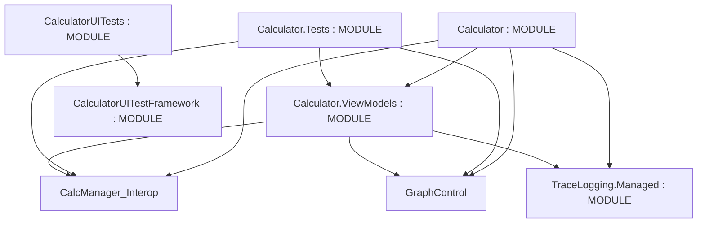

# Repository Architecture Analysis: microsoft/calculator

## Metadata
- **SHA**: `79e1ac53bba690cdf930e5dcd6ed9dbc4cbfb128`
- **Primary Ecosystem**: .NET

## Quality Metrics
- **avg_cyclomatic_complexity**: 10.96
- **component_count**: 6
- **files_analyzed**: 150
- **framework**: Unknown
- **loc**: 36361
- **max_cyclomatic_complexity**: 229
- **sloc**: 29853

# Architecture: microsoft/calculator

## Context
- **Repository**: `microsoft/calculator`
- **SHA**: `79e1ac53bba690cdf930e5dcd6ed9dbc4cbfb128`
- **Ecosystem**: .NET
- **Framework**: Unknown

## Building Block View

## Component Details
- **Calculator** (`src/Calculator/Calculator.csproj`): MODULE (deps: CalcManager.Interop, Calculator.ViewModels, GraphControl, TraceLogging.Managed)
- **Calculator.Tests** (`src/Calculator.Tests/Calculator.Tests.csproj`): MODULE (deps: CalcManager.Interop, Calculator.ViewModels, GraphControl)
- **Calculator.ViewModels** (`src/Calculator.ViewModels/Calculator.ViewModels.csproj`): MODULE (deps: CalcManager.Interop, GraphControl, TraceLogging.Managed)
- **CalculatorUITestFramework** (`src/CalculatorUITestFramework/CalculatorUITestFramework.csproj`): MODULE
- **CalculatorUITests** (`src/CalculatorUITests/CalculatorUITests.csproj`): MODULE (deps: CalculatorUITestFramework)
- **TraceLogging.Managed** (`src/TraceLogging.Managed/TraceLogging.Managed.csproj`): MODULE

## CI/CD Pipeline Topology

