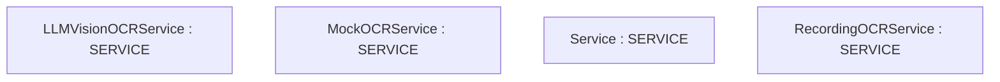

# Repository Architecture Analysis: microsoft/markitdown

## Metadata
- **SHA**: `ed178952a6672abdfd35b5f9e76a80b6cefc086e`
- **Primary Ecosystem**: Python

## Quality Metrics
- **avg_cyclomatic_complexity**: 3.84
- **component_count**: 7
- **files_analyzed**: 93
- **framework**: Unknown
- **loc**: 22800
- **max_cyclomatic_complexity**: 59
- **sloc**: 17654

# Architecture: microsoft/markitdown

## Context
- **Repository**: `microsoft/markitdown`
- **SHA**: `ed178952a6672abdfd35b5f9e76a80b6cefc086e`
- **Ecosystem**: Python
- **Framework**: Unknown

## Building Block View

## Component Details
- **LLMVisionOCRService** (`packages/markitdown-ocr/src/markitdown_ocr/_ocr_service.py`): SERVICE
- **MockOCRService** (`packages/markitdown-ocr/tests/test_docx_converter.py`): SERVICE
- **Service** (`packages/markitdown-ocr/tests/test_ocr_metadata.py`): SERVICE
- **MockOCRService** (`packages/markitdown-ocr/tests/test_pdf_converter.py`): SERVICE
- **RecordingOCRService** (`packages/markitdown-ocr/tests/test_pdf_converter.py`): SERVICE
- **MockOCRService** (`packages/markitdown-ocr/tests/test_pptx_converter.py`): SERVICE
- **MockOCRService** (`packages/markitdown-ocr/tests/test_xlsx_converter.py`): SERVICE

## CI/CD Pipeline Topology

