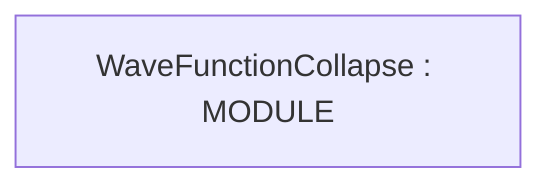

# Repository Architecture Analysis: mxgmn/WaveFunctionCollapse

## Metadata
- **SHA**: `de7d22e705e816b62b4d613199d0463820fcaef3`
- **Primary Ecosystem**: .NET

## Quality Metrics
- **avg_cyclomatic_complexity**: 28.2
- **component_count**: 1
- **files_analyzed**: 5
- **framework**: ASP.NET Core
- **loc**: 795
- **max_cyclomatic_complexity**: 49
- **sloc**: 686

# Architecture: mxgmn/WaveFunctionCollapse

## Context
- **Repository**: `mxgmn/WaveFunctionCollapse`
- **SHA**: `de7d22e705e816b62b4d613199d0463820fcaef3`
- **Ecosystem**: .NET
- **Framework**: Unknown

## Building Block View

## Component Details
- **WaveFunctionCollapse** (`WaveFunctionCollapse.csproj`): MODULE

## CI/CD Pipeline Topology

