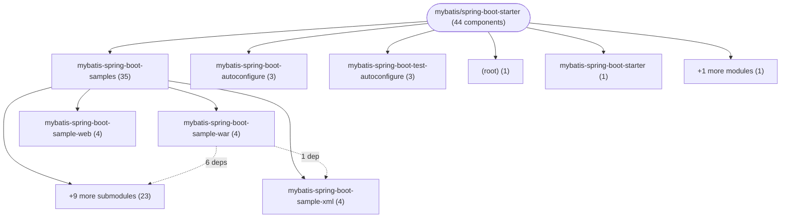

# Repository Architecture Analysis: mybatis/spring-boot-starter

## Metadata
- **SHA**: `d50a965cfbcd2a284039b896c7c492fa331f9708`
- **Primary Ecosystem**: Java

## Quality Metrics
- **avg_cyclomatic_complexity**: 3.05
- **component_count**: 44
- **files_analyzed**: 328
- **framework**: Spring Boot
- **loc**: 25528
- **max_cyclomatic_complexity**: 33
- **sloc**: 13502

# Architecture: mybatis/spring-boot-starter

## Context
- **Repository**: `mybatis/spring-boot-starter`
- **SHA**: `d50a965cfbcd2a284039b896c7c492fa331f9708`
- **Ecosystem**: Java
- **Framework**: Unknown

## Building Block View

## Component Details
- **mybatis-spring-boot-autoconfigure** (`mybatis-spring-boot-autoconfigure/pom.xml`): MODULE
- **mybatis-spring-boot-sample-annotation** (`mybatis-spring-boot-samples/mybatis-spring-boot-sample-annotation/pom.xml`): MODULE
- **mybatis-spring-boot-sample-freemarker** (`mybatis-spring-boot-samples/mybatis-spring-boot-sample-freemarker/pom.xml`): MODULE
- **mybatis-spring-boot-sample-freemarker-legacy** (`mybatis-spring-boot-samples/mybatis-spring-boot-sample-freemarker-legacy/pom.xml`): MODULE
- **mybatis-spring-boot-sample-groovy** (`mybatis-spring-boot-samples/mybatis-spring-boot-sample-groovy/pom.xml`): MODULE
- **mybatis-spring-boot-sample-kotlin** (`mybatis-spring-boot-samples/mybatis-spring-boot-sample-kotlin/pom.xml`): MODULE
- **mybatis-spring-boot-sample-thymeleaf** (`mybatis-spring-boot-samples/mybatis-spring-boot-sample-thymeleaf/pom.xml`): MODULE
- **mybatis-spring-boot-sample-velocity** (`mybatis-spring-boot-samples/mybatis-spring-boot-sample-velocity/pom.xml`): MODULE
- **mybatis-spring-boot-sample-velocity-legacy** (`mybatis-spring-boot-samples/mybatis-spring-boot-sample-velocity-legacy/pom.xml`): MODULE
- **mybatis-spring-boot-sample-war** (`mybatis-spring-boot-samples/mybatis-spring-boot-sample-war/pom.xml`): MODULE
- **mybatis-spring-boot-sample-web** (`mybatis-spring-boot-samples/mybatis-spring-boot-sample-web/pom.xml`): MODULE
- **mybatis-spring-boot-sample-xml** (`mybatis-spring-boot-samples/mybatis-spring-boot-sample-xml/pom.xml`): MODULE
- **mybatis-spring-boot-samples** (`mybatis-spring-boot-samples/pom.xml`): MODULE
- **mybatis-spring-boot-starter** (`mybatis-spring-boot-starter/pom.xml`): MODULE
- **mybatis-spring-boot-starter-test** (`mybatis-spring-boot-starter-test/pom.xml`): MODULE
- **mybatis-spring-boot-test-autoconfigure** (`mybatis-spring-boot-test-autoconfigure/pom.xml`): MODULE
- **mybatis-spring-boot** (`pom.xml`): MODULE
- **MybatisLanguageDriverAutoConfiguration** (`mybatis-spring-boot-autoconfigure/src/main/java/org/mybatis/spring/boot/autoconfigure/MybatisLanguageDriverAutoConfiguration.java`): CONFIG
- **MybatisProperties** (`mybatis-spring-boot-autoconfigure/src/main/java/org/mybatis/spring/boot/autoconfigure/MybatisProperties.java`): CONFIG
- **SampleAnnotationApplication** (`mybatis-spring-boot-samples/mybatis-spring-boot-sample-annotation/src/main/java/sample/mybatis/annotation/SampleAnnotationApplication.java`): CONFIG
- **MapperTestApplication** (`mybatis-spring-boot-samples/mybatis-spring-boot-sample-annotation/src/test/java/sample/mybatis/annotation/mapper/MapperTestApplication.java`): CONFIG (deps: SampleAnnotationApplication)
- **SampleFreeMarkerApplication** (`mybatis-spring-boot-samples/mybatis-spring-boot-sample-freemarker-legacy/src/main/java/sample/mybatis/freemarker/legacy/SampleFreeMarkerApplication.java`): CONFIG
- **MapperTestApplication** (`mybatis-spring-boot-samples/mybatis-spring-boot-sample-freemarker-legacy/src/test/java/sample/mybatis/freemarker/legacy/mapper/MapperTestApplication.java`): CONFIG (deps: SampleFreeMarkerApplication)
- **SampleFreeMarkerApplication** (`mybatis-spring-boot-samples/mybatis-spring-boot-sample-freemarker/src/main/java/sample/mybatis/freemarker/SampleFreeMarkerApplication.java`): CONFIG
- **MapperTestApplication** (`mybatis-spring-boot-samples/mybatis-spring-boot-sample-freemarker/src/test/java/sample/mybatis/freemarker/mapper/MapperTestApplication.java`): CONFIG (deps: SampleFreeMarkerApplication)
- **SampleKotlinApplication** (`mybatis-spring-boot-samples/mybatis-spring-boot-sample-kotlin/src/main/kotlin/sample/mybatis/kotlin/SampleKotlinApplication.kt`): CONFIG
- **MapperTestApplication** (`mybatis-spring-boot-samples/mybatis-spring-boot-sample-kotlin/src/test/kotlin/sample/mybatis/kotlin/mapper/MapperTestApplication.kt`): CONFIG
- **SampleThymeleafApplication** (`mybatis-spring-boot-samples/mybatis-spring-boot-sample-thymeleaf/src/main/java/sample/mybatis/thymeleaf/SampleThymeleafApplication.java`): CONFIG
- **MapperTestApplication** (`mybatis-spring-boot-samples/mybatis-spring-boot-sample-thymeleaf/src/test/java/sample/mybatis/thymeleaf/mapper/MapperTestApplication.java`): CONFIG (deps: SampleThymeleafApplication)
- **SampleVelocityApplication** (`mybatis-spring-boot-samples/mybatis-spring-boot-sample-velocity-legacy/src/main/java/sample/mybatis/velocity/legacy/SampleVelocityApplication.java`): CONFIG
- **MapperTestApplication** (`mybatis-spring-boot-samples/mybatis-spring-boot-sample-velocity-legacy/src/test/java/sample/mybatis/velocity/legacy/mapper/MapperTestApplication.java`): CONFIG (deps: SampleVelocityApplication)
- **SampleVelocityApplication** (`mybatis-spring-boot-samples/mybatis-spring-boot-sample-velocity/src/main/java/sample/mybatis/velocity/SampleVelocityApplication.java`): CONFIG
- **MapperTestApplication** (`mybatis-spring-boot-samples/mybatis-spring-boot-sample-velocity/src/test/java/sample/mybatis/velocity/mapper/MapperTestApplication.java`): CONFIG (deps: SampleVelocityApplication)
- **SampleWebApplication** (`mybatis-spring-boot-samples/mybatis-spring-boot-sample-war/src/main/java/sample/mybatis/war/SampleWebApplication.java`): CONFIG
- **CityRestController** (`mybatis-spring-boot-samples/mybatis-spring-boot-sample-war/src/main/java/sample/mybatis/war/controller/CityRestController.java`): API_ROUTE
- **MapperTestApplication** (`mybatis-spring-boot-samples/mybatis-spring-boot-sample-war/src/test/java/sample/mybatis/war/mapper/MapperTestApplication.java`): CONFIG (deps: SampleWebApplication)
- **SampleWebApplication** (`mybatis-spring-boot-samples/mybatis-spring-boot-sample-web/src/main/java/sample/mybatis/web/SampleWebApplication.java`): CONFIG
- **CityRestController** (`mybatis-spring-boot-samples/mybatis-spring-boot-sample-web/src/main/java/sample/mybatis/web/controller/CityRestController.java`): API_ROUTE
- **MapperTestApplication** (`mybatis-spring-boot-samples/mybatis-spring-boot-sample-web/src/test/java/sample/mybatis/web/mapper/MapperTestApplication.java`): CONFIG (deps: SampleWebApplication)
- **SampleXmlApplication** (`mybatis-spring-boot-samples/mybatis-spring-boot-sample-xml/src/main/java/sample/mybatis/xml/SampleXmlApplication.java`): CONFIG
- **DaoTestApplication** (`mybatis-spring-boot-samples/mybatis-spring-boot-sample-xml/src/test/java/sample/mybatis/xml/dao/DaoTestApplication.java`): CONFIG (deps: SampleXmlApplication)
- **MapperTestApplication** (`mybatis-spring-boot-samples/mybatis-spring-boot-sample-xml/src/test/java/sample/mybatis/xml/mapper/MapperTestApplication.java`): CONFIG (deps: SampleXmlApplication)
- **ExampleMybatisApplication** (`mybatis-spring-boot-test-autoconfigure/src/test/java/org/mybatis/spring/boot/test/autoconfigure/ExampleMybatisApplication.java`): CONFIG
- **ExampleService** (`mybatis-spring-boot-test-autoconfigure/src/test/java/org/mybatis/spring/boot/test/autoconfigure/ExampleService.java`): SERVICE

## CI/CD Pipeline Topology

