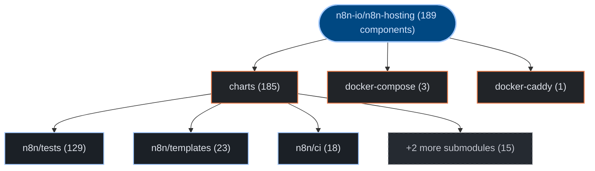

# Repository Architecture Analysis: n8n-io/n8n-hosting

## Metadata
- **SHA**: `1f1d7452db790fdec1e6e8e941d4f01f4341e4bd`
- **Primary Ecosystem**: Container / Helm / IaC

## Quality Metrics
- **ast_engine**: fallback
- **avg_cognitive_complexity**: 0.0
- **avg_cyclomatic_complexity**: 0.0
- **component_count**: 189
- **dead_code_count**: 0
- **dead_code_symbols**: 0 entry(ies)
- **duplication_pct**: 0.0
- **file_complexities**: 0 entry(ies)
- **files_analyzed**: 189
- **fitness_passed**: True
- **fitness_violation_count**: 0
- **framework**: Helm Chart
- **import_edges**: 0 entry(ies)
- **loc**: 11050
- **max_cognitive_complexity**: 0
- **max_cyclomatic_complexity**: 0
- **sloc**: 9276
- **test_file_count**: 168

# Architecture: n8n-io/n8n-hosting

## Context
- **Repository**: `n8n-io/n8n-hosting`
- **SHA**: `1f1d7452db790fdec1e6e8e941d4f01f4341e4bd`
- **Ecosystem**: Container / Helm / IaC
- **Framework**: Helm Chart

## Building Block View

## Component Details

Showing top 60 representative components out of 189 across 3 module group(s):

- **Module `charts`** (185 components — module: 185)
- **Module `docker-compose`** (3 components — module: 3)
- **Module `docker-caddy`** (1 components — module: 1)

- **Chart** (`charts/n8n/Chart.yaml`): module
- **binary-data-queue-s3.in** (`charts/n8n/tests/migrate-values/cases/binary-data-queue-s3.in.yaml`): module
- **binary-data-queue-s3.out** (`charts/n8n/tests/migrate-values/cases/binary-data-queue-s3.out.yaml`): module
- **binary-data-queue.in** (`charts/n8n/tests/migrate-values/cases/binary-data-queue.in.yaml`): module
- **binary-data-queue.out** (`charts/n8n/tests/migrate-values/cases/binary-data-queue.out.yaml`): module
- **binary-data-s3-default-mode.in** (`charts/n8n/tests/migrate-values/cases/binary-data-s3-default-mode.in.yaml`): module
- **binary-data-s3-default-mode.out** (`charts/n8n/tests/migrate-values/cases/binary-data-s3-default-mode.out.yaml`): module
- **binary-data-s3.in** (`charts/n8n/tests/migrate-values/cases/binary-data-s3.in.yaml`): module
- **binary-data-s3.out** (`charts/n8n/tests/migrate-values/cases/binary-data-s3.out.yaml`): module
- **blank-line-in-block.in** (`charts/n8n/tests/migrate-values/cases/blank-line-in-block.in.yaml`): module
- **blank-line-in-block.out** (`charts/n8n/tests/migrate-values/cases/blank-line-in-block.out.yaml`): module
- **chart-1.16-security-context** (`charts/n8n/tests/values/chart-1.16-security-context.yaml`): module
- **chart-1.16-worker-probes** (`charts/n8n/tests/values/chart-1.16-worker-probes.yaml`): module
- **chart-set-env.in** (`charts/n8n/tests/migrate-values/cases/chart-set-env.in.yaml`): module
- **chart-set-env.out** (`charts/n8n/tests/migrate-values/cases/chart-set-env.out.yaml`): module
- **chart-set-variables.in** (`charts/n8n/tests/migrate-values/cases/chart-set-variables.in.yaml`): module
- **chart-set-variables.out** (`charts/n8n/tests/migrate-values/cases/chart-set-variables.out.yaml`): module
- **concurrency-env-list.in** (`charts/n8n/tests/migrate-values/cases/concurrency-env-list.in.yaml`): module
- **concurrency-env-list.out** (`charts/n8n/tests/migrate-values/cases/concurrency-env-list.out.yaml`): module
- **concurrency-queue.in** (`charts/n8n/tests/migrate-values/cases/concurrency-queue.in.yaml`): module
- **concurrency-queue.out** (`charts/n8n/tests/migrate-values/cases/concurrency-queue.out.yaml`): module
- **concurrency-standalone.in** (`charts/n8n/tests/migrate-values/cases/concurrency-standalone.in.yaml`): module
- **concurrency-standalone.out** (`charts/n8n/tests/migrate-values/cases/concurrency-standalone.out.yaml`): module
- **concurrency-unset.in** (`charts/n8n/tests/migrate-values/cases/concurrency-unset.in.yaml`): module
- **concurrency-unset.out** (`charts/n8n/tests/migrate-values/cases/concurrency-unset.out.yaml`): module
- **configmap** (`charts/n8n/templates/configmap.yaml`): module
- **database-ssl-secret_test** (`charts/n8n/tests/database-ssl-secret_test.yaml`): module
- **database-ssl.in** (`charts/n8n/tests/migrate-values/cases/database-ssl.in.yaml`): module
- **database-ssl.out** (`charts/n8n/tests/migrate-values/cases/database-ssl.out.yaml`): module
- **database-ssl_test** (`charts/n8n/tests/database-ssl_test.yaml`): module
- **database-type_test** (`charts/n8n/tests/database-type_test.yaml`): module
- **default-render_test** (`charts/n8n/tests/default-render_test.yaml`): module
- **deployment-artifact_test** (`charts/n8n/tests/deployment-artifact_test.yaml`): module
- **deployment-main** (`charts/n8n/templates/deployment-main.yaml`): module
- **deployment-webhook-processor** (`charts/n8n/templates/deployment-webhook-processor.yaml`): module
- **deployment-worker** (`charts/n8n/templates/deployment-worker.yaml`): module
- **docker-compose** (`docker-caddy/docker-compose.yml`): module
- **docker-compose** (`docker-compose/subfolderWithSSL/docker-compose.yml`): module
- **docker-compose** (`docker-compose/withPostgres/docker-compose.yml`): module
- **docker-compose** (`docker-compose/withPostgresAndWorker/docker-compose.yml`): module
- **editor-url_test** (`charts/n8n/tests/editor-url_test.yaml`): module
- **encryption-key-file_test** (`charts/n8n/tests/encryption-key-file_test.yaml`): module
- **env-from_test** (`charts/n8n/tests/env-from_test.yaml`): module
- **env-lists-not-applied.in** (`charts/n8n/tests/migrate-values/cases/env-lists-not-applied.in.yaml`): module
- **env-lists-not-applied.out** (`charts/n8n/tests/migrate-values/cases/env-lists-not-applied.out.yaml`): module
- **env-lists.in** (`charts/n8n/tests/migrate-values/cases/env-lists.in.yaml`): module
- **env-lists.out** (`charts/n8n/tests/migrate-values/cases/env-lists.out.yaml`): module
- **env-main-not-a-map** (`charts/n8n/tests/values/env-main-not-a-map.yaml`): module
- **env-maps_test** (`charts/n8n/tests/env-maps_test.yaml`): module
- **env-not-a-map** (`charts/n8n/tests/values/env-not-a-map.yaml`): module
- **env-overrides_test** (`charts/n8n/tests/env-overrides_test.yaml`): module
- **env-precedence.in** (`charts/n8n/tests/migrate-values/cases/env-precedence.in.yaml`): module
- **env-precedence.out** (`charts/n8n/tests/migrate-values/cases/env-precedence.out.yaml`): module
- **extra-objects** (`charts/n8n/ci/install/extra-objects.yaml`): module
- **extra-objects** (`charts/n8n/examples/extra-objects.yaml`): module
- **extra-objects** (`charts/n8n/templates/extra-objects.yaml`): module
- **extra-objects_test** (`charts/n8n/tests/extra-objects_test.yaml`): module
- **extraContainers-values** (`charts/n8n/ci/extraContainers-values.yaml`): module
- **gateway-httproute** (`charts/n8n/ci/install/gateway-httproute.yaml`): module
- **gateway-httproute** (`charts/n8n/examples/gateway-httproute.yaml`): module

## 6-Dimension Repository Scorecard

- **Overall Grade**: `F` (59.00/100)
- **Technical Debt Score**: 41.00
- **Estimated Remediation Effort**: 62.75h

| Dimension | Grade | Score | Weight | Details |
| :--- | :---: | :---: | :---: | :--- |
| Code Quality | `A` | 100.00 | 0.20 | avg_cc=0.00, max_cc=0, duplication=0.00%, dead_code=0 |
| Dependency Health | `A` | 90.00 | 0.15 | dependencies=0 (no manifests parsed) |
| Maintainability | `A` | 100.00 | 0.15 | avg_cognitive=0.00, max_cognitive=0, fitness_violations=0, oversized_files=0 |
| Pipeline Health | `F` | 0.00 | 0.15 | workflows=6, operational_antipatterns=26, parallel_branches=True |
| Security | `F` | 0.00 | 0.20 | vulnerabilities=0, secrets=1, pipeline_security_findings=16 |
| Test Coverage | `C` | 70.00 | 0.15 | coverage=unavailable, ci_test_job=True, test_files_detected=True |

## Supply Chain Dependencies, Vulnerabilities & Secrets

- **Dependencies Parsed**: 0 | **Vulnerabilities**: 0 | **Secrets**: 1

### Secret Findings (Redacted)
- **[CRITICAL] `ATRUSS-SEC-004`** at `charts/n8n/tests/database-ssl_test.yaml:77` (`-----BEGIN ... PRIVATE KEY----- [REDACTED]`)

## Section 7: Code-to-Cloud Deployment Traceability

```mermaid
flowchart LR
    classDef atlasCategory fill:#212428,stroke:#E87A48,stroke-width:1.5px,color:#dfe3eb
    classDef atlasWorkflow fill:#1b2026,stroke:#a3c9ff,stroke-width:1.5px,color:#dfe3eb
    classDef atlasJob fill:#171c22,stroke:#8d9199,stroke-width:1px,color:#dfe3eb
    classDef atlasTarget fill:#005227,stroke:#8bd99b,stroke-width:1.5px,color:#a7f6b6
    subgraph code_modules["Code Modules"]
        mod_charts_n8n["charts/n8n"]:::atlasCategory
        mod_docker_caddy["docker-caddy"]:::atlasCategory
        mod_docker_compose_subfolderWithSSL["docker-compose/subfolderWithSSL"]:::atlasCategory
        mod_docker_compose_withPostgres["docker-compose/withPostgres"]:::atlasCategory
        mod_docker_compose_withPostgresAndWorker["docker-compose/withPostgresAndWorker"]:::atlasCategory
    end
    subgraph build_artifacts["Build Artifacts / Containers"]
        art_docker_caddy_docker_compose_yml["docker-caddy/docker-compose.yml"]:::atlasWorkflow
        art_docker_compose_subfolderWithSSL_docker_compose_yml["docker-compose/subfolderWithSSL/docker-compose.yml"]:::atlasWorkflow
        art_docker_compose_withPostgres_docker_compose_yml["docker-compose/withPostgres/docker-compose.yml"]:::atlasWorkflow
        art_docker_compose_withPostgresAndWorker_docker_compose_yml["docker-compose/withPostgresAndWorker/docker-compose.yml"]:::atlasWorkflow
        art_kubernetes_n8n_claim0_persistentvolumeclaim_yaml["kubernetes/n8n-claim0-persistentvolumeclaim.yaml"]:::atlasWorkflow
        art_kubernetes_n8n_deployment_yaml["kubernetes/n8n-deployment.yaml"]:::atlasWorkflow
        art_kubernetes_n8n_service_yaml["kubernetes/n8n-service.yaml"]:::atlasWorkflow
        art_kubernetes_namespace_yaml["kubernetes/namespace.yaml"]:::atlasWorkflow
        art_kubernetes_postgres_claim0_persistentvolumeclaim_yaml["kubernetes/postgres-claim0-persistentvolumeclaim.yaml"]:::atlasWorkflow
        art_kubernetes_postgres_configmap_yaml["kubernetes/postgres-configmap.yaml"]:::atlasWorkflow
        art_kubernetes_postgres_deployment_yaml["kubernetes/postgres-deployment.yaml"]:::atlasWorkflow
        art_kubernetes_postgres_secret_yaml["kubernetes/postgres-secret.yaml"]:::atlasWorkflow
        art_kubernetes_postgres_service_yaml["kubernetes/postgres-service.yaml"]:::atlasWorkflow
    end
    subgraph ci_jobs["CI/CD Jobs"]
        job_bump_n8n_version_yml_bump["bump-n8n-version.yml#bump"]:::atlasJob
        job_ci_yml_gate["ci.yml#gate"]:::atlasJob
        job_ci_yml_install_test["ci.yml#install-test"]:::atlasJob
        job_ci_yml_kubeconform["ci.yml#kubeconform"]:::atlasJob
        job_ci_yml_lint["ci.yml#lint"]:::atlasJob
        job_ci_yml_migrate_values["ci.yml#migrate-values"]:::atlasJob
        job_ci_yml_template_validation["ci.yml#template-validation"]:::atlasJob
        job_ci_yml_unittest["ci.yml#unittest"]:::atlasJob
        job_ci_yml_upgrade_test["ci.yml#upgrade-test"]:::atlasJob
        job_preview_chart_yml_publish["preview-chart.yml#publish"]:::atlasJob
        job_release_yml_publish["release.yml#publish"]:::atlasJob
    end
    subgraph runtime_envs["Runtime Environments"]
        env_azure["azure"]:::atlasTarget
        env_kubernetes["kubernetes"]:::atlasTarget
    end
    job_ci_yml_install_test -->|DEPLOYS_TO| env_azure
    job_ci_yml_install_test -->|DEPLOYS_TO| env_kubernetes
    job_ci_yml_kubeconform -->|DEPLOYS_TO| env_azure
    job_ci_yml_kubeconform -->|DEPLOYS_TO| env_kubernetes
    job_ci_yml_lint -->|DEPLOYS_TO| env_azure
    job_ci_yml_migrate_values -->|DEPLOYS_TO| env_azure
    job_ci_yml_migrate_values -->|DEPLOYS_TO| env_kubernetes
    job_ci_yml_template_validation -->|DEPLOYS_TO| env_azure
    job_ci_yml_template_validation -->|DEPLOYS_TO| env_kubernetes
    job_ci_yml_unittest -->|DEPLOYS_TO| env_azure
    job_ci_yml_unittest -->|DEPLOYS_TO| env_kubernetes
    job_ci_yml_upgrade_test -->|DEPLOYS_TO| env_azure
    job_ci_yml_upgrade_test -->|DEPLOYS_TO| env_kubernetes
    job_preview_chart_yml_publish -->|DEPLOYS_TO| env_azure
    job_preview_chart_yml_publish -->|DEPLOYS_TO| env_kubernetes
    job_release_yml_publish -->|DEPLOYS_TO| env_azure
    job_release_yml_publish -->|DEPLOYS_TO| env_kubernetes
    mod_charts_n8n -->|BUILT_BY| job_bump_n8n_version_yml_bump
    mod_charts_n8n -->|BUILT_BY| job_ci_yml_gate
    mod_charts_n8n -->|DEPLOYED_BY| job_ci_yml_install_test
    mod_charts_n8n -->|DEPLOYED_BY| job_ci_yml_kubeconform
    mod_charts_n8n -->|DEPLOYED_BY| job_ci_yml_lint
    mod_charts_n8n -->|DEPLOYED_BY| job_ci_yml_migrate_values
    mod_charts_n8n -->|DEPLOYED_BY| job_ci_yml_template_validation
    mod_charts_n8n -->|DEPLOYED_BY| job_ci_yml_unittest
    mod_charts_n8n -->|DEPLOYED_BY| job_ci_yml_upgrade_test
    mod_charts_n8n -->|DEPLOYED_BY| job_preview_chart_yml_publish
    mod_charts_n8n -->|DEPLOYED_BY| job_release_yml_publish
    mod_charts_n8n -->|PACKAGED_BY| art_docker_caddy_docker_compose_yml
    mod_charts_n8n -->|PACKAGED_BY| art_docker_compose_subfolderWithSSL_docker_compose_yml
    mod_charts_n8n -->|PACKAGED_BY| art_docker_compose_withPostgres_docker_compose_yml
    mod_charts_n8n -->|PACKAGED_BY| art_docker_compose_withPostgresAndWorker_docker_compose_yml
    mod_charts_n8n -->|PACKAGED_BY| art_kubernetes_n8n_claim0_persistentvolumeclaim_yaml
    mod_charts_n8n -->|PACKAGED_BY| art_kubernetes_n8n_deployment_yaml
    mod_charts_n8n -->|PACKAGED_BY| art_kubernetes_n8n_service_yaml
    mod_charts_n8n -->|PACKAGED_BY| art_kubernetes_namespace_yaml
    mod_charts_n8n -->|PACKAGED_BY| art_kubernetes_postgres_claim0_persistentvolumeclaim_yaml
    mod_charts_n8n -->|PACKAGED_BY| art_kubernetes_postgres_configmap_yaml
    mod_charts_n8n -->|PACKAGED_BY| art_kubernetes_postgres_deployment_yaml
    mod_charts_n8n -->|PACKAGED_BY| art_kubernetes_postgres_secret_yaml
    mod_charts_n8n -->|PACKAGED_BY| art_kubernetes_postgres_service_yaml
    mod_docker_caddy -->|PACKAGED_BY| art_docker_caddy_docker_compose_yml
    mod_docker_compose_subfolderWithSSL -->|PACKAGED_BY| art_docker_compose_subfolderWithSSL_docker_compose_yml
    mod_docker_compose_withPostgres -->|PACKAGED_BY| art_docker_compose_withPostgres_docker_compose_yml
    mod_docker_compose_withPostgresAndWorker -->|PACKAGED_BY| art_docker_compose_withPostgresAndWorker_docker_compose_yml
```

- `ci.yml#install-test` (ci_job) --[DEPLOYS_TO]--> `azure` (environment)
- `ci.yml#install-test` (ci_job) --[DEPLOYS_TO]--> `kubernetes` (environment)
- `ci.yml#kubeconform` (ci_job) --[DEPLOYS_TO]--> `azure` (environment)
- `ci.yml#kubeconform` (ci_job) --[DEPLOYS_TO]--> `kubernetes` (environment)
- `ci.yml#lint` (ci_job) --[DEPLOYS_TO]--> `azure` (environment)
- `ci.yml#migrate-values` (ci_job) --[DEPLOYS_TO]--> `azure` (environment)
- `ci.yml#migrate-values` (ci_job) --[DEPLOYS_TO]--> `kubernetes` (environment)
- `ci.yml#template-validation` (ci_job) --[DEPLOYS_TO]--> `azure` (environment)
- `ci.yml#template-validation` (ci_job) --[DEPLOYS_TO]--> `kubernetes` (environment)
- `ci.yml#unittest` (ci_job) --[DEPLOYS_TO]--> `azure` (environment)
- `ci.yml#unittest` (ci_job) --[DEPLOYS_TO]--> `kubernetes` (environment)
- `ci.yml#upgrade-test` (ci_job) --[DEPLOYS_TO]--> `azure` (environment)
- `ci.yml#upgrade-test` (ci_job) --[DEPLOYS_TO]--> `kubernetes` (environment)
- `preview-chart.yml#publish` (ci_job) --[DEPLOYS_TO]--> `azure` (environment)
- `preview-chart.yml#publish` (ci_job) --[DEPLOYS_TO]--> `kubernetes` (environment)
- `release.yml#publish` (ci_job) --[DEPLOYS_TO]--> `azure` (environment)
- `release.yml#publish` (ci_job) --[DEPLOYS_TO]--> `kubernetes` (environment)
- `charts/n8n` (code_module) --[BUILT_BY]--> `bump-n8n-version.yml#bump` (ci_job)
- `charts/n8n` (code_module) --[BUILT_BY]--> `ci.yml#gate` (ci_job)
- `charts/n8n` (code_module) --[DEPLOYED_BY]--> `ci.yml#install-test` (ci_job)
- `charts/n8n` (code_module) --[DEPLOYED_BY]--> `ci.yml#kubeconform` (ci_job)
- `charts/n8n` (code_module) --[DEPLOYED_BY]--> `ci.yml#lint` (ci_job)
- `charts/n8n` (code_module) --[DEPLOYED_BY]--> `ci.yml#migrate-values` (ci_job)
- `charts/n8n` (code_module) --[DEPLOYED_BY]--> `ci.yml#template-validation` (ci_job)
- `charts/n8n` (code_module) --[DEPLOYED_BY]--> `ci.yml#unittest` (ci_job)
- `charts/n8n` (code_module) --[DEPLOYED_BY]--> `ci.yml#upgrade-test` (ci_job)
- `charts/n8n` (code_module) --[DEPLOYED_BY]--> `preview-chart.yml#publish` (ci_job)
- `charts/n8n` (code_module) --[DEPLOYED_BY]--> `release.yml#publish` (ci_job)
- `charts/n8n` (code_module) --[PACKAGED_BY]--> `docker-caddy/docker-compose.yml` (container)
- `charts/n8n` (code_module) --[PACKAGED_BY]--> `docker-compose/subfolderWithSSL/docker-compose.yml` (container)
- `charts/n8n` (code_module) --[PACKAGED_BY]--> `docker-compose/withPostgres/docker-compose.yml` (container)
- `charts/n8n` (code_module) --[PACKAGED_BY]--> `docker-compose/withPostgresAndWorker/docker-compose.yml` (container)
- `charts/n8n` (code_module) --[PACKAGED_BY]--> `kubernetes/n8n-claim0-persistentvolumeclaim.yaml` (iac)
- `charts/n8n` (code_module) --[PACKAGED_BY]--> `kubernetes/n8n-deployment.yaml` (iac)
- `charts/n8n` (code_module) --[PACKAGED_BY]--> `kubernetes/n8n-service.yaml` (iac)
- `charts/n8n` (code_module) --[PACKAGED_BY]--> `kubernetes/namespace.yaml` (iac)
- `charts/n8n` (code_module) --[PACKAGED_BY]--> `kubernetes/postgres-claim0-persistentvolumeclaim.yaml` (iac)
- `charts/n8n` (code_module) --[PACKAGED_BY]--> `kubernetes/postgres-configmap.yaml` (iac)
- `charts/n8n` (code_module) --[PACKAGED_BY]--> `kubernetes/postgres-deployment.yaml` (iac)
- `charts/n8n` (code_module) --[PACKAGED_BY]--> `kubernetes/postgres-secret.yaml` (iac)

## CI/CD Pipeline Topology

```mermaid
graph TD;
  classDef atlasRoot fill:#004882,stroke:#a3c9ff,stroke-width:2px,color:#d3e4ff
  classDef atlasCategory fill:#212428,stroke:#E87A48,stroke-width:1.5px,color:#dfe3eb
  classDef atlasWorkflow fill:#1b2026,stroke:#a3c9ff,stroke-width:1.5px,color:#dfe3eb
  classDef atlasJob fill:#171c22,stroke:#8d9199,stroke-width:1px,color:#dfe3eb
  classDef atlasTarget fill:#005227,stroke:#8bd99b,stroke-width:1.5px,color:#a7f6b6
  classDef atlasAlert fill:#93000a,stroke:#ffb4ab,stroke-width:1.5px,color:#ffdad6
  classDef atlasMore fill:#252a31,stroke:#8d9199,stroke-dasharray:4 4,color:#c3c6cf
  pipeline_root(["n8n-io/n8n-hosting (6 workflows)"]):::atlasRoot
  subgraph sg_grp_0_Scheduled___Manual["Scheduled & Manual (3 workflows · 3 jobs)"]
    direction TB
    subgraph sg_wf_0_Artifact_Hub_metadata["Artifact Hub metadata (1 jobs)"]
      direction TB
      wf_0_Artifact_Hub_metadata(["Trigger: Artifact Hub metadata"]):::atlasWorkflow
      job_0_push["push"]:::atlasJob
      wf_0_Artifact_Hub_metadata --> job_0_push
    end
    pipeline_root --> wf_0_Artifact_Hub_metadata
    subgraph sg_wf_2_Bump_n8n_version["Bump n8n version (1 jobs)"]
      direction TB
      wf_2_Bump_n8n_version(["Trigger: Bump n8n version"]):::atlasWorkflow
      job_2_bump["bump"]:::atlasJob
      wf_2_Bump_n8n_version --> job_2_bump
    end
    pipeline_root --> wf_2_Bump_n8n_version
    subgraph sg_wf_4_Preview_chart["Preview chart (1 jobs)"]
      direction TB
      wf_4_Preview_chart(["Trigger: Preview chart"]):::atlasWorkflow
      job_4_publish["publish"]:::atlasJob
      wf_4_Preview_chart --> job_4_publish
    end
    pipeline_root --> wf_4_Preview_chart
  end
  subgraph sg_grp_1_CI___Verification["CI & Verification (2 workflows · 11 jobs)"]
    direction TB
    subgraph sg_wf_1_Backport["Backport (1 jobs)"]
      direction TB
      wf_1_Backport(["Trigger: Backport"]):::atlasWorkflow
      job_1_backport["backport"]:::atlasJob
      wf_1_Backport --> job_1_backport
    end
    pipeline_root --> wf_1_Backport
    subgraph sg_wf_3_CI["CI (10 jobs)"]
      direction TB
      wf_3_CI(["Trigger: CI"]):::atlasWorkflow
      job_3_gate["gate"]:::atlasJob
      job_3_lint["lint"]:::atlasJob
      job_3_unittest["unittest"]:::atlasJob
      wf_3_CI --> job_3_gate
      wf_3_CI --> job_3_lint
      wf_3_CI --> job_3_unittest
    end
    pipeline_root --> wf_3_CI
  end
  subgraph sg_grp_2_Release___Deploy["Release & Deploy (1 workflows · 2 jobs)"]
    direction TB
    subgraph sg_wf_5_Release["Release (2 jobs)"]
      direction TB
      wf_5_Release(["Trigger: Release"]):::atlasWorkflow
      job_5_release["release"]:::atlasJob
      job_5_publish["publish"]:::atlasJob
      wf_5_Release --> job_5_release
      job_5_release --> job_5_publish
    end
    pipeline_root --> wf_5_Release
  end
```

