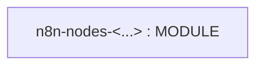
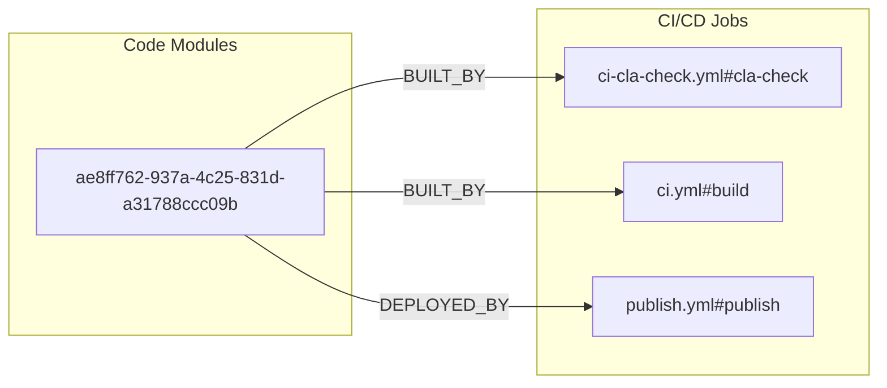
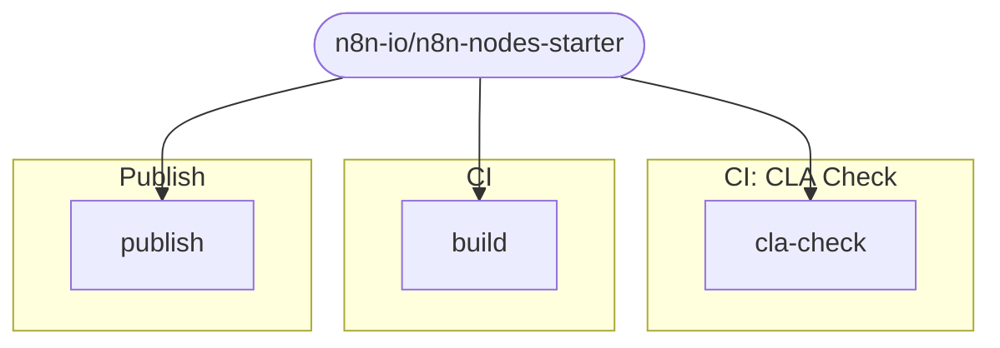

# Repository Architecture Analysis: n8n-io/n8n-nodes-starter

## Metadata
- **SHA**: `6240cb49c06c41b6bc0b2c4c6fc28924ad3a4fbd`
- **Primary Ecosystem**: JavaScript/TypeScript

## Quality Metrics
- **ast_engine**: tree-sitter
- **avg_cognitive_complexity**: 1.28
- **avg_cyclomatic_complexity**: 1.94
- **component_count**: 1
- **dead_code_count**: 0
- **dead_code_symbols**: 0 entry(ies)
- **duplication_pct**: 81.82
- **file_complexities**: 18 entry(ies)
- **files_analyzed**: 18
- **fitness_passed**: False
- **fitness_violation_count**: 1
- **framework**: TypeScript
- **import_edges**: 60 entry(ies)
- **loc**: 1071
- **max_cognitive_complexity**: 11
- **max_cyclomatic_complexity**: 5
- **sloc**: 953

# Architecture: n8n-io/n8n-nodes-starter

## Context
- **Repository**: `n8n-io/n8n-nodes-starter`
- **SHA**: `6240cb49c06c41b6bc0b2c4c6fc28924ad3a4fbd`
- **Ecosystem**: JavaScript/TypeScript
- **Framework**: TypeScript

## Building Block View

## Component Details
- **n8n-nodes-<...>** (`package.json`): MODULE

## 6-Dimension Repository Scorecard

- **Overall Grade**: `B` (83.30/100)
- **Technical Debt Score**: 16.70
- **Estimated Remediation Effort**: 26.54h

| Dimension | Grade | Score | Weight | Details |
| :--- | :---: | :---: | :---: | :--- |
| Code Quality | `C` | 75.00 | 0.20 | avg_cc=1.94, max_cc=5, duplication=81.82%, dead_code=0 |
| Dependency Health | `A` | 100.00 | 0.15 | dependencies=669, outdated=0, vulnerable=0, has_lockfile=True |
| Maintainability | `A` | 94.00 | 0.15 | avg_cognitive=1.28, max_cognitive=11, fitness_violations=1, oversized_files=0 |
| Pipeline Health | `C` | 74.00 | 0.15 | workflows=3, operational_antipatterns=3, parallel_branches=False |
| Security | `B` | 88.00 | 0.20 | vulnerabilities=0, secrets=0, pipeline_security_findings=1 |
| Test Coverage | `C` | 70.00 | 0.15 | coverage=unavailable, ci_test_job=True, test_files_detected=False |

## Architecture Fitness & Workspace Boundaries

- **[MEDIUM] `ATRUSS-ARCH-005` (COMPLEXITY_THRESHOLD)**: Repository duplication_pct (81.82) exceeds policy threshold (15.0).

## Supply Chain Dependencies, Vulnerabilities & Secrets

- **Dependencies Parsed**: 669 | **Vulnerabilities**: 0 | **Secrets**: 0

### Inventory Sample
- `@n8n/node-cli` `*` (npm, `package.json`)
- `@n8n/node-cli` `0.33.1` (npm, `package-lock.json`)
- `eslint` `9.39.4` (npm, `package-lock.json`)
- `eslint` `9.39.4` (npm, `package.json`)
- `prettier` `3.8.3` (npm, `package-lock.json`)
- `prettier` `3.8.3` (npm, `package.json`)
- `release-it` `20.2.0` (npm, `package-lock.json`)
- `release-it` `20.2.0` (npm, `package.json`)
- `typescript` `5.9.3` (npm, `package-lock.json`)
- `typescript` `5.9.3` (npm, `package.json`)
- `@anthropic-ai/sdk` `0.27.3` (npm, `package-lock.json`)
- `@borewit/text-codec` `0.2.2` (npm, `package-lock.json`)
- `@browserbasehq/sdk` `2.13.0` (npm, `package-lock.json`)
- `@browserbasehq/stagehand` `1.14.0` (npm, `package-lock.json`)
- `@cfworker/json-schema` `4.1.1` (npm, `package-lock.json`)
- `@clack/core` `0.5.0` (npm, `package-lock.json`)
- `@clack/prompts` `0.11.0` (npm, `package-lock.json`)
- `@emnapi/core` `1.9.0` (npm, `package-lock.json`)
- `@emnapi/runtime` `1.9.0` (npm, `package-lock.json`)
- `@emnapi/wasi-threads` `1.2.0` (npm, `package-lock.json`)
- `@eslint-community/eslint-utils` `4.9.1` (npm, `package-lock.json`)
- `@eslint-community/regexpp` `4.12.2` (npm, `package-lock.json`)
- `@eslint/config-array` `0.21.2` (npm, `package-lock.json`)
- `@eslint/config-helpers` `0.4.2` (npm, `package-lock.json`)
- `@eslint/core` `0.17.0` (npm, `package-lock.json`)
- `@eslint/eslintrc` `2.1.4` (npm, `package-lock.json`)
- `@eslint/eslintrc` `3.3.5` (npm, `package-lock.json`)
- `@eslint/js` `8.57.1` (npm, `package-lock.json`)
- `@eslint/js` `9.39.4` (npm, `package-lock.json`)
- `@eslint/object-schema` `2.1.7` (npm, `package-lock.json`)
- ... (+639 more dependencies)

## Section 7: Code-to-Cloud Deployment Traceability

- `ae8ff762-937a-4c25-831d-a31788ccc09b` (code_module) --[BUILT_BY]--> `ci-cla-check.yml#cla-check` (ci_job)
- `ae8ff762-937a-4c25-831d-a31788ccc09b` (code_module) --[BUILT_BY]--> `ci.yml#build` (ci_job)
- `ae8ff762-937a-4c25-831d-a31788ccc09b` (code_module) --[DEPLOYED_BY]--> `publish.yml#publish` (ci_job)

## CI/CD Pipeline Topology

