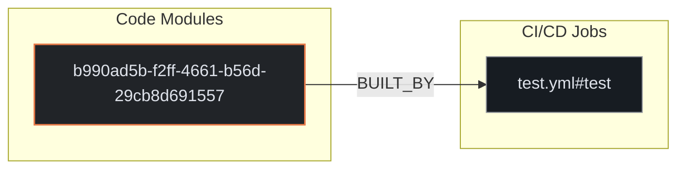
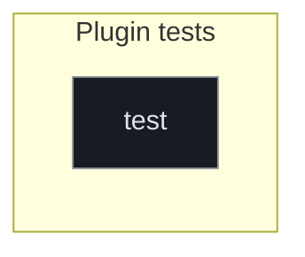

# Repository Architecture Analysis: n8n-io/skills

## Metadata
- **SHA**: `626f50fdf2934116eea2c5469339e03d2d524e83`
- **Primary Ecosystem**: JavaScript/TypeScript

## Quality Metrics
- **ast_engine**: tree-sitter
- **avg_cognitive_complexity**: 4.5
- **avg_cyclomatic_complexity**: 3.92
- **component_count**: 1
- **dead_code_count**: 0
- **dead_code_symbols**: 0 entry(ies)
- **duplication_pct**: 45.59
- **file_complexities**: 5 entry(ies)
- **files_analyzed**: 5
- **fitness_passed**: False
- **fitness_violation_count**: 2
- **framework**: Unknown
- **import_edges**: 44 entry(ies)
- **loc**: 651
- **max_cognitive_complexity**: 36
- **max_cyclomatic_complexity**: 18
- **sloc**: 495
- **test_file_count**: 1

# Architecture: n8n-io/skills

## Context
- **Repository**: `n8n-io/skills`
- **SHA**: `626f50fdf2934116eea2c5469339e03d2d524e83`
- **Ecosystem**: JavaScript/TypeScript
- **Framework**: Unknown

## Building Block View

## Component Details
- **n8n-skills** (`package.json`): MODULE

## 6-Dimension Repository Scorecard

- **Overall Grade**: `B` (80.61/100)
- **Technical Debt Score**: 19.39
- **Estimated Remediation Effort**: 18.97h

| Dimension | Grade | Score | Weight | Details |
| :--- | :---: | :---: | :---: | :--- |
| Code Quality | `D` | 66.82 | 0.20 | avg_cc=3.92, max_cc=18, duplication=45.59%, dead_code=0 |
| Dependency Health | `A` | 100.00 | 0.15 | dependencies=63, outdated=0, vulnerable=0, has_lockfile=True |
| Maintainability | `D` | 64.00 | 0.15 | avg_cognitive=4.50, max_cognitive=36, fitness_violations=2, oversized_files=0 |
| Pipeline Health | `A` | 97.00 | 0.15 | workflows=1, operational_antipatterns=1, parallel_branches=False |
| Security | `B` | 88.00 | 0.20 | vulnerabilities=0, secrets=0, pipeline_security_findings=1 |
| Test Coverage | `C` | 70.00 | 0.15 | coverage=unavailable, ci_test_job=True, test_files_detected=True |

## Architecture Fitness & Workspace Boundaries

- **[MEDIUM] `ATRUSS-ARCH-005` (COMPLEXITY_THRESHOLD)**: Repository duplication_pct (45.59) exceeds policy threshold (15.0).
- **[MEDIUM] `ATRUSS-ARCH-005` (COMPLEXITY_THRESHOLD)**: Repository max_cognitive_complexity (36.0) exceeds policy threshold (25.0).

## Supply Chain Dependencies, Vulnerabilities & Secrets

- **Dependencies Parsed**: 63 | **Vulnerabilities**: 0 | **Secrets**: 0

### Inventory Sample
- `vitest` `5.1.0` (npm, `package.json`)
- `vitest` `5.1.0` (npm, `pnpm-lock.yaml`)
- `yaml` `2.9.1` (npm, `package.json`)
- `yaml` `2.9.1` (npm, `pnpm-lock.yaml`)
- `@jridgewell/resolve-uri` `3.1.2` (npm, `pnpm-lock.yaml`)
- `@jridgewell/sourcemap-codec` `1.6.0` (npm, `pnpm-lock.yaml`)
- `@jridgewell/trace-mapping` `0.3.31` (npm, `pnpm-lock.yaml`)
- `@oxc-project/types` `0.156.0` (npm, `pnpm-lock.yaml`)
- `@rolldown/binding-android-arm-eabi` `1.2.18` (npm, `pnpm-lock.yaml`)
- `@rolldown/binding-android-arm64` `1.2.18` (npm, `pnpm-lock.yaml`)
- `@rolldown/binding-darwin-arm64` `1.2.18` (npm, `pnpm-lock.yaml`)
- `@rolldown/binding-darwin-x64` `1.2.18` (npm, `pnpm-lock.yaml`)
- `@rolldown/binding-freebsd-x64` `1.2.18` (npm, `pnpm-lock.yaml`)
- `@rolldown/binding-linux-arm-gnueabihf` `1.2.18` (npm, `pnpm-lock.yaml`)
- `@rolldown/binding-linux-arm64-gnu` `1.2.18` (npm, `pnpm-lock.yaml`)
- `@rolldown/binding-linux-arm64-musl` `1.2.18` (npm, `pnpm-lock.yaml`)
- `@rolldown/binding-linux-ppc64-gnu` `1.2.18` (npm, `pnpm-lock.yaml`)
- `@rolldown/binding-linux-s390x-gnu` `1.2.18` (npm, `pnpm-lock.yaml`)
- `@rolldown/binding-linux-x64-gnu` `1.2.18` (npm, `pnpm-lock.yaml`)
- `@rolldown/binding-linux-x64-musl` `1.2.18` (npm, `pnpm-lock.yaml`)
- `@rolldown/binding-openharmony-arm64` `1.2.18` (npm, `pnpm-lock.yaml`)
- `@rolldown/binding-win32-arm64-msvc` `1.2.18` (npm, `pnpm-lock.yaml`)
- `@rolldown/binding-win32-x64-msvc` `1.2.18` (npm, `pnpm-lock.yaml`)
- `@rolldown/pluginutils` `1.1.0` (npm, `pnpm-lock.yaml`)
- `@types/chai` `5.2.3` (npm, `pnpm-lock.yaml`)
- `@types/deep-eql` `4.0.2` (npm, `pnpm-lock.yaml`)
- `@types/estree` `1.0.10` (npm, `pnpm-lock.yaml`)
- `@vitest/mocker` `5.1.0` (npm, `pnpm-lock.yaml`)
- `@vitest/spy` `5.1.0` (npm, `pnpm-lock.yaml`)
- `assertion-error` `2.0.1` (npm, `pnpm-lock.yaml`)
- ... (+33 more dependencies)

## Section 7: Code-to-Cloud Deployment Traceability

- `b990ad5b-f2ff-4661-b56d-29cb8d691557` (code_module) --[BUILT_BY]--> `test.yml#test` (ci_job)

## CI/CD Pipeline Topology

