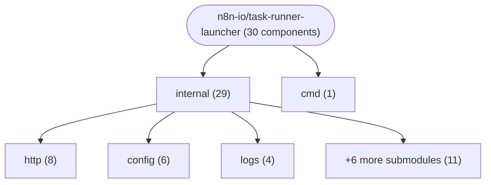
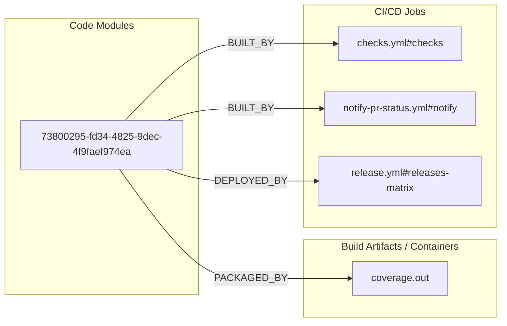
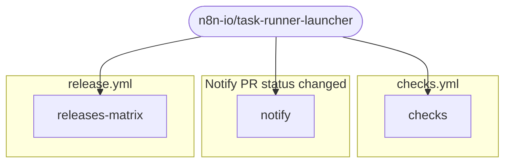

# Repository Architecture Analysis: n8n-io/task-runner-launcher

## Metadata
- **SHA**: `a569a0d2ef40c936fbd36d628cfc2b17856a261d`
- **Primary Ecosystem**: Go

## Quality Metrics
- **ast_engine**: fallback
- **avg_cognitive_complexity**: 0.0
- **avg_cyclomatic_complexity**: 0.0
- **component_count**: 30
- **dead_code_count**: 0
- **dead_code_symbols**: 0 entry(ies)
- **duplication_pct**: 0.0
- **file_complexities**: 0 entry(ies)
- **files_analyzed**: 30
- **fitness_passed**: True
- **fitness_violation_count**: 0
- **framework**: Go Service
- **import_edges**: 0 entry(ies)
- **loc**: 6464
- **max_cognitive_complexity**: 0
- **max_cyclomatic_complexity**: 0
- **sloc**: 5436
- **test_file_count**: 14

# Architecture: n8n-io/task-runner-launcher

## Context
- **Repository**: `n8n-io/task-runner-launcher`
- **SHA**: `a569a0d2ef40c936fbd36d628cfc2b17856a261d`
- **Ecosystem**: Go
- **Framework**: Go Service

## Building Block View

## Component Details
- **main** (`cmd/launcher/main.go`): module
- **launch** (`internal/commands/launch.go`): module
- **launch_test** (`internal/commands/launch_test.go`): module
- **config** (`internal/config/config.go`): module
- **config_test** (`internal/config/config_test.go`): module
- **lookuper** (`internal/config/lookuper.go`): module
- **lookuper_test** (`internal/config/lookuper_test.go`): module
- **validate_url** (`internal/config/validate_url.go`): module
- **validate_url_test** (`internal/config/validate_url_test.go`): module
- **env** (`internal/env/env.go`): module
- **env_test** (`internal/env/env_test.go`): module
- **sentry** (`internal/errorreporting/sentry.go`): module
- **sentry_test** (`internal/errorreporting/sentry_test.go`): module
- **errs** (`internal/errs/errs.go`): module
- **check_until_broker_ready** (`internal/http/check_until_broker_ready.go`): module
- **check_until_broker_ready_test** (`internal/http/check_until_broker_ready_test.go`): module
- **fetch_grant_token** (`internal/http/fetch_grant_token.go`): module
- **fetch_grant_token_test** (`internal/http/fetch_grant_token_test.go`): module
- **healthcheck_server** (`internal/http/healthcheck_server.go`): module
- **healthcheck_server_test** (`internal/http/healthcheck_server_test.go`): module
- **manage_runner_health** (`internal/http/manage_runner_health.go`): module
- **manage_runner_health_test** (`internal/http/manage_runner_health_test.go`): module
- **logger** (`internal/logs/logger.go`): module
- **logger_test** (`internal/logs/logger_test.go`): module
- **runner_writers** (`internal/logs/runner_writers.go`): module
- **runner_writers_test** (`internal/logs/runner_writers_test.go`): module
- **retry** (`internal/retry/retry.go`): module
- **retry_test** (`internal/retry/retry_test.go`): module
- **handshake** (`internal/ws/handshake.go`): module
- **handshake_test** (`internal/ws/handshake_test.go`): module

## 6-Dimension Repository Scorecard

- **Overall Grade**: `B` (81.70/100)
- **Technical Debt Score**: 18.30
- **Estimated Remediation Effort**: 12.57h

| Dimension | Grade | Score | Weight | Details |
| :--- | :---: | :---: | :---: | :--- |
| Code Quality | `A` | 100.00 | 0.20 | avg_cc=0.00, max_cc=0, duplication=0.00%, dead_code=0 |
| Dependency Health | `B` | 85.00 | 0.15 | dependencies=10, outdated=0, vulnerable=0, has_lockfile=False |
| Maintainability | `A` | 100.00 | 0.15 | avg_cognitive=0.00, max_cognitive=0, fitness_violations=0, oversized_files=0 |
| Pipeline Health | `C` | 71.00 | 0.15 | workflows=3, operational_antipatterns=4, parallel_branches=False |
| Security | `D` | 64.00 | 0.20 | vulnerabilities=0, secrets=0, pipeline_security_findings=3 |
| Test Coverage | `C` | 70.00 | 0.15 | coverage=unavailable, ci_test_job=True, test_files_detected=True |

## Supply Chain Dependencies, Vulnerabilities & Secrets

- **Dependencies Parsed**: 10 | **Vulnerabilities**: 0 | **Secrets**: 0

### Inventory Sample
- `github.com/getsentry/sentry-go` `0.35.2` (golang, `go.mod`)
- `github.com/gorilla/websocket` `1.5.3` (golang, `go.mod`)
- `github.com/sethvargo/go-envconfig` `1.1.0` (golang, `go.mod`)
- `github.com/stretchr/testify` `1.8.4` (golang, `go.mod`)
- `github.com/davecgh/go-spew` `1.1.1` (golang, `go.mod`)
- `github.com/kr/text` `0.2.0` (golang, `go.mod`)
- `github.com/pmezard/go-difflib` `1.0.0` (golang, `go.mod`)
- `golang.org/x/sys` `0.49.0` (golang, `go.mod`)
- `golang.org/x/text` `0.43.0` (golang, `go.mod`)
- `gopkg.in/yaml.v3` `3.0.1` (golang, `go.mod`)

## Section 7: Code-to-Cloud Deployment Traceability

- `73800295-fd34-4825-9dec-4f9faef974ea` (code_module) --[BUILT_BY]--> `checks.yml#checks` (ci_job)
- `73800295-fd34-4825-9dec-4f9faef974ea` (code_module) --[BUILT_BY]--> `notify-pr-status.yml#notify` (ci_job)
- `73800295-fd34-4825-9dec-4f9faef974ea` (code_module) --[DEPLOYED_BY]--> `release.yml#releases-matrix` (ci_job)
- `73800295-fd34-4825-9dec-4f9faef974ea` (code_module) --[PACKAGED_BY]--> `coverage.out` (container)

## CI/CD Pipeline Topology

