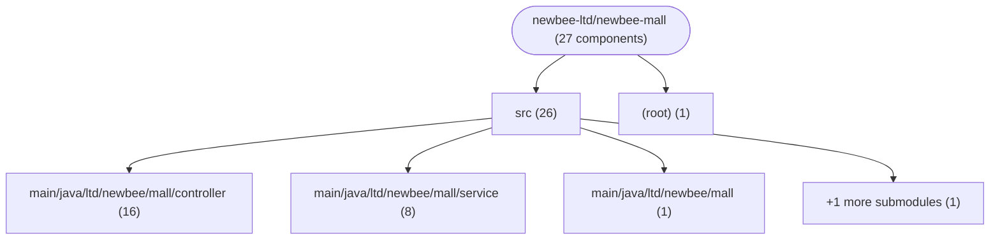
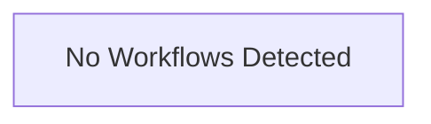

# Repository Architecture Analysis: newbee-ltd/newbee-mall

## Metadata
- **SHA**: `a069069b07027613bf0e7f571736be86f431faee`
- **Primary Ecosystem**: Java

## Quality Metrics
- **avg_cyclomatic_complexity**: 4.48
- **component_count**: 27
- **files_analyzed**: 88
- **framework**: Spring Boot
- **loc**: 7609
- **max_cyclomatic_complexity**: 58
- **sloc**: 4937

# Architecture: newbee-ltd/newbee-mall

## Context
- **Repository**: `newbee-ltd/newbee-mall`
- **SHA**: `a069069b07027613bf0e7f571736be86f431faee`
- **Ecosystem**: Java
- **Framework**: Unknown

## Building Block View

## Component Details
- **newbee-mall** (`pom.xml`): MODULE
- **NewBeeMallApplication** (`src/main/java/ltd/newbee/mall/NewBeeMallApplication.java`): CONFIG
- **NeeBeeMallWebMvcConfigurer** (`src/main/java/ltd/newbee/mall/config/NeeBeeMallWebMvcConfigurer.java`): CONFIG
- **AdminController** (`src/main/java/ltd/newbee/mall/controller/admin/AdminController.java`): API_ROUTE
- **NewBeeMallCarouselController** (`src/main/java/ltd/newbee/mall/controller/admin/NewBeeMallCarouselController.java`): API_ROUTE
- **NewBeeMallGoodsCategoryController** (`src/main/java/ltd/newbee/mall/controller/admin/NewBeeMallGoodsCategoryController.java`): API_ROUTE
- **NewBeeMallGoodsController** (`src/main/java/ltd/newbee/mall/controller/admin/NewBeeMallGoodsController.java`): API_ROUTE
- **NewBeeMallGoodsIndexConfigController** (`src/main/java/ltd/newbee/mall/controller/admin/NewBeeMallGoodsIndexConfigController.java`): API_ROUTE
- **NewBeeMallOrderController** (`src/main/java/ltd/newbee/mall/controller/admin/NewBeeMallOrderController.java`): API_ROUTE
- **NewBeeMallUserController** (`src/main/java/ltd/newbee/mall/controller/admin/NewBeeMallUserController.java`): API_ROUTE
- **CommonController** (`src/main/java/ltd/newbee/mall/controller/common/CommonController.java`): API_ROUTE
- **ErrorPageController** (`src/main/java/ltd/newbee/mall/controller/common/ErrorPageController.java`): API_ROUTE
- **NewBeeMallExceptionHandler** (`src/main/java/ltd/newbee/mall/controller/common/NewBeeMallExceptionHandler.java`): API_ROUTE
- **UploadController** (`src/main/java/ltd/newbee/mall/controller/common/UploadController.java`): API_ROUTE
- **GoodsController** (`src/main/java/ltd/newbee/mall/controller/mall/GoodsController.java`): API_ROUTE
- **IndexController** (`src/main/java/ltd/newbee/mall/controller/mall/IndexController.java`): API_ROUTE
- **OrderController** (`src/main/java/ltd/newbee/mall/controller/mall/OrderController.java`): API_ROUTE
- **PersonalController** (`src/main/java/ltd/newbee/mall/controller/mall/PersonalController.java`): API_ROUTE
- **ShoppingCartController** (`src/main/java/ltd/newbee/mall/controller/mall/ShoppingCartController.java`): API_ROUTE
- **AdminUserServiceImpl** (`src/main/java/ltd/newbee/mall/service/impl/AdminUserServiceImpl.java`): SERVICE
- **NewBeeMallCarouselServiceImpl** (`src/main/java/ltd/newbee/mall/service/impl/NewBeeMallCarouselServiceImpl.java`): SERVICE
- **NewBeeMallCategoryServiceImpl** (`src/main/java/ltd/newbee/mall/service/impl/NewBeeMallCategoryServiceImpl.java`): SERVICE
- **NewBeeMallGoodsServiceImpl** (`src/main/java/ltd/newbee/mall/service/impl/NewBeeMallGoodsServiceImpl.java`): SERVICE
- **NewBeeMallIndexConfigServiceImpl** (`src/main/java/ltd/newbee/mall/service/impl/NewBeeMallIndexConfigServiceImpl.java`): SERVICE
- **NewBeeMallOrderServiceImpl** (`src/main/java/ltd/newbee/mall/service/impl/NewBeeMallOrderServiceImpl.java`): SERVICE
- **NewBeeMallShoppingCartServiceImpl** (`src/main/java/ltd/newbee/mall/service/impl/NewBeeMallShoppingCartServiceImpl.java`): SERVICE
- **NewBeeMallUserServiceImpl** (`src/main/java/ltd/newbee/mall/service/impl/NewBeeMallUserServiceImpl.java`): SERVICE

## CI/CD Pipeline Topology

