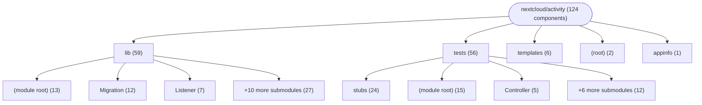
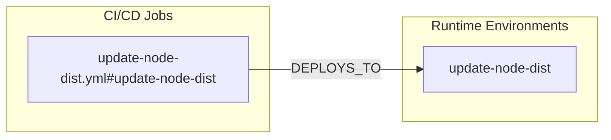
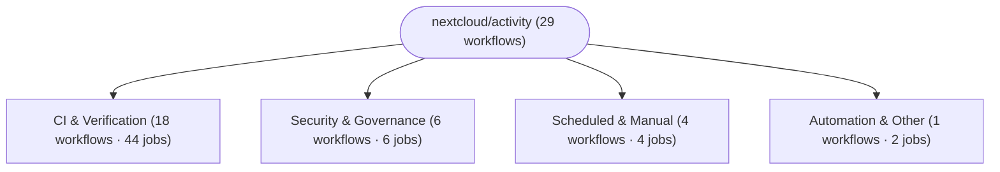

# Repository Architecture Analysis: nextcloud/activity

## Metadata
- **SHA**: `1865dae1b79ec5d3ecc47ebb5e14cec8953e5801`
- **Primary Ecosystem**: PHP

## Quality Metrics
- **ast_engine**: fallback
- **avg_cognitive_complexity**: 0.0
- **avg_cyclomatic_complexity**: 0.0
- **component_count**: 124
- **dead_code_count**: 0
- **dead_code_symbols**: 0 entry(ies)
- **duplication_pct**: 0.0
- **file_complexities**: 0 entry(ies)
- **files_analyzed**: 124
- **fitness_passed**: True
- **fitness_violation_count**: 0
- **framework**: PHP Composer
- **import_edges**: 0 entry(ies)
- **loc**: 19397
- **max_cognitive_complexity**: 0
- **max_cyclomatic_complexity**: 0
- **sloc**: 12954
- **test_file_count**: 75

# Architecture: nextcloud/activity

## Context
- **Repository**: `nextcloud/activity`
- **SHA**: `1865dae1b79ec5d3ecc47ebb5e14cec8953e5801`
- **Ecosystem**: PHP
- **Framework**: PHP Composer

## Building Block View

## Component Details

Showing top 60 representative components out of 124 across 5 module group(s):

- **Module `lib`** (59 components — module: 59)
- **Module `tests`** (56 components — module: 56)
- **Module `templates`** (6 components — module: 6)
- **Module `(root)`** (2 components — module: 2)
- **Module `appinfo`** (1 components — module: 1)

- **.php-cs-fixer.dist** (`.php-cs-fixer.dist.php`): module
- **APIv1Controller** (`lib/Controller/APIv1Controller.php`): module
- **APIv1ControllerTest** (`tests/Controller/APIv1ControllerTest.php`): module
- **APIv2Controller** (`lib/Controller/APIv2Controller.php`): module
- **APIv2ControllerTest** (`tests/Controller/APIv2ControllerTest.php`): module
- **ActivitiesController** (`lib/Controller/ActivitiesController.php`): module
- **ActivitiesControllerTest** (`tests/Controller/ActivitiesControllerTest.php`): module
- **ActivityWidget** (`lib/Dashboard/ActivityWidget.php`): module
- **AddMissingIndicesListener** (`lib/Listener/AddMissingIndicesListener.php`): module
- **Admin** (`lib/Settings/Admin.php`): module
- **AdminSection** (`lib/Settings/AdminSection.php`): module
- **AllFilter** (`lib/Filter/AllFilter.php`): module
- **Application** (`lib/AppInfo/Application.php`): module
- **ApplicationTest** (`tests/AppInfo/ApplicationTest.php`): module
- **ByFilter** (`lib/Filter/ByFilter.php`): module
- **Capabilities** (`lib/Capabilities.php`): module
- **CapabilitiesTest** (`tests/CapabilitiesTest.php`): module
- **Consumer** (`lib/Consumer.php`): module
- **ConsumerTest** (`tests/ConsumerTest.php`): module
- **CurrentUser** (`lib/CurrentUser.php`): module
- **CurrentUserTest** (`tests/CurrentUserTest.php`): module
- **Data** (`lib/Data.php`): module
- **DataDeleteActivitiesTest** (`tests/DataDeleteActivitiesTest.php`): module
- **DataTest** (`tests/DataTest.php`): module
- **DigestMail** (`lib/BackgroundJob/DigestMail.php`): module
- **DigestSender** (`lib/DigestSender.php`): module
- **DigestSenderTest** (`tests/DigestSenderTest.php`): module
- **EmailNotification** (`lib/BackgroundJob/EmailNotification.php`): module
- **EmailNotificationTest** (`tests/BackgroundJob/EmailNotificationTest.php`): module
- **ExpireActivities** (`lib/BackgroundJob/ExpireActivities.php`): module
- **ExpireActivitiesTest** (`tests/BackgroundJob/ExpireActivitiesTest.php`): module
- **FeedController** (`lib/Controller/FeedController.php`): module
- **FeedControllerTest** (`tests/Controller/FeedControllerTest.php`): module
- **Files** (`lib/Extension/Files.php`): module
- **FilesHooks** (`lib/FilesHooks.php`): module
- **FilesHooksTest** (`tests/FilesHooksTest.php`): module
- **Files_Sharing** (`lib/Extension/Files_Sharing.php`): module
- **FocusedFilter** (`lib/Filter/FocusedFilter.php`): module
- **GroupHelper** (`lib/GroupHelper.php`): module
- **GroupHelperDisabled** (`lib/GroupHelperDisabled.php`): module
- **GroupHelperTest** (`tests/GroupHelperTest.php`): module
- **InvalidFilterException** (`lib/Exception/InvalidFilterException.php`): module
- **InvalidSearchCriteriaException** (`lib/Exception/InvalidSearchCriteriaException.php`): module
- **LoadAdditionalScriptsEvent** (`lib/Event/LoadAdditionalScriptsEvent.php`): module
- **LoadSidebarScripts** (`lib/Listener/LoadSidebarScripts.php`): module
- **MailQueueHandler** (`lib/MailQueueHandler.php`): module
- **MailQueueHandlerTest** (`tests/MailQueueHandlerTest.php`): module
- **NodeEventListener** (`lib/Listener/NodeEventListener.php`): module
- **NodeEventListenerTest** (`tests/Listener/NodeEventListenerTest.php`): module
- **NodeRestoredListener** (`lib/Listener/NodeRestoredListener.php`): module
- **NodeRestoredListenerTest** (`tests/Listener/NodeRestoredListenerTest.php`): module
- **NotificationGenerator** (`lib/NotificationGenerator.php`): module
- **NotificationGeneratorTest** (`tests/NotificationGeneratorTest.php`): module
- **Personal** (`lib/Settings/Personal.php`): module
- **PersonalSection** (`lib/Settings/PersonalSection.php`): module
- **Provider** (`tests/Mock/Provider.php`): module
- **RemoteActivity** (`lib/BackgroundJob/RemoteActivity.php`): module
- **RemoteActivityController** (`lib/Controller/RemoteActivityController.php`): module
- **RemoteActivityControllerTest** (`tests/Controller/RemoteActivityControllerTest.php`): module
- **RemoveFormerActivitySettings** (`lib/BackgroundJob/RemoveFormerActivitySettings.php`): module

## 6-Dimension Repository Scorecard

- **Overall Grade**: `D` (60.50/100)
- **Technical Debt Score**: 39.50
- **Estimated Remediation Effort**: 58.38h

| Dimension | Grade | Score | Weight | Details |
| :--- | :---: | :---: | :---: | :--- |
| Code Quality | `A` | 100.00 | 0.20 | avg_cc=0.00, max_cc=0, duplication=0.00%, dead_code=0 |
| Dependency Health | `A` | 100.00 | 0.15 | dependencies=1087, outdated=0, vulnerable=0, has_lockfile=True |
| Maintainability | `A` | 100.00 | 0.15 | avg_cognitive=0.00, max_cognitive=0, fitness_violations=0, oversized_files=0 |
| Pipeline Health | `F` | 0.00 | 0.15 | workflows=29, operational_antipatterns=64, parallel_branches=True |
| Security | `F` | 0.00 | 0.20 | vulnerabilities=0, secrets=0, pipeline_security_findings=6 |
| Test Coverage | `C` | 70.00 | 0.15 | coverage=unavailable, ci_test_job=True, test_files_detected=True |

## Supply Chain Dependencies, Vulnerabilities & Secrets

- **Dependencies Parsed**: 1087 | **Vulnerabilities**: 0 | **Secrets**: 0

### Inventory Sample
- `@mdi/svg` `7.4.47` (npm, `package-lock.json`)
- `@mdi/svg` `7.4.47` (npm, `package.json`)
- `@nextcloud/auth` `2.6.0` (npm, `package-lock.json`)
- `@nextcloud/auth` `2.6.0` (npm, `package.json`)
- `@nextcloud/axios` `2.6.0` (npm, `package-lock.json`)
- `@nextcloud/axios` `2.6.0` (npm, `package.json`)
- `@nextcloud/browserslist-config` `3.1.2` (npm, `package-lock.json`)
- `@nextcloud/browserslist-config` `3.1.2` (npm, `package.json`)
- `@nextcloud/dialogs` `7.5.0` (npm, `package-lock.json`)
- `@nextcloud/dialogs` `7.5.0` (npm, `package.json`)
- `@nextcloud/e2e-test-server` `0.6.1` (npm, `package-lock.json`)
- `@nextcloud/e2e-test-server` `0.6.1` (npm, `package.json`)
- `@nextcloud/eslint-config` `9.0.1` (npm, `package-lock.json`)
- `@nextcloud/eslint-config` `9.0.1` (npm, `package.json`)
- `@nextcloud/files` `4.1.0` (npm, `package-lock.json`)
- `@nextcloud/files` `4.1.0` (npm, `package.json`)
- `@nextcloud/initial-state` `3.0.0` (npm, `package-lock.json`)
- `@nextcloud/initial-state` `3.0.0` (npm, `package.json`)
- `@nextcloud/l10n` `3.4.1` (npm, `package-lock.json`)
- `@nextcloud/l10n` `3.4.1` (npm, `package.json`)
- `@nextcloud/logger` `3.0.3` (npm, `package-lock.json`)
- `@nextcloud/logger` `3.0.3` (npm, `package.json`)
- `@nextcloud/moment` `1.3.5` (npm, `package-lock.json`)
- `@nextcloud/moment` `1.3.5` (npm, `package.json`)
- `@nextcloud/paths` `3.1.0` (npm, `package-lock.json`)
- `@nextcloud/paths` `3.1.0` (npm, `package.json`)
- `@nextcloud/router` `3.2.0` (npm, `package-lock.json`)
- `@nextcloud/router` `3.2.0` (npm, `package.json`)
- `@nextcloud/stylelint-config` `3.2.2` (npm, `package-lock.json`)
- `@nextcloud/stylelint-config` `3.2.2` (npm, `package.json`)
- ... (+1057 more dependencies)

## Section 7: Code-to-Cloud Deployment Traceability

- `update-node-dist.yml#update-node-dist` (ci_job) --[DEPLOYS_TO]--> `update-node-dist` (environment)

## CI/CD Pipeline Topology

