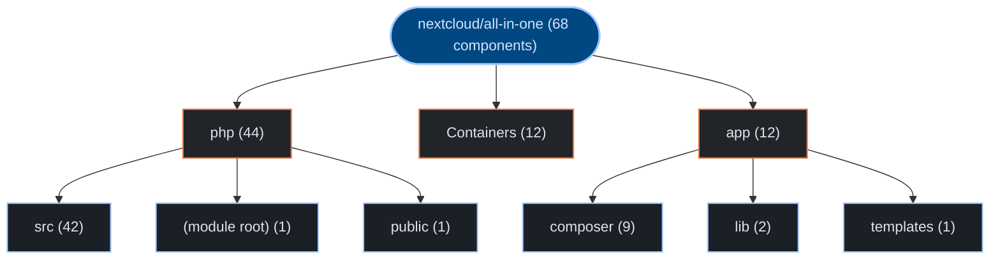

# Repository Architecture Analysis: nextcloud/all-in-one

## Metadata
- **SHA**: `1061a6d697944407a1bb7950c53f1dffa8997e4b`
- **Primary Ecosystem**: PHP

## Quality Metrics
- **ast_engine**: fallback
- **avg_cognitive_complexity**: 0.0
- **avg_cyclomatic_complexity**: 0.0
- **component_count**: 68
- **dead_code_count**: 0
- **dead_code_symbols**: 0 entry(ies)
- **duplication_pct**: 0.0
- **file_complexities**: 0 entry(ies)
- **files_analyzed**: 68
- **fitness_passed**: True
- **fitness_violation_count**: 0
- **framework**: PHP Composer
- **import_edges**: 0 entry(ies)
- **loc**: 14754
- **max_cognitive_complexity**: 0
- **max_cyclomatic_complexity**: 0
- **sloc**: 12778
- **test_file_count**: 30

# Architecture: nextcloud/all-in-one

## Context
- **Repository**: `nextcloud/all-in-one`
- **SHA**: `1061a6d697944407a1bb7950c53f1dffa8997e4b`
- **Ecosystem**: PHP
- **Framework**: PHP Composer

## Building Block View

## Component Details

Showing top 60 representative components out of 68 across 3 module group(s):

- **Module `php`** (44 components — module: 44)
- **Module `Containers`** (12 components — module: 12)
- **Module `app`** (12 components — module: 12)

- **Admin** (`app/lib/Settings/Admin.php`): module
- **AioVariables** (`php/src/Container/AioVariables.php`): module
- **AuthManager** (`php/src/Auth/AuthManager.php`): module
- **AuthMiddleware** (`php/src/Middleware/AuthMiddleware.php`): module
- **BackupNotification** (`php/src/Cron/BackupNotification.php`): module
- **CheckBackup** (`php/src/Cron/CheckBackup.php`): module
- **CheckFreeDiskSpace** (`php/src/Cron/CheckFreeDiskSpace.php`): module
- **ClassExtension** (`php/src/Twig/ClassExtension.php`): module
- **ClassLoader** (`app/composer/composer/ClassLoader.php`): module
- **ConfigurationController** (`php/src/Controller/ConfigurationController.php`): module
- **ConfigurationManager** (`php/src/Data/ConfigurationManager.php`): module
- **Container** (`php/src/Container/Container.php`): module
- **ContainerDefinitionFetcher** (`php/src/ContainerDefinitionFetcher.php`): module
- **ContainerEnvironmentVariables** (`php/src/Container/ContainerEnvironmentVariables.php`): module
- **ContainerPort** (`php/src/Container/ContainerPort.php`): module
- **ContainerPorts** (`php/src/Container/ContainerPorts.php`): module
- **ContainerState** (`php/src/Container/ContainerState.php`): module
- **ContainerVolume** (`php/src/Container/ContainerVolume.php`): module
- **ContainerVolumes** (`php/src/Container/ContainerVolumes.php`): module
- **CreateBackup** (`php/src/Cron/CreateBackup.php`): module
- **CsrfExtension** (`php/src/Twig/CsrfExtension.php`): module
- **DataConst** (`php/src/Data/DataConst.php`): module
- **DependencyInjection** (`php/src/DependencyInjection.php`): module
- **DesecController** (`php/src/Controller/DesecController.php`): module
- **DesecManager** (`php/src/Desec/DesecManager.php`): module
- **DockerActionManager** (`php/src/Docker/DockerActionManager.php`): module
- **DockerController** (`php/src/Controller/DockerController.php`): module
- **DockerHubManager** (`php/src/Docker/DockerHubManager.php`): module
- **GitHubContainerRegistryManager** (`php/src/Docker/GitHubContainerRegistryManager.php`): module
- **InstalledVersions** (`app/composer/composer/InstalledVersions.php`): module
- **InvalidSettingConfigurationException** (`php/src/Data/InvalidSettingConfigurationException.php`): module
- **LoginController** (`app/lib/Controller/LoginController.php`): module
- **LoginController** (`php/src/Controller/LoginController.php`): module
- **NetworkHelper** (`php/src/Helper/NetworkHelper.php`): module
- **OfficeSuite** (`php/src/Data/OfficeSuite.php`): module
- **OutdatedNotification** (`php/src/Cron/OutdatedNotification.php`): module
- **PasswordGenerator** (`php/src/Auth/PasswordGenerator.php`): module
- **PullContainerImages** (`php/src/Cron/PullContainerImages.php`): module
- **Setup** (`php/src/Data/Setup.php`): module
- **StartAndUpdateContainers** (`php/src/Cron/StartAndUpdateContainers.php`): module
- **StartContainers** (`php/src/Cron/StartContainers.php`): module
- **StopContainers** (`php/src/Cron/StopContainers.php`): module
- **UpdateDesecIp** (`php/src/Cron/UpdateDesecIp.php`): module
- **UpdateMastercontainer** (`php/src/Cron/UpdateMastercontainer.php`): module
- **UpdateNotification** (`php/src/Cron/UpdateNotification.php`): module
- **VersionState** (`php/src/Container/VersionState.php`): module
- **admin** (`app/templates/admin.php`): module
- **aio.config** (`Containers/nextcloud/config/aio.config.php`): module
- **apcu.config** (`Containers/nextcloud/config/apcu.config.php`): module
- **apps.config** (`Containers/nextcloud/config/apps.config.php`): module
- **autoload** (`app/composer/autoload.php`): module
- **autoload_classmap** (`app/composer/composer/autoload_classmap.php`): module
- **autoload_namespaces** (`app/composer/composer/autoload_namespaces.php`): module
- **autoload_psr4** (`app/composer/composer/autoload_psr4.php`): module
- **autoload_real** (`app/composer/composer/autoload_real.php`): module
- **autoload_static** (`app/composer/composer/autoload_static.php`): module
- **certificates-bundle.config** (`Containers/nextcloud/config/certificates-bundle.config.php`): module
- **domain-validator** (`php/domain-validator.php`): module
- **index** (`php/public/index.php`): module
- **installed** (`app/composer/composer/installed.php`): module

## 6-Dimension Repository Scorecard

- **Overall Grade**: `D` (60.50/100)
- **Technical Debt Score**: 39.50
- **Estimated Remediation Effort**: 69.88h

| Dimension | Grade | Score | Weight | Details |
| :--- | :---: | :---: | :---: | :--- |
| Code Quality | `A` | 100.00 | 0.20 | avg_cc=0.00, max_cc=0, duplication=0.00%, dead_code=0 |
| Dependency Health | `A` | 100.00 | 0.15 | dependencies=16, outdated=0, vulnerable=0, has_lockfile=True |
| Maintainability | `A` | 100.00 | 0.15 | avg_cognitive=0.00, max_cognitive=0, fitness_violations=0, oversized_files=0 |
| Pipeline Health | `F` | 0.00 | 0.15 | workflows=31, operational_antipatterns=33, parallel_branches=False |
| Security | `F` | 0.00 | 0.20 | vulnerabilities=0, secrets=0, pipeline_security_findings=25 |
| Test Coverage | `C` | 70.00 | 0.15 | coverage=unavailable, ci_test_job=True, test_files_detected=True |

## Supply Chain Dependencies, Vulnerabilities & Secrets

- **Dependencies Parsed**: 16 | **Vulnerabilities**: 0 | **Secrets**: 0

### Inventory Sample
- `guzzlehttp/guzzle` `7.5` (composer, `php/composer.json`)
- `guzzlehttp/psr7` `2.4` (composer, `php/composer.json`)
- `http-interop/http-factory-guzzle` `1.2` (composer, `php/composer.json`)
- `php-di/slim-bridge` `3.3` (composer, `php/composer.json`)
- `slim/csrf` `1.3` (composer, `php/composer.json`)
- `slim/psr7` `1.8` (composer, `php/composer.json`)
- `slim/slim` `4.11` (composer, `php/composer.json`)
- `slim/twig-view` `3.3` (composer, `php/composer.json`)
- `@playwright/test` `1.56.1` (npm, `php/tests/package-lock.json`)
- `@playwright/test` `1.56.1` (npm, `php/tests/package.json`)
- `sserbin/twig-linter` `*` (composer, `php/composer.json`)
- `vimeo/psalm` `7.0` (composer, `php/composer.json`)
- `wapmorgan/php-deprecation-detector` `dev-master` (composer, `php/composer.json`)
- `fsevents` `2.3.2` (npm, `php/tests/package-lock.json`)
- `playwright` `1.56.1` (npm, `php/tests/package-lock.json`)
- `playwright-core` `1.56.1` (npm, `php/tests/package-lock.json`)

## Section 7: Code-to-Cloud Deployment Traceability

```mermaid
flowchart LR
    classDef atlasCategory fill:#212428,stroke:#E87A48,stroke-width:1.5px,color:#dfe3eb
    classDef atlasWorkflow fill:#1b2026,stroke:#a3c9ff,stroke-width:1.5px,color:#dfe3eb
    classDef atlasJob fill:#171c22,stroke:#8d9199,stroke-width:1px,color:#dfe3eb
    classDef atlasTarget fill:#005227,stroke:#8bd99b,stroke-width:1.5px,color:#a7f6b6
    subgraph code_modules["Code Modules"]
        mod_Containers_alpine["Containers/alpine"]:::atlasCategory
        mod_Containers_apache["Containers/apache"]:::atlasCategory
        mod_Containers_borgbackup["Containers/borgbackup"]:::atlasCategory
        mod_Containers_clamav["Containers/clamav"]:::atlasCategory
        mod_Containers_collabora["Containers/collabora"]:::atlasCategory
        mod_Containers_docker_socket_proxy["Containers/docker-socket-proxy"]:::atlasCategory
        mod_Containers_domaincheck["Containers/domaincheck"]:::atlasCategory
        mod_Containers_eurooffice["Containers/eurooffice"]:::atlasCategory
        mod_Containers_fulltextsearch["Containers/fulltextsearch"]:::atlasCategory
        mod_Containers_harp["Containers/harp"]:::atlasCategory
        mod_Containers_imaginary["Containers/imaginary"]:::atlasCategory
        mod_Containers_mastercontainer["Containers/mastercontainer"]:::atlasCategory
        mod_Containers_nextcloud["Containers/nextcloud"]:::atlasCategory
        mod_Containers_notify_push["Containers/notify-push"]:::atlasCategory
        mod_Containers_onlyoffice["Containers/onlyoffice"]:::atlasCategory
        mod_Containers_postgresql["Containers/postgresql"]:::atlasCategory
        mod_Containers_redis["Containers/redis"]:::atlasCategory
        mod_Containers_talk["Containers/talk"]:::atlasCategory
        mod_Containers_talk_recording["Containers/talk-recording"]:::atlasCategory
        mod_Containers_watchtower["Containers/watchtower"]:::atlasCategory
        mod_Containers_whiteboard["Containers/whiteboard"]:::atlasCategory
        mod_app_composer["app/composer"]:::atlasCategory
        mod_nextcloud_aio_helm_chart["nextcloud-aio-helm-chart"]:::atlasCategory
        mod_php["php"]:::atlasCategory
        mod_php_tests["php/tests"]:::atlasCategory
        mod_php_tests_Containers_composer["php/tests/Containers/composer"]:::atlasCategory
    end
    subgraph build_artifacts["Build Artifacts / Containers"]
        art_Containers_alpine_Dockerfile["Containers/alpine/Dockerfile"]:::atlasWorkflow
        art_Containers_apache_Dockerfile["Containers/apache/Dockerfile"]:::atlasWorkflow
        art_Containers_borgbackup_Dockerfile["Containers/borgbackup/Dockerfile"]:::atlasWorkflow
        art_Containers_clamav_Dockerfile["Containers/clamav/Dockerfile"]:::atlasWorkflow
        art_Containers_collabora_Dockerfile["Containers/collabora/Dockerfile"]:::atlasWorkflow
        art_Containers_docker_socket_proxy_Dockerfile["Containers/docker-socket-proxy/Dockerfile"]:::atlasWorkflow
        art_Containers_domaincheck_Dockerfile["Containers/domaincheck/Dockerfile"]:::atlasWorkflow
        art_Containers_eurooffice_Dockerfile["Containers/eurooffice/Dockerfile"]:::atlasWorkflow
        art_Containers_fulltextsearch_Dockerfile["Containers/fulltextsearch/Dockerfile"]:::atlasWorkflow
        art_Containers_harp_Dockerfile["Containers/harp/Dockerfile"]:::atlasWorkflow
        art_Containers_imaginary_Dockerfile["Containers/imaginary/Dockerfile"]:::atlasWorkflow
        art_Containers_mastercontainer_Dockerfile["Containers/mastercontainer/Dockerfile"]:::atlasWorkflow
        art_Containers_nextcloud_Dockerfile["Containers/nextcloud/Dockerfile"]:::atlasWorkflow
        art_Containers_notify_push_Dockerfile["Containers/notify-push/Dockerfile"]:::atlasWorkflow
        art_Containers_onlyoffice_Dockerfile["Containers/onlyoffice/Dockerfile"]:::atlasWorkflow
        art_Containers_postgresql_Dockerfile["Containers/postgresql/Dockerfile"]:::atlasWorkflow
        art_Containers_redis_Dockerfile["Containers/redis/Dockerfile"]:::atlasWorkflow
        art_Containers_talk_recording_Dockerfile["Containers/talk-recording/Dockerfile"]:::atlasWorkflow
        art_Containers_talk_Dockerfile["Containers/talk/Dockerfile"]:::atlasWorkflow
        art_Containers_watchtower_Dockerfile["Containers/watchtower/Dockerfile"]:::atlasWorkflow
        art_Containers_whiteboard_Dockerfile["Containers/whiteboard/Dockerfile"]:::atlasWorkflow
        art_php_tests_Containers_composer_Dockerfile["php/tests/Containers/composer/Dockerfile"]:::atlasWorkflow
    end
    subgraph ci_jobs["CI/CD Jobs"]
        job_collabora_yml_collabora_update["collabora.yml#collabora-update"]:::atlasJob
        job_dependency_updates_yml_dependency_updates["dependency-updates.yml#dependency_updates"]:::atlasJob
        job_desec_api_version_watch_yml_watch["desec-api-version-watch.yml#watch"]:::atlasJob
        job_helm_release_yml_release["helm-release.yml#release"]:::atlasJob
        job_imaginary_update_yml_run_update["imaginary-update.yml#run_update"]:::atlasJob
        job_json_validator_yml_json_validator["json-validator.yml#json-validator"]:::atlasJob
        job_lint_helm_yml_lint_helm["lint-helm.yml#lint-helm"]:::atlasJob
        job_lint_php_yml_php_lint["lint-php.yml#php-lint"]:::atlasJob
        job_lint_php_yml_summary["lint-php.yml#summary"]:::atlasJob
        job_nextcloud_update_yml_run_update_sh["nextcloud-update.yml#run_update_sh"]:::atlasJob
        job_php_deprecation_detector_yml_phpdd["php-deprecation-detector.yml#phpdd"]:::atlasJob
        job_playwright_on_push_yml_test["playwright-on-push.yml#test"]:::atlasJob
        job_playwright_on_workflow_dispatch_yml_test["playwright-on-workflow-dispatch.yml#test"]:::atlasJob
        job_psalm_update_baseline_yml_update_psalm_baseline["psalm-update-baseline.yml#update-psalm-baseline"]:::atlasJob
        job_psalm_yml_static_analysis["psalm.yml#static-analysis"]:::atlasJob
        job_talk_yml_talk_update["talk.yml#talk-update"]:::atlasJob
        job_twig_lint_yml_twig_lint["twig-lint.yml#twig-lint"]:::atlasJob
        job_update_helm_yml_update_helm["update-helm.yml#update-helm"]:::atlasJob
        job_watchtower_update_yml_watchtower_update["watchtower-update.yml#watchtower-update"]:::atlasJob
    end
    subgraph runtime_envs["Runtime Environments"]
        env_azure["azure"]:::atlasTarget
        env_kubernetes["kubernetes"]:::atlasTarget
    end
    job_helm_release_yml_release -->|DEPLOYS_TO| env_azure
    job_helm_release_yml_release -->|DEPLOYS_TO| env_kubernetes
    job_lint_helm_yml_lint_helm -->|DEPLOYS_TO| env_azure
    job_lint_helm_yml_lint_helm -->|DEPLOYS_TO| env_kubernetes
    mod_Containers_alpine -->|PACKAGED_BY| art_Containers_alpine_Dockerfile
    mod_Containers_alpine -->|PACKAGED_BY| art_Containers_apache_Dockerfile
    mod_Containers_alpine -->|PACKAGED_BY| art_Containers_borgbackup_Dockerfile
    mod_Containers_alpine -->|PACKAGED_BY| art_Containers_clamav_Dockerfile
    mod_Containers_alpine -->|PACKAGED_BY| art_Containers_docker_socket_proxy_Dockerfile
    mod_Containers_alpine -->|PACKAGED_BY| art_Containers_domaincheck_Dockerfile
    mod_Containers_alpine -->|PACKAGED_BY| art_Containers_imaginary_Dockerfile
    mod_Containers_alpine -->|PACKAGED_BY| art_Containers_mastercontainer_Dockerfile
    mod_Containers_alpine -->|PACKAGED_BY| art_Containers_nextcloud_Dockerfile
    mod_Containers_alpine -->|PACKAGED_BY| art_Containers_notify_push_Dockerfile
    mod_Containers_alpine -->|PACKAGED_BY| art_Containers_postgresql_Dockerfile
    mod_Containers_alpine -->|PACKAGED_BY| art_Containers_redis_Dockerfile
    mod_Containers_alpine -->|PACKAGED_BY| art_Containers_talk_recording_Dockerfile
    mod_Containers_alpine -->|PACKAGED_BY| art_Containers_talk_Dockerfile
    mod_Containers_alpine -->|PACKAGED_BY| art_Containers_watchtower_Dockerfile
    mod_Containers_apache -->|PACKAGED_BY| art_Containers_apache_Dockerfile
    mod_Containers_borgbackup -->|PACKAGED_BY| art_Containers_borgbackup_Dockerfile
    mod_Containers_clamav -->|PACKAGED_BY| art_Containers_clamav_Dockerfile
    mod_Containers_collabora -->|PACKAGED_BY| art_Containers_collabora_Dockerfile
    mod_Containers_docker_socket_proxy -->|PACKAGED_BY| art_Containers_docker_socket_proxy_Dockerfile
    mod_Containers_domaincheck -->|PACKAGED_BY| art_Containers_domaincheck_Dockerfile
    mod_Containers_eurooffice -->|PACKAGED_BY| art_Containers_eurooffice_Dockerfile
    mod_Containers_fulltextsearch -->|PACKAGED_BY| art_Containers_fulltextsearch_Dockerfile
    mod_Containers_harp -->|PACKAGED_BY| art_Containers_harp_Dockerfile
    mod_Containers_imaginary -->|BUILT_BY| job_imaginary_update_yml_run_update
    mod_Containers_imaginary -->|PACKAGED_BY| art_Containers_imaginary_Dockerfile
    mod_Containers_mastercontainer -->|BUILT_BY| job_dependency_updates_yml_dependency_updates
    mod_Containers_mastercontainer -->|PACKAGED_BY| art_Containers_mastercontainer_Dockerfile
    mod_Containers_nextcloud -->|BUILT_BY| job_dependency_updates_yml_dependency_updates
    mod_Containers_nextcloud -->|BUILT_BY| job_nextcloud_update_yml_run_update_sh
    mod_Containers_nextcloud -->|PACKAGED_BY| art_Containers_alpine_Dockerfile
    mod_Containers_nextcloud -->|PACKAGED_BY| art_Containers_apache_Dockerfile
    mod_Containers_nextcloud -->|PACKAGED_BY| art_Containers_borgbackup_Dockerfile
    mod_Containers_nextcloud -->|PACKAGED_BY| art_Containers_clamav_Dockerfile
    mod_Containers_nextcloud -->|PACKAGED_BY| art_Containers_collabora_Dockerfile
    mod_Containers_nextcloud -->|PACKAGED_BY| art_Containers_docker_socket_proxy_Dockerfile
    mod_Containers_nextcloud -->|PACKAGED_BY| art_Containers_domaincheck_Dockerfile
    mod_Containers_nextcloud -->|PACKAGED_BY| art_Containers_eurooffice_Dockerfile
    mod_Containers_nextcloud -->|PACKAGED_BY| art_Containers_fulltextsearch_Dockerfile
    mod_Containers_nextcloud -->|PACKAGED_BY| art_Containers_harp_Dockerfile
    mod_Containers_nextcloud -->|PACKAGED_BY| art_Containers_imaginary_Dockerfile
    mod_Containers_nextcloud -->|PACKAGED_BY| art_Containers_mastercontainer_Dockerfile
    mod_Containers_nextcloud -->|PACKAGED_BY| art_Containers_nextcloud_Dockerfile
    mod_Containers_nextcloud -->|PACKAGED_BY| art_Containers_notify_push_Dockerfile
    mod_Containers_nextcloud -->|PACKAGED_BY| art_Containers_onlyoffice_Dockerfile
    mod_Containers_nextcloud -->|PACKAGED_BY| art_Containers_postgresql_Dockerfile
    mod_Containers_nextcloud -->|PACKAGED_BY| art_Containers_redis_Dockerfile
    mod_Containers_nextcloud -->|PACKAGED_BY| art_Containers_talk_recording_Dockerfile
    mod_Containers_nextcloud -->|PACKAGED_BY| art_Containers_talk_Dockerfile
    mod_Containers_nextcloud -->|PACKAGED_BY| art_Containers_watchtower_Dockerfile
    mod_Containers_nextcloud -->|PACKAGED_BY| art_Containers_whiteboard_Dockerfile
    mod_Containers_notify_push -->|PACKAGED_BY| art_Containers_notify_push_Dockerfile
    mod_Containers_onlyoffice -->|PACKAGED_BY| art_Containers_onlyoffice_Dockerfile
    mod_Containers_postgresql -->|PACKAGED_BY| art_Containers_nextcloud_Dockerfile
    mod_Containers_postgresql -->|PACKAGED_BY| art_Containers_postgresql_Dockerfile
    mod_Containers_redis -->|PACKAGED_BY| art_Containers_nextcloud_Dockerfile
    mod_Containers_redis -->|PACKAGED_BY| art_Containers_redis_Dockerfile
    mod_Containers_talk -->|BUILT_BY| job_talk_yml_talk_update
    mod_Containers_talk -->|PACKAGED_BY| art_Containers_talk_recording_Dockerfile
    mod_Containers_talk -->|PACKAGED_BY| art_Containers_talk_Dockerfile
    mod_Containers_talk_recording -->|BUILT_BY| job_talk_yml_talk_update
    mod_Containers_talk_recording -->|PACKAGED_BY| art_Containers_talk_recording_Dockerfile
    mod_Containers_watchtower -->|BUILT_BY| job_watchtower_update_yml_watchtower_update
    mod_Containers_watchtower -->|PACKAGED_BY| art_Containers_apache_Dockerfile
    mod_Containers_watchtower -->|PACKAGED_BY| art_Containers_borgbackup_Dockerfile
    mod_Containers_watchtower -->|PACKAGED_BY| art_Containers_clamav_Dockerfile
    mod_Containers_watchtower -->|PACKAGED_BY| art_Containers_collabora_Dockerfile
    mod_Containers_watchtower -->|PACKAGED_BY| art_Containers_docker_socket_proxy_Dockerfile
    mod_Containers_watchtower -->|PACKAGED_BY| art_Containers_domaincheck_Dockerfile
    mod_Containers_watchtower -->|PACKAGED_BY| art_Containers_eurooffice_Dockerfile
    mod_Containers_watchtower -->|PACKAGED_BY| art_Containers_fulltextsearch_Dockerfile
    mod_Containers_watchtower -->|PACKAGED_BY| art_Containers_harp_Dockerfile
    mod_Containers_watchtower -->|PACKAGED_BY| art_Containers_imaginary_Dockerfile
    mod_Containers_watchtower -->|PACKAGED_BY| art_Containers_nextcloud_Dockerfile
    mod_Containers_watchtower -->|PACKAGED_BY| art_Containers_notify_push_Dockerfile
    mod_Containers_watchtower -->|PACKAGED_BY| art_Containers_onlyoffice_Dockerfile
    mod_Containers_watchtower -->|PACKAGED_BY| art_Containers_postgresql_Dockerfile
    mod_Containers_watchtower -->|PACKAGED_BY| art_Containers_redis_Dockerfile
    mod_Containers_watchtower -->|PACKAGED_BY| art_Containers_talk_recording_Dockerfile
    mod_Containers_watchtower -->|PACKAGED_BY| art_Containers_talk_Dockerfile
    mod_Containers_watchtower -->|PACKAGED_BY| art_Containers_watchtower_Dockerfile
    mod_Containers_watchtower -->|PACKAGED_BY| art_Containers_whiteboard_Dockerfile
    mod_Containers_whiteboard -->|PACKAGED_BY| art_Containers_whiteboard_Dockerfile
    mod_app_composer -->|PACKAGED_BY| art_Containers_mastercontainer_Dockerfile
    mod_app_composer -->|PACKAGED_BY| art_php_tests_Containers_composer_Dockerfile
    mod_nextcloud_aio_helm_chart -->|BUILT_BY| job_update_helm_yml_update_helm
    mod_nextcloud_aio_helm_chart -->|DEPLOYED_BY| job_helm_release_yml_release
    mod_nextcloud_aio_helm_chart -->|DEPLOYED_BY| job_lint_helm_yml_lint_helm
    mod_php -->|BUILT_BY| job_collabora_yml_collabora_update
    mod_php -->|BUILT_BY| job_dependency_updates_yml_dependency_updates
    mod_php -->|BUILT_BY| job_desec_api_version_watch_yml_watch
    mod_php -->|BUILT_BY| job_json_validator_yml_json_validator
    mod_php -->|BUILT_BY| job_lint_php_yml_php_lint
    mod_php -->|BUILT_BY| job_lint_php_yml_summary
    mod_php -->|BUILT_BY| job_nextcloud_update_yml_run_update_sh
    mod_php -->|BUILT_BY| job_php_deprecation_detector_yml_phpdd
    mod_php -->|BUILT_BY| job_playwright_on_push_yml_test
    mod_php -->|BUILT_BY| job_playwright_on_workflow_dispatch_yml_test
    mod_php -->|BUILT_BY| job_psalm_update_baseline_yml_update_psalm_baseline
    mod_php -->|BUILT_BY| job_psalm_yml_static_analysis
    mod_php -->|BUILT_BY| job_twig_lint_yml_twig_lint
    mod_php -->|BUILT_BY| job_update_helm_yml_update_helm
    mod_php -->|PACKAGED_BY| art_Containers_mastercontainer_Dockerfile
    mod_php -->|PACKAGED_BY| art_Containers_nextcloud_Dockerfile
    mod_php -->|PACKAGED_BY| art_php_tests_Containers_composer_Dockerfile
    mod_php_tests -->|BUILT_BY| job_dependency_updates_yml_dependency_updates
    mod_php_tests -->|BUILT_BY| job_desec_api_version_watch_yml_watch
    mod_php_tests -->|BUILT_BY| job_playwright_on_push_yml_test
    mod_php_tests -->|BUILT_BY| job_playwright_on_workflow_dispatch_yml_test
    mod_php_tests -->|PACKAGED_BY| art_Containers_mastercontainer_Dockerfile
    mod_php_tests_Containers_composer -->|BUILT_BY| job_dependency_updates_yml_dependency_updates
    mod_php_tests_Containers_composer -->|PACKAGED_BY| art_Containers_mastercontainer_Dockerfile
    mod_php_tests_Containers_composer -->|PACKAGED_BY| art_php_tests_Containers_composer_Dockerfile
    art_Containers_imaginary_Dockerfile -->|BUILT_BY| job_imaginary_update_yml_run_update
    art_Containers_mastercontainer_Dockerfile -->|BUILT_BY| job_dependency_updates_yml_dependency_updates
    art_Containers_nextcloud_Dockerfile -->|BUILT_BY| job_dependency_updates_yml_dependency_updates
    art_Containers_nextcloud_Dockerfile -->|BUILT_BY| job_nextcloud_update_yml_run_update_sh
    art_Containers_talk_recording_Dockerfile -->|BUILT_BY| job_talk_yml_talk_update
    art_Containers_talk_Dockerfile -->|BUILT_BY| job_talk_yml_talk_update
    art_Containers_watchtower_Dockerfile -->|BUILT_BY| job_watchtower_update_yml_watchtower_update
    art_php_tests_Containers_composer_Dockerfile -->|BUILT_BY| job_dependency_updates_yml_dependency_updates
```

- `helm-release.yml#release` (ci_job) --[DEPLOYS_TO]--> `azure` (environment)
- `helm-release.yml#release` (ci_job) --[DEPLOYS_TO]--> `kubernetes` (environment)
- `lint-helm.yml#lint-helm` (ci_job) --[DEPLOYS_TO]--> `azure` (environment)
- `lint-helm.yml#lint-helm` (ci_job) --[DEPLOYS_TO]--> `kubernetes` (environment)
- `Containers/alpine` (code_module) --[PACKAGED_BY]--> `Containers/alpine/Dockerfile` (container)
- `Containers/alpine` (code_module) --[PACKAGED_BY]--> `Containers/apache/Dockerfile` (container)
- `Containers/alpine` (code_module) --[PACKAGED_BY]--> `Containers/borgbackup/Dockerfile` (container)
- `Containers/alpine` (code_module) --[PACKAGED_BY]--> `Containers/clamav/Dockerfile` (container)
- `Containers/alpine` (code_module) --[PACKAGED_BY]--> `Containers/docker-socket-proxy/Dockerfile` (container)
- `Containers/alpine` (code_module) --[PACKAGED_BY]--> `Containers/domaincheck/Dockerfile` (container)
- `Containers/alpine` (code_module) --[PACKAGED_BY]--> `Containers/imaginary/Dockerfile` (container)
- `Containers/alpine` (code_module) --[PACKAGED_BY]--> `Containers/mastercontainer/Dockerfile` (container)
- `Containers/alpine` (code_module) --[PACKAGED_BY]--> `Containers/nextcloud/Dockerfile` (container)
- `Containers/alpine` (code_module) --[PACKAGED_BY]--> `Containers/notify-push/Dockerfile` (container)
- `Containers/alpine` (code_module) --[PACKAGED_BY]--> `Containers/postgresql/Dockerfile` (container)
- `Containers/alpine` (code_module) --[PACKAGED_BY]--> `Containers/redis/Dockerfile` (container)
- `Containers/alpine` (code_module) --[PACKAGED_BY]--> `Containers/talk-recording/Dockerfile` (container)
- `Containers/alpine` (code_module) --[PACKAGED_BY]--> `Containers/talk/Dockerfile` (container)
- `Containers/alpine` (code_module) --[PACKAGED_BY]--> `Containers/watchtower/Dockerfile` (container)
- `Containers/apache` (code_module) --[PACKAGED_BY]--> `Containers/apache/Dockerfile` (container)
- `Containers/borgbackup` (code_module) --[PACKAGED_BY]--> `Containers/borgbackup/Dockerfile` (container)
- `Containers/clamav` (code_module) --[PACKAGED_BY]--> `Containers/clamav/Dockerfile` (container)
- `Containers/collabora` (code_module) --[PACKAGED_BY]--> `Containers/collabora/Dockerfile` (container)
- `Containers/docker-socket-proxy` (code_module) --[PACKAGED_BY]--> `Containers/docker-socket-proxy/Dockerfile` (container)
- `Containers/domaincheck` (code_module) --[PACKAGED_BY]--> `Containers/domaincheck/Dockerfile` (container)
- `Containers/eurooffice` (code_module) --[PACKAGED_BY]--> `Containers/eurooffice/Dockerfile` (container)
- `Containers/fulltextsearch` (code_module) --[PACKAGED_BY]--> `Containers/fulltextsearch/Dockerfile` (container)
- `Containers/harp` (code_module) --[PACKAGED_BY]--> `Containers/harp/Dockerfile` (container)
- `Containers/imaginary` (code_module) --[BUILT_BY]--> `imaginary-update.yml#run_update` (ci_job)
- `Containers/imaginary` (code_module) --[PACKAGED_BY]--> `Containers/imaginary/Dockerfile` (container)
- `Containers/mastercontainer` (code_module) --[BUILT_BY]--> `dependency-updates.yml#dependency_updates` (ci_job)
- `Containers/mastercontainer` (code_module) --[PACKAGED_BY]--> `Containers/mastercontainer/Dockerfile` (container)
- `Containers/nextcloud` (code_module) --[BUILT_BY]--> `dependency-updates.yml#dependency_updates` (ci_job)
- `Containers/nextcloud` (code_module) --[BUILT_BY]--> `nextcloud-update.yml#run_update_sh` (ci_job)
- `Containers/nextcloud` (code_module) --[PACKAGED_BY]--> `Containers/alpine/Dockerfile` (container)
- `Containers/nextcloud` (code_module) --[PACKAGED_BY]--> `Containers/apache/Dockerfile` (container)
- `Containers/nextcloud` (code_module) --[PACKAGED_BY]--> `Containers/borgbackup/Dockerfile` (container)
- `Containers/nextcloud` (code_module) --[PACKAGED_BY]--> `Containers/clamav/Dockerfile` (container)
- `Containers/nextcloud` (code_module) --[PACKAGED_BY]--> `Containers/collabora/Dockerfile` (container)
- `Containers/nextcloud` (code_module) --[PACKAGED_BY]--> `Containers/docker-socket-proxy/Dockerfile` (container)

## CI/CD Pipeline Topology

```mermaid
graph TD;
  classDef atlasRoot fill:#004882,stroke:#a3c9ff,stroke-width:2px,color:#d3e4ff
  classDef atlasCategory fill:#212428,stroke:#E87A48,stroke-width:1.5px,color:#dfe3eb
  classDef atlasWorkflow fill:#1b2026,stroke:#a3c9ff,stroke-width:1.5px,color:#dfe3eb
  classDef atlasJob fill:#171c22,stroke:#8d9199,stroke-width:1px,color:#dfe3eb
  classDef atlasTarget fill:#005227,stroke:#8bd99b,stroke-width:1.5px,color:#a7f6b6
  classDef atlasAlert fill:#93000a,stroke:#ffb4ab,stroke-width:1.5px,color:#ffdad6
  classDef atlasMore fill:#252a31,stroke:#8d9199,stroke-dasharray:4 4,color:#c3c6cf
  pipeline_root(["nextcloud/all-in-one (31 workflows)"]):::atlasRoot
  grp_0_Scheduled___Manual["Scheduled & Manual (16 workflows · 16 jobs)"]:::atlasCategory
  pipeline_root --> grp_0_Scheduled___Manual
  wf_11_Lint_Helm_Charts["Lint Helm Charts (1 jobs)"]:::atlasWorkflow
  grp_0_Scheduled___Manual --> wf_11_Lint_Helm_Charts
  job_11_lint_helm["lint-helm"]:::atlasJob
  wf_11_Lint_Helm_Charts --> job_11_lint_helm
  wf_18_Playwright_Tests["Playwright Tests (1 jobs)"]:::atlasWorkflow
  grp_0_Scheduled___Manual --> wf_18_Playwright_Tests
  job_18_test["test"]:::atlasJob
  wf_18_Playwright_Tests --> job_18_test
  wf_25_Update_Copyright["Update Copyright (1 jobs)"]:::atlasWorkflow
  grp_0_Scheduled___Manual --> wf_25_Update_Copyright
  job_25_update_copyright["update-copyright"]:::atlasJob
  wf_25_Update_Copyright --> job_25_update_copyright
  grp_1_CI___Verification["CI & Verification (11 workflows · 12 jobs)"]:::atlasCategory
  pipeline_root --> grp_1_CI___Verification
  wf_0_Codespell["Codespell (1 jobs)"]:::atlasWorkflow
  grp_1_CI___Verification --> wf_0_Codespell
  job_0_codespell["codespell"]:::atlasJob
  wf_0_Codespell --> job_0_codespell
  wf_6_Docker_Lint["Docker Lint (1 jobs)"]:::atlasWorkflow
  grp_1_CI___Verification --> wf_6_Docker_Lint
  job_6_docker_lint["docker-lint"]:::atlasJob
  wf_6_Docker_Lint --> job_6_docker_lint
  wf_12_Lint_php["Lint php (2 jobs)"]:::atlasWorkflow
  grp_1_CI___Verification --> wf_12_Lint_php
  job_12_php_lint["php-lint"]:::atlasJob
  job_12_summary["summary"]:::atlasJob
  wf_12_Lint_php --> job_12_php_lint
  job_12_php_lint --> job_12_summary
  grp_2_Release___Deploy["Release & Deploy (2 workflows · 2 jobs)"]:::atlasCategory
  pipeline_root --> grp_2_Release___Deploy
  wf_7_Block_if_prerelease_is_present["Block if prerelease is present (1 jobs)"]:::atlasWorkflow
  grp_2_Release___Deploy --> wf_7_Block_if_prerelease_is_present
  job_7_check_latest_release["check-latest-release"]:::atlasJob
  wf_7_Block_if_prerelease_is_present --> job_7_check_latest_release
  wf_8_Helm_Chart_Releaser["Helm Chart Releaser (1 jobs)"]:::atlasWorkflow
  grp_2_Release___Deploy --> wf_8_Helm_Chart_Releaser
  job_8_release["release"]:::atlasJob
  wf_8_Helm_Chart_Releaser --> job_8_release
  grp_3_Security___Governance["Security & Governance (2 workflows · 2 jobs)"]:::atlasCategory
  pipeline_root --> grp_3_Security___Governance
  wf_3_Auto_approve_Dependabot_PRs["Auto approve Dependabot PRs (1 jobs)"]:::atlasWorkflow
  grp_3_Security___Governance --> wf_3_Auto_approve_Dependabot_PRs
  job_3_auto_approve_merge["auto-approve-merge"]:::atlasJob
  wf_3_Auto_approve_Dependabot_PRs --> job_3_auto_approve_merge
  wf_14_Lock_Threads["Lock Threads (1 jobs)"]:::atlasWorkflow
  grp_3_Security___Governance --> wf_14_Lock_Threads
  job_14_action["action"]:::atlasJob
  wf_14_Lock_Threads --> job_14_action
  wf_more["+21 more workflows"]:::atlasMore
  pipeline_root --> wf_more
```

