# Repository Architecture Analysis: nextcloud/desktop

## Metadata
- **SHA**: `9ca4db9d5850499fe9b953708ed5f5666caa4a94`
- **Primary Ecosystem**: JavaScript/TypeScript

## Quality Metrics
- **ast_engine**: tree-sitter
- **avg_cognitive_complexity**: 26.21
- **avg_cyclomatic_complexity**: 13.79
- **component_count**: 0
- **dead_code_count**: 1
- **dead_code_symbols**: 1 entry(ies)
- **duplication_pct**: 99.81
- **file_complexities**: 13 entry(ies)
- **files_analyzed**: 65
- **fitness_passed**: False
- **fitness_violation_count**: 3
- **framework**: Unknown
- **import_edges**: 0 entry(ies)
- **loc**: 510218
- **max_cognitive_complexity**: 54
- **max_cyclomatic_complexity**: 26
- **sloc**: 508659
- **test_file_count**: 150

## 6-Dimension Repository Scorecard

- **Overall Grade**: `F` (57.10/100)
- **Technical Debt Score**: 42.90
- **Estimated Remediation Effort**: 53.44h

| Dimension | Grade | Score | Weight | Details |
| :--- | :---: | :---: | :---: | :--- |
| Code Quality | `F` | 26.50 | 0.20 | avg_cc=13.79, max_cc=26, duplication=99.81%, dead_code=1 |
| Dependency Health | `A` | 90.00 | 0.15 | dependencies=0 (no manifests parsed) |
| Maintainability | `F` | 12.00 | 0.15 | avg_cognitive=26.21, max_cognitive=54, fitness_violations=3, oversized_files=12 |
| Pipeline Health | `F` | 40.00 | 0.15 | workflows=0 |
| Security | `A` | 100.00 | 0.20 | vulnerabilities=0, secrets=0, pipeline_security_findings=0 |
| Test Coverage | `C` | 70.00 | 0.15 | coverage=unavailable, ci_test_job=False, test_files_detected=True |

## Architecture Fitness & Workspace Boundaries

- **[MEDIUM] `ATRUSS-ARCH-005` (COMPLEXITY_THRESHOLD)**: Repository duplication_pct (99.81) exceeds policy threshold (15.0).
- **[MEDIUM] `ATRUSS-ARCH-005` (COMPLEXITY_THRESHOLD)**: Repository max_cognitive_complexity (54.0) exceeds policy threshold (25.0).
- **[MEDIUM] `ATRUSS-ARCH-005` (COMPLEXITY_THRESHOLD)**: Repository max_cyclomatic_complexity (26.0) exceeds policy threshold (20.0).

## CI/CD Pipeline Topology

```mermaid
graph TD;
  classDef atlasRoot fill:#004882,stroke:#a3c9ff,stroke-width:2px,color:#d3e4ff
  classDef atlasCategory fill:#212428,stroke:#E87A48,stroke-width:1.5px,color:#dfe3eb
  classDef atlasWorkflow fill:#1b2026,stroke:#a3c9ff,stroke-width:1.5px,color:#dfe3eb
  classDef atlasJob fill:#171c22,stroke:#8d9199,stroke-width:1px,color:#dfe3eb
  classDef atlasTarget fill:#005227,stroke:#8bd99b,stroke-width:1.5px,color:#a7f6b6
  classDef atlasAlert fill:#93000a,stroke:#ffb4ab,stroke-width:1.5px,color:#ffdad6
  classDef atlasMore fill:#252a31,stroke:#8d9199,stroke-dasharray:4 4,color:#c3c6cf
  pipeline_root(["nextcloud/desktop (20 workflows)"]):::atlasRoot
  grp_0_CI___Verification["CI & Verification (13 workflows · 17 jobs)"]:::atlasCategory
  pipeline_root --> grp_0_CI___Verification
  wf_2_Check_translations["Check translations (2 jobs)"]:::atlasWorkflow
  grp_0_CI___Verification --> wf_2_Check_translations
  job_2_checkGermanTranslations["checkGermanTranslations"]:::atlasJob
  job_2_checkTranslations["checkTranslations"]:::atlasJob
  wf_2_Check_translations --> job_2_checkGermanTranslations
  wf_2_Check_translations --> job_2_checkTranslations
  wf_10_macOS_Build_and_Test["macOS Build and Test (2 jobs)"]:::atlasWorkflow
  grp_0_CI___Verification --> wf_10_macOS_Build_and_Test
  job_10_build["build"]:::atlasJob
  job_10_test["test"]:::atlasJob
  wf_10_macOS_Build_and_Test --> job_10_build
  job_10_build --> job_10_test
  wf_13_NextcloudFileProviderKit["NextcloudFileProviderKit (2 jobs)"]:::atlasWorkflow
  grp_0_CI___Verification --> wf_13_NextcloudFileProviderKit
  job_13_Lint["Lint"]:::atlasJob
  job_13_Tests["Tests"]:::atlasJob
  wf_13_NextcloudFileProviderKit --> job_13_Lint
  wf_13_NextcloudFileProviderKit --> job_13_Tests
  grp_1_Automation___Other["Automation & Other (3 workflows · 3 jobs)"]:::atlasCategory
  pipeline_root --> grp_1_Automation___Other
  wf_1_Auto_label_bug_reports["Auto-label bug reports (1 jobs)"]:::atlasWorkflow
  grp_1_Automation___Other --> wf_1_Auto_label_bug_reports
  job_1_add_os_label["add-os-label"]:::atlasJob
  wf_1_Auto_label_bug_reports --> job_1_add_os_label
  wf_6_Linux_Appimage_Comment["Linux Appimage Comment (1 jobs)"]:::atlasWorkflow
  grp_1_Automation___Other --> wf_6_Linux_Appimage_Comment
  job_6_comment_appimage["comment-appimage"]:::atlasJob
  wf_6_Linux_Appimage_Comment --> job_6_comment_appimage
  wf_12_Remove_needsinfo_labels["Remove needsinfo labels (1 jobs)"]:::atlasWorkflow
  grp_1_Automation___Other --> wf_12_Remove_needsinfo_labels
  job_12_remove_labels["remove_labels"]:::atlasJob
  wf_12_Remove_needsinfo_labels --> job_12_remove_labels
  grp_2_Security___Governance["Security & Governance (3 workflows · 3 jobs)"]:::atlasCategory
  pipeline_root --> grp_2_Security___Governance
  wf_0_Block_unconventional_commits["Block unconventional commits (1 jobs)"]:::atlasWorkflow
  grp_2_Security___Governance --> wf_0_Block_unconventional_commits
  job_0_block_unconventional_commits["block-unconventional-commits"]:::atlasJob
  wf_0_Block_unconventional_commits --> job_0_block_unconventional_commits
  wf_5_Block_fixup_and_squash_commits["Block fixup and squash commits (1 jobs)"]:::atlasWorkflow
  grp_2_Security___Governance --> wf_5_Block_fixup_and_squash_commits
  job_5_commit_message_check["commit-message-check"]:::atlasJob
  wf_5_Block_fixup_and_squash_commits --> job_5_commit_message_check
  wf_18_Close_stale_issues["Close stale issues (1 jobs)"]:::atlasWorkflow
  grp_2_Security___Governance --> wf_18_Close_stale_issues
  job_18_stale["stale"]:::atlasJob
  wf_18_Close_stale_issues --> job_18_stale
  grp_3_Scheduled___Manual["Scheduled & Manual (1 workflows · 1 jobs)"]:::atlasCategory
  pipeline_root --> grp_3_Scheduled___Manual
  wf_14_Ask_for_feedback_on_PRs["Ask for feedback on PRs (1 jobs)"]:::atlasWorkflow
  grp_3_Scheduled___Manual --> wf_14_Ask_for_feedback_on_PRs
  job_14_pr_feedback["pr-feedback"]:::atlasJob
  wf_14_Ask_for_feedback_on_PRs --> job_14_pr_feedback
  wf_more["+10 more workflows"]:::atlasMore
  pipeline_root --> wf_more
```

