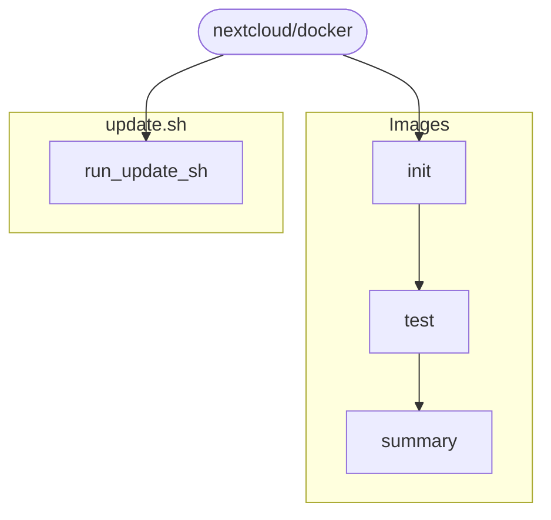

# Repository Architecture Analysis: nextcloud/docker

## Metadata
- **SHA**: `18bc14cc9d4d8516fd8cd19034f9493ace636f13`
- **Primary Ecosystem**: Container / Helm / IaC

## Quality Metrics
- **ast_engine**: fallback
- **avg_cognitive_complexity**: 0.0
- **avg_cyclomatic_complexity**: 0.0
- **component_count**: 8
- **dead_code_count**: 0
- **dead_code_symbols**: 0 entry(ies)
- **duplication_pct**: 0.0
- **file_complexities**: 0 entry(ies)
- **files_analyzed**: 8
- **fitness_passed**: True
- **fitness_violation_count**: 0
- **framework**: Docker Compose
- **import_edges**: 0 entry(ies)
- **loc**: 730
- **max_cognitive_complexity**: 0
- **max_cyclomatic_complexity**: 0
- **sloc**: 530

# Architecture: nextcloud/docker

## Context
- **Repository**: `nextcloud/docker`
- **SHA**: `18bc14cc9d4d8516fd8cd19034f9493ace636f13`
- **Ecosystem**: Container / Helm / IaC
- **Framework**: Docker Compose

## Building Block View


## Component Details
- **compose** (`.examples/docker-compose/insecure/mariadb/apache/compose.yaml`): module
- **compose** (`.examples/docker-compose/insecure/mariadb/fpm/compose.yaml`): module
- **compose** (`.examples/docker-compose/insecure/postgres/apache/compose.yaml`): module
- **compose** (`.examples/docker-compose/insecure/postgres/fpm/compose.yaml`): module
- **compose** (`.examples/docker-compose/with-nginx-proxy/mariadb/apache/compose.yaml`): module
- **compose** (`.examples/docker-compose/with-nginx-proxy/mariadb/fpm/compose.yaml`): module
- **compose** (`.examples/docker-compose/with-nginx-proxy/postgres/apache/compose.yaml`): module
- **compose** (`.examples/docker-compose/with-nginx-proxy/postgres/fpm/compose.yaml`): module

## 6-Dimension Repository Scorecard

- **Overall Grade**: `B` (86.95/100)
- **Technical Debt Score**: 13.05
- **Estimated Remediation Effort**: 8.76h

| Dimension | Grade | Score | Weight | Details |
| :--- | :---: | :---: | :---: | :--- |
| Code Quality | `A` | 100.00 | 0.20 | avg_cc=0.00, max_cc=0, duplication=0.00%, dead_code=0 |
| Dependency Health | `A` | 90.00 | 0.15 | dependencies=0 (no manifests parsed) |
| Maintainability | `A` | 100.00 | 0.15 | avg_cognitive=0.00, max_cognitive=0, fitness_violations=0, oversized_files=0 |
| Pipeline Health | `B` | 85.00 | 0.15 | workflows=2, operational_antipatterns=5, parallel_branches=False |
| Security | `C` | 76.00 | 0.20 | vulnerabilities=0, secrets=0, pipeline_security_findings=2 |
| Test Coverage | `C` | 70.00 | 0.15 | coverage=unavailable, ci_test_job=True, test_files_detected=False |

## Section 7: Code-to-Cloud Deployment Traceability

```mermaid
flowchart LR
    subgraph code_modules["Code Modules"]
        mod__examples_docker_compose_insecure_mariadb_apache[".examples/docker-compose/insecure/mariadb/apache"]
        mod__examples_docker_compose_insecure_mariadb_fpm[".examples/docker-compose/insecure/mariadb/fpm"]
        mod__examples_docker_compose_insecure_postgres_apache[".examples/docker-compose/insecure/postgres/apache"]
        mod__examples_docker_compose_insecure_postgres_fpm[".examples/docker-compose/insecure/postgres/fpm"]
        mod__examples_docker_compose_with_nginx_proxy_mariadb_apache[".examples/docker-compose/with-nginx-proxy/mariadb/apache"]
        mod__examples_docker_compose_with_nginx_proxy_mariadb_apache_proxy[".examples/docker-compose/with-nginx-proxy/mariadb/apache/proxy"]
        mod__examples_docker_compose_with_nginx_proxy_mariadb_fpm[".examples/docker-compose/with-nginx-proxy/mariadb/fpm"]
        mod__examples_docker_compose_with_nginx_proxy_mariadb_fpm_proxy[".examples/docker-compose/with-nginx-proxy/mariadb/fpm/proxy"]
        mod__examples_docker_compose_with_nginx_proxy_postgres_apache[".examples/docker-compose/with-nginx-proxy/postgres/apache"]
        mod__examples_docker_compose_with_nginx_proxy_postgres_apache_proxy[".examples/docker-compose/with-nginx-proxy/postgres/apache/proxy"]
        mod__examples_docker_compose_with_nginx_proxy_postgres_fpm[".examples/docker-compose/with-nginx-proxy/postgres/fpm"]
        mod__examples_docker_compose_with_nginx_proxy_postgres_fpm_proxy[".examples/docker-compose/with-nginx-proxy/postgres/fpm/proxy"]
        mod__examples_dockerfiles_cron_apache[".examples/dockerfiles/cron/apache"]
        mod__examples_dockerfiles_cron_fpm[".examples/dockerfiles/cron/fpm"]
        mod__examples_dockerfiles_cron_fpm_alpine[".examples/dockerfiles/cron/fpm-alpine"]
        mod__examples_dockerfiles_full_apache[".examples/dockerfiles/full/apache"]
        mod__examples_dockerfiles_full_fpm[".examples/dockerfiles/full/fpm"]
        mod__examples_dockerfiles_full_fpm_alpine[".examples/dockerfiles/full/fpm-alpine"]
        mod__examples_dockerfiles_imap_apache[".examples/dockerfiles/imap/apache"]
        mod__examples_dockerfiles_imap_fpm[".examples/dockerfiles/imap/fpm"]
        mod__examples_dockerfiles_imap_fpm_alpine[".examples/dockerfiles/imap/fpm-alpine"]
        mod__examples_dockerfiles_smb_apache[".examples/dockerfiles/smb/apache"]
        mod__examples_dockerfiles_smb_fpm[".examples/dockerfiles/smb/fpm"]
        mod__examples_dockerfiles_smb_fpm_alpine[".examples/dockerfiles/smb/fpm-alpine"]
        mod_32_apache["32/apache"]
        mod_32_fpm["32/fpm"]
        mod_32_fpm_alpine["32/fpm-alpine"]
        mod_33_apache["33/apache"]
        mod_33_fpm["33/fpm"]
        mod_33_fpm_alpine["33/fpm-alpine"]
        mod_34_apache["34/apache"]
        mod_34_fpm["34/fpm"]
        mod_34_fpm_alpine["34/fpm-alpine"]
        mod_35_apache["35/apache"]
        mod_35_fpm["35/fpm"]
        mod_35_fpm_alpine["35/fpm-alpine"]
    end
    subgraph build_artifacts["Build Artifacts / Containers"]
        art__examples_docker_compose_with_nginx_proxy_mariadb_apache_proxy_Dockerfile[".examples/docker-compose/with-nginx-proxy/mariadb/apache/proxy/Dockerfile"]
        art__examples_docker_compose_with_nginx_proxy_mariadb_fpm_proxy_Dockerfile[".examples/docker-compose/with-nginx-proxy/mariadb/fpm/proxy/Dockerfile"]
        art__examples_docker_compose_with_nginx_proxy_postgres_apache_proxy_Dockerfile[".examples/docker-compose/with-nginx-proxy/postgres/apache/proxy/Dockerfile"]
        art__examples_docker_compose_with_nginx_proxy_postgres_fpm_proxy_Dockerfile[".examples/docker-compose/with-nginx-proxy/postgres/fpm/proxy/Dockerfile"]
        art__examples_dockerfiles_cron_apache_Dockerfile[".examples/dockerfiles/cron/apache/Dockerfile"]
        art__examples_dockerfiles_cron_fpm_alpine_Dockerfile[".examples/dockerfiles/cron/fpm-alpine/Dockerfile"]
        art__examples_dockerfiles_cron_fpm_Dockerfile[".examples/dockerfiles/cron/fpm/Dockerfile"]
        art__examples_dockerfiles_full_apache_Dockerfile[".examples/dockerfiles/full/apache/Dockerfile"]
        art__examples_dockerfiles_full_fpm_alpine_Dockerfile[".examples/dockerfiles/full/fpm-alpine/Dockerfile"]
        art__examples_dockerfiles_full_fpm_Dockerfile[".examples/dockerfiles/full/fpm/Dockerfile"]
        art__examples_dockerfiles_imap_apache_Dockerfile[".examples/dockerfiles/imap/apache/Dockerfile"]
        art__examples_dockerfiles_imap_fpm_alpine_Dockerfile[".examples/dockerfiles/imap/fpm-alpine/Dockerfile"]
        art__examples_dockerfiles_imap_fpm_Dockerfile[".examples/dockerfiles/imap/fpm/Dockerfile"]
        art__examples_dockerfiles_smb_apache_Dockerfile[".examples/dockerfiles/smb/apache/Dockerfile"]
        art__examples_dockerfiles_smb_fpm_alpine_Dockerfile[".examples/dockerfiles/smb/fpm-alpine/Dockerfile"]
        art__examples_dockerfiles_smb_fpm_Dockerfile[".examples/dockerfiles/smb/fpm/Dockerfile"]
        art_32_apache_Dockerfile["32/apache/Dockerfile"]
        art_32_fpm_alpine_Dockerfile["32/fpm-alpine/Dockerfile"]
        art_32_fpm_Dockerfile["32/fpm/Dockerfile"]
        art_33_apache_Dockerfile["33/apache/Dockerfile"]
        art_33_fpm_alpine_Dockerfile["33/fpm-alpine/Dockerfile"]
        art_33_fpm_Dockerfile["33/fpm/Dockerfile"]
        art_34_apache_Dockerfile["34/apache/Dockerfile"]
        art_34_fpm_alpine_Dockerfile["34/fpm-alpine/Dockerfile"]
        art_34_fpm_Dockerfile["34/fpm/Dockerfile"]
        art_35_apache_Dockerfile["35/apache/Dockerfile"]
        art_35_fpm_alpine_Dockerfile["35/fpm-alpine/Dockerfile"]
        art_35_fpm_Dockerfile["35/fpm/Dockerfile"]
    end
    mod__examples_docker_compose_insecure_mariadb_apache -->|PACKAGED_BY| art__examples_dockerfiles_cron_apache_Dockerfile
    mod__examples_docker_compose_insecure_mariadb_apache -->|PACKAGED_BY| art__examples_dockerfiles_full_apache_Dockerfile
    mod__examples_docker_compose_insecure_mariadb_apache -->|PACKAGED_BY| art__examples_dockerfiles_imap_apache_Dockerfile
    mod__examples_docker_compose_insecure_mariadb_apache -->|PACKAGED_BY| art__examples_dockerfiles_smb_apache_Dockerfile
    mod__examples_docker_compose_insecure_mariadb_apache -->|PACKAGED_BY| art_32_apache_Dockerfile
    mod__examples_docker_compose_insecure_mariadb_apache -->|PACKAGED_BY| art_33_apache_Dockerfile
    mod__examples_docker_compose_insecure_mariadb_apache -->|PACKAGED_BY| art_34_apache_Dockerfile
    mod__examples_docker_compose_insecure_mariadb_apache -->|PACKAGED_BY| art_35_apache_Dockerfile
    mod__examples_docker_compose_insecure_mariadb_fpm -->|PACKAGED_BY| art__examples_dockerfiles_cron_fpm_alpine_Dockerfile
    mod__examples_docker_compose_insecure_mariadb_fpm -->|PACKAGED_BY| art__examples_dockerfiles_cron_fpm_Dockerfile
    mod__examples_docker_compose_insecure_mariadb_fpm -->|PACKAGED_BY| art__examples_dockerfiles_full_fpm_alpine_Dockerfile
    mod__examples_docker_compose_insecure_mariadb_fpm -->|PACKAGED_BY| art__examples_dockerfiles_full_fpm_Dockerfile
    mod__examples_docker_compose_insecure_mariadb_fpm -->|PACKAGED_BY| art__examples_dockerfiles_imap_fpm_alpine_Dockerfile
    mod__examples_docker_compose_insecure_mariadb_fpm -->|PACKAGED_BY| art__examples_dockerfiles_imap_fpm_Dockerfile
    mod__examples_docker_compose_insecure_mariadb_fpm -->|PACKAGED_BY| art__examples_dockerfiles_smb_fpm_alpine_Dockerfile
    mod__examples_docker_compose_insecure_mariadb_fpm -->|PACKAGED_BY| art__examples_dockerfiles_smb_fpm_Dockerfile
    mod__examples_docker_compose_insecure_mariadb_fpm -->|PACKAGED_BY| art_32_fpm_alpine_Dockerfile
    mod__examples_docker_compose_insecure_mariadb_fpm -->|PACKAGED_BY| art_32_fpm_Dockerfile
    mod__examples_docker_compose_insecure_mariadb_fpm -->|PACKAGED_BY| art_33_fpm_alpine_Dockerfile
    mod__examples_docker_compose_insecure_mariadb_fpm -->|PACKAGED_BY| art_33_fpm_Dockerfile
    mod__examples_docker_compose_insecure_mariadb_fpm -->|PACKAGED_BY| art_34_fpm_alpine_Dockerfile
    mod__examples_docker_compose_insecure_mariadb_fpm -->|PACKAGED_BY| art_34_fpm_Dockerfile
    mod__examples_docker_compose_insecure_mariadb_fpm -->|PACKAGED_BY| art_35_fpm_alpine_Dockerfile
    mod__examples_docker_compose_insecure_mariadb_fpm -->|PACKAGED_BY| art_35_fpm_Dockerfile
    mod__examples_docker_compose_insecure_postgres_apache -->|PACKAGED_BY| art__examples_dockerfiles_cron_apache_Dockerfile
    mod__examples_docker_compose_insecure_postgres_apache -->|PACKAGED_BY| art__examples_dockerfiles_full_apache_Dockerfile
    mod__examples_docker_compose_insecure_postgres_apache -->|PACKAGED_BY| art__examples_dockerfiles_imap_apache_Dockerfile
    mod__examples_docker_compose_insecure_postgres_apache -->|PACKAGED_BY| art__examples_dockerfiles_smb_apache_Dockerfile
    mod__examples_docker_compose_insecure_postgres_apache -->|PACKAGED_BY| art_32_apache_Dockerfile
    mod__examples_docker_compose_insecure_postgres_apache -->|PACKAGED_BY| art_33_apache_Dockerfile
    mod__examples_docker_compose_insecure_postgres_apache -->|PACKAGED_BY| art_34_apache_Dockerfile
    mod__examples_docker_compose_insecure_postgres_apache -->|PACKAGED_BY| art_35_apache_Dockerfile
    mod__examples_docker_compose_insecure_postgres_fpm -->|PACKAGED_BY| art__examples_dockerfiles_cron_fpm_alpine_Dockerfile
    mod__examples_docker_compose_insecure_postgres_fpm -->|PACKAGED_BY| art__examples_dockerfiles_cron_fpm_Dockerfile
    mod__examples_docker_compose_insecure_postgres_fpm -->|PACKAGED_BY| art__examples_dockerfiles_full_fpm_alpine_Dockerfile
    mod__examples_docker_compose_insecure_postgres_fpm -->|PACKAGED_BY| art__examples_dockerfiles_full_fpm_Dockerfile
    mod__examples_docker_compose_insecure_postgres_fpm -->|PACKAGED_BY| art__examples_dockerfiles_imap_fpm_alpine_Dockerfile
    mod__examples_docker_compose_insecure_postgres_fpm -->|PACKAGED_BY| art__examples_dockerfiles_imap_fpm_Dockerfile
    mod__examples_docker_compose_insecure_postgres_fpm -->|PACKAGED_BY| art__examples_dockerfiles_smb_fpm_alpine_Dockerfile
    mod__examples_docker_compose_insecure_postgres_fpm -->|PACKAGED_BY| art__examples_dockerfiles_smb_fpm_Dockerfile
    mod__examples_docker_compose_insecure_postgres_fpm -->|PACKAGED_BY| art_32_fpm_alpine_Dockerfile
    mod__examples_docker_compose_insecure_postgres_fpm -->|PACKAGED_BY| art_32_fpm_Dockerfile
    mod__examples_docker_compose_insecure_postgres_fpm -->|PACKAGED_BY| art_33_fpm_alpine_Dockerfile
    mod__examples_docker_compose_insecure_postgres_fpm -->|PACKAGED_BY| art_33_fpm_Dockerfile
    mod__examples_docker_compose_insecure_postgres_fpm -->|PACKAGED_BY| art_34_fpm_alpine_Dockerfile
    mod__examples_docker_compose_insecure_postgres_fpm -->|PACKAGED_BY| art_34_fpm_Dockerfile
    mod__examples_docker_compose_insecure_postgres_fpm -->|PACKAGED_BY| art_35_fpm_alpine_Dockerfile
    mod__examples_docker_compose_insecure_postgres_fpm -->|PACKAGED_BY| art_35_fpm_Dockerfile
    mod__examples_docker_compose_with_nginx_proxy_mariadb_apache -->|PACKAGED_BY| art__examples_dockerfiles_cron_apache_Dockerfile
    mod__examples_docker_compose_with_nginx_proxy_mariadb_apache -->|PACKAGED_BY| art__examples_dockerfiles_full_apache_Dockerfile
    mod__examples_docker_compose_with_nginx_proxy_mariadb_apache -->|PACKAGED_BY| art__examples_dockerfiles_imap_apache_Dockerfile
    mod__examples_docker_compose_with_nginx_proxy_mariadb_apache -->|PACKAGED_BY| art__examples_dockerfiles_smb_apache_Dockerfile
    mod__examples_docker_compose_with_nginx_proxy_mariadb_apache -->|PACKAGED_BY| art_32_apache_Dockerfile
    mod__examples_docker_compose_with_nginx_proxy_mariadb_apache -->|PACKAGED_BY| art_33_apache_Dockerfile
    mod__examples_docker_compose_with_nginx_proxy_mariadb_apache -->|PACKAGED_BY| art_34_apache_Dockerfile
    mod__examples_docker_compose_with_nginx_proxy_mariadb_apache -->|PACKAGED_BY| art_35_apache_Dockerfile
    mod__examples_docker_compose_with_nginx_proxy_mariadb_apache_proxy -->|PACKAGED_BY| art__examples_docker_compose_with_nginx_proxy_mariadb_apache_proxy_Dockerfile
    mod__examples_docker_compose_with_nginx_proxy_mariadb_apache_proxy -->|PACKAGED_BY| art__examples_docker_compose_with_nginx_proxy_mariadb_fpm_proxy_Dockerfile
    mod__examples_docker_compose_with_nginx_proxy_mariadb_apache_proxy -->|PACKAGED_BY| art__examples_docker_compose_with_nginx_proxy_postgres_apache_proxy_Dockerfile
    mod__examples_docker_compose_with_nginx_proxy_mariadb_apache_proxy -->|PACKAGED_BY| art__examples_docker_compose_with_nginx_proxy_postgres_fpm_proxy_Dockerfile
    mod__examples_docker_compose_with_nginx_proxy_mariadb_fpm -->|PACKAGED_BY| art__examples_dockerfiles_cron_fpm_alpine_Dockerfile
    mod__examples_docker_compose_with_nginx_proxy_mariadb_fpm -->|PACKAGED_BY| art__examples_dockerfiles_cron_fpm_Dockerfile
    mod__examples_docker_compose_with_nginx_proxy_mariadb_fpm -->|PACKAGED_BY| art__examples_dockerfiles_full_fpm_alpine_Dockerfile
    mod__examples_docker_compose_with_nginx_proxy_mariadb_fpm -->|PACKAGED_BY| art__examples_dockerfiles_full_fpm_Dockerfile
    mod__examples_docker_compose_with_nginx_proxy_mariadb_fpm -->|PACKAGED_BY| art__examples_dockerfiles_imap_fpm_alpine_Dockerfile
    mod__examples_docker_compose_with_nginx_proxy_mariadb_fpm -->|PACKAGED_BY| art__examples_dockerfiles_imap_fpm_Dockerfile
    mod__examples_docker_compose_with_nginx_proxy_mariadb_fpm -->|PACKAGED_BY| art__examples_dockerfiles_smb_fpm_alpine_Dockerfile
    mod__examples_docker_compose_with_nginx_proxy_mariadb_fpm -->|PACKAGED_BY| art__examples_dockerfiles_smb_fpm_Dockerfile
    mod__examples_docker_compose_with_nginx_proxy_mariadb_fpm -->|PACKAGED_BY| art_32_fpm_alpine_Dockerfile
    mod__examples_docker_compose_with_nginx_proxy_mariadb_fpm -->|PACKAGED_BY| art_32_fpm_Dockerfile
    mod__examples_docker_compose_with_nginx_proxy_mariadb_fpm -->|PACKAGED_BY| art_33_fpm_alpine_Dockerfile
    mod__examples_docker_compose_with_nginx_proxy_mariadb_fpm -->|PACKAGED_BY| art_33_fpm_Dockerfile
    mod__examples_docker_compose_with_nginx_proxy_mariadb_fpm -->|PACKAGED_BY| art_34_fpm_alpine_Dockerfile
    mod__examples_docker_compose_with_nginx_proxy_mariadb_fpm -->|PACKAGED_BY| art_34_fpm_Dockerfile
    mod__examples_docker_compose_with_nginx_proxy_mariadb_fpm -->|PACKAGED_BY| art_35_fpm_alpine_Dockerfile
    mod__examples_docker_compose_with_nginx_proxy_mariadb_fpm -->|PACKAGED_BY| art_35_fpm_Dockerfile
    mod__examples_docker_compose_with_nginx_proxy_mariadb_fpm_proxy -->|PACKAGED_BY| art__examples_docker_compose_with_nginx_proxy_mariadb_apache_proxy_Dockerfile
    mod__examples_docker_compose_with_nginx_proxy_mariadb_fpm_proxy -->|PACKAGED_BY| art__examples_docker_compose_with_nginx_proxy_mariadb_fpm_proxy_Dockerfile
    mod__examples_docker_compose_with_nginx_proxy_mariadb_fpm_proxy -->|PACKAGED_BY| art__examples_docker_compose_with_nginx_proxy_postgres_apache_proxy_Dockerfile
    mod__examples_docker_compose_with_nginx_proxy_mariadb_fpm_proxy -->|PACKAGED_BY| art__examples_docker_compose_with_nginx_proxy_postgres_fpm_proxy_Dockerfile
    mod__examples_docker_compose_with_nginx_proxy_postgres_apache -->|PACKAGED_BY| art__examples_dockerfiles_cron_apache_Dockerfile
    mod__examples_docker_compose_with_nginx_proxy_postgres_apache -->|PACKAGED_BY| art__examples_dockerfiles_full_apache_Dockerfile
    mod__examples_docker_compose_with_nginx_proxy_postgres_apache -->|PACKAGED_BY| art__examples_dockerfiles_imap_apache_Dockerfile
    mod__examples_docker_compose_with_nginx_proxy_postgres_apache -->|PACKAGED_BY| art__examples_dockerfiles_smb_apache_Dockerfile
    mod__examples_docker_compose_with_nginx_proxy_postgres_apache -->|PACKAGED_BY| art_32_apache_Dockerfile
    mod__examples_docker_compose_with_nginx_proxy_postgres_apache -->|PACKAGED_BY| art_33_apache_Dockerfile
    mod__examples_docker_compose_with_nginx_proxy_postgres_apache -->|PACKAGED_BY| art_34_apache_Dockerfile
    mod__examples_docker_compose_with_nginx_proxy_postgres_apache -->|PACKAGED_BY| art_35_apache_Dockerfile
    mod__examples_docker_compose_with_nginx_proxy_postgres_apache_proxy -->|PACKAGED_BY| art__examples_docker_compose_with_nginx_proxy_mariadb_apache_proxy_Dockerfile
    mod__examples_docker_compose_with_nginx_proxy_postgres_apache_proxy -->|PACKAGED_BY| art__examples_docker_compose_with_nginx_proxy_mariadb_fpm_proxy_Dockerfile
    mod__examples_docker_compose_with_nginx_proxy_postgres_apache_proxy -->|PACKAGED_BY| art__examples_docker_compose_with_nginx_proxy_postgres_apache_proxy_Dockerfile
    mod__examples_docker_compose_with_nginx_proxy_postgres_apache_proxy -->|PACKAGED_BY| art__examples_docker_compose_with_nginx_proxy_postgres_fpm_proxy_Dockerfile
    mod__examples_docker_compose_with_nginx_proxy_postgres_fpm -->|PACKAGED_BY| art__examples_dockerfiles_cron_fpm_alpine_Dockerfile
    mod__examples_docker_compose_with_nginx_proxy_postgres_fpm -->|PACKAGED_BY| art__examples_dockerfiles_cron_fpm_Dockerfile
    mod__examples_docker_compose_with_nginx_proxy_postgres_fpm -->|PACKAGED_BY| art__examples_dockerfiles_full_fpm_alpine_Dockerfile
    mod__examples_docker_compose_with_nginx_proxy_postgres_fpm -->|PACKAGED_BY| art__examples_dockerfiles_full_fpm_Dockerfile
    mod__examples_docker_compose_with_nginx_proxy_postgres_fpm -->|PACKAGED_BY| art__examples_dockerfiles_imap_fpm_alpine_Dockerfile
    mod__examples_docker_compose_with_nginx_proxy_postgres_fpm -->|PACKAGED_BY| art__examples_dockerfiles_imap_fpm_Dockerfile
    mod__examples_docker_compose_with_nginx_proxy_postgres_fpm -->|PACKAGED_BY| art__examples_dockerfiles_smb_fpm_alpine_Dockerfile
    mod__examples_docker_compose_with_nginx_proxy_postgres_fpm -->|PACKAGED_BY| art__examples_dockerfiles_smb_fpm_Dockerfile
    mod__examples_docker_compose_with_nginx_proxy_postgres_fpm -->|PACKAGED_BY| art_32_fpm_alpine_Dockerfile
    mod__examples_docker_compose_with_nginx_proxy_postgres_fpm -->|PACKAGED_BY| art_32_fpm_Dockerfile
    mod__examples_docker_compose_with_nginx_proxy_postgres_fpm -->|PACKAGED_BY| art_33_fpm_alpine_Dockerfile
    mod__examples_docker_compose_with_nginx_proxy_postgres_fpm -->|PACKAGED_BY| art_33_fpm_Dockerfile
    mod__examples_docker_compose_with_nginx_proxy_postgres_fpm -->|PACKAGED_BY| art_34_fpm_alpine_Dockerfile
    mod__examples_docker_compose_with_nginx_proxy_postgres_fpm -->|PACKAGED_BY| art_34_fpm_Dockerfile
    mod__examples_docker_compose_with_nginx_proxy_postgres_fpm -->|PACKAGED_BY| art_35_fpm_alpine_Dockerfile
    mod__examples_docker_compose_with_nginx_proxy_postgres_fpm -->|PACKAGED_BY| art_35_fpm_Dockerfile
    mod__examples_docker_compose_with_nginx_proxy_postgres_fpm_proxy -->|PACKAGED_BY| art__examples_docker_compose_with_nginx_proxy_mariadb_apache_proxy_Dockerfile
    mod__examples_docker_compose_with_nginx_proxy_postgres_fpm_proxy -->|PACKAGED_BY| art__examples_docker_compose_with_nginx_proxy_mariadb_fpm_proxy_Dockerfile
    mod__examples_docker_compose_with_nginx_proxy_postgres_fpm_proxy -->|PACKAGED_BY| art__examples_docker_compose_with_nginx_proxy_postgres_apache_proxy_Dockerfile
    mod__examples_docker_compose_with_nginx_proxy_postgres_fpm_proxy -->|PACKAGED_BY| art__examples_docker_compose_with_nginx_proxy_postgres_fpm_proxy_Dockerfile
    mod__examples_dockerfiles_cron_apache -->|PACKAGED_BY| art__examples_dockerfiles_cron_apache_Dockerfile
    mod__examples_dockerfiles_cron_apache -->|PACKAGED_BY| art__examples_dockerfiles_full_apache_Dockerfile
    mod__examples_dockerfiles_cron_apache -->|PACKAGED_BY| art__examples_dockerfiles_imap_apache_Dockerfile
    mod__examples_dockerfiles_cron_apache -->|PACKAGED_BY| art__examples_dockerfiles_smb_apache_Dockerfile
    mod__examples_dockerfiles_cron_apache -->|PACKAGED_BY| art_32_apache_Dockerfile
    mod__examples_dockerfiles_cron_apache -->|PACKAGED_BY| art_33_apache_Dockerfile
    mod__examples_dockerfiles_cron_apache -->|PACKAGED_BY| art_34_apache_Dockerfile
    mod__examples_dockerfiles_cron_apache -->|PACKAGED_BY| art_35_apache_Dockerfile
    mod__examples_dockerfiles_cron_fpm -->|PACKAGED_BY| art__examples_dockerfiles_cron_fpm_alpine_Dockerfile
    mod__examples_dockerfiles_cron_fpm -->|PACKAGED_BY| art__examples_dockerfiles_cron_fpm_Dockerfile
    mod__examples_dockerfiles_cron_fpm -->|PACKAGED_BY| art__examples_dockerfiles_full_fpm_alpine_Dockerfile
    mod__examples_dockerfiles_cron_fpm -->|PACKAGED_BY| art__examples_dockerfiles_full_fpm_Dockerfile
    mod__examples_dockerfiles_cron_fpm -->|PACKAGED_BY| art__examples_dockerfiles_imap_fpm_alpine_Dockerfile
    mod__examples_dockerfiles_cron_fpm -->|PACKAGED_BY| art__examples_dockerfiles_imap_fpm_Dockerfile
    mod__examples_dockerfiles_cron_fpm -->|PACKAGED_BY| art__examples_dockerfiles_smb_fpm_alpine_Dockerfile
    mod__examples_dockerfiles_cron_fpm -->|PACKAGED_BY| art__examples_dockerfiles_smb_fpm_Dockerfile
    mod__examples_dockerfiles_cron_fpm -->|PACKAGED_BY| art_32_fpm_alpine_Dockerfile
    mod__examples_dockerfiles_cron_fpm -->|PACKAGED_BY| art_32_fpm_Dockerfile
    mod__examples_dockerfiles_cron_fpm -->|PACKAGED_BY| art_33_fpm_alpine_Dockerfile
    mod__examples_dockerfiles_cron_fpm -->|PACKAGED_BY| art_33_fpm_Dockerfile
    mod__examples_dockerfiles_cron_fpm -->|PACKAGED_BY| art_34_fpm_alpine_Dockerfile
    mod__examples_dockerfiles_cron_fpm -->|PACKAGED_BY| art_34_fpm_Dockerfile
    mod__examples_dockerfiles_cron_fpm -->|PACKAGED_BY| art_35_fpm_alpine_Dockerfile
    mod__examples_dockerfiles_cron_fpm -->|PACKAGED_BY| art_35_fpm_Dockerfile
    mod__examples_dockerfiles_cron_fpm_alpine -->|PACKAGED_BY| art__examples_dockerfiles_cron_fpm_alpine_Dockerfile
    mod__examples_dockerfiles_cron_fpm_alpine -->|PACKAGED_BY| art__examples_dockerfiles_full_fpm_alpine_Dockerfile
    mod__examples_dockerfiles_cron_fpm_alpine -->|PACKAGED_BY| art__examples_dockerfiles_imap_fpm_alpine_Dockerfile
    mod__examples_dockerfiles_cron_fpm_alpine -->|PACKAGED_BY| art__examples_dockerfiles_smb_fpm_alpine_Dockerfile
    mod__examples_dockerfiles_cron_fpm_alpine -->|PACKAGED_BY| art_32_fpm_alpine_Dockerfile
    mod__examples_dockerfiles_cron_fpm_alpine -->|PACKAGED_BY| art_33_fpm_alpine_Dockerfile
    mod__examples_dockerfiles_cron_fpm_alpine -->|PACKAGED_BY| art_34_fpm_alpine_Dockerfile
    mod__examples_dockerfiles_cron_fpm_alpine -->|PACKAGED_BY| art_35_fpm_alpine_Dockerfile
    mod__examples_dockerfiles_full_apache -->|PACKAGED_BY| art__examples_dockerfiles_cron_apache_Dockerfile
    mod__examples_dockerfiles_full_apache -->|PACKAGED_BY| art__examples_dockerfiles_full_apache_Dockerfile
    mod__examples_dockerfiles_full_apache -->|PACKAGED_BY| art__examples_dockerfiles_imap_apache_Dockerfile
    mod__examples_dockerfiles_full_apache -->|PACKAGED_BY| art__examples_dockerfiles_smb_apache_Dockerfile
    mod__examples_dockerfiles_full_apache -->|PACKAGED_BY| art_32_apache_Dockerfile
    mod__examples_dockerfiles_full_apache -->|PACKAGED_BY| art_33_apache_Dockerfile
    mod__examples_dockerfiles_full_apache -->|PACKAGED_BY| art_34_apache_Dockerfile
    mod__examples_dockerfiles_full_apache -->|PACKAGED_BY| art_35_apache_Dockerfile
    mod__examples_dockerfiles_full_fpm -->|PACKAGED_BY| art__examples_dockerfiles_cron_fpm_alpine_Dockerfile
    mod__examples_dockerfiles_full_fpm -->|PACKAGED_BY| art__examples_dockerfiles_cron_fpm_Dockerfile
    mod__examples_dockerfiles_full_fpm -->|PACKAGED_BY| art__examples_dockerfiles_full_fpm_alpine_Dockerfile
    mod__examples_dockerfiles_full_fpm -->|PACKAGED_BY| art__examples_dockerfiles_full_fpm_Dockerfile
    mod__examples_dockerfiles_full_fpm -->|PACKAGED_BY| art__examples_dockerfiles_imap_fpm_alpine_Dockerfile
    mod__examples_dockerfiles_full_fpm -->|PACKAGED_BY| art__examples_dockerfiles_imap_fpm_Dockerfile
    mod__examples_dockerfiles_full_fpm -->|PACKAGED_BY| art__examples_dockerfiles_smb_fpm_alpine_Dockerfile
    mod__examples_dockerfiles_full_fpm -->|PACKAGED_BY| art__examples_dockerfiles_smb_fpm_Dockerfile
    mod__examples_dockerfiles_full_fpm -->|PACKAGED_BY| art_32_fpm_alpine_Dockerfile
    mod__examples_dockerfiles_full_fpm -->|PACKAGED_BY| art_32_fpm_Dockerfile
    mod__examples_dockerfiles_full_fpm -->|PACKAGED_BY| art_33_fpm_alpine_Dockerfile
    mod__examples_dockerfiles_full_fpm -->|PACKAGED_BY| art_33_fpm_Dockerfile
    mod__examples_dockerfiles_full_fpm -->|PACKAGED_BY| art_34_fpm_alpine_Dockerfile
    mod__examples_dockerfiles_full_fpm -->|PACKAGED_BY| art_34_fpm_Dockerfile
    mod__examples_dockerfiles_full_fpm -->|PACKAGED_BY| art_35_fpm_alpine_Dockerfile
    mod__examples_dockerfiles_full_fpm -->|PACKAGED_BY| art_35_fpm_Dockerfile
    mod__examples_dockerfiles_full_fpm_alpine -->|PACKAGED_BY| art__examples_dockerfiles_cron_fpm_alpine_Dockerfile
    mod__examples_dockerfiles_full_fpm_alpine -->|PACKAGED_BY| art__examples_dockerfiles_full_fpm_alpine_Dockerfile
    mod__examples_dockerfiles_full_fpm_alpine -->|PACKAGED_BY| art__examples_dockerfiles_imap_fpm_alpine_Dockerfile
    mod__examples_dockerfiles_full_fpm_alpine -->|PACKAGED_BY| art__examples_dockerfiles_smb_fpm_alpine_Dockerfile
    mod__examples_dockerfiles_full_fpm_alpine -->|PACKAGED_BY| art_32_fpm_alpine_Dockerfile
    mod__examples_dockerfiles_full_fpm_alpine -->|PACKAGED_BY| art_33_fpm_alpine_Dockerfile
    mod__examples_dockerfiles_full_fpm_alpine -->|PACKAGED_BY| art_34_fpm_alpine_Dockerfile
    mod__examples_dockerfiles_full_fpm_alpine -->|PACKAGED_BY| art_35_fpm_alpine_Dockerfile
    mod__examples_dockerfiles_imap_apache -->|PACKAGED_BY| art__examples_dockerfiles_cron_apache_Dockerfile
    mod__examples_dockerfiles_imap_apache -->|PACKAGED_BY| art__examples_dockerfiles_full_apache_Dockerfile
    mod__examples_dockerfiles_imap_apache -->|PACKAGED_BY| art__examples_dockerfiles_imap_apache_Dockerfile
    mod__examples_dockerfiles_imap_apache -->|PACKAGED_BY| art__examples_dockerfiles_smb_apache_Dockerfile
    mod__examples_dockerfiles_imap_apache -->|PACKAGED_BY| art_32_apache_Dockerfile
    mod__examples_dockerfiles_imap_apache -->|PACKAGED_BY| art_33_apache_Dockerfile
    mod__examples_dockerfiles_imap_apache -->|PACKAGED_BY| art_34_apache_Dockerfile
    mod__examples_dockerfiles_imap_apache -->|PACKAGED_BY| art_35_apache_Dockerfile
    mod__examples_dockerfiles_imap_fpm -->|PACKAGED_BY| art__examples_dockerfiles_cron_fpm_alpine_Dockerfile
    mod__examples_dockerfiles_imap_fpm -->|PACKAGED_BY| art__examples_dockerfiles_cron_fpm_Dockerfile
    mod__examples_dockerfiles_imap_fpm -->|PACKAGED_BY| art__examples_dockerfiles_full_fpm_alpine_Dockerfile
    mod__examples_dockerfiles_imap_fpm -->|PACKAGED_BY| art__examples_dockerfiles_full_fpm_Dockerfile
    mod__examples_dockerfiles_imap_fpm -->|PACKAGED_BY| art__examples_dockerfiles_imap_fpm_alpine_Dockerfile
    mod__examples_dockerfiles_imap_fpm -->|PACKAGED_BY| art__examples_dockerfiles_imap_fpm_Dockerfile
    mod__examples_dockerfiles_imap_fpm -->|PACKAGED_BY| art__examples_dockerfiles_smb_fpm_alpine_Dockerfile
    mod__examples_dockerfiles_imap_fpm -->|PACKAGED_BY| art__examples_dockerfiles_smb_fpm_Dockerfile
    mod__examples_dockerfiles_imap_fpm -->|PACKAGED_BY| art_32_fpm_alpine_Dockerfile
    mod__examples_dockerfiles_imap_fpm -->|PACKAGED_BY| art_32_fpm_Dockerfile
    mod__examples_dockerfiles_imap_fpm -->|PACKAGED_BY| art_33_fpm_alpine_Dockerfile
    mod__examples_dockerfiles_imap_fpm -->|PACKAGED_BY| art_33_fpm_Dockerfile
    mod__examples_dockerfiles_imap_fpm -->|PACKAGED_BY| art_34_fpm_alpine_Dockerfile
    mod__examples_dockerfiles_imap_fpm -->|PACKAGED_BY| art_34_fpm_Dockerfile
    mod__examples_dockerfiles_imap_fpm -->|PACKAGED_BY| art_35_fpm_alpine_Dockerfile
    mod__examples_dockerfiles_imap_fpm -->|PACKAGED_BY| art_35_fpm_Dockerfile
    mod__examples_dockerfiles_imap_fpm_alpine -->|PACKAGED_BY| art__examples_dockerfiles_cron_fpm_alpine_Dockerfile
    mod__examples_dockerfiles_imap_fpm_alpine -->|PACKAGED_BY| art__examples_dockerfiles_full_fpm_alpine_Dockerfile
    mod__examples_dockerfiles_imap_fpm_alpine -->|PACKAGED_BY| art__examples_dockerfiles_imap_fpm_alpine_Dockerfile
    mod__examples_dockerfiles_imap_fpm_alpine -->|PACKAGED_BY| art__examples_dockerfiles_smb_fpm_alpine_Dockerfile
    mod__examples_dockerfiles_imap_fpm_alpine -->|PACKAGED_BY| art_32_fpm_alpine_Dockerfile
    mod__examples_dockerfiles_imap_fpm_alpine -->|PACKAGED_BY| art_33_fpm_alpine_Dockerfile
    mod__examples_dockerfiles_imap_fpm_alpine -->|PACKAGED_BY| art_34_fpm_alpine_Dockerfile
    mod__examples_dockerfiles_imap_fpm_alpine -->|PACKAGED_BY| art_35_fpm_alpine_Dockerfile
    mod__examples_dockerfiles_smb_apache -->|PACKAGED_BY| art__examples_dockerfiles_cron_apache_Dockerfile
    mod__examples_dockerfiles_smb_apache -->|PACKAGED_BY| art__examples_dockerfiles_full_apache_Dockerfile
    mod__examples_dockerfiles_smb_apache -->|PACKAGED_BY| art__examples_dockerfiles_imap_apache_Dockerfile
    mod__examples_dockerfiles_smb_apache -->|PACKAGED_BY| art__examples_dockerfiles_smb_apache_Dockerfile
    mod__examples_dockerfiles_smb_apache -->|PACKAGED_BY| art_32_apache_Dockerfile
    mod__examples_dockerfiles_smb_apache -->|PACKAGED_BY| art_33_apache_Dockerfile
    mod__examples_dockerfiles_smb_apache -->|PACKAGED_BY| art_34_apache_Dockerfile
    mod__examples_dockerfiles_smb_apache -->|PACKAGED_BY| art_35_apache_Dockerfile
    mod__examples_dockerfiles_smb_fpm -->|PACKAGED_BY| art__examples_dockerfiles_cron_fpm_alpine_Dockerfile
    mod__examples_dockerfiles_smb_fpm -->|PACKAGED_BY| art__examples_dockerfiles_cron_fpm_Dockerfile
    mod__examples_dockerfiles_smb_fpm -->|PACKAGED_BY| art__examples_dockerfiles_full_fpm_alpine_Dockerfile
    mod__examples_dockerfiles_smb_fpm -->|PACKAGED_BY| art__examples_dockerfiles_full_fpm_Dockerfile
    mod__examples_dockerfiles_smb_fpm -->|PACKAGED_BY| art__examples_dockerfiles_imap_fpm_alpine_Dockerfile
    mod__examples_dockerfiles_smb_fpm -->|PACKAGED_BY| art__examples_dockerfiles_imap_fpm_Dockerfile
    mod__examples_dockerfiles_smb_fpm -->|PACKAGED_BY| art__examples_dockerfiles_smb_fpm_alpine_Dockerfile
    mod__examples_dockerfiles_smb_fpm -->|PACKAGED_BY| art__examples_dockerfiles_smb_fpm_Dockerfile
    mod__examples_dockerfiles_smb_fpm -->|PACKAGED_BY| art_32_fpm_alpine_Dockerfile
    mod__examples_dockerfiles_smb_fpm -->|PACKAGED_BY| art_32_fpm_Dockerfile
    mod__examples_dockerfiles_smb_fpm -->|PACKAGED_BY| art_33_fpm_alpine_Dockerfile
    mod__examples_dockerfiles_smb_fpm -->|PACKAGED_BY| art_33_fpm_Dockerfile
    mod__examples_dockerfiles_smb_fpm -->|PACKAGED_BY| art_34_fpm_alpine_Dockerfile
    mod__examples_dockerfiles_smb_fpm -->|PACKAGED_BY| art_34_fpm_Dockerfile
    mod__examples_dockerfiles_smb_fpm -->|PACKAGED_BY| art_35_fpm_alpine_Dockerfile
    mod__examples_dockerfiles_smb_fpm -->|PACKAGED_BY| art_35_fpm_Dockerfile
    mod__examples_dockerfiles_smb_fpm_alpine -->|PACKAGED_BY| art__examples_dockerfiles_cron_fpm_alpine_Dockerfile
    mod__examples_dockerfiles_smb_fpm_alpine -->|PACKAGED_BY| art__examples_dockerfiles_full_fpm_alpine_Dockerfile
    mod__examples_dockerfiles_smb_fpm_alpine -->|PACKAGED_BY| art__examples_dockerfiles_imap_fpm_alpine_Dockerfile
    mod__examples_dockerfiles_smb_fpm_alpine -->|PACKAGED_BY| art__examples_dockerfiles_smb_fpm_alpine_Dockerfile
    mod__examples_dockerfiles_smb_fpm_alpine -->|PACKAGED_BY| art_32_fpm_alpine_Dockerfile
    mod__examples_dockerfiles_smb_fpm_alpine -->|PACKAGED_BY| art_33_fpm_alpine_Dockerfile
    mod__examples_dockerfiles_smb_fpm_alpine -->|PACKAGED_BY| art_34_fpm_alpine_Dockerfile
    mod__examples_dockerfiles_smb_fpm_alpine -->|PACKAGED_BY| art_35_fpm_alpine_Dockerfile
    mod_32_apache -->|PACKAGED_BY| art__examples_dockerfiles_cron_apache_Dockerfile
    mod_32_apache -->|PACKAGED_BY| art__examples_dockerfiles_full_apache_Dockerfile
    mod_32_apache -->|PACKAGED_BY| art__examples_dockerfiles_imap_apache_Dockerfile
    mod_32_apache -->|PACKAGED_BY| art__examples_dockerfiles_smb_apache_Dockerfile
    mod_32_apache -->|PACKAGED_BY| art_32_apache_Dockerfile
    mod_32_apache -->|PACKAGED_BY| art_33_apache_Dockerfile
    mod_32_apache -->|PACKAGED_BY| art_34_apache_Dockerfile
    mod_32_apache -->|PACKAGED_BY| art_35_apache_Dockerfile
    mod_32_fpm -->|PACKAGED_BY| art__examples_dockerfiles_cron_fpm_alpine_Dockerfile
    mod_32_fpm -->|PACKAGED_BY| art__examples_dockerfiles_cron_fpm_Dockerfile
    mod_32_fpm -->|PACKAGED_BY| art__examples_dockerfiles_full_fpm_alpine_Dockerfile
    mod_32_fpm -->|PACKAGED_BY| art__examples_dockerfiles_full_fpm_Dockerfile
    mod_32_fpm -->|PACKAGED_BY| art__examples_dockerfiles_imap_fpm_alpine_Dockerfile
    mod_32_fpm -->|PACKAGED_BY| art__examples_dockerfiles_imap_fpm_Dockerfile
    mod_32_fpm -->|PACKAGED_BY| art__examples_dockerfiles_smb_fpm_alpine_Dockerfile
    mod_32_fpm -->|PACKAGED_BY| art__examples_dockerfiles_smb_fpm_Dockerfile
    mod_32_fpm -->|PACKAGED_BY| art_32_fpm_alpine_Dockerfile
    mod_32_fpm -->|PACKAGED_BY| art_32_fpm_Dockerfile
    mod_32_fpm -->|PACKAGED_BY| art_33_fpm_alpine_Dockerfile
    mod_32_fpm -->|PACKAGED_BY| art_33_fpm_Dockerfile
    mod_32_fpm -->|PACKAGED_BY| art_34_fpm_alpine_Dockerfile
    mod_32_fpm -->|PACKAGED_BY| art_34_fpm_Dockerfile
    mod_32_fpm -->|PACKAGED_BY| art_35_fpm_alpine_Dockerfile
    mod_32_fpm -->|PACKAGED_BY| art_35_fpm_Dockerfile
    mod_32_fpm_alpine -->|PACKAGED_BY| art__examples_dockerfiles_cron_fpm_alpine_Dockerfile
    mod_32_fpm_alpine -->|PACKAGED_BY| art__examples_dockerfiles_full_fpm_alpine_Dockerfile
    mod_32_fpm_alpine -->|PACKAGED_BY| art__examples_dockerfiles_imap_fpm_alpine_Dockerfile
    mod_32_fpm_alpine -->|PACKAGED_BY| art__examples_dockerfiles_smb_fpm_alpine_Dockerfile
    mod_32_fpm_alpine -->|PACKAGED_BY| art_32_fpm_alpine_Dockerfile
    mod_32_fpm_alpine -->|PACKAGED_BY| art_33_fpm_alpine_Dockerfile
    mod_32_fpm_alpine -->|PACKAGED_BY| art_34_fpm_alpine_Dockerfile
    mod_32_fpm_alpine -->|PACKAGED_BY| art_35_fpm_alpine_Dockerfile
    mod_33_apache -->|PACKAGED_BY| art__examples_dockerfiles_cron_apache_Dockerfile
    mod_33_apache -->|PACKAGED_BY| art__examples_dockerfiles_full_apache_Dockerfile
    mod_33_apache -->|PACKAGED_BY| art__examples_dockerfiles_imap_apache_Dockerfile
    mod_33_apache -->|PACKAGED_BY| art__examples_dockerfiles_smb_apache_Dockerfile
    mod_33_apache -->|PACKAGED_BY| art_32_apache_Dockerfile
    mod_33_apache -->|PACKAGED_BY| art_33_apache_Dockerfile
    mod_33_apache -->|PACKAGED_BY| art_34_apache_Dockerfile
    mod_33_apache -->|PACKAGED_BY| art_35_apache_Dockerfile
    mod_33_fpm -->|PACKAGED_BY| art__examples_dockerfiles_cron_fpm_alpine_Dockerfile
    mod_33_fpm -->|PACKAGED_BY| art__examples_dockerfiles_cron_fpm_Dockerfile
    mod_33_fpm -->|PACKAGED_BY| art__examples_dockerfiles_full_fpm_alpine_Dockerfile
    mod_33_fpm -->|PACKAGED_BY| art__examples_dockerfiles_full_fpm_Dockerfile
    mod_33_fpm -->|PACKAGED_BY| art__examples_dockerfiles_imap_fpm_alpine_Dockerfile
    mod_33_fpm -->|PACKAGED_BY| art__examples_dockerfiles_imap_fpm_Dockerfile
    mod_33_fpm -->|PACKAGED_BY| art__examples_dockerfiles_smb_fpm_alpine_Dockerfile
    mod_33_fpm -->|PACKAGED_BY| art__examples_dockerfiles_smb_fpm_Dockerfile
    mod_33_fpm -->|PACKAGED_BY| art_32_fpm_alpine_Dockerfile
    mod_33_fpm -->|PACKAGED_BY| art_32_fpm_Dockerfile
    mod_33_fpm -->|PACKAGED_BY| art_33_fpm_alpine_Dockerfile
    mod_33_fpm -->|PACKAGED_BY| art_33_fpm_Dockerfile
    mod_33_fpm -->|PACKAGED_BY| art_34_fpm_alpine_Dockerfile
    mod_33_fpm -->|PACKAGED_BY| art_34_fpm_Dockerfile
    mod_33_fpm -->|PACKAGED_BY| art_35_fpm_alpine_Dockerfile
    mod_33_fpm -->|PACKAGED_BY| art_35_fpm_Dockerfile
    mod_33_fpm_alpine -->|PACKAGED_BY| art__examples_dockerfiles_cron_fpm_alpine_Dockerfile
    mod_33_fpm_alpine -->|PACKAGED_BY| art__examples_dockerfiles_full_fpm_alpine_Dockerfile
    mod_33_fpm_alpine -->|PACKAGED_BY| art__examples_dockerfiles_imap_fpm_alpine_Dockerfile
    mod_33_fpm_alpine -->|PACKAGED_BY| art__examples_dockerfiles_smb_fpm_alpine_Dockerfile
    mod_33_fpm_alpine -->|PACKAGED_BY| art_32_fpm_alpine_Dockerfile
    mod_33_fpm_alpine -->|PACKAGED_BY| art_33_fpm_alpine_Dockerfile
    mod_33_fpm_alpine -->|PACKAGED_BY| art_34_fpm_alpine_Dockerfile
    mod_33_fpm_alpine -->|PACKAGED_BY| art_35_fpm_alpine_Dockerfile
    mod_34_apache -->|PACKAGED_BY| art__examples_dockerfiles_cron_apache_Dockerfile
    mod_34_apache -->|PACKAGED_BY| art__examples_dockerfiles_full_apache_Dockerfile
    mod_34_apache -->|PACKAGED_BY| art__examples_dockerfiles_imap_apache_Dockerfile
    mod_34_apache -->|PACKAGED_BY| art__examples_dockerfiles_smb_apache_Dockerfile
    mod_34_apache -->|PACKAGED_BY| art_32_apache_Dockerfile
    mod_34_apache -->|PACKAGED_BY| art_33_apache_Dockerfile
    mod_34_apache -->|PACKAGED_BY| art_34_apache_Dockerfile
    mod_34_apache -->|PACKAGED_BY| art_35_apache_Dockerfile
    mod_34_fpm -->|PACKAGED_BY| art__examples_dockerfiles_cron_fpm_alpine_Dockerfile
    mod_34_fpm -->|PACKAGED_BY| art__examples_dockerfiles_cron_fpm_Dockerfile
    mod_34_fpm -->|PACKAGED_BY| art__examples_dockerfiles_full_fpm_alpine_Dockerfile
    mod_34_fpm -->|PACKAGED_BY| art__examples_dockerfiles_full_fpm_Dockerfile
    mod_34_fpm -->|PACKAGED_BY| art__examples_dockerfiles_imap_fpm_alpine_Dockerfile
    mod_34_fpm -->|PACKAGED_BY| art__examples_dockerfiles_imap_fpm_Dockerfile
    mod_34_fpm -->|PACKAGED_BY| art__examples_dockerfiles_smb_fpm_alpine_Dockerfile
    mod_34_fpm -->|PACKAGED_BY| art__examples_dockerfiles_smb_fpm_Dockerfile
    mod_34_fpm -->|PACKAGED_BY| art_32_fpm_alpine_Dockerfile
    mod_34_fpm -->|PACKAGED_BY| art_32_fpm_Dockerfile
    mod_34_fpm -->|PACKAGED_BY| art_33_fpm_alpine_Dockerfile
    mod_34_fpm -->|PACKAGED_BY| art_33_fpm_Dockerfile
    mod_34_fpm -->|PACKAGED_BY| art_34_fpm_alpine_Dockerfile
    mod_34_fpm -->|PACKAGED_BY| art_34_fpm_Dockerfile
    mod_34_fpm -->|PACKAGED_BY| art_35_fpm_alpine_Dockerfile
    mod_34_fpm -->|PACKAGED_BY| art_35_fpm_Dockerfile
    mod_34_fpm_alpine -->|PACKAGED_BY| art__examples_dockerfiles_cron_fpm_alpine_Dockerfile
    mod_34_fpm_alpine -->|PACKAGED_BY| art__examples_dockerfiles_full_fpm_alpine_Dockerfile
    mod_34_fpm_alpine -->|PACKAGED_BY| art__examples_dockerfiles_imap_fpm_alpine_Dockerfile
    mod_34_fpm_alpine -->|PACKAGED_BY| art__examples_dockerfiles_smb_fpm_alpine_Dockerfile
    mod_34_fpm_alpine -->|PACKAGED_BY| art_32_fpm_alpine_Dockerfile
    mod_34_fpm_alpine -->|PACKAGED_BY| art_33_fpm_alpine_Dockerfile
    mod_34_fpm_alpine -->|PACKAGED_BY| art_34_fpm_alpine_Dockerfile
    mod_34_fpm_alpine -->|PACKAGED_BY| art_35_fpm_alpine_Dockerfile
    mod_35_apache -->|PACKAGED_BY| art__examples_dockerfiles_cron_apache_Dockerfile
    mod_35_apache -->|PACKAGED_BY| art__examples_dockerfiles_full_apache_Dockerfile
    mod_35_apache -->|PACKAGED_BY| art__examples_dockerfiles_imap_apache_Dockerfile
    mod_35_apache -->|PACKAGED_BY| art__examples_dockerfiles_smb_apache_Dockerfile
    mod_35_apache -->|PACKAGED_BY| art_32_apache_Dockerfile
    mod_35_apache -->|PACKAGED_BY| art_33_apache_Dockerfile
    mod_35_apache -->|PACKAGED_BY| art_34_apache_Dockerfile
    mod_35_apache -->|PACKAGED_BY| art_35_apache_Dockerfile
    mod_35_fpm -->|PACKAGED_BY| art__examples_dockerfiles_cron_fpm_alpine_Dockerfile
    mod_35_fpm -->|PACKAGED_BY| art__examples_dockerfiles_cron_fpm_Dockerfile
    mod_35_fpm -->|PACKAGED_BY| art__examples_dockerfiles_full_fpm_alpine_Dockerfile
    mod_35_fpm -->|PACKAGED_BY| art__examples_dockerfiles_full_fpm_Dockerfile
    mod_35_fpm -->|PACKAGED_BY| art__examples_dockerfiles_imap_fpm_alpine_Dockerfile
    mod_35_fpm -->|PACKAGED_BY| art__examples_dockerfiles_imap_fpm_Dockerfile
    mod_35_fpm -->|PACKAGED_BY| art__examples_dockerfiles_smb_fpm_alpine_Dockerfile
    mod_35_fpm -->|PACKAGED_BY| art__examples_dockerfiles_smb_fpm_Dockerfile
    mod_35_fpm -->|PACKAGED_BY| art_32_fpm_alpine_Dockerfile
    mod_35_fpm -->|PACKAGED_BY| art_32_fpm_Dockerfile
    mod_35_fpm -->|PACKAGED_BY| art_33_fpm_alpine_Dockerfile
    mod_35_fpm -->|PACKAGED_BY| art_33_fpm_Dockerfile
    mod_35_fpm -->|PACKAGED_BY| art_34_fpm_alpine_Dockerfile
    mod_35_fpm -->|PACKAGED_BY| art_34_fpm_Dockerfile
    mod_35_fpm -->|PACKAGED_BY| art_35_fpm_alpine_Dockerfile
    mod_35_fpm -->|PACKAGED_BY| art_35_fpm_Dockerfile
    mod_35_fpm_alpine -->|PACKAGED_BY| art__examples_dockerfiles_cron_fpm_alpine_Dockerfile
    mod_35_fpm_alpine -->|PACKAGED_BY| art__examples_dockerfiles_full_fpm_alpine_Dockerfile
    mod_35_fpm_alpine -->|PACKAGED_BY| art__examples_dockerfiles_imap_fpm_alpine_Dockerfile
    mod_35_fpm_alpine -->|PACKAGED_BY| art__examples_dockerfiles_smb_fpm_alpine_Dockerfile
    mod_35_fpm_alpine -->|PACKAGED_BY| art_32_fpm_alpine_Dockerfile
    mod_35_fpm_alpine -->|PACKAGED_BY| art_33_fpm_alpine_Dockerfile
    mod_35_fpm_alpine -->|PACKAGED_BY| art_34_fpm_alpine_Dockerfile
    mod_35_fpm_alpine -->|PACKAGED_BY| art_35_fpm_alpine_Dockerfile
```

- `.examples/docker-compose/insecure/mariadb/apache` (code_module) --[PACKAGED_BY]--> `.examples/dockerfiles/cron/apache/Dockerfile` (container)
- `.examples/docker-compose/insecure/mariadb/apache` (code_module) --[PACKAGED_BY]--> `.examples/dockerfiles/full/apache/Dockerfile` (container)
- `.examples/docker-compose/insecure/mariadb/apache` (code_module) --[PACKAGED_BY]--> `.examples/dockerfiles/imap/apache/Dockerfile` (container)
- `.examples/docker-compose/insecure/mariadb/apache` (code_module) --[PACKAGED_BY]--> `.examples/dockerfiles/smb/apache/Dockerfile` (container)
- `.examples/docker-compose/insecure/mariadb/apache` (code_module) --[PACKAGED_BY]--> `32/apache/Dockerfile` (container)
- `.examples/docker-compose/insecure/mariadb/apache` (code_module) --[PACKAGED_BY]--> `33/apache/Dockerfile` (container)
- `.examples/docker-compose/insecure/mariadb/apache` (code_module) --[PACKAGED_BY]--> `34/apache/Dockerfile` (container)
- `.examples/docker-compose/insecure/mariadb/apache` (code_module) --[PACKAGED_BY]--> `35/apache/Dockerfile` (container)
- `.examples/docker-compose/insecure/mariadb/fpm` (code_module) --[PACKAGED_BY]--> `.examples/dockerfiles/cron/fpm-alpine/Dockerfile` (container)
- `.examples/docker-compose/insecure/mariadb/fpm` (code_module) --[PACKAGED_BY]--> `.examples/dockerfiles/cron/fpm/Dockerfile` (container)
- `.examples/docker-compose/insecure/mariadb/fpm` (code_module) --[PACKAGED_BY]--> `.examples/dockerfiles/full/fpm-alpine/Dockerfile` (container)
- `.examples/docker-compose/insecure/mariadb/fpm` (code_module) --[PACKAGED_BY]--> `.examples/dockerfiles/full/fpm/Dockerfile` (container)
- `.examples/docker-compose/insecure/mariadb/fpm` (code_module) --[PACKAGED_BY]--> `.examples/dockerfiles/imap/fpm-alpine/Dockerfile` (container)
- `.examples/docker-compose/insecure/mariadb/fpm` (code_module) --[PACKAGED_BY]--> `.examples/dockerfiles/imap/fpm/Dockerfile` (container)
- `.examples/docker-compose/insecure/mariadb/fpm` (code_module) --[PACKAGED_BY]--> `.examples/dockerfiles/smb/fpm-alpine/Dockerfile` (container)
- `.examples/docker-compose/insecure/mariadb/fpm` (code_module) --[PACKAGED_BY]--> `.examples/dockerfiles/smb/fpm/Dockerfile` (container)
- `.examples/docker-compose/insecure/mariadb/fpm` (code_module) --[PACKAGED_BY]--> `32/fpm-alpine/Dockerfile` (container)
- `.examples/docker-compose/insecure/mariadb/fpm` (code_module) --[PACKAGED_BY]--> `32/fpm/Dockerfile` (container)
- `.examples/docker-compose/insecure/mariadb/fpm` (code_module) --[PACKAGED_BY]--> `33/fpm-alpine/Dockerfile` (container)
- `.examples/docker-compose/insecure/mariadb/fpm` (code_module) --[PACKAGED_BY]--> `33/fpm/Dockerfile` (container)
- `.examples/docker-compose/insecure/mariadb/fpm` (code_module) --[PACKAGED_BY]--> `34/fpm-alpine/Dockerfile` (container)
- `.examples/docker-compose/insecure/mariadb/fpm` (code_module) --[PACKAGED_BY]--> `34/fpm/Dockerfile` (container)
- `.examples/docker-compose/insecure/mariadb/fpm` (code_module) --[PACKAGED_BY]--> `35/fpm-alpine/Dockerfile` (container)
- `.examples/docker-compose/insecure/mariadb/fpm` (code_module) --[PACKAGED_BY]--> `35/fpm/Dockerfile` (container)
- `.examples/docker-compose/insecure/postgres/apache` (code_module) --[PACKAGED_BY]--> `.examples/dockerfiles/cron/apache/Dockerfile` (container)
- `.examples/docker-compose/insecure/postgres/apache` (code_module) --[PACKAGED_BY]--> `.examples/dockerfiles/full/apache/Dockerfile` (container)
- `.examples/docker-compose/insecure/postgres/apache` (code_module) --[PACKAGED_BY]--> `.examples/dockerfiles/imap/apache/Dockerfile` (container)
- `.examples/docker-compose/insecure/postgres/apache` (code_module) --[PACKAGED_BY]--> `.examples/dockerfiles/smb/apache/Dockerfile` (container)
- `.examples/docker-compose/insecure/postgres/apache` (code_module) --[PACKAGED_BY]--> `32/apache/Dockerfile` (container)
- `.examples/docker-compose/insecure/postgres/apache` (code_module) --[PACKAGED_BY]--> `33/apache/Dockerfile` (container)
- `.examples/docker-compose/insecure/postgres/apache` (code_module) --[PACKAGED_BY]--> `34/apache/Dockerfile` (container)
- `.examples/docker-compose/insecure/postgres/apache` (code_module) --[PACKAGED_BY]--> `35/apache/Dockerfile` (container)
- `.examples/docker-compose/insecure/postgres/fpm` (code_module) --[PACKAGED_BY]--> `.examples/dockerfiles/cron/fpm-alpine/Dockerfile` (container)
- `.examples/docker-compose/insecure/postgres/fpm` (code_module) --[PACKAGED_BY]--> `.examples/dockerfiles/cron/fpm/Dockerfile` (container)
- `.examples/docker-compose/insecure/postgres/fpm` (code_module) --[PACKAGED_BY]--> `.examples/dockerfiles/full/fpm-alpine/Dockerfile` (container)
- `.examples/docker-compose/insecure/postgres/fpm` (code_module) --[PACKAGED_BY]--> `.examples/dockerfiles/full/fpm/Dockerfile` (container)
- `.examples/docker-compose/insecure/postgres/fpm` (code_module) --[PACKAGED_BY]--> `.examples/dockerfiles/imap/fpm-alpine/Dockerfile` (container)
- `.examples/docker-compose/insecure/postgres/fpm` (code_module) --[PACKAGED_BY]--> `.examples/dockerfiles/imap/fpm/Dockerfile` (container)
- `.examples/docker-compose/insecure/postgres/fpm` (code_module) --[PACKAGED_BY]--> `.examples/dockerfiles/smb/fpm-alpine/Dockerfile` (container)
- `.examples/docker-compose/insecure/postgres/fpm` (code_module) --[PACKAGED_BY]--> `.examples/dockerfiles/smb/fpm/Dockerfile` (container)


## CI/CD Pipeline Topology


