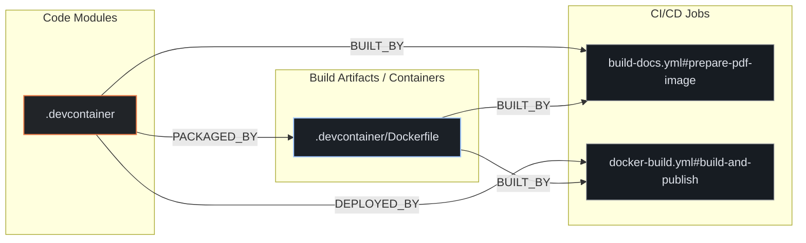

# Repository Architecture Analysis: nextcloud/documentation

## Metadata
- **SHA**: `962d63ba78cb757f0c50f2c0b97e4b42983768f1`
- **Primary Ecosystem**: Python

## Quality Metrics
- **ast_engine**: tree-sitter
- **avg_cognitive_complexity**: 1.22
- **avg_cyclomatic_complexity**: 2.22
- **component_count**: 0
- **dead_code_count**: 2
- **dead_code_symbols**: 2 entry(ies)
- **duplication_pct**: 58.1
- **file_complexities**: 5 entry(ies)
- **files_analyzed**: 5
- **fitness_passed**: False
- **fitness_violation_count**: 1
- **framework**: Unknown
- **import_edges**: 20 entry(ies)
- **loc**: 747
- **max_cognitive_complexity**: 4
- **max_cyclomatic_complexity**: 5
- **sloc**: 420
- **test_file_count**: 3

## 6-Dimension Repository Scorecard

- **Overall Grade**: `F` (51.55/100)
- **Technical Debt Score**: 48.45
- **Estimated Remediation Effort**: 72.73h

| Dimension | Grade | Score | Weight | Details |
| :--- | :---: | :---: | :---: | :--- |
| Code Quality | `C` | 71.00 | 0.20 | avg_cc=2.22, max_cc=5, duplication=58.10%, dead_code=2 |
| Dependency Health | `B` | 85.00 | 0.15 | dependencies=39, outdated=0, vulnerable=0, has_lockfile=False |
| Maintainability | `A` | 94.00 | 0.15 | avg_cognitive=1.22, max_cognitive=4, fitness_violations=1, oversized_files=0 |
| Pipeline Health | `F` | 0.00 | 0.15 | workflows=19, operational_antipatterns=43, parallel_branches=True |
| Security | `F` | 0.00 | 0.20 | vulnerabilities=0, secrets=2, pipeline_security_findings=8 |
| Test Coverage | `C` | 70.00 | 0.15 | coverage=unavailable, ci_test_job=True, test_files_detected=True |

## Architecture Fitness & Workspace Boundaries

- **[MEDIUM] `ATRUSS-ARCH-005` (COMPLEXITY_THRESHOLD)**: Repository duplication_pct (58.1) exceeds policy threshold (15.0).

## Supply Chain Dependencies, Vulnerabilities & Secrets

- **Dependencies Parsed**: 39 | **Vulnerabilities**: 0 | **Secrets**: 2

### Secret Findings (Redacted)
- **[HIGH] `ATRUSS-SEC-005`** at `developer_manual/client_apis/LoginFlow/index.rst:137` (`"token":"mQUY***REDACTED***",`)
- **[HIGH] `ATRUSS-SEC-005`** at `developer_manual/client_apis/LoginFlow/index.rst:158` (`"appPassword":"yKTV***REDACTED***"`)

### Inventory Sample
- `Babel` `2.18.0` (PyPI, `requirements.txt`)
- `Jinja2` `3.1.6` (PyPI, `requirements.txt`)
- `MarkupSafe` `3.0.4` (PyPI, `requirements.txt`)
- `Pillow` `13.0.0` (PyPI, `requirements.txt`)
- `PyYAML` `6.0.3` (PyPI, `requirements.txt`)
- `Pygments` `2.21.0` (PyPI, `requirements.txt`)
- `Sphinx` `9.2.0` (PyPI, `requirements.txt`)
- `alabaster` `1.0.0` (PyPI, `requirements.txt`)
- `certifi` `2026.10.23` (PyPI, `requirements.txt`)
- `charset-normalizer` `3.5.2` (PyPI, `requirements.txt`)
- `docutils` `0.21.2` (PyPI, `requirements.txt`)
- `idna` `3.20` (PyPI, `requirements.txt`)
- `imagesize` `2.0.1` (PyPI, `requirements.txt`)
- `importlib-metadata` `10.1.0` (PyPI, `requirements.txt`)
- `packaging` `26.3` (PyPI, `requirements.txt`)
- `reportlab` `4.5.1` (PyPI, `requirements.txt`)
- `requests` `2.34.2` (PyPI, `requirements.txt`)
- `rst2pdf` `0.105` (PyPI, `requirements.txt`)
- `smartypants` `2.0.2` (PyPI, `requirements.txt`)
- `snowballstemmer` `3.1.1` (PyPI, `requirements.txt`)
- `sphinx-copybutton` `0.5.2` (PyPI, `requirements.txt`)
- `sphinx-lint` `1.0.2` (PyPI, `requirements.txt`)
- `sphinx-notfound-page` `1.1.0` (PyPI, `requirements.txt`)
- `sphinx-reredirects` `1.1.0` (PyPI, `requirements.txt`)
- `sphinx-rtd-dark-mode` `1.3.0` (PyPI, `requirements.txt`)
- `sphinx-rtd-theme` `3.1.0` (PyPI, `requirements.txt`)
- `sphinx-toolbox` `4.3.1` (PyPI, `requirements.txt`)
- `sphinxcontrib-applehelp` `2.0.0` (PyPI, `requirements.txt`)
- `sphinxcontrib-devhelp` `2.0.0` (PyPI, `requirements.txt`)
- `sphinxcontrib-htmlhelp` `2.1.0` (PyPI, `requirements.txt`)
- ... (+9 more dependencies)

## Section 7: Code-to-Cloud Deployment Traceability

- `.devcontainer` (code_module) --[BUILT_BY]--> `build-docs.yml#prepare-pdf-image` (ci_job)
- `.devcontainer` (code_module) --[DEPLOYED_BY]--> `docker-build.yml#build-and-publish` (ci_job)
- `.devcontainer` (code_module) --[PACKAGED_BY]--> `.devcontainer/Dockerfile` (container)
- `.devcontainer/Dockerfile` (container) --[BUILT_BY]--> `build-docs.yml#prepare-pdf-image` (ci_job)
- `.devcontainer/Dockerfile` (container) --[BUILT_BY]--> `docker-build.yml#build-and-publish` (ci_job)

## CI/CD Pipeline Topology

```mermaid
graph TD;
  classDef atlasRoot fill:#004882,stroke:#a3c9ff,stroke-width:2px,color:#d3e4ff
  classDef atlasCategory fill:#212428,stroke:#E87A48,stroke-width:1.5px,color:#dfe3eb
  classDef atlasWorkflow fill:#1b2026,stroke:#a3c9ff,stroke-width:1.5px,color:#dfe3eb
  classDef atlasJob fill:#171c22,stroke:#8d9199,stroke-width:1px,color:#dfe3eb
  classDef atlasTarget fill:#005227,stroke:#8bd99b,stroke-width:1.5px,color:#a7f6b6
  classDef atlasAlert fill:#93000a,stroke:#ffb4ab,stroke-width:1.5px,color:#ffdad6
  classDef atlasMore fill:#252a31,stroke:#8d9199,stroke-dasharray:4 4,color:#c3c6cf
  pipeline_root(["nextcloud/documentation (19 workflows)"]):::atlasRoot
  grp_0_CI___Verification["CI & Verification (9 workflows · 18 jobs)"]:::atlasCategory
  pipeline_root --> grp_0_CI___Verification
  wf_1_Build_documentation__reusable_["Build documentation (reusable) (5 jobs)"]:::atlasWorkflow
  grp_0_CI___Verification --> wf_1_Build_documentation__reusable_
  job_1_build_html["build-html"]:::atlasJob
  job_1_build_epub["build-epub"]:::atlasJob
  job_1_prepare_pdf_image["prepare-pdf-image"]:::atlasJob
  wf_1_Build_documentation__reusable_ --> job_1_build_html
  wf_1_Build_documentation__reusable_ --> job_1_build_epub
  wf_1_Build_documentation__reusable_ --> job_1_prepare_pdf_image
  wf_10_Labeling["Labeling (3 jobs)"]:::atlasWorkflow
  grp_0_CI___Verification --> wf_10_Labeling
  job_10_label_by_files["label-by-files"]:::atlasJob
  job_10_triage_pr["triage-pr"]:::atlasJob
  job_10_triage_issue["triage-issue"]:::atlasJob
  wf_10_Labeling --> job_10_label_by_files
  job_10_label_by_files --> job_10_triage_pr
  wf_10_Labeling --> job_10_triage_issue
  wf_14_Build_documentation["Build documentation (4 jobs)"]:::atlasWorkflow
  grp_0_CI___Verification --> wf_14_Build_documentation
  job_14_build["build"]:::atlasJob
  job_14_link_check["link-check"]:::atlasJob
  job_14_netlify_preview["netlify-preview"]:::atlasJob
  wf_14_Build_documentation --> job_14_build
  job_14_build --> job_14_link_check
  job_14_build --> job_14_netlify_preview
  grp_1_Scheduled___Manual["Scheduled & Manual (4 workflows · 4 jobs)"]:::atlasCategory
  pipeline_root --> grp_1_Scheduled___Manual
  wf_9_Generate_catalog_templates__POT__files_fetched_automatically_by_transifex["Generate catalog templates (POT) files fetched automatically by transifex (1 jobs)"]:::atlasWorkflow
  grp_1_Scheduled___Manual --> wf_9_Generate_catalog_templates__POT__files_fetched_automatically_by_transifex
  job_9_user_manual["user_manual"]:::atlasJob
  wf_9_Generate_catalog_templates__POT__files_fetched_automatically_by_transifex --> job_9_user_manual
  wf_12_Ask_for_feedback_on_PRs["Ask for feedback on PRs (1 jobs)"]:::atlasWorkflow
  grp_1_Scheduled___Manual --> wf_12_Ask_for_feedback_on_PRs
  job_12_pr_feedback["pr-feedback"]:::atlasJob
  wf_12_Ask_for_feedback_on_PRs --> job_12_pr_feedback
  wf_18_Checkout_File_from_Master["Checkout File from Master (1 jobs)"]:::atlasWorkflow
  grp_1_Scheduled___Manual --> wf_18_Checkout_File_from_Master
  job_18_checkout["checkout"]:::atlasJob
  wf_18_Checkout_File_from_Master --> job_18_checkout
  grp_2_Release___Deploy["Release & Deploy (3 workflows · 7 jobs)"]:::atlasCategory
  pipeline_root --> grp_2_Release___Deploy
  wf_5_Deploy_documentation["Deploy documentation (4 jobs)"]:::atlasWorkflow
  grp_2_Release___Deploy --> wf_5_Deploy_documentation
  job_5_prepare["prepare"]:::atlasJob
  job_5_build["build"]:::atlasJob
  job_5_deploy["deploy"]:::atlasJob
  wf_5_Deploy_documentation --> job_5_prepare
  job_5_prepare --> job_5_build
  job_5_build --> job_5_deploy
  wf_15_Squash_gh_pages_history["Squash gh-pages history (2 jobs)"]:::atlasWorkflow
  grp_2_Release___Deploy --> wf_15_Squash_gh_pages_history
  job_15_test["test"]:::atlasJob
  wf_15_Squash_gh_pages_history --> job_15_test
  grp_3_Security___Governance["Security & Governance (3 workflows · 3 jobs)"]:::atlasCategory
  pipeline_root --> grp_3_Security___Governance
  wf_4_Auto_approve_Dependabot_PRs["Auto approve Dependabot PRs (1 jobs)"]:::atlasWorkflow
  grp_3_Security___Governance --> wf_4_Auto_approve_Dependabot_PRs
  wf_7_Block_fixup_and_squash_commits["Block fixup and squash commits (1 jobs)"]:::atlasWorkflow
  grp_3_Security___Governance --> wf_7_Block_fixup_and_squash_commits
  wf_more["+9 more workflows"]:::atlasMore
  pipeline_root --> wf_more
```

