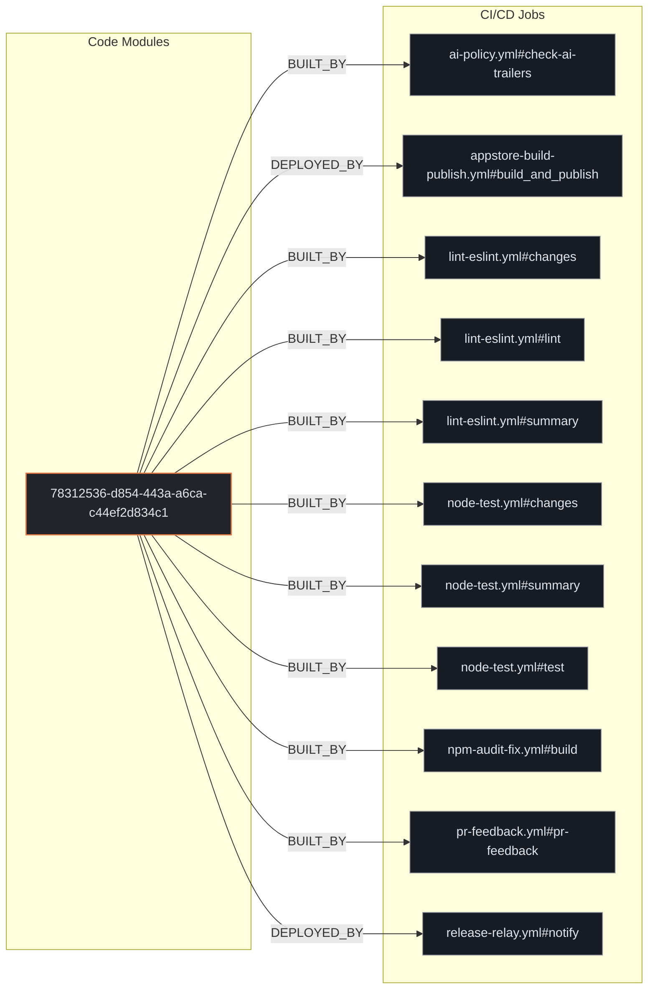
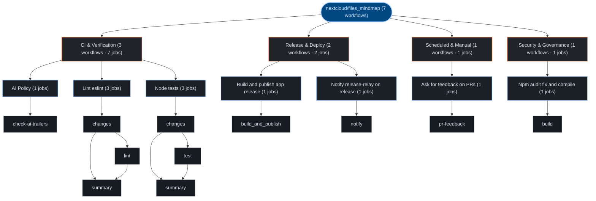

# Repository Architecture Analysis: nextcloud/files_mindmap

## Metadata
- **SHA**: `46625e243af396fe29a2f99d618fbc121474804c`
- **Primary Ecosystem**: JavaScript/TypeScript

## Quality Metrics
- **ast_engine**: tree-sitter
- **avg_cognitive_complexity**: 1.76
- **avg_cyclomatic_complexity**: 2.17
- **component_count**: 1
- **dead_code_count**: 9
- **dead_code_symbols**: 9 entry(ies)
- **duplication_pct**: 76.83
- **file_complexities**: 25 entry(ies)
- **files_analyzed**: 106
- **fitness_passed**: False
- **fitness_violation_count**: 3
- **framework**: React (Vite)
- **import_edges**: 100 entry(ies)
- **loc**: 5431
- **max_cognitive_complexity**: 51
- **max_cyclomatic_complexity**: 27
- **sloc**: 4934
- **test_file_count**: 9

# Architecture: nextcloud/files_mindmap

## Context
- **Repository**: `nextcloud/files_mindmap`
- **SHA**: `46625e243af396fe29a2f99d618fbc121474804c`
- **Ecosystem**: JavaScript/TypeScript
- **Framework**: React (Vite)

## Building Block View

## Component Details
- **files_mindmap** (`package.json`): MODULE

## 6-Dimension Repository Scorecard

- **Overall Grade**: `F` (47.05/100)
- **Technical Debt Score**: 52.95
- **Estimated Remediation Effort**: 56.85h

| Dimension | Grade | Score | Weight | Details |
| :--- | :---: | :---: | :---: | :--- |
| Code Quality | `F` | 39.00 | 0.20 | avg_cc=2.17, max_cc=27, duplication=76.83%, dead_code=9 |
| Dependency Health | `A` | 100.00 | 0.15 | dependencies=1222, outdated=0, vulnerable=0, has_lockfile=True |
| Maintainability | `F` | 57.00 | 0.15 | avg_cognitive=1.76, max_cognitive=51, fitness_violations=3, oversized_files=0 |
| Pipeline Health | `F` | 8.00 | 0.15 | workflows=7, operational_antipatterns=17, parallel_branches=True |
| Security | `F` | 20.00 | 0.20 | vulnerabilities=0, secrets=0, pipeline_security_findings=4 |
| Test Coverage | `C` | 70.00 | 0.15 | coverage=unavailable, ci_test_job=True, test_files_detected=True |

## Architecture Fitness & Workspace Boundaries

- **[MEDIUM] `ATRUSS-ARCH-005` (COMPLEXITY_THRESHOLD)**: Repository duplication_pct (76.83) exceeds policy threshold (15.0).
- **[MEDIUM] `ATRUSS-ARCH-005` (COMPLEXITY_THRESHOLD)**: Repository max_cognitive_complexity (51.0) exceeds policy threshold (25.0).
- **[MEDIUM] `ATRUSS-ARCH-005` (COMPLEXITY_THRESHOLD)**: Repository max_cyclomatic_complexity (27.0) exceeds policy threshold (20.0).

## Supply Chain Dependencies, Vulnerabilities & Secrets

- **Dependencies Parsed**: 1222 | **Vulnerabilities**: 0 | **Secrets**: 0

### Inventory Sample
- `@babel/core` `7.3.3` (npm, `vendor/jquery/package.json`)
- `@babel/plugin-transform-for-of` `7.2.0` (npm, `vendor/jquery/package.json`)
- `@markedjs/html-differ` `2.0.0` (npm, `vendor/marked/package-lock.json`)
- `@markedjs/html-differ` `2.0.0` (npm, `vendor/marked/package.json`)
- `@nextcloud/auth` `2.5.0` (npm, `package.json`)
- `@nextcloud/auth` `2.6.0` (npm, `package-lock.json`)
- `@nextcloud/axios` `2.4.0` (npm, `package.json`)
- `@nextcloud/axios` `2.6.0` (npm, `package-lock.json`)
- `@nextcloud/browserslist-config` `3.0.0` (npm, `package.json`)
- `@nextcloud/browserslist-config` `3.1.2` (npm, `package-lock.json`)
- `@nextcloud/dialogs` `7.5.0` (npm, `package.json`)
- `@nextcloud/dialogs` `7.6.0` (npm, `package-lock.json`)
- `@nextcloud/eslint-config` `9.0.1` (npm, `package-lock.json`)
- `@nextcloud/eslint-config` `9.0.1` (npm, `package.json`)
- `@nextcloud/event-bus` `3.1.0` (npm, `package.json`)
- `@nextcloud/event-bus` `3.3.3` (npm, `package-lock.json`)
- `@nextcloud/files` `4.1.1` (npm, `package-lock.json`)
- `@nextcloud/files` `4.1.1` (npm, `package.json`)
- `@nextcloud/l10n` `3.0.0` (npm, `package.json`)
- `@nextcloud/l10n` `3.4.1` (npm, `package-lock.json`)
- `@nextcloud/logger` `3.0.0` (npm, `package.json`)
- `@nextcloud/logger` `3.0.3` (npm, `package-lock.json`)
- `@nextcloud/paths` `3.1.0` (npm, `package-lock.json`)
- `@nextcloud/paths` `3.1.0` (npm, `package.json`)
- `@nextcloud/router` `3.2.0` (npm, `package-lock.json`)
- `@nextcloud/router` `3.2.0` (npm, `package.json`)
- `@nextcloud/sharing` `0.4.0` (npm, `package-lock.json`)
- `@nextcloud/sharing` `0.4.0` (npm, `package.json`)
- `@nextcloud/viewer` `2.0.0-beta.20` (npm, `package.json`)
- `@nextcloud/viewer` `2.0.0-beta.21` (npm, `package-lock.json`)
- ... (+1192 more dependencies)

## Section 7: Code-to-Cloud Deployment Traceability

- `78312536-d854-443a-a6ca-c44ef2d834c1` (code_module) --[BUILT_BY]--> `ai-policy.yml#check-ai-trailers` (ci_job)
- `78312536-d854-443a-a6ca-c44ef2d834c1` (code_module) --[BUILT_BY]--> `lint-eslint.yml#changes` (ci_job)
- `78312536-d854-443a-a6ca-c44ef2d834c1` (code_module) --[BUILT_BY]--> `lint-eslint.yml#lint` (ci_job)
- `78312536-d854-443a-a6ca-c44ef2d834c1` (code_module) --[BUILT_BY]--> `lint-eslint.yml#summary` (ci_job)
- `78312536-d854-443a-a6ca-c44ef2d834c1` (code_module) --[BUILT_BY]--> `node-test.yml#changes` (ci_job)
- `78312536-d854-443a-a6ca-c44ef2d834c1` (code_module) --[BUILT_BY]--> `node-test.yml#summary` (ci_job)
- `78312536-d854-443a-a6ca-c44ef2d834c1` (code_module) --[BUILT_BY]--> `node-test.yml#test` (ci_job)
- `78312536-d854-443a-a6ca-c44ef2d834c1` (code_module) --[BUILT_BY]--> `npm-audit-fix.yml#build` (ci_job)
- `78312536-d854-443a-a6ca-c44ef2d834c1` (code_module) --[BUILT_BY]--> `pr-feedback.yml#pr-feedback` (ci_job)
- `78312536-d854-443a-a6ca-c44ef2d834c1` (code_module) --[DEPLOYED_BY]--> `appstore-build-publish.yml#build_and_publish` (ci_job)
- `78312536-d854-443a-a6ca-c44ef2d834c1` (code_module) --[DEPLOYED_BY]--> `release-relay.yml#notify` (ci_job)

## CI/CD Pipeline Topology

