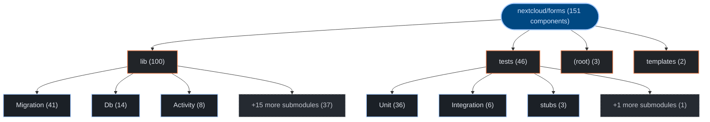

# Repository Architecture Analysis: nextcloud/forms

## Metadata
- **SHA**: `721c146513097c1d6d1c0a716ec20c2e9514edc1`
- **Primary Ecosystem**: PHP

## Quality Metrics
- **ast_engine**: fallback
- **avg_cognitive_complexity**: 0.0
- **avg_cyclomatic_complexity**: 0.0
- **component_count**: 151
- **dead_code_count**: 0
- **dead_code_symbols**: 0 entry(ies)
- **duplication_pct**: 0.0
- **file_complexities**: 0 entry(ies)
- **files_analyzed**: 151
- **fitness_passed**: True
- **fitness_violation_count**: 0
- **framework**: PHP Composer
- **import_edges**: 0 entry(ies)
- **loc**: 29646
- **max_cognitive_complexity**: 0
- **max_cyclomatic_complexity**: 0
- **sloc**: 21131
- **test_file_count**: 61

# Architecture: nextcloud/forms

## Context
- **Repository**: `nextcloud/forms`
- **SHA**: `721c146513097c1d6d1c0a716ec20c2e9514edc1`
- **Ecosystem**: PHP
- **Framework**: PHP Composer

## Building Block View

## Component Details

Showing top 60 representative components out of 151 across 4 module group(s):

- **Module `lib`** (100 components — module: 100)
- **Module `tests`** (46 components — module: 46)
- **Module `(root)`** (3 components — module: 3)
- **Module `templates`** (2 components — module: 2)

- **.php-cs-fixer.dist** (`.php-cs-fixer.dist.php`): module
- **AbstractFormEvent** (`lib/Events/AbstractFormEvent.php`): module
- **ActivityConstants** (`lib/Activity/ActivityConstants.php`): module
- **ActivityManager** (`lib/Activity/ActivityManager.php`): module
- **ActivityManagerTest** (`tests/Unit/Activity/ActivityManagerTest.php`): module
- **AnalyticsDatasource** (`lib/Analytics/AnalyticsDatasource.php`): module
- **AnalyticsDatasourceListener** (`lib/Listener/AnalyticsDatasourceListener.php`): module
- **AnalyticsDatasourceTest** (`tests/Unit/Analytics/AnalyticsDatasourceTest.php`): module
- **Answer** (`lib/Db/Answer.php`): module
- **AnswerMapper** (`lib/Db/AnswerMapper.php`): module
- **ApiController** (`lib/Controller/ApiController.php`): module
- **ApiControllerTest** (`tests/Unit/Controller/ApiControllerTest.php`): module
- **ApiV3Test** (`tests/Integration/Api/ApiV3Test.php`): module
- **Application** (`lib/AppInfo/Application.php`): module
- **ApplicationTest** (`tests/Unit/AppInfo/ApplicationTest.php`): module
- **AuditEvents** (`tests/Unit/AuditLog/AuditEvents.php`): module
- **AuditLogger** (`lib/AuditLog/AuditLogger.php`): module
- **AuditLoggerTest** (`tests/Unit/AuditLog/AuditLoggerTest.php`): module
- **Capabilities** (`lib/Capabilities.php`): module
- **CirclesService** (`lib/Service/CirclesService.php`): module
- **CirclesServiceTest** (`tests/Unit/Service/CirclesServiceTest.php`): module
- **CleanupUploadedFilesJob** (`lib/BackgroundJob/CleanupUploadedFilesJob.php`): module
- **CleanupUploadedFilesJobTest** (`tests/Unit/BackgroundJob/CleanupUploadedFilesJobTest.php`): module
- **CommentsEntityListener** (`lib/Listener/CommentsEntityListener.php`): module
- **ConfigController** (`lib/Controller/ConfigController.php`): module
- **ConfigControllerTest** (`tests/Unit/Controller/ConfigControllerTest.php`): module
- **ConfigService** (`lib/Service/ConfigService.php`): module
- **ConfigServiceTest** (`tests/Unit/Service/ConfigServiceTest.php`): module
- **ConfirmationEmailService** (`lib/Service/ConfirmationEmailService.php`): module
- **ConfirmationEmailServiceTest** (`tests/Unit/Service/ConfirmationEmailServiceTest.php`): module
- **Constants** (`lib/Constants.php`): module
- **DeleteQuestionFoldersJob** (`lib/BackgroundJob/DeleteQuestionFoldersJob.php`): module
- **DeleteQuestionFoldersJobTest** (`tests/Integration/BackgroundJob/DeleteQuestionFoldersJobTest.php`): module
- **FilePathHelper** (`lib/Helper/FilePathHelper.php`): module
- **FilePathHelperTest** (`tests/Unit/Helper/FilePathHelperTest.php`): module
- **Filter** (`lib/Activity/Filter.php`): module
- **FilterTest** (`tests/Unit/Activity/FilterTest.php`): module
- **Form** (`lib/Db/Form.php`): module
- **FormMapper** (`lib/Db/FormMapper.php`): module
- **FormMapperTest** (`tests/Unit/Db/FormMapperTest.php`): module
- **FormSubmittedEvent** (`lib/Events/FormSubmittedEvent.php`): module
- **FormsActivitySettings** (`lib/Activity/Settings/FormsActivitySettings.php`): module
- **FormsActivitySettingsTest** (`tests/Unit/Activity/Settings/FormsActivitySettingsTest.php`): module
- **FormsMigrator** (`lib/FormsMigrator.php`): module
- **FormsMigratorTest** (`tests/Unit/FormsMigratorTest.php`): module
- **FormsSearchResultEntry** (`lib/Search/FormsSearchResultEntry.php`): module
- **FormsService** (`lib/Service/FormsService.php`): module
- **FormsServiceTest** (`tests/Unit/Service/FormsServiceTest.php`): module
- **IntegrationBase** (`tests/Integration/IntegrationBase.php`): module
- **MockedMapperException** (`tests/Unit/MockedMapperException.php`): module
- **NewShare** (`lib/Activity/Settings/NewShare.php`): module
- **NewShareTest** (`tests/Unit/Activity/Settings/NewShareTest.php`): module
- **NewSharedSubmission** (`lib/Activity/Settings/NewSharedSubmission.php`): module
- **NewSharedSubmissionTest** (`tests/Unit/Activity/Settings/NewSharedSubmissionTest.php`): module
- **NewSubmission** (`lib/Activity/Settings/NewSubmission.php`): module
- **NewSubmissionTest** (`tests/Unit/Activity/Settings/NewSubmissionTest.php`): module
- **NoSuchFormException** (`lib/Exception/NoSuchFormException.php`): module
- **Operation** (`lib/AuditLog/Operation.php`): module
- **OperationTest** (`tests/Unit/AuditLog/OperationTest.php`): module
- **Option** (`lib/Db/Option.php`): module

## 6-Dimension Repository Scorecard

- **Overall Grade**: `D` (60.50/100)
- **Technical Debt Score**: 39.50
- **Estimated Remediation Effort**: 66.38h

| Dimension | Grade | Score | Weight | Details |
| :--- | :---: | :---: | :---: | :--- |
| Code Quality | `A` | 100.00 | 0.20 | avg_cc=0.00, max_cc=0, duplication=0.00%, dead_code=0 |
| Dependency Health | `A` | 100.00 | 0.15 | dependencies=1030, outdated=0, vulnerable=0, has_lockfile=True |
| Maintainability | `A` | 100.00 | 0.15 | avg_cognitive=0.00, max_cognitive=0, fitness_violations=0, oversized_files=0 |
| Pipeline Health | `F` | 0.00 | 0.15 | workflows=22, operational_antipatterns=50, parallel_branches=True |
| Security | `F` | 0.00 | 0.20 | vulnerabilities=0, secrets=5, pipeline_security_findings=8 |
| Test Coverage | `C` | 70.00 | 0.15 | coverage=unavailable, ci_test_job=True, test_files_detected=True |

## Supply Chain Dependencies, Vulnerabilities & Secrets

- **Dependencies Parsed**: 1030 | **Vulnerabilities**: 0 | **Secrets**: 5

### Secret Findings (Redacted)
- **[HIGH] `ATRUSS-SEC-005`** at `docs/API_v3.md:696` (`"token": "abcd***REDACTED***"`)
- **[HIGH] `ATRUSS-SEC-005`** at `l10n/zh_HK.js:261` (`"Set the public share link token to something easy to remember or generate a new token." : "將公開分***REDACTED***",`)
- **[HIGH] `ATRUSS-SEC-005`** at `l10n/zh_HK.json:259` (`"Set the public share link token to something easy to remember or generate a new token." : "將公開分***REDACTED***",`)
- **[HIGH] `ATRUSS-SEC-005`** at `l10n/zh_TW.js:262` (`"Set the public share link token to something easy to remember or generate a new token." : "將公開分***REDACTED***",`)
- **[HIGH] `ATRUSS-SEC-005`** at `l10n/zh_TW.json:260` (`"Set the public share link token to something easy to remember or generate a new token." : "將公開分***REDACTED***",`)

### Inventory Sample
- `maennchen/zipstream-php` `2.4` (composer, `composer.json`)
- `nextcloud/coding-standard` `1.3` (composer, `vendor-bin/cs-fixer/composer.json`)
- `phpoffice/phpspreadsheet` `5.0` (composer, `composer.json`)
- `@material-symbols/svg-400` `0.48.3` (npm, `package-lock.json`)
- `@material-symbols/svg-400` `0.48.3` (npm, `package.json`)
- `@nextcloud/auth` `2.6.0` (npm, `package-lock.json`)
- `@nextcloud/auth` `2.6.0` (npm, `package.json`)
- `@nextcloud/axios` `2.6.0` (npm, `package-lock.json`)
- `@nextcloud/axios` `2.6.0` (npm, `package.json`)
- `@nextcloud/browserslist-config` `3.1.2` (npm, `package-lock.json`)
- `@nextcloud/browserslist-config` `3.1.2` (npm, `package.json`)
- `@nextcloud/dialogs` `8.0.0` (npm, `package-lock.json`)
- `@nextcloud/dialogs` `8.0.0` (npm, `package.json`)
- `@nextcloud/e2e-test-server` `0.6.1` (npm, `package-lock.json`)
- `@nextcloud/e2e-test-server` `0.6.1` (npm, `package.json`)
- `@nextcloud/eslint-config` `9.0.1` (npm, `package-lock.json`)
- `@nextcloud/eslint-config` `9.0.1` (npm, `package.json`)
- `@nextcloud/event-bus` `3.3.3` (npm, `package-lock.json`)
- `@nextcloud/event-bus` `3.3.3` (npm, `package.json`)
- `@nextcloud/files` `4.1.1` (npm, `package-lock.json`)
- `@nextcloud/files` `4.1.1` (npm, `package.json`)
- `@nextcloud/initial-state` `3.0.0` (npm, `package-lock.json`)
- `@nextcloud/initial-state` `3.0.0` (npm, `package.json`)
- `@nextcloud/l10n` `3.4.1` (npm, `package-lock.json`)
- `@nextcloud/l10n` `3.4.1` (npm, `package.json`)
- `@nextcloud/logger` `3.0.3` (npm, `package-lock.json`)
- `@nextcloud/logger` `3.0.3` (npm, `package.json`)
- `@nextcloud/moment` `1.3.5` (npm, `package-lock.json`)
- `@nextcloud/moment` `1.3.5` (npm, `package.json`)
- `@nextcloud/prettier-config` `1.2.0` (npm, `package-lock.json`)
- ... (+1000 more dependencies)

## CI/CD Pipeline Topology

```mermaid
graph TD;
  classDef atlasRoot fill:#004882,stroke:#a3c9ff,stroke-width:2px,color:#d3e4ff
  classDef atlasCategory fill:#212428,stroke:#E87A48,stroke-width:1.5px,color:#dfe3eb
  classDef atlasWorkflow fill:#1b2026,stroke:#a3c9ff,stroke-width:1.5px,color:#dfe3eb
  classDef atlasJob fill:#171c22,stroke:#8d9199,stroke-width:1px,color:#dfe3eb
  classDef atlasTarget fill:#005227,stroke:#8bd99b,stroke-width:1.5px,color:#a7f6b6
  classDef atlasAlert fill:#93000a,stroke:#ffb4ab,stroke-width:1.5px,color:#ffdad6
  classDef atlasMore fill:#252a31,stroke:#8d9199,stroke-dasharray:4 4,color:#c3c6cf
  pipeline_root(["nextcloud/forms (22 workflows)"]):::atlasRoot
  grp_0_CI___Verification["CI & Verification (15 workflows · 35 jobs)"]:::atlasCategory
  pipeline_root --> grp_0_CI___Verification
  wf_3_Lint_eslint["Lint eslint (3 jobs)"]:::atlasWorkflow
  grp_0_CI___Verification --> wf_3_Lint_eslint
  job_3_changes["changes"]:::atlasJob
  job_3_lint["lint"]:::atlasJob
  job_3_summary["summary"]:::atlasJob
  wf_3_Lint_eslint --> job_3_changes
  job_3_changes --> job_3_lint
  job_3_changes --> job_3_summary
  job_3_lint --> job_3_summary
  wf_6_Lint_php["Lint php (3 jobs)"]:::atlasWorkflow
  grp_0_CI___Verification --> wf_6_Lint_php
  job_6_matrix["matrix"]:::atlasJob
  job_6_php_lint["php-lint"]:::atlasJob
  job_6_summary["summary"]:::atlasJob
  wf_6_Lint_php --> job_6_matrix
  job_6_matrix --> job_6_php_lint
  job_6_php_lint --> job_6_summary
  wf_8_Node_tests["Node tests (3 jobs)"]:::atlasWorkflow
  grp_0_CI___Verification --> wf_8_Node_tests
  job_8_changes["changes"]:::atlasJob
  job_8_test["test"]:::atlasJob
  job_8_summary["summary"]:::atlasJob
  wf_8_Node_tests --> job_8_changes
  job_8_changes --> job_8_test
  job_8_changes --> job_8_summary
  job_8_test --> job_8_summary
  grp_1_Scheduled___Manual["Scheduled & Manual (3 workflows · 3 jobs)"]:::atlasCategory
  pipeline_root --> grp_1_Scheduled___Manual
  wf_16_Ask_for_feedback_on_PRs["Ask for feedback on PRs (1 jobs)"]:::atlasWorkflow
  grp_1_Scheduled___Manual --> wf_16_Ask_for_feedback_on_PRs
  job_16_pr_feedback["pr-feedback"]:::atlasJob
  wf_16_Ask_for_feedback_on_PRs --> job_16_pr_feedback
  wf_18_Apply_rector_changes["Apply rector changes (1 jobs)"]:::atlasWorkflow
  grp_1_Scheduled___Manual --> wf_18_Apply_rector_changes
  job_18_build["build"]:::atlasJob
  wf_18_Apply_rector_changes --> job_18_build
  wf_21_Update_workflows["Update workflows (1 jobs)"]:::atlasWorkflow
  grp_1_Scheduled___Manual --> wf_21_Update_workflows
  job_21_dispatch["dispatch"]:::atlasJob
  wf_21_Update_workflows --> job_21_dispatch
  grp_2_Release___Deploy["Release & Deploy (2 workflows · 2 jobs)"]:::atlasCategory
  pipeline_root --> grp_2_Release___Deploy
  wf_0_Build_and_publish_app_release["Build and publish app release (1 jobs)"]:::atlasWorkflow
  grp_2_Release___Deploy --> wf_0_Build_and_publish_app_release
  job_0_build_and_publish["build_and_publish"]:::atlasJob
  wf_0_Build_and_publish_app_release --> job_0_build_and_publish
  wf_19_Notify_release_relay_on_release["Notify release-relay on release (1 jobs)"]:::atlasWorkflow
  grp_2_Release___Deploy --> wf_19_Notify_release_relay_on_release
  job_19_notify["notify"]:::atlasJob
  wf_19_Notify_release_relay_on_release --> job_19_notify
  grp_3_Security___Governance["Security & Governance (2 workflows · 2 jobs)"]:::atlasCategory
  pipeline_root --> grp_3_Security___Governance
  wf_1_Auto_approve_Dependabot_PRs["Auto approve Dependabot PRs (1 jobs)"]:::atlasWorkflow
  grp_3_Security___Governance --> wf_1_Auto_approve_Dependabot_PRs
  job_1_auto_approve_merge["auto-approve-merge"]:::atlasJob
  wf_1_Auto_approve_Dependabot_PRs --> job_1_auto_approve_merge
  wf_2_Block_fixup_and_squash_commits["Block fixup and squash commits (1 jobs)"]:::atlasWorkflow
  grp_3_Security___Governance --> wf_2_Block_fixup_and_squash_commits
  job_2_commit_message_check["commit-message-check"]:::atlasJob
  wf_2_Block_fixup_and_squash_commits --> job_2_commit_message_check
  wf_more["+12 more workflows"]:::atlasMore
  pipeline_root --> wf_more
```

