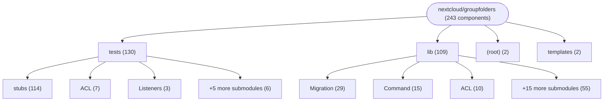
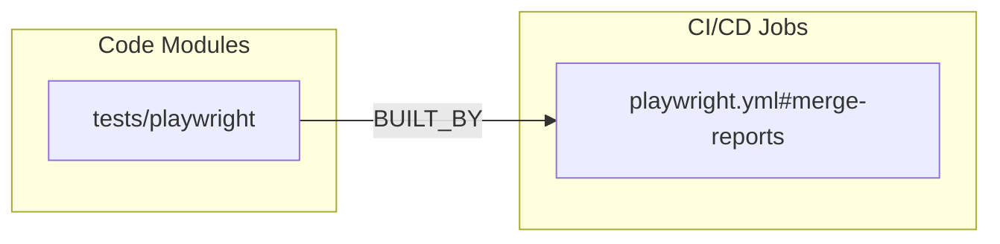
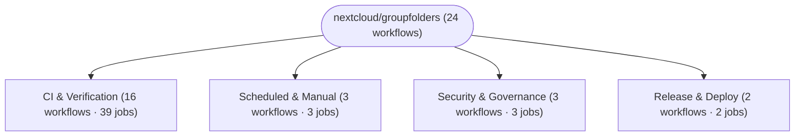

# Repository Architecture Analysis: nextcloud/groupfolders

## Metadata
- **SHA**: `3475e3c8f3456e02d186fcd0bfc8ef9fc36a94ad`
- **Primary Ecosystem**: PHP

## Quality Metrics
- **ast_engine**: tree-sitter
- **avg_cognitive_complexity**: 0.52
- **avg_cyclomatic_complexity**: 1.48
- **component_count**: 243
- **dead_code_count**: 0
- **dead_code_symbols**: 0 entry(ies)
- **duplication_pct**: 4.19
- **file_complexities**: 25 entry(ies)
- **files_analyzed**: 270
- **fitness_passed**: True
- **fitness_violation_count**: 0
- **framework**: PHP Composer
- **import_edges**: 100 entry(ies)
- **loc**: 37695
- **max_cognitive_complexity**: 6
- **max_cyclomatic_complexity**: 6
- **sloc**: 20114
- **test_file_count**: 160

# Architecture: nextcloud/groupfolders

## Context
- **Repository**: `nextcloud/groupfolders`
- **SHA**: `3475e3c8f3456e02d186fcd0bfc8ef9fc36a94ad`
- **Ecosystem**: PHP
- **Framework**: PHP Composer

## Building Block View

## Component Details

Showing top 60 representative components out of 243 across 4 module group(s):

- **Module `tests`** (130 components — module: 130)
- **Module `lib`** (109 components — module: 109)
- **Module `(root)`** (2 components — module: 2)
- **Module `templates`** (2 components — module: 2)

- **.php-cs-fixer.dist** (`.php-cs-fixer.dist.php`): module
- **ACL** (`lib/Command/ACL.php`): module
- **ACLCacheWrapper** (`lib/ACL/ACLCacheWrapper.php`): module
- **ACLCacheWrapperTest** (`tests/ACL/ACLCacheWrapperTest.php`): module
- **ACLManager** (`lib/ACL/ACLManager.php`): module
- **ACLManagerFactory** (`lib/ACL/ACLManagerFactory.php`): module
- **ACLManagerFactoryTest** (`tests/ACL/ACLManagerFactoryTest.php`): module
- **ACLManagerTest** (`tests/ACL/ACLManagerTest.php`): module
- **ACLPlugin** (`lib/DAV/ACLPlugin.php`): module
- **ACLScannerTest** (`tests/ACL/ACLScannerTest.php`): module
- **ACLStorageWrapper** (`lib/ACL/ACLStorageWrapper.php`): module
- **ACLStorageWrapperTest** (`tests/ACL/ACLStorageWrapperTest.php`): module
- **Admin** (`lib/Settings/Admin.php`): module
- **AdminSecurity** (`lib/Settings/AdminSecurity.php`): module
- **Application** (`lib/AppInfo/Application.php`): module
- **ApplicationService** (`lib/Service/ApplicationService.php`): module
- **AuthorizedAdminSettingMiddleware** (`lib/AuthorizedAdminSettingMiddleware.php`): module
- **CacheListener** (`lib/Listeners/CacheListener.php`): module
- **CacheRootPermissionsMask** (`lib/Mount/CacheRootPermissionsMask.php`): module
- **Capabilities** (`lib/AppInfo/Capabilities.php`): module
- **CapabilitiesTest** (`tests/AppInfo/CapabilitiesTest.php`): module
- **CircleDestroyedEventListener** (`lib/Listeners/CircleDestroyedEventListener.php`): module
- **CircleDestroyedEventListenerTest** (`tests/Listeners/CircleDestroyedEventListenerTest.php`): module
- **Cleanup** (`lib/Command/Trashbin/Cleanup.php`): module
- **Create** (`lib/Command/Create.php`): module
- **DelegationController** (`lib/Controller/DelegationController.php`): module
- **DelegationService** (`lib/Service/DelegationService.php`): module
- **Delete** (`lib/Command/Delete.php`): module
- **DeleteListener** (`lib/Listeners/DeleteListener.php`): module
- **ExpireGroupBase** (`lib/Command/ExpireGroup/ExpireGroupBase.php`): module
- **ExpireGroupPlaceholder** (`lib/BackgroundJob/ExpireGroupPlaceholder.php`): module
- **ExpireGroupTrash** (`lib/BackgroundJob/ExpireGroupTrash.php`): module
- **ExpireGroupTrash** (`lib/Command/ExpireGroup/ExpireGroupTrash.php`): module
- **ExpireGroupVersions** (`lib/BackgroundJob/ExpireGroupVersions.php`): module
- **ExpireGroupVersions** (`lib/Command/ExpireGroup/ExpireGroupVersions.php`): module
- **ExpireGroupVersionsPlaceholder** (`lib/Command/ExpireGroupVersionsPlaceholder.php`): module
- **ExpireGroupVersionsTrash** (`lib/Command/ExpireGroup/ExpireGroupVersionsTrash.php`): module
- **ExpireManager** (`lib/Versions/ExpireManager.php`): module
- **FolderCommand** (`lib/Command/FolderCommand.php`): module
- **FolderController** (`lib/Controller/FolderController.php`): module
- **FolderDefinition** (`lib/Folder/FolderDefinition.php`): module
- **FolderDefinitionWithMappings** (`lib/Folder/FolderDefinitionWithMappings.php`): module
- **FolderDefinitionWithPermissions** (`lib/Folder/FolderDefinitionWithPermissions.php`): module
- **FolderManager** (`lib/Folder/FolderManager.php`): module
- **FolderManagerTest** (`tests/Folder/FolderManagerTest.php`): module
- **FolderStorageManager** (`lib/Mount/FolderStorageManager.php`): module
- **FolderWithMappingsAndCache** (`lib/Folder/FolderWithMappingsAndCache.php`): module
- **FoldersFilter** (`lib/Service/FoldersFilter.php`): module
- **Group** (`lib/Command/Group.php`): module
- **GroupFolderEncryptionJail** (`lib/Mount/GroupFolderEncryptionJail.php`): module
- **GroupFolderNoEncryptionStorage** (`lib/Mount/GroupFolderNoEncryptionStorage.php`): module
- **GroupFolderNode** (`lib/DAV/GroupFolderNode.php`): module
- **GroupFolderStorage** (`lib/Mount/GroupFolderStorage.php`): module
- **GroupFoldersHome** (`lib/DAV/GroupFoldersHome.php`): module
- **GroupMountPoint** (`lib/Mount/GroupMountPoint.php`): module
- **GroupTrashItem** (`lib/Trash/GroupTrashItem.php`): module
- **GroupVersion** (`lib/Versions/GroupVersion.php`): module
- **GroupVersionEntity** (`lib/Versions/GroupVersionEntity.php`): module
- **GroupVersionsExpireDeleteFileEvent** (`lib/Event/GroupVersionsExpireDeleteFileEvent.php`): module
- **GroupVersionsExpireDeleteVersionEvent** (`lib/Event/GroupVersionsExpireDeleteVersionEvent.php`): module

## 6-Dimension Repository Scorecard

- **Overall Grade**: `F` (59.24/100)
- **Technical Debt Score**: 40.76
- **Estimated Remediation Effort**: 64.03h

| Dimension | Grade | Score | Weight | Details |
| :--- | :---: | :---: | :---: | :--- |
| Code Quality | `A` | 93.72 | 0.20 | avg_cc=1.48, max_cc=6, duplication=4.19%, dead_code=0 |
| Dependency Health | `A` | 100.00 | 0.15 | dependencies=999, outdated=0, vulnerable=0, has_lockfile=True |
| Maintainability | `A` | 100.00 | 0.15 | avg_cognitive=0.52, max_cognitive=6, fitness_violations=0, oversized_files=0 |
| Pipeline Health | `F` | 0.00 | 0.15 | workflows=24, operational_antipatterns=54, parallel_branches=True |
| Security | `F` | 0.00 | 0.20 | vulnerabilities=0, secrets=1, pipeline_security_findings=9 |
| Test Coverage | `C` | 70.00 | 0.15 | coverage=unavailable, ci_test_job=True, test_files_detected=True |

## Supply Chain Dependencies, Vulnerabilities & Secrets

- **Dependencies Parsed**: 999 | **Vulnerabilities**: 0 | **Secrets**: 1

### Secret Findings (Redacted)
- **[HIGH] `ATRUSS-SEC-005`** at `.github/workflows/phpunit-sqlite-s3.yml:81` (`MINIO_ROOT_PASSWORD: bWlu***REDACTED***`)

### Inventory Sample
- `bamarni/composer-bin-plugin` `1.8` (composer, `composer.json`)
- `@mdi/js` `7.4.47` (npm, `package-lock.json`)
- `@mdi/js` `7.4.47` (npm, `package.json`)
- `@mdi/svg` `7.4.47` (npm, `package-lock.json`)
- `@mdi/svg` `7.4.47` (npm, `package.json`)
- `@nextcloud/auth` `2.5.2` (npm, `package.json`)
- `@nextcloud/auth` `2.6.0` (npm, `package-lock.json`)
- `@nextcloud/axios` `2.5.2` (npm, `package.json`)
- `@nextcloud/axios` `2.6.0` (npm, `package-lock.json`)
- `@nextcloud/browserslist-config` `3.1.2` (npm, `package-lock.json`)
- `@nextcloud/browserslist-config` `3.1.2` (npm, `package.json`)
- `@nextcloud/dialogs` `7.3.0` (npm, `package.json`)
- `@nextcloud/dialogs` `7.6.0` (npm, `package-lock.json`)
- `@nextcloud/e2e-test-server` `0.6.1` (npm, `package-lock.json`)
- `@nextcloud/e2e-test-server` `0.6.1` (npm, `package.json`)
- `@nextcloud/eslint-config` `9.0.1` (npm, `package-lock.json`)
- `@nextcloud/eslint-config` `9.0.1` (npm, `package.json`)
- `@nextcloud/files` `4.0.0` (npm, `package.json`)
- `@nextcloud/files` `4.1.1` (npm, `package-lock.json`)
- `@nextcloud/initial-state` `3.0.0` (npm, `package-lock.json`)
- `@nextcloud/initial-state` `3.0.0` (npm, `package.json`)
- `@nextcloud/l10n` `3.3.0` (npm, `package.json`)
- `@nextcloud/l10n` `3.4.1` (npm, `package-lock.json`)
- `@nextcloud/logger` `3.0.2` (npm, `package.json`)
- `@nextcloud/logger` `3.0.3` (npm, `package-lock.json`)
- `@nextcloud/password-confirmation` `6.0.2` (npm, `package.json`)
- `@nextcloud/password-confirmation` `6.1.0` (npm, `package-lock.json`)
- `@nextcloud/paths` `3.0.0` (npm, `package.json`)
- `@nextcloud/paths` `3.1.0` (npm, `package-lock.json`)
- `@nextcloud/router` `3.0.1` (npm, `package.json`)
- ... (+969 more dependencies)

## Section 7: Code-to-Cloud Deployment Traceability

- `tests/playwright` (code_module) --[BUILT_BY]--> `playwright.yml#merge-reports` (ci_job)

## CI/CD Pipeline Topology

