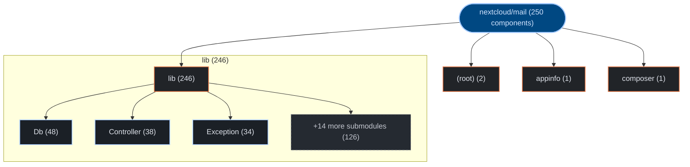
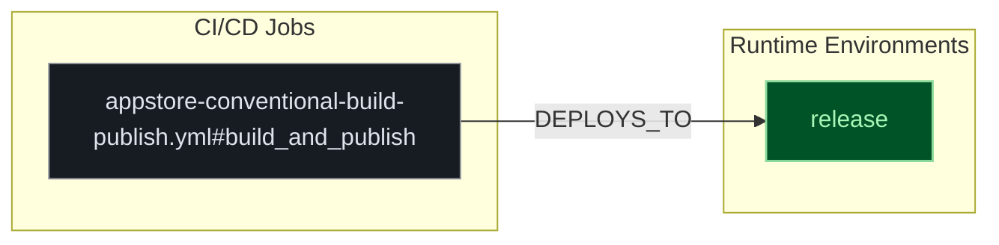

# Repository Architecture Analysis: nextcloud/mail

## Metadata
- **SHA**: `c43e29b6b0be392898ecdcd4f0bf9944a67ef9aa`
- **Primary Ecosystem**: PHP

## Quality Metrics
- **ast_engine**: fallback
- **avg_cognitive_complexity**: 0.0
- **avg_cyclomatic_complexity**: 0.0
- **component_count**: 250
- **dead_code_count**: 0
- **dead_code_symbols**: 0 entry(ies)
- **duplication_pct**: 0.0
- **file_complexities**: 0 entry(ies)
- **files_analyzed**: 894
- **fitness_passed**: True
- **fitness_violation_count**: 0
- **framework**: PHP Composer
- **import_edges**: 0 entry(ies)
- **loc**: 122815
- **max_cognitive_complexity**: 0
- **max_cyclomatic_complexity**: 0
- **sloc**: 89067
- **test_file_count**: 517

# Architecture: nextcloud/mail

## Context
- **Repository**: `nextcloud/mail`
- **SHA**: `c43e29b6b0be392898ecdcd4f0bf9944a67ef9aa`
- **Ecosystem**: PHP
- **Framework**: PHP Composer

## Building Block View

## Component Details

Showing top 60 representative components out of 250 across 4 module group(s):

- **Module `lib`** (246 components — module: 246)
- **Module `(root)`** (2 components — module: 2)
- **Module `appinfo`** (1 components — module: 1)
- **Module `composer`** (1 components — module: 1)

- **.php-cs-fixer.dist** (`.php-cs-fixer.dist.php`): module
- **ACreateOrUpdateProvisioningCommand** (`lib/Command/ACreateOrUpdateProvisioningCommand.php`): module
- **AProvisioningCommand** (`lib/Command/AProvisioningCommand.php`): module
- **Account** (`lib/Account.php`): module
- **AccountApiController** (`lib/Controller/AccountApiController.php`): module
- **AccountsController** (`lib/Controller/AccountsController.php`): module
- **ActionStep** (`lib/Db/ActionStep.php`): module
- **ActionStepController** (`lib/Controller/ActionStepController.php`): module
- **ActionStepMapper** (`lib/Db/ActionStepMapper.php`): module
- **Actions** (`lib/Db/Actions.php`): module
- **ActionsMapper** (`lib/Db/ActionsMapper.php`): module
- **AddMissingTags** (`lib/Command/AddMissingTags.php`): module
- **Address** (`lib/Address.php`): module
- **AddressList** (`lib/AddressList.php`): module
- **Alias** (`lib/Db/Alias.php`): module
- **AliasMapper** (`lib/Db/AliasMapper.php`): module
- **AliasesController** (`lib/Controller/AliasesController.php`): module
- **Application** (`lib/AppInfo/Application.php`): module
- **Attachment** (`lib/Attachment.php`): module
- **AttachmentDownloadResponse** (`lib/Http/AttachmentDownloadResponse.php`): module
- **AttachmentNotFoundException** (`lib/Exception/AttachmentNotFoundException.php`): module
- **AutoCompleteController** (`lib/Controller/AutoCompleteController.php`): module
- **AutoConfigController** (`lib/Controller/AutoConfigController.php`): module
- **AvatarDownloadResponse** (`lib/Http/AvatarDownloadResponse.php`): module
- **AvatarsController** (`lib/Controller/AvatarsController.php`): module
- **BeforeImapClientCreated** (`lib/Events/BeforeImapClientCreated.php`): module
- **BeforeMessageDeletedEvent** (`lib/Events/BeforeMessageDeletedEvent.php`): module
- **Cache** (`lib/Cache/Cache.php`): module
- **CachedMailbox** (`lib/Cache/CachedMailbox.php`): module
- **ClassifierTrainingException** (`lib/Exception/ClassifierTrainingException.php`): module
- **CleanUp** (`lib/Command/CleanUp.php`): module
- **CleanupJob** (`lib/BackgroundJob/CleanupJob.php`): module
- **ClearMailboxCache** (`lib/Command/ClearMailboxCache.php`): module
- **ClientException** (`lib/Exception/ClientException.php`): module
- **CollectedAddress** (`lib/Db/CollectedAddress.php`): module
- **CollectedAddressMapper** (`lib/Db/CollectedAddressMapper.php`): module
- **ConfigLexicon** (`lib/ConfigLexicon.php`): module
- **ContactIntegrationController** (`lib/Controller/ContactIntegrationController.php`): module
- **Container** (`lib/IMAP/Threading/Container.php`): module
- **ContextChatProvider** (`lib/ContextChat/ContextChatProvider.php`): module
- **Converter** (`lib/IMAP/Charset/Converter.php`): module
- **CouldNotConnectException** (`lib/Exception/CouldNotConnectException.php`): module
- **CreateImapAccount** (`lib/Command/CreateImapAccount.php`): module
- **CreateJmapAccount** (`lib/Command/CreateJmapAccount.php`): module
- **CreateProvisioning** (`lib/Command/CreateProvisioning.php`): module
- **CreateTagMigrationJobEntry** (`lib/Command/CreateTagMigrationJobEntry.php`): module
- **DatabaseMessage** (`lib/IMAP/Threading/DatabaseMessage.php`): module
- **DebugAccount** (`lib/Command/DebugAccount.php`): module
- **DeepLinkController** (`lib/Controller/DeepLinkController.php`): module
- **Delegation** (`lib/Db/Delegation.php`): module
- **DelegationController** (`lib/Controller/DelegationController.php`): module
- **DelegationExistsException** (`lib/Exception/DelegationExistsException.php`): module
- **DelegationForbiddenException** (`lib/Exception/DelegationForbiddenException.php`): module
- **DelegationMapper** (`lib/Db/DelegationMapper.php`): module
- **DeleteAccount** (`lib/Command/DeleteAccount.php`): module
- **DeleteDuplicatedUidsJob** (`lib/BackgroundJob/DeleteDuplicatedUidsJob.php`): module
- **DeleteProvisioning** (`lib/Command/DeleteProvisioning.php`): module
- **DraftMessageCreatedEvent** (`lib/Events/DraftMessageCreatedEvent.php`): module
- **DraftSavedEvent** (`lib/Events/DraftSavedEvent.php`): module
- **DraftsController** (`lib/Controller/DraftsController.php`): module

## 6-Dimension Repository Scorecard

- **Overall Grade**: `D` (60.50/100)
- **Technical Debt Score**: 39.50
- **Estimated Remediation Effort**: 99.38h

| Dimension | Grade | Score | Weight | Details |
| :--- | :---: | :---: | :---: | :--- |
| Code Quality | `A` | 100.00 | 0.20 | avg_cc=0.00, max_cc=0, duplication=0.00%, dead_code=0 |
| Dependency Health | `A` | 100.00 | 0.15 | dependencies=1287, outdated=0, vulnerable=0, has_lockfile=True |
| Maintainability | `A` | 100.00 | 0.15 | avg_cognitive=0.00, max_cognitive=0, fitness_violations=0, oversized_files=0 |
| Pipeline Health | `F` | 0.00 | 0.15 | workflows=23, operational_antipatterns=51, parallel_branches=True |
| Security | `F` | 0.00 | 0.20 | vulnerabilities=0, secrets=18, pipeline_security_findings=11 |
| Test Coverage | `C` | 70.00 | 0.15 | coverage=unavailable, ci_test_job=True, test_files_detected=True |

## Supply Chain Dependencies, Vulnerabilities & Secrets

- **Dependencies Parsed**: 1287 | **Vulnerabilities**: 0 | **Secrets**: 18

### Secret Findings (Redacted)
- **[HIGH] `ATRUSS-SEC-005`** at `l10n/ja.js:574` (`"Please login using a password to enable this account. The current session is using passwordless authentication, e.g. SSO or WebAuthn." : "このアカ***REDACTED***",`)
- **[HIGH] `ATRUSS-SEC-005`** at `l10n/ja.js:979` (`"Without a master user, all users authenticate with their normal username and this master password." : "マスター***REDACTED***",`)
- **[HIGH] `ATRUSS-SEC-005`** at `l10n/ja.js:997` (`"The provided PKCS #12 certificate must contain at least one certificate and exactly one private key." : "指定され***REDACTED***",`)
- **[HIGH] `ATRUSS-SEC-005`** at `l10n/ja.js:998` (`"Failed to import the certificate. Please check the password." : "証明書の***REDACTED***",`)
- **[HIGH] `ATRUSS-SEC-005`** at `l10n/ja.json:572` (`"Please login using a password to enable this account. The current session is using passwordless authentication, e.g. SSO or WebAuthn." : "このアカ***REDACTED***",`)
- **[HIGH] `ATRUSS-SEC-005`** at `l10n/ja.json:977` (`"Without a master user, all users authenticate with their normal username and this master password." : "マスター***REDACTED***",`)
- **[HIGH] `ATRUSS-SEC-005`** at `l10n/ja.json:995` (`"The provided PKCS #12 certificate must contain at least one certificate and exactly one private key." : "指定され***REDACTED***",`)
- **[HIGH] `ATRUSS-SEC-005`** at `l10n/ja.json:996` (`"Failed to import the certificate. Please check the password." : "証明書の***REDACTED***",`)
- **[HIGH] `ATRUSS-SEC-005`** at `l10n/zh_CN.js:860` (`"Without a master user, all users authenticate with their normal username and this master password." : "如果没有***REDACTED***",`)
- **[HIGH] `ATRUSS-SEC-005`** at `l10n/zh_CN.json:858` (`"Without a master user, all users authenticate with their normal username and this master password." : "如果没有***REDACTED***",`)
- **[HIGH] `ATRUSS-SEC-005`** at `l10n/zh_HK.js:971` (`"Without a master user, all users authenticate with their normal username and this master password." : "如沒有設***REDACTED***",`)
- **[HIGH] `ATRUSS-SEC-005`** at `l10n/zh_HK.json:969` (`"Without a master user, all users authenticate with their normal username and this master password." : "如沒有設***REDACTED***",`)
- **[CRITICAL] `ATRUSS-SEC-004`** at `src/tests/data/user@imap.localhost.key:1` (`-----BEGIN ... PRIVATE KEY----- [REDACTED]`)
- **[CRITICAL] `ATRUSS-SEC-004`** at `tests/data/smime-certs/cn-only@imap.localhost.key:1` (`-----BEGIN ... PRIVATE KEY----- [REDACTED]`)
- **[CRITICAL] `ATRUSS-SEC-004`** at `tests/data/smime-certs/debug@imap.localhost.key:1` (`-----BEGIN ... PRIVATE KEY----- [REDACTED]`)
- **[CRITICAL] `ATRUSS-SEC-004`** at `tests/data/smime-certs/san-only@imap.localhost.key:1` (`-----BEGIN ... PRIVATE KEY----- [REDACTED]`)
- **[CRITICAL] `ATRUSS-SEC-004`** at `tests/data/smime-certs/user@domain.tld.key:1` (`-----BEGIN ... PRIVATE KEY----- [REDACTED]`)
- **[CRITICAL] `ATRUSS-SEC-004`** at `tests/data/smime-certs/user@imap.localhost.key:1` (`-----BEGIN ... PRIVATE KEY----- [REDACTED]`)

### Inventory Sample
- `arthurhoaro/favicon` `2.0.1` (composer, `composer.json`)
- `bamarni/composer-bin-plugin` `1.9.1` (composer, `composer.json`)
- `bytestream/horde-exception` `2.2.0` (composer, `composer.json`)
- `bytestream/horde-imap-client` `2.34.4` (composer, `composer.json`)
- `bytestream/horde-mail` `2.7.3` (composer, `composer.json`)
- `bytestream/horde-mime` `2.14.2` (composer, `composer.json`)
- `bytestream/horde-stream` `1.7.2` (composer, `composer.json`)
- `bytestream/horde-stringprep` `1.2.1` (composer, `composer.json`)
- `bytestream/horde-support` `2.4.0` (composer, `composer.json`)
- `bytestream/horde-text-filter` `2.5.0` (composer, `composer.json`)
- `bytestream/horde-text-flowed` `2.1` (composer, `composer.json`)
- `bytestream/horde-util` `2.8.1` (composer, `composer.json`)
- `cerdic/css-tidy` `2.2.1` (composer, `composer.json`)
- `coenjacobs/mozart` `1.2.3` (composer, `vendor-bin/mozart/composer.json`)
- `cweagans/composer-patches` `2.0` (composer, `composer.json`)
- `ezyang/htmlpurifier` `4.19.1` (composer, `composer.json`)
- `glenscott/url-normalizer` `1.4` (composer, `composer.json`)
- `gravatarphp/gravatar` `*` (composer, `composer.json`)
- `hamza221/html2text` `1.0` (composer, `composer.json`)
- `jeremykendall/php-domain-parser` `6.4.0` (composer, `composer.json`)
- `nextcloud/horde-managesieve` `1.0.1` (composer, `composer.json`)
- `nextcloud/horde-smtp` `1.0.3` (composer, `composer.json`)
- `nextcloud/kitinerary` `1.0` (composer, `composer.json`)
- `nextcloud/kitinerary-bin` `1.0.7` (composer, `composer.json`)
- `nextcloud/kitinerary-flatpak` `1.0.1` (composer, `composer.json`)
- `nextcloud/kitinerary-sys` `2.0.1` (composer, `composer.json`)
- `nextcloud/openapi-extractor` `1.9.1` (composer, `vendor-bin/openapi/composer.json`)
- `phpmailer/dkimvalidator` `0.3.1` (composer, `composer.json`)
- `psr/log` `3.0.2` (composer, `vendor-bin/psalm-stubs/composer.json`)
- `rubix/ml` `2.6.1` (composer, `composer.json`)
- ... (+1257 more dependencies)

## Section 7: Code-to-Cloud Deployment Traceability

- `appstore-conventional-build-publish.yml#build_and_publish` (ci_job) --[DEPLOYS_TO]--> `release` (environment)

## CI/CD Pipeline Topology

```mermaid
graph TD;
  classDef atlasRoot fill:#004882,stroke:#a3c9ff,stroke-width:2px,color:#d3e4ff
  classDef atlasCategory fill:#212428,stroke:#E87A48,stroke-width:1.5px,color:#dfe3eb
  classDef atlasWorkflow fill:#1b2026,stroke:#a3c9ff,stroke-width:1.5px,color:#dfe3eb
  classDef atlasJob fill:#171c22,stroke:#8d9199,stroke-width:1px,color:#dfe3eb
  classDef atlasTarget fill:#005227,stroke:#8bd99b,stroke-width:1.5px,color:#a7f6b6
  classDef atlasAlert fill:#93000a,stroke:#ffb4ab,stroke-width:1.5px,color:#ffdad6
  classDef atlasMore fill:#252a31,stroke:#8d9199,stroke-dasharray:4 4,color:#c3c6cf
  pipeline_root(["nextcloud/mail (23 workflows)"]):::atlasRoot
  subgraph sg_grp_0_CI___Verification["CI & Verification (12 workflows · 26 jobs)"]
    direction TB
    subgraph sg_wf_6_Lint_eslint["Lint eslint (3 jobs)"]
      direction TB
      wf_6_Lint_eslint(["Trigger: Lint eslint"]):::atlasWorkflow
      job_6_changes["changes"]:::atlasJob
      job_6_lint["lint"]:::atlasJob
      job_6_summary["summary"]:::atlasJob
      wf_6_Lint_eslint --> job_6_changes
      job_6_changes --> job_6_lint
      job_6_changes --> job_6_summary
      job_6_lint --> job_6_summary
    end
    pipeline_root --> wf_6_Lint_eslint
    subgraph sg_wf_9_Lint_php["Lint php (3 jobs)"]
      direction TB
      wf_9_Lint_php(["Trigger: Lint php"]):::atlasWorkflow
      job_9_matrix["matrix"]:::atlasJob
      job_9_php_lint["php-lint"]:::atlasJob
      job_9_summary["summary"]:::atlasJob
      wf_9_Lint_php --> job_9_matrix
      job_9_matrix --> job_9_php_lint
      job_9_php_lint --> job_9_summary
    end
    pipeline_root --> wf_9_Lint_php
    subgraph sg_wf_21_Test["Test (9 jobs)"]
      direction TB
      wf_21_Test(["Trigger: Test"]):::atlasWorkflow
      job_21_changes["changes"]:::atlasJob
      job_21_unit_tests["unit-tests"]:::atlasJob
      job_21_integration_tests["integration-tests"]:::atlasJob
      wf_21_Test --> job_21_changes
      job_21_changes --> job_21_unit_tests
      job_21_changes --> job_21_integration_tests
    end
    pipeline_root --> wf_21_Test
  end
  subgraph sg_grp_1_Security___Governance["Security & Governance (5 workflows · 6 jobs)"]
    direction TB
    subgraph sg_wf_3_Block_unconventional_commits["Block unconventional commits (1 jobs)"]
      direction TB
      wf_3_Block_unconventional_commits(["Trigger: Block unconventional commits"]):::atlasWorkflow
      job_3_block_unconventional_commits["block-unconventional-commits"]:::atlasJob
      wf_3_Block_unconventional_commits --> job_3_block_unconventional_commits
    end
    pipeline_root --> wf_3_Block_unconventional_commits
    subgraph sg_wf_4_Block_fixup_and_squash_commits["Block fixup and squash commits (1 jobs)"]
      direction TB
      wf_4_Block_fixup_and_squash_commits(["Trigger: Block fixup and squash commits"]):::atlasWorkflow
      job_4_commit_message_check["commit-message-check"]:::atlasJob
      wf_4_Block_fixup_and_squash_commits --> job_4_commit_message_check
    end
    pipeline_root --> wf_4_Block_fixup_and_squash_commits
    subgraph sg_wf_11_Selective_npm_audit_fix["Selective npm audit fix (2 jobs)"]
      direction TB
      wf_11_Selective_npm_audit_fix(["Trigger: Selective npm audit fix"]):::atlasWorkflow
      job_11_matrix["matrix"]:::atlasJob
      job_11_fix["fix"]:::atlasJob
      wf_11_Selective_npm_audit_fix --> job_11_matrix
      job_11_matrix --> job_11_fix
    end
    pipeline_root --> wf_11_Selective_npm_audit_fix
  end
  subgraph sg_grp_2_Release___Deploy["Release & Deploy (3 workflows · 3 jobs)"]
    direction TB
    subgraph sg_wf_1_Build_and_publish_app_release["Build and publish app release (1 jobs)"]
      direction TB
      wf_1_Build_and_publish_app_release(["Trigger: Build and publish app release"]):::atlasWorkflow
      job_1_build_and_publish["build_and_publish"]:::atlasJob
      wf_1_Build_and_publish_app_release --> job_1_build_and_publish
    end
    pipeline_root --> wf_1_Build_and_publish_app_release
    subgraph sg_wf_2_Build_and_publish_app_release_conventionally["Build and publish app release conventionally (1 jobs)"]
      direction TB
      wf_2_Build_and_publish_app_release_conventionally(["Trigger: Build and publish app release conventionally"]):::atlasWorkflow
      job_2_build_and_publish["build_and_publish"]:::atlasJob
      wf_2_Build_and_publish_app_release_conventionally --> job_2_build_and_publish
    end
    pipeline_root --> wf_2_Build_and_publish_app_release_conventionally
  end
  subgraph sg_grp_3_Scheduled___Manual["Scheduled & Manual (3 workflows · 3 jobs)"]
    direction TB
    subgraph sg_wf_15_Ask_for_feedback_on_PRs["Ask for feedback on PRs (1 jobs)"]
      direction TB
      wf_15_Ask_for_feedback_on_PRs(["Trigger: Ask for feedback on PRs"]):::atlasWorkflow
      job_15_pr_feedback["pr-feedback"]:::atlasJob
      wf_15_Ask_for_feedback_on_PRs --> job_15_pr_feedback
    end
    pipeline_root --> wf_15_Ask_for_feedback_on_PRs
    wf_22_Update_public_suffix_list["Update public suffix list (1 jobs)"]:::atlasWorkflow
    pipeline_root --> wf_22_Update_public_suffix_list
  end
  wf_more["+13 more workflows"]:::atlasMore
  pipeline_root --> wf_more
```

