# Repository Architecture Analysis: nextcloud/notifications

## Metadata
- **SHA**: `7c8497170145dd296e5303497cc7eeea49f1f41f`
- **Primary Ecosystem**: PHP

## Quality Metrics
- **ast_engine**: fallback
- **avg_cognitive_complexity**: 0.0
- **avg_cyclomatic_complexity**: 0.0
- **component_count**: 77
- **dead_code_count**: 0
- **dead_code_symbols**: 0 entry(ies)
- **duplication_pct**: 0.0
- **file_complexities**: 0 entry(ies)
- **files_analyzed**: 77
- **fitness_passed**: True
- **fitness_violation_count**: 0
- **framework**: Symfony
- **import_edges**: 0 entry(ies)
- **loc**: 12218
- **max_cognitive_complexity**: 0
- **max_cyclomatic_complexity**: 0
- **sloc**: 8976
- **test_file_count**: 44

# Architecture: nextcloud/notifications

## Context
- **Repository**: `nextcloud/notifications`
- **SHA**: `7c8497170145dd296e5303497cc7eeea49f1f41f`
- **Ecosystem**: PHP
- **Framework**: Symfony

## Building Block View

```mermaid
graph TD;
  classDef atlasRoot fill:#004882,stroke:#a3c9ff,stroke-width:2px,color:#d3e4ff
  classDef atlasCategory fill:#212428,stroke:#E87A48,stroke-width:1.5px,color:#dfe3eb
  classDef atlasWorkflow fill:#1b2026,stroke:#a3c9ff,stroke-width:1.5px,color:#dfe3eb
  classDef atlasJob fill:#171c22,stroke:#8d9199,stroke-width:1px,color:#dfe3eb
  classDef atlasTarget fill:#005227,stroke:#8bd99b,stroke-width:1.5px,color:#a7f6b6
  classDef atlasAlert fill:#93000a,stroke:#ffb4ab,stroke-width:1.5px,color:#ffdad6
  classDef atlasMore fill:#252a31,stroke:#8d9199,stroke-dasharray:4 4,color:#c3c6cf
    repo_root(["nextcloud/notifications (77 components)"]):::atlasRoot
    subgraph sg_dir_0_lib["lib (48)"]
      direction TB
      dir_0_lib["lib (48)"]:::atlasCategory
      sub_0_0__module_root_["(module root) (7)"]:::atlasWorkflow
      dir_0_lib --> sub_0_0__module_root_
      sub_0_1_Controller["Controller (6)"]:::atlasWorkflow
      dir_0_lib --> sub_0_1_Controller
      sub_0_2_Migration["Migration (6)"]:::atlasWorkflow
      dir_0_lib --> sub_0_2_Migration
      sub_0_more["+10 more submodules (29)"]:::atlasMore
      dir_0_lib --> sub_0_more
    end
    repo_root --> dir_0_lib
    subgraph sg_dir_1_tests["tests (24)"]
      direction TB
      dir_1_tests["tests (24)"]:::atlasCategory
      sub_1_0_Unit["Unit (17)"]:::atlasWorkflow
      dir_1_tests --> sub_1_0_Unit
      sub_1_1_Integration["Integration (6)"]:::atlasWorkflow
      dir_1_tests --> sub_1_1_Integration
      sub_1_2_stubs["stubs (1)"]:::atlasWorkflow
      dir_1_tests --> sub_1_2_stubs
    end
    repo_root --> dir_1_tests
    dir_2__root_["(root) (2)"]:::atlasCategory
    repo_root --> dir_2__root_
    dir_3_templates["templates (2)"]:::atlasCategory
    repo_root --> dir_3_templates
    dir_4_composer["composer (1)"]:::atlasCategory
    repo_root --> dir_4_composer
```

## Component Details

Showing top 60 representative components out of 77 across 5 module group(s):

- **Module `lib`** (48 components — module: 48)
- **Module `tests`** (24 components — module: 24)
- **Module `(root)`** (2 components — module: 2)
- **Module `templates`** (2 components — module: 2)
- **Module `composer`** (1 components — module: 1)

- **.php-cs-fixer.dist** (`.php-cs-fixer.dist.php`): module
- **APIController** (`lib/Controller/APIController.php`): module
- **APIControllerTest** (`tests/Unit/Controller/APIControllerTest.php`): module
- **ActivationSubStatus** (`lib/WebPush/ActivationSubStatus.php`): module
- **AddMissingIndicesListener** (`lib/Listener/AddMissingIndicesListener.php`): module
- **Admin** (`lib/Settings/Admin.php`): module
- **AdminNotifications** (`lib/Notifier/AdminNotifications.php`): module
- **AdminSection** (`lib/Settings/AdminSection.php`): module
- **App** (`lib/App.php`): module
- **AppTest** (`tests/Unit/AppTest.php`): module
- **Application** (`lib/AppInfo/Application.php`): module
- **Application** (`tests/Integration/app/lib/AppInfo/Application.php`): module
- **ApplicationTest** (`tests/Unit/AppInfo/ApplicationTest.php`): module
- **BeforeTemplateRenderedListener** (`lib/Listener/BeforeTemplateRenderedListener.php`): module
- **CSPListener** (`lib/Listener/CSPListener.php`): module
- **Capabilities** (`lib/Capabilities.php`): module
- **CapabilitiesTest** (`tests/Unit/CapabilitiesTest.php`): module
- **ClientAdapter** (`lib/WebPush/ClientAdapter.php`): module
- **ClientAdapterTest** (`tests/Unit/WebPush/ClientAdapterTest.php`): module
- **ClientException** (`lib/WebPush/ClientException.php`): module
- **ClientService** (`lib/Service/ClientService.php`): module
- **CommandLineTrait** (`tests/Integration/features/bootstrap/CommandLineTrait.php`): module
- **Delete** (`lib/Command/Delete.php`): module
- **EndpointController** (`lib/Controller/EndpointController.php`): module
- **EndpointController** (`tests/Integration/app/lib/Controller/EndpointController.php`): module
- **EndpointControllerTest** (`tests/Unit/Controller/EndpointControllerTest.php`): module
- **ExpireActivityNotifications** (`lib/BackgroundJob/ExpireActivityNotifications.php`): module
- **ExpireActivityNotificationsTest** (`tests/Unit/BackgroundJob/ExpireActivityNotificationsTest.php`): module
- **FeatureContext** (`tests/Integration/features/bootstrap/FeatureContext.php`): module
- **Generate** (`lib/Command/Generate.php`): module
- **GenerateTest** (`tests/Unit/Command/GenerateTest.php`): module
- **GenerateUserSettings** (`lib/BackgroundJob/GenerateUserSettings.php`): module
- **Handler** (`lib/Handler.php`): module
- **HandlerTest** (`tests/Unit/HandlerTest.php`): module
- **InvalidDeviceTokenException** (`lib/Exceptions/InvalidDeviceTokenException.php`): module
- **MailNotifications** (`lib/MailNotifications.php`): module
- **MailNotificationsTest** (`tests/Unit/MailNotificationsTest.php`): module
- **NewSubStatus** (`lib/WebPush/NewSubStatus.php`): module
- **NotificationNotFoundException** (`lib/Exceptions/NotificationNotFoundException.php`): module
- **Notifier** (`tests/Integration/app/lib/Notifier.php`): module
- **NotifierTest** (`tests/Unit/Notifier/NotifierTest.php`): module
- **Personal** (`lib/Settings/Personal.php`): module
- **PersonalSection** (`lib/Settings/PersonalSection.php`): module
- **PromiseAdapter** (`lib/WebPush/PromiseAdapter.php`): module
- **PromiseAdapterTest** (`tests/Unit/WebPush/PromiseAdapterTest.php`): module
- **Push** (`lib/Push.php`): module
- **PushController** (`lib/Controller/PushController.php`): module
- **PushControllerTest** (`tests/Unit/Controller/PushControllerTest.php`): module
- **PushTest** (`tests/Unit/PushTest.php`): module
- **ResponseDefinitions** (`lib/ResponseDefinitions.php`): module
- **SendNotificationMails** (`lib/BackgroundJob/SendNotificationMails.php`): module
- **Settings** (`lib/Model/Settings.php`): module
- **SettingsController** (`lib/Controller/SettingsController.php`): module
- **SettingsMapper** (`lib/Model/SettingsMapper.php`): module
- **SetupWarningOnRateLimitReached** (`lib/Settings/SetupWarningOnRateLimitReached.php`): module
- **TestPush** (`lib/Command/TestPush.php`): module
- **TokenValidation** (`lib/WebPush/TokenValidation.php`): module
- **UserCreatedListener** (`lib/Listener/UserCreatedListener.php`): module
- **UserDeletedListener** (`lib/Listener/UserDeletedListener.php`): module
- **Version2004Date20190107135757** (`lib/Migration/Version2004Date20190107135757.php`): module

## 6-Dimension Repository Scorecard

- **Overall Grade**: `D` (60.50/100)
- **Technical Debt Score**: 39.50
- **Estimated Remediation Effort**: 57.38h

| Dimension | Grade | Score | Weight | Details |
| :--- | :---: | :---: | :---: | :--- |
| Code Quality | `A` | 100.00 | 0.20 | avg_cc=0.00, max_cc=0, duplication=0.00%, dead_code=0 |
| Dependency Health | `A` | 100.00 | 0.15 | dependencies=928, outdated=0, vulnerable=0, has_lockfile=True |
| Maintainability | `A` | 100.00 | 0.15 | avg_cognitive=0.00, max_cognitive=0, fitness_violations=0, oversized_files=0 |
| Pipeline Health | `F` | 0.00 | 0.15 | workflows=26, operational_antipatterns=50, parallel_branches=True |
| Security | `F` | 0.00 | 0.20 | vulnerabilities=0, secrets=4, pipeline_security_findings=6 |
| Test Coverage | `C` | 70.00 | 0.15 | coverage=unavailable, ci_test_job=True, test_files_detected=True |

## Supply Chain Dependencies, Vulnerabilities & Secrets

- **Dependencies Parsed**: 928 | **Vulnerabilities**: 0 | **Secrets**: 4

### Secret Findings (Redacted)
- **[CRITICAL] `ATRUSS-SEC-004`** at `tests/Unit/Controller/PushControllerTest.php:51` (`-----BEGIN ... PRIVATE KEY----- [REDACTED]`)
- **[HIGH] `ATRUSS-SEC-005`** at `tests/Unit/Controller/WebPushControllerTest.php:50` (`protected static string $uaPublicKey = 'BCVx***REDACTED***';`)
- **[CRITICAL] `ATRUSS-SEC-004`** at `tests/Unit/PushTest.php:693` (`-----BEGIN ... PRIVATE KEY----- [REDACTED]`)
- **[HIGH] `ATRUSS-SEC-005`** at `tests/Unit/WebPushClientTest.php:24` (`protected static string $uaPublicKey = 'BCVx***REDACTED***';`)

### Inventory Sample
- `bamarni/composer-bin-plugin` `1.9.1` (composer, `composer.json`)
- `coenjacobs/mozart` `1.2.3` (composer, `vendor-bin/mozart/composer.json`)
- `guzzlehttp/psr7` `3.2` (composer, `composer.json`)
- `minishlink/web-push` `11.0` (composer, `composer.json`)
- `@nextcloud/auth` `2.6.0` (npm, `package-lock.json`)
- `@nextcloud/auth` `2.6.0` (npm, `package.json`)
- `@nextcloud/axios` `2.6.0` (npm, `package-lock.json`)
- `@nextcloud/axios` `2.6.0` (npm, `package.json`)
- `@nextcloud/browser-storage` `0.5.0` (npm, `package-lock.json`)
- `@nextcloud/browser-storage` `0.5.0` (npm, `package.json`)
- `@nextcloud/browserslist-config` `3.1.2` (npm, `package-lock.json`)
- `@nextcloud/browserslist-config` `3.1.2` (npm, `package.json`)
- `@nextcloud/capabilities` `1.2.1` (npm, `package-lock.json`)
- `@nextcloud/capabilities` `1.2.1` (npm, `package.json`)
- `@nextcloud/dialogs` `8.0.0` (npm, `package-lock.json`)
- `@nextcloud/dialogs` `8.0.0` (npm, `package.json`)
- `@nextcloud/eslint-config` `9.0.1` (npm, `package-lock.json`)
- `@nextcloud/eslint-config` `9.0.1` (npm, `package.json`)
- `@nextcloud/event-bus` `3.3.3` (npm, `package-lock.json`)
- `@nextcloud/event-bus` `3.3.3` (npm, `package.json`)
- `@nextcloud/initial-state` `3.0.0` (npm, `package-lock.json`)
- `@nextcloud/initial-state` `3.0.0` (npm, `package.json`)
- `@nextcloud/l10n` `3.4.1` (npm, `package-lock.json`)
- `@nextcloud/l10n` `3.4.1` (npm, `package.json`)
- `@nextcloud/notify_push` `1.4.0` (npm, `package-lock.json`)
- `@nextcloud/notify_push` `1.4.0` (npm, `package.json`)
- `@nextcloud/router` `3.1.0` (npm, `package.json`)
- `@nextcloud/router` `3.2.0` (npm, `package-lock.json`)
- `@nextcloud/stylelint-config` `3.2.2` (npm, `package-lock.json`)
- `@nextcloud/stylelint-config` `3.2.2` (npm, `package.json`)
- ... (+898 more dependencies)

## CI/CD Pipeline Topology

```mermaid
graph TD;
  classDef atlasRoot fill:#004882,stroke:#a3c9ff,stroke-width:2px,color:#d3e4ff
  classDef atlasCategory fill:#212428,stroke:#E87A48,stroke-width:1.5px,color:#dfe3eb
  classDef atlasWorkflow fill:#1b2026,stroke:#a3c9ff,stroke-width:1.5px,color:#dfe3eb
  classDef atlasJob fill:#171c22,stroke:#8d9199,stroke-width:1px,color:#dfe3eb
  classDef atlasTarget fill:#005227,stroke:#8bd99b,stroke-width:1.5px,color:#a7f6b6
  classDef atlasAlert fill:#93000a,stroke:#ffb4ab,stroke-width:1.5px,color:#ffdad6
  classDef atlasMore fill:#252a31,stroke:#8d9199,stroke-dasharray:4 4,color:#c3c6cf
  pipeline_root(["nextcloud/notifications (26 workflows)"]):::atlasRoot
  subgraph sg_grp_0_CI___Verification["CI & Verification (15 workflows · 31 jobs)"]
    direction TB
    subgraph sg_wf_7_Lint_eslint["Lint eslint (3 jobs)"]
      direction TB
      wf_7_Lint_eslint(["Trigger: Lint eslint"]):::atlasWorkflow
      job_7_changes["changes"]:::atlasJob
      job_7_lint["lint"]:::atlasJob
      job_7_summary["summary"]:::atlasJob
      wf_7_Lint_eslint --> job_7_changes
      job_7_changes --> job_7_lint
      job_7_changes --> job_7_summary
      job_7_lint --> job_7_summary
    end
    pipeline_root --> wf_7_Lint_eslint
    subgraph sg_wf_10_Lint_php["Lint php (3 jobs)"]
      direction TB
      wf_10_Lint_php(["Trigger: Lint php"]):::atlasWorkflow
      job_10_matrix["matrix"]:::atlasJob
      job_10_php_lint["php-lint"]:::atlasJob
      job_10_summary["summary"]:::atlasJob
      wf_10_Lint_php --> job_10_matrix
      job_10_matrix --> job_10_php_lint
      job_10_php_lint --> job_10_summary
    end
    pipeline_root --> wf_10_Lint_php
    subgraph sg_wf_13_Build_Javascript["Build Javascript (3 jobs)"]
      direction TB
      wf_13_Build_Javascript(["Trigger: Build Javascript"]):::atlasWorkflow
      job_13_changes["changes"]:::atlasJob
      job_13_build["build"]:::atlasJob
      job_13_summary["summary"]:::atlasJob
      wf_13_Build_Javascript --> job_13_changes
      job_13_changes --> job_13_build
      job_13_changes --> job_13_summary
      job_13_build --> job_13_summary
    end
    pipeline_root --> wf_13_Build_Javascript
  end
  subgraph sg_grp_1_Security___Governance["Security & Governance (6 workflows · 6 jobs)"]
    direction TB
    subgraph sg_wf_1_Block_merges_during_freezes["Block merges during freezes (1 jobs)"]
      direction TB
      wf_1_Block_merges_during_freezes(["Trigger: Block merges during freezes"]):::atlasWorkflow
      job_1_block_merges_during_freeze["block-merges-during-freeze"]:::atlasJob
      wf_1_Block_merges_during_freezes --> job_1_block_merges_during_freeze
    end
    pipeline_root --> wf_1_Block_merges_during_freezes
    subgraph sg_wf_5_Auto_approve_Dependabot_PRs["Auto approve Dependabot PRs (1 jobs)"]
      direction TB
      wf_5_Auto_approve_Dependabot_PRs(["Trigger: Auto approve Dependabot PRs"]):::atlasWorkflow
      job_5_auto_approve_merge["auto-approve-merge"]:::atlasJob
      wf_5_Auto_approve_Dependabot_PRs --> job_5_auto_approve_merge
    end
    pipeline_root --> wf_5_Auto_approve_Dependabot_PRs
    subgraph sg_wf_6_Block_fixup_and_squash_commits["Block fixup and squash commits (1 jobs)"]
      direction TB
      wf_6_Block_fixup_and_squash_commits(["Trigger: Block fixup and squash commits"]):::atlasWorkflow
      job_6_commit_message_check["commit-message-check"]:::atlasJob
      wf_6_Block_fixup_and_squash_commits --> job_6_commit_message_check
    end
    pipeline_root --> wf_6_Block_fixup_and_squash_commits
  end
  subgraph sg_grp_2_Scheduled___Manual["Scheduled & Manual (3 workflows · 3 jobs)"]
    direction TB
    subgraph sg_wf_20_Ask_for_feedback_on_PRs["Ask for feedback on PRs (1 jobs)"]
      direction TB
      wf_20_Ask_for_feedback_on_PRs(["Trigger: Ask for feedback on PRs"]):::atlasWorkflow
      job_20_pr_feedback["pr-feedback"]:::atlasJob
      wf_20_Ask_for_feedback_on_PRs --> job_20_pr_feedback
    end
    pipeline_root --> wf_20_Ask_for_feedback_on_PRs
    subgraph sg_wf_24_Update_nextcloud_ocp["Update nextcloud/ocp (1 jobs)"]
      direction TB
      wf_24_Update_nextcloud_ocp(["Trigger: Update nextcloud/ocp"]):::atlasWorkflow
      job_24_update_nextcloud_ocp["update-nextcloud-ocp"]:::atlasJob
      wf_24_Update_nextcloud_ocp --> job_24_update_nextcloud_ocp
    end
    pipeline_root --> wf_24_Update_nextcloud_ocp
  end
  subgraph sg_grp_3_Automation___Other["Automation & Other (2 workflows · 4 jobs)"]
    direction TB
    subgraph sg_wf_3_Compile_Command["Compile Command (2 jobs)"]
      direction TB
      wf_3_Compile_Command(["Trigger: Compile Command"]):::atlasWorkflow
      job_3_init["init"]:::atlasJob
      job_3_process["process"]:::atlasJob
      wf_3_Compile_Command --> job_3_init
      job_3_init --> job_3_process
    end
    pipeline_root --> wf_3_Compile_Command
    wf_4_OpenAPI_Command["OpenAPI Command (2 jobs)"]:::atlasWorkflow
    pipeline_root --> wf_4_OpenAPI_Command
  end
  wf_more["+16 more workflows"]:::atlasMore
  pipeline_root --> wf_more
```

