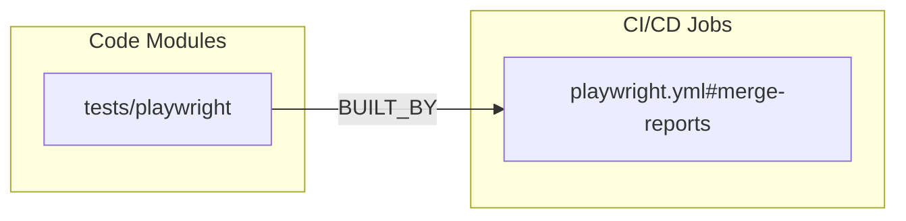
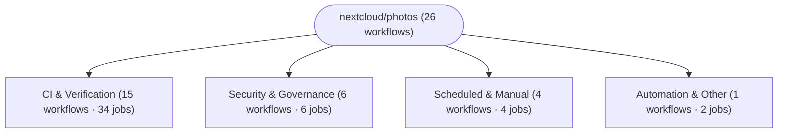

# Repository Architecture Analysis: nextcloud/photos

## Metadata
- **SHA**: `fb6721820486169409559d14df300167e51010c9`
- **Primary Ecosystem**: JavaScript/TypeScript

## Quality Metrics
- **ast_engine**: tree-sitter
- **avg_cognitive_complexity**: 12.29
- **avg_cyclomatic_complexity**: 4.04
- **component_count**: 1
- **dead_code_count**: 723
- **dead_code_symbols**: 27 entry(ies)
- **duplication_pct**: 83.8
- **file_complexities**: 25 entry(ies)
- **files_analyzed**: 506
- **fitness_passed**: False
- **fitness_violation_count**: 3
- **framework**: React (Vite)
- **import_edges**: 100 entry(ies)
- **loc**: 30501
- **max_cognitive_complexity**: 49778
- **max_cyclomatic_complexity**: 1363
- **sloc**: 23240
- **test_file_count**: 149

# Architecture: nextcloud/photos

## Context
- **Repository**: `nextcloud/photos`
- **SHA**: `fb6721820486169409559d14df300167e51010c9`
- **Ecosystem**: JavaScript/TypeScript
- **Framework**: React (Vite)

## Building Block View

## Component Details
- **photos** (`package.json`): MODULE

## 6-Dimension Repository Scorecard

- **Overall Grade**: `F` (35.94/100)
- **Technical Debt Score**: 64.06
- **Estimated Remediation Effort**: 255.52h

| Dimension | Grade | Score | Weight | Details |
| :--- | :---: | :---: | :---: | :--- |
| Code Quality | `F` | 25.84 | 0.20 | avg_cc=4.04, max_cc=1363, duplication=83.80%, dead_code=723 |
| Dependency Health | `A` | 100.00 | 0.15 | dependencies=1415, outdated=0, vulnerable=0, has_lockfile=True |
| Maintainability | `F` | 35.13 | 0.15 | avg_cognitive=12.29, max_cognitive=49778, fitness_violations=3, oversized_files=0 |
| Pipeline Health | `F` | 0.00 | 0.15 | workflows=26, operational_antipatterns=50, parallel_branches=True |
| Security | `F` | 0.00 | 0.20 | vulnerabilities=0, secrets=0, pipeline_security_findings=5 |
| Test Coverage | `C` | 70.00 | 0.15 | coverage=unavailable, ci_test_job=True, test_files_detected=True |

## Architecture Fitness & Workspace Boundaries

- **[MEDIUM] `ATRUSS-ARCH-005` (COMPLEXITY_THRESHOLD)**: Repository duplication_pct (83.8) exceeds policy threshold (15.0).
- **[MEDIUM] `ATRUSS-ARCH-005` (COMPLEXITY_THRESHOLD)**: Repository max_cognitive_complexity (49778.0) exceeds policy threshold (25.0).
- **[MEDIUM] `ATRUSS-ARCH-005` (COMPLEXITY_THRESHOLD)**: Repository max_cyclomatic_complexity (1363.0) exceeds policy threshold (20.0).

## Supply Chain Dependencies, Vulnerabilities & Secrets

- **Dependencies Parsed**: 1415 | **Vulnerabilities**: 0 | **Secrets**: 0

### Inventory Sample
- `hexogen/kdtree` `0.2.5` (composer, `composer.json`)
- `woltlab/webp-exif` `0.1.5` (composer, `composer.json`)
- `@essentials/request-timeout` `1.3.0` (npm, `package-lock.json`)
- `@essentials/request-timeout` `1.3.0` (npm, `package.json`)
- `@mdi/svg` `7.4.47` (npm, `package-lock.json`)
- `@mdi/svg` `7.4.47` (npm, `package.json`)
- `@nextcloud/auth` `2.1.0` (npm, `package.json`)
- `@nextcloud/auth` `2.6.0` (npm, `package-lock.json`)
- `@nextcloud/axios` `2.1.0` (npm, `package.json`)
- `@nextcloud/axios` `2.6.0` (npm, `package-lock.json`)
- `@nextcloud/babel-config` `1.3.0` (npm, `package-lock.json`)
- `@nextcloud/babel-config` `1.3.0` (npm, `package.json`)
- `@nextcloud/browserslist-config` `3.1.2` (npm, `package-lock.json`)
- `@nextcloud/browserslist-config` `3.1.2` (npm, `package.json`)
- `@nextcloud/dialogs` `7.5.0` (npm, `package.json`)
- `@nextcloud/dialogs` `7.6.0` (npm, `package-lock.json`)
- `@nextcloud/e2e-test-server` `0.6.0` (npm, `package-lock.json`)
- `@nextcloud/e2e-test-server` `0.6.0` (npm, `package.json`)
- `@nextcloud/eslint-config` `9.0.1` (npm, `package-lock.json`)
- `@nextcloud/eslint-config` `9.0.1` (npm, `package.json`)
- `@nextcloud/event-bus` `3.1.0` (npm, `package.json`)
- `@nextcloud/event-bus` `3.3.3` (npm, `package-lock.json`)
- `@nextcloud/files` `4.1.0-beta.2` (npm, `package.json`)
- `@nextcloud/files` `4.1.1` (npm, `package-lock.json`)
- `@nextcloud/initial-state` `3.0.0` (npm, `package-lock.json`)
- `@nextcloud/initial-state` `3.0.0` (npm, `package.json`)
- `@nextcloud/l10n` `3.4.1` (npm, `package-lock.json`)
- `@nextcloud/l10n` `3.4.1` (npm, `package.json`)
- `@nextcloud/logger` `3.0.2` (npm, `package.json`)
- `@nextcloud/logger` `3.0.3` (npm, `package-lock.json`)
- ... (+1385 more dependencies)

## Section 7: Code-to-Cloud Deployment Traceability

- `tests/playwright` (code_module) --[BUILT_BY]--> `playwright.yml#merge-reports` (ci_job)

## CI/CD Pipeline Topology

