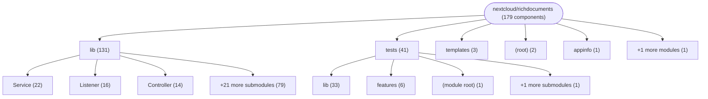
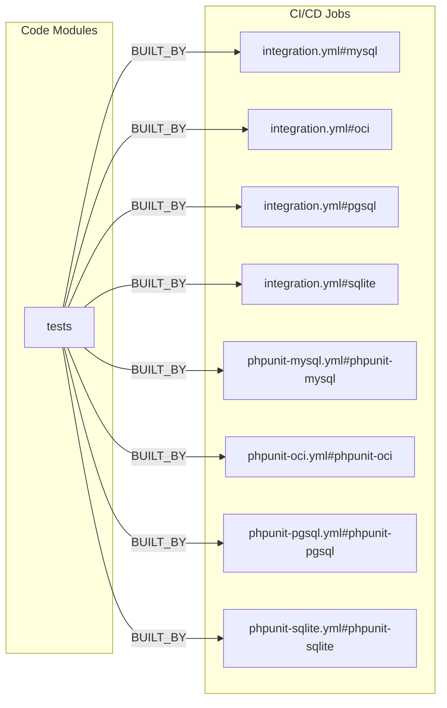
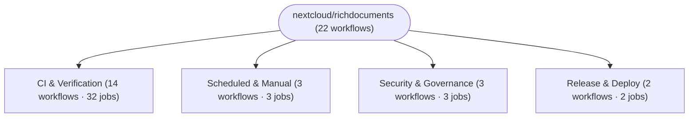

# Repository Architecture Analysis: nextcloud/richdocuments

## Metadata
- **SHA**: `4e8b9888284103007f1021dfbb3e84070f674122`
- **Primary Ecosystem**: PHP

## Quality Metrics
- **ast_engine**: fallback
- **avg_cognitive_complexity**: 0.0
- **avg_cyclomatic_complexity**: 0.0
- **component_count**: 179
- **dead_code_count**: 0
- **dead_code_symbols**: 0 entry(ies)
- **duplication_pct**: 0.0
- **file_complexities**: 0 entry(ies)
- **files_analyzed**: 179
- **fitness_passed**: True
- **fitness_violation_count**: 0
- **framework**: PHP Composer
- **import_edges**: 0 entry(ies)
- **loc**: 20512
- **max_cognitive_complexity**: 0
- **max_cyclomatic_complexity**: 0
- **sloc**: 14397
- **test_file_count**: 68

# Architecture: nextcloud/richdocuments

## Context
- **Repository**: `nextcloud/richdocuments`
- **SHA**: `4e8b9888284103007f1021dfbb3e84070f674122`
- **Ecosystem**: PHP
- **Framework**: PHP Composer

## Building Block View

## Component Details

Showing top 60 representative components out of 179 across 6 module group(s):

- **Module `lib`** (131 components — module: 131)
- **Module `tests`** (41 components — module: 41)
- **Module `templates`** (3 components — module: 3)
- **Module `(root)`** (2 components — module: 2)
- **Module `appinfo`** (1 components — module: 1)
- **Module `composer`** (1 components — module: 1)

- **.php-cs-fixer.dist** (`.php-cs-fixer.dist.php`): module
- **AbstractOfficeCreator** (`lib/DirectEditing/AbstractOfficeCreator.php`): module
- **ActivateConfig** (`lib/Command/ActivateConfig.php`): module
- **AddContentSecurityPolicyListener** (`lib/Listener/AddContentSecurityPolicyListener.php`): module
- **AddContentSecurityPolicyListenerTest** (`tests/lib/Listener/AddContentSecurityPolicyListenerTest.php`): module
- **AddFeaturePolicyListener** (`lib/Listener/AddFeaturePolicyListener.php`): module
- **AddFeaturePolicyListenerTest** (`tests/OCA/Richdocuments/Listener/AddFeaturePolicyListenerTest.php`): module
- **AddMissingIndicesListener** (`lib/Listener/AddMissingIndicesListener.php`): module
- **AddSabrePluginListener** (`lib/Listener/AddSabrePluginListener.php`): module
- **Admin** (`lib/Settings/Admin.php`): module
- **AdminTest** (`tests/lib/Settings/AdminTest.php`): module
- **ApiContext** (`tests/features/bootstrap/ApiContext.php`): module
- **AppConfig** (`lib/AppConfig.php`): module
- **AppConfigTest** (`tests/lib/AppConfigTest.php`): module
- **Application** (`lib/AppInfo/Application.php`): module
- **Asset** (`lib/Db/Asset.php`): module
- **AssetMapper** (`lib/Db/AssetMapper.php`): module
- **AssetsController** (`lib/Controller/AssetsController.php`): module
- **BeforeFederationRedirectEvent** (`lib/Events/BeforeFederationRedirectEvent.php`): module
- **BeforeFetchPreviewListener** (`lib/Listener/BeforeFetchPreviewListener.php`): module
- **BeforeGetTemplatesListener** (`lib/Listener/BeforeGetTemplatesListener.php`): module
- **BeforeTemplateRenderedListener** (`lib/Listener/BeforeTemplateRenderedListener.php`): module
- **CachedRequestService** (`lib/Service/CachedRequestService.php`): module
- **CachedRequestServiceTest** (`tests/lib/Service/CachedRequestServiceTest.php`): module
- **Capabilities** (`lib/Capabilities.php`): module
- **CapabilitiesService** (`lib/Service/CapabilitiesService.php`): module
- **CapabilitiesServiceTest** (`tests/lib/Service/CapabilitiesServiceTest.php`): module
- **Cleanup** (`lib/Backgroundjobs/Cleanup.php`): module
- **CollaboraTemplateProvider** (`lib/Template/CollaboraTemplateProvider.php`): module
- **CollaboraUpdate** (`lib/SetupCheck/CollaboraUpdate.php`): module
- **CollaboraUpdateTest** (`tests/lib/SetupCheck/CollaboraUpdateTest.php`): module
- **ConnectivityCheck** (`lib/SetupCheck/ConnectivityCheck.php`): module
- **ConnectivityCheckTest** (`tests/lib/SetupCheck/ConnectivityCheckTest.php`): module
- **ConnectivityService** (`lib/Service/ConnectivityService.php`): module
- **ConnectivityServiceTest** (`tests/lib/Service/ConnectivityServiceTest.php`): module
- **ConversionProvider** (`lib/Conversion/ConversionProvider.php`): module
- **ConversionProviderTest** (`tests/lib/Conversion/ConversionProviderTest.php`): module
- **ConvertToBigInt** (`lib/Command/ConvertToBigInt.php`): module
- **CreateDocument** (`lib/DirectEditing/CreateDocument.php`): module
- **CreateDrawing** (`lib/DirectEditing/CreateDrawing.php`): module
- **CreatePresentation** (`lib/DirectEditing/CreatePresentation.php`): module
- **CreateSpreadsheet** (`lib/DirectEditing/CreateSpreadsheet.php`): module
- **DemoService** (`lib/Service/DemoService.php`): module
- **Direct** (`lib/Db/Direct.php`): module
- **DirectContext** (`tests/features/bootstrap/DirectContext.php`): module
- **DirectEditingViewService** (`lib/Service/DirectEditingViewService.php`): module
- **DirectMapper** (`lib/Db/DirectMapper.php`): module
- **DirectViewController** (`lib/Controller/DirectViewController.php`): module
- **DiscoveryService** (`lib/Service/DiscoveryService.php`): module
- **DiscoveryServiceTest** (`tests/lib/Service/DiscoveryServiceTest.php`): module
- **DocumentAPIController** (`lib/Controller/DocumentAPIController.php`): module
- **DocumentController** (`lib/Controller/DocumentController.php`): module
- **DocumentControllerTest** (`tests/lib/Controller/DocumentControllerTest.php`): module
- **DocumentGenerationService** (`lib/Service/DocumentGenerationService.php`): module
- **DocumentOpenedEvent** (`lib/Events/DocumentOpenedEvent.php`): module
- **DocumentTrait** (`lib/Controller/DocumentTrait.php`): module
- **EMF** (`lib/Preview/EMF.php`): module
- **ExpiredTokenException** (`lib/Exceptions/ExpiredTokenException.php`): module
- **FederationContext** (`tests/features/bootstrap/FederationContext.php`): module
- **FederationController** (`lib/Controller/FederationController.php`): module

## 6-Dimension Repository Scorecard

- **Overall Grade**: `D` (60.50/100)
- **Technical Debt Score**: 39.50
- **Estimated Remediation Effort**: 56.38h

| Dimension | Grade | Score | Weight | Details |
| :--- | :---: | :---: | :---: | :--- |
| Code Quality | `A` | 100.00 | 0.20 | avg_cc=0.00, max_cc=0, duplication=0.00%, dead_code=0 |
| Dependency Health | `A` | 100.00 | 0.15 | dependencies=1494, outdated=0, vulnerable=0, has_lockfile=True |
| Maintainability | `A` | 100.00 | 0.15 | avg_cognitive=0.00, max_cognitive=0, fitness_violations=0, oversized_files=0 |
| Pipeline Health | `F` | 0.00 | 0.15 | workflows=22, operational_antipatterns=46, parallel_branches=True |
| Security | `F` | 0.00 | 0.20 | vulnerabilities=0, secrets=0, pipeline_security_findings=9 |
| Test Coverage | `C` | 70.00 | 0.15 | coverage=unavailable, ci_test_job=True, test_files_detected=True |

## Supply Chain Dependencies, Vulnerabilities & Secrets

- **Dependencies Parsed**: 1494 | **Vulnerabilities**: 0 | **Secrets**: 0

### Inventory Sample
- `league/commonmark` `2.10` (composer, `composer.json`)
- `mikehaertl/php-pdftk` `0.14.4` (composer, `composer.json`)
- `phpseclib/phpseclib` `4.0` (composer, `composer.json`)
- `@cypress/webpack-batteries-included-preprocessor` `5.0.0` (npm, `package-lock.json`)
- `@cypress/webpack-batteries-included-preprocessor` `5.0.0` (npm, `package.json`)
- `@nextcloud/auth` `2.6.0` (npm, `package-lock.json`)
- `@nextcloud/auth` `2.6.0` (npm, `package.json`)
- `@nextcloud/axios` `2.6.0` (npm, `package-lock.json`)
- `@nextcloud/axios` `2.6.0` (npm, `package.json`)
- `@nextcloud/babel-config` `1.3.0` (npm, `package-lock.json`)
- `@nextcloud/babel-config` `1.3.0` (npm, `package.json`)
- `@nextcloud/browserslist-config` `3.1.2` (npm, `package-lock.json`)
- `@nextcloud/browserslist-config` `3.1.2` (npm, `package.json`)
- `@nextcloud/capabilities` `1.2.1` (npm, `package-lock.json`)
- `@nextcloud/capabilities` `1.2.1` (npm, `package.json`)
- `@nextcloud/dialogs` `7.5.0` (npm, `package-lock.json`)
- `@nextcloud/dialogs` `7.5.0` (npm, `package.json`)
- `@nextcloud/e2e-test-server` `0.6.1` (npm, `package-lock.json`)
- `@nextcloud/e2e-test-server` `0.6.1` (npm, `package.json`)
- `@nextcloud/eslint-config` `9.0.1` (npm, `package-lock.json`)
- `@nextcloud/eslint-config` `9.0.1` (npm, `package.json`)
- `@nextcloud/event-bus` `3.3.3` (npm, `package-lock.json`)
- `@nextcloud/event-bus` `3.3.3` (npm, `package.json`)
- `@nextcloud/files` `4.1.1` (npm, `package-lock.json`)
- `@nextcloud/files` `4.1.1` (npm, `package.json`)
- `@nextcloud/initial-state` `3.0.0` (npm, `package-lock.json`)
- `@nextcloud/initial-state` `3.0.0` (npm, `package.json`)
- `@nextcloud/l10n` `3.4.1` (npm, `package-lock.json`)
- `@nextcloud/l10n` `3.4.1` (npm, `package.json`)
- `@nextcloud/paths` `3.1.0` (npm, `package-lock.json`)
- ... (+1464 more dependencies)

## Section 7: Code-to-Cloud Deployment Traceability

- `tests` (code_module) --[BUILT_BY]--> `integration.yml#mysql` (ci_job)
- `tests` (code_module) --[BUILT_BY]--> `integration.yml#oci` (ci_job)
- `tests` (code_module) --[BUILT_BY]--> `integration.yml#pgsql` (ci_job)
- `tests` (code_module) --[BUILT_BY]--> `integration.yml#sqlite` (ci_job)
- `tests` (code_module) --[BUILT_BY]--> `phpunit-mysql.yml#phpunit-mysql` (ci_job)
- `tests` (code_module) --[BUILT_BY]--> `phpunit-oci.yml#phpunit-oci` (ci_job)
- `tests` (code_module) --[BUILT_BY]--> `phpunit-pgsql.yml#phpunit-pgsql` (ci_job)
- `tests` (code_module) --[BUILT_BY]--> `phpunit-sqlite.yml#phpunit-sqlite` (ci_job)

## CI/CD Pipeline Topology

