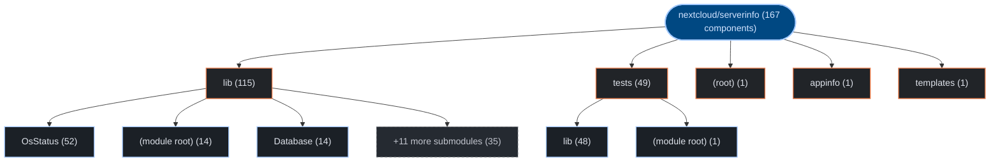

# Repository Architecture Analysis: nextcloud/serverinfo

## Metadata
- **SHA**: `5b4fe4d799afa39482776bbc6d48250b57b1f3ad`
- **Primary Ecosystem**: PHP

## Quality Metrics
- **ast_engine**: fallback
- **avg_cognitive_complexity**: 0.0
- **avg_cyclomatic_complexity**: 0.0
- **component_count**: 167
- **dead_code_count**: 0
- **dead_code_symbols**: 0 entry(ies)
- **duplication_pct**: 0.0
- **file_complexities**: 0 entry(ies)
- **files_analyzed**: 167
- **fitness_passed**: True
- **fitness_violation_count**: 0
- **framework**: PHP Composer
- **import_edges**: 0 entry(ies)
- **loc**: 24734
- **max_cognitive_complexity**: 0
- **max_cyclomatic_complexity**: 0
- **sloc**: 16650
- **test_file_count**: 126

# Architecture: nextcloud/serverinfo

## Context
- **Repository**: `nextcloud/serverinfo`
- **SHA**: `5b4fe4d799afa39482776bbc6d48250b57b1f3ad`
- **Ecosystem**: PHP
- **Framework**: PHP Composer

## Building Block View

## Component Details

Showing top 60 representative components out of 167 across 5 module group(s):

- **Module `lib`** (115 components — module: 115)
- **Module `tests`** (49 components — module: 49)
- **Module `(root)`** (1 components — module: 1)
- **Module `appinfo`** (1 components — module: 1)
- **Module `templates`** (1 components — module: 1)

- **.php-cs-fixer.dist** (`.php-cs-fixer.dist.php`): module
- **AbstractOsCheck** (`lib/SetupChecks/AbstractOsCheck.php`): module
- **AdminSection** (`lib/Settings/AdminSection.php`): module
- **AdminSettings** (`lib/Settings/AdminSettings.php`): module
- **Advisor** (`lib/Database/Advisor.php`): module
- **AdvisorTest** (`tests/lib/Database/AdvisorTest.php`): module
- **ApiController** (`lib/Controller/ApiController.php`): module
- **ApiControllerTest** (`tests/lib/ApiControllerTest.php`): module
- **Apk** (`lib/OsStatus/Packages/Apk.php`): module
- **Application** (`lib/AppInfo/Application.php`): module
- **ApplyDescriptor** (`lib/Database/ApplyDescriptor.php`): module
- **Apt** (`lib/OsStatus/Packages/Apt.php`): module
- **AptTest** (`tests/lib/OsStatus/AptTest.php`): module
- **AutomaticUpdates** (`lib/OsStatus/Packages/AutomaticUpdates.php`): module
- **BackgroundJobs** (`lib/Collector/BackgroundJobs.php`): module
- **BackgroundJobsTest** (`tests/lib/Collector/BackgroundJobsTest.php`): module
- **CPU** (`lib/Resources/CPU.php`): module
- **CheckSummary** (`lib/Database/CheckSummary.php`): module
- **CommandOutput** (`lib/OperatingSystems/CommandOutput.php`): module
- **CommandResult** (`lib/OsStatus/Host/CommandResult.php`): module
- **CommandRunner** (`lib/OsStatus/Host/CommandRunner.php`): module
- **CommandRunnerTest** (`tests/lib/OsStatus/CommandRunnerTest.php`): module
- **Concern** (`lib/OsStatus/Verdict/Concern.php`): module
- **ConcernTexts** (`lib/OsStatus/Verdict/ConcernTexts.php`): module
- **ConcernTextsTest** (`tests/lib/OsStatus/ConcernTextsTest.php`): module
- **ConfigLexicon** (`lib/Config/ConfigLexicon.php`): module
- **CoreLibraryProbe** (`lib/OsStatus/Reboot/CoreLibraryProbe.php`): module
- **Cron** (`lib/Collector/Cron.php`): module
- **CronTest** (`tests/lib/Collector/CronTest.php`): module
- **DatabaseChecks** (`lib/SetupChecks/DatabaseChecks.php`): module
- **DatabaseChecksTest** (`tests/lib/SetupChecks/DatabaseChecksTest.php`): module
- **DatabaseController** (`lib/Controller/DatabaseController.php`): module
- **DatabaseControllerLiveTest** (`tests/lib/Database/DatabaseControllerLiveTest.php`): module
- **DatabaseProbe** (`lib/Database/DatabaseProbe.php`): module
- **DatabaseStatistics** (`lib/DatabaseStatistics.php`): module
- **Disk** (`lib/Resources/Disk.php`): module
- **Dnf** (`lib/OsStatus/Packages/Dnf.php`): module
- **DnfTest** (`tests/lib/OsStatus/DnfTest.php`): module
- **Dummy** (`lib/OperatingSystems/Dummy.php`): module
- **DummyTest** (`tests/lib/DummyTest.php`): module
- **EntryPointsTest** (`tests/lib/OsStatus/EntryPointsTest.php`): module
- **Environment** (`lib/OsStatus/Environment.php`): module
- **EnvironmentDetector** (`lib/OsStatus/EnvironmentDetector.php`): module
- **EnvironmentDetectorTest** (`tests/lib/OsStatus/EnvironmentDetectorTest.php`): module
- **ExpressionEvaluator** (`lib/Database/ExpressionEvaluator.php`): module
- **ExpressionException** (`lib/Database/ExpressionException.php`): module
- **FakeHost** (`tests/lib/OsStatus/FakeHost.php`): module
- **FakeL10N** (`tests/lib/OsStatus/FakeL10N.php`): module
- **FpmStatistics** (`lib/FpmStatistics.php`): module
- **FreeBSD** (`lib/OperatingSystems/FreeBSD.php`): module
- **FreeBSDTest** (`tests/lib/FreeBSDTest.php`): module
- **HeldPackage** (`lib/OsStatus/Packages/HeldPackage.php`): module
- **HelperReport** (`lib/OsStatus/Helper/HelperReport.php`): module
- **HelperReportReader** (`lib/OsStatus/Helper/HelperReportReader.php`): module
- **HelperReportReaderTest** (`tests/lib/OsStatus/HelperReportReaderTest.php`): module
- **HelperScriptTest** (`tests/lib/OsStatus/HelperScriptTest.php`): module
- **HelperState** (`lib/OsStatus/Helper/HelperState.php`): module
- **IHost** (`lib/OsStatus/Host/IHost.php`): module
- **IOperatingSystem** (`lib/OperatingSystems/IOperatingSystem.php`): module
- **IPackageManager** (`lib/OsStatus/Packages/IPackageManager.php`): module

## 6-Dimension Repository Scorecard

- **Overall Grade**: `D` (60.50/100)
- **Technical Debt Score**: 39.50
- **Estimated Remediation Effort**: 48.88h

| Dimension | Grade | Score | Weight | Details |
| :--- | :---: | :---: | :---: | :--- |
| Code Quality | `A` | 100.00 | 0.20 | avg_cc=0.00, max_cc=0, duplication=0.00%, dead_code=0 |
| Dependency Health | `A` | 100.00 | 0.15 | dependencies=799, outdated=0, vulnerable=0, has_lockfile=True |
| Maintainability | `A` | 100.00 | 0.15 | avg_cognitive=0.00, max_cognitive=0, fitness_violations=0, oversized_files=0 |
| Pipeline Health | `F` | 0.00 | 0.15 | workflows=22, operational_antipatterns=43, parallel_branches=True |
| Security | `F` | 0.00 | 0.20 | vulnerabilities=0, secrets=0, pipeline_security_findings=8 |
| Test Coverage | `C` | 70.00 | 0.15 | coverage=unavailable, ci_test_job=True, test_files_detected=True |

## Supply Chain Dependencies, Vulnerabilities & Secrets

- **Dependencies Parsed**: 799 | **Vulnerabilities**: 0 | **Secrets**: 0

### Inventory Sample
- `@nextcloud/axios` `2.6.0` (npm, `package-lock.json`)
- `@nextcloud/axios` `2.6.0` (npm, `package.json`)
- `@nextcloud/browserslist-config` `3.1.2` (npm, `package-lock.json`)
- `@nextcloud/browserslist-config` `3.1.2` (npm, `package.json`)
- `@nextcloud/eslint-config` `9.0.1` (npm, `package-lock.json`)
- `@nextcloud/eslint-config` `9.0.1` (npm, `package.json`)
- `@nextcloud/l10n` `3.4.1` (npm, `package-lock.json`)
- `@nextcloud/l10n` `3.4.1` (npm, `package.json`)
- `@nextcloud/password-confirmation` `6.2.1` (npm, `package-lock.json`)
- `@nextcloud/password-confirmation` `6.2.1` (npm, `package.json`)
- `@nextcloud/router` `3.2.0` (npm, `package-lock.json`)
- `@nextcloud/router` `3.2.0` (npm, `package.json`)
- `@nextcloud/vite-config` `2.5.1` (npm, `package.json`)
- `@nextcloud/vite-config` `2.5.4` (npm, `package-lock.json`)
- `@nextcloud/vue` `9.13.1` (npm, `package.json`)
- `@nextcloud/vue` `9.14.1` (npm, `package-lock.json`)
- `@vitejs/plugin-vue` `6.0.10` (npm, `package-lock.json`)
- `@vitejs/plugin-vue` `6.0.10` (npm, `package.json`)
- `@vue/test-utils` `2.5.1` (npm, `package.json`)
- `@vue/test-utils` `2.6.0` (npm, `package-lock.json`)
- `chart.js` `4.6.1` (npm, `package-lock.json`)
- `chart.js` `4.6.1` (npm, `package.json`)
- `happy-dom` `21.0.4` (npm, `package-lock.json`)
- `happy-dom` `21.0.4` (npm, `package.json`)
- `vitest` `5.1.0` (npm, `package-lock.json`)
- `vitest` `5.1.0` (npm, `package.json`)
- `vue` `3.5.44` (npm, `package-lock.json`)
- `vue` `3.5.44` (npm, `package.json`)
- `vue-chartjs` `5.3.4` (npm, `package-lock.json`)
- `vue-chartjs` `5.3.4` (npm, `package.json`)
- ... (+769 more dependencies)

## CI/CD Pipeline Topology

```mermaid
graph TD;
  classDef atlasRoot fill:#004882,stroke:#a3c9ff,stroke-width:2px,color:#d3e4ff
  classDef atlasCategory fill:#212428,stroke:#E87A48,stroke-width:1.5px,color:#dfe3eb
  classDef atlasWorkflow fill:#1b2026,stroke:#a3c9ff,stroke-width:1.5px,color:#dfe3eb
  classDef atlasJob fill:#171c22,stroke:#8d9199,stroke-width:1px,color:#dfe3eb
  classDef atlasTarget fill:#005227,stroke:#8bd99b,stroke-width:1.5px,color:#a7f6b6
  classDef atlasAlert fill:#93000a,stroke:#ffb4ab,stroke-width:1.5px,color:#ffdad6
  classDef atlasMore fill:#252a31,stroke:#8d9199,stroke-dasharray:4 4,color:#c3c6cf
  pipeline_root(["nextcloud/serverinfo (22 workflows)"]):::atlasRoot
  grp_0_CI___Verification["CI & Verification (13 workflows · 29 jobs)"]:::atlasCategory
  pipeline_root --> grp_0_CI___Verification
  wf_8_Lint_php["Lint php (3 jobs)"]:::atlasWorkflow
  grp_0_CI___Verification --> wf_8_Lint_php
  job_8_matrix["matrix"]:::atlasJob
  job_8_php_lint["php-lint"]:::atlasJob
  job_8_summary["summary"]:::atlasJob
  wf_8_Lint_php --> job_8_matrix
  job_8_matrix --> job_8_php_lint
  job_8_php_lint --> job_8_summary
  wf_9_Node_tests["Node tests (3 jobs)"]:::atlasWorkflow
  grp_0_CI___Verification --> wf_9_Node_tests
  job_9_changes["changes"]:::atlasJob
  job_9_test["test"]:::atlasJob
  job_9_summary["summary"]:::atlasJob
  wf_9_Node_tests --> job_9_changes
  job_9_changes --> job_9_test
  job_9_changes --> job_9_summary
  job_9_test --> job_9_summary
  wf_11_Build_Javascript["Build Javascript (3 jobs)"]:::atlasWorkflow
  grp_0_CI___Verification --> wf_11_Build_Javascript
  job_11_changes["changes"]:::atlasJob
  job_11_build["build"]:::atlasJob
  job_11_summary["summary"]:::atlasJob
  wf_11_Build_Javascript --> job_11_changes
  job_11_changes --> job_11_build
  job_11_changes --> job_11_summary
  job_11_build --> job_11_summary
  grp_1_Security___Governance["Security & Governance (5 workflows · 5 jobs)"]:::atlasCategory
  pipeline_root --> grp_1_Security___Governance
  wf_1_Block_merges_during_freezes["Block merges during freezes (1 jobs)"]:::atlasWorkflow
  grp_1_Security___Governance --> wf_1_Block_merges_during_freezes
  job_1_block_merges_during_freeze["block-merges-during-freeze"]:::atlasJob
  wf_1_Block_merges_during_freezes --> job_1_block_merges_during_freeze
  wf_4_Auto_approve_Dependabot_PRs["Auto approve Dependabot PRs (1 jobs)"]:::atlasWorkflow
  grp_1_Security___Governance --> wf_4_Auto_approve_Dependabot_PRs
  job_4_auto_approve_merge["auto-approve-merge"]:::atlasJob
  wf_4_Auto_approve_Dependabot_PRs --> job_4_auto_approve_merge
  wf_5_Block_fixup_and_squash_commits["Block fixup and squash commits (1 jobs)"]:::atlasWorkflow
  grp_1_Security___Governance --> wf_5_Block_fixup_and_squash_commits
  job_5_commit_message_check["commit-message-check"]:::atlasJob
  wf_5_Block_fixup_and_squash_commits --> job_5_commit_message_check
  grp_2_Scheduled___Manual["Scheduled & Manual (3 workflows · 3 jobs)"]:::atlasCategory
  pipeline_root --> grp_2_Scheduled___Manual
  wf_17_Ask_for_feedback_on_PRs["Ask for feedback on PRs (1 jobs)"]:::atlasWorkflow
  grp_2_Scheduled___Manual --> wf_17_Ask_for_feedback_on_PRs
  job_17_pr_feedback["pr-feedback"]:::atlasJob
  wf_17_Ask_for_feedback_on_PRs --> job_17_pr_feedback
  wf_20_Update_workflows["Update workflows (1 jobs)"]:::atlasWorkflow
  grp_2_Scheduled___Manual --> wf_20_Update_workflows
  job_20_dispatch["dispatch"]:::atlasJob
  wf_20_Update_workflows --> job_20_dispatch
  wf_21_Update_nextcloud_ocp["Update nextcloud/ocp (1 jobs)"]:::atlasWorkflow
  grp_2_Scheduled___Manual --> wf_21_Update_nextcloud_ocp
  job_21_update_nextcloud_ocp["update-nextcloud-ocp"]:::atlasJob
  wf_21_Update_nextcloud_ocp --> job_21_update_nextcloud_ocp
  grp_3_Automation___Other["Automation & Other (1 workflows · 2 jobs)"]:::atlasCategory
  pipeline_root --> grp_3_Automation___Other
  wf_3_Compile_Command["Compile Command (2 jobs)"]:::atlasWorkflow
  grp_3_Automation___Other --> wf_3_Compile_Command
  job_3_init["init"]:::atlasJob
  wf_3_Compile_Command --> job_3_init
  wf_more["+12 more workflows"]:::atlasMore
  pipeline_root --> wf_more
```

