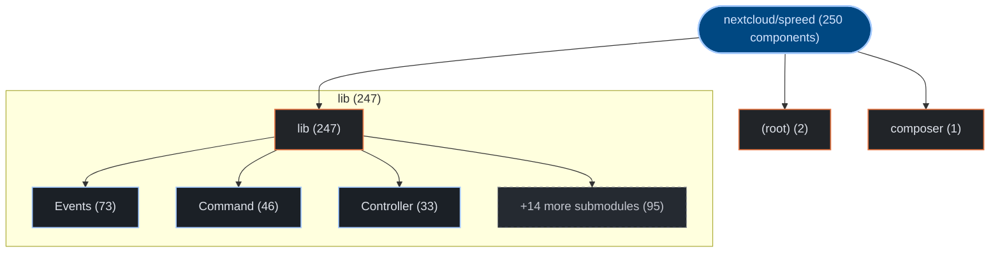

# Repository Architecture Analysis: nextcloud/spreed

## Metadata
- **SHA**: `d1adc6be568045dd442a2bc08f74f83935f69da3`
- **Primary Ecosystem**: PHP

## Quality Metrics
- **ast_engine**: fallback
- **avg_cognitive_complexity**: 0.0
- **avg_cyclomatic_complexity**: 0.0
- **component_count**: 250
- **dead_code_count**: 0
- **dead_code_symbols**: 0 entry(ies)
- **duplication_pct**: 0.0
- **file_complexities**: 0 entry(ies)
- **files_analyzed**: 889
- **fitness_passed**: True
- **fitness_violation_count**: 0
- **framework**: PHP Composer
- **import_edges**: 0 entry(ies)
- **loc**: 140894
- **max_cognitive_complexity**: 0
- **max_cyclomatic_complexity**: 0
- **sloc**: 100690
- **test_file_count**: 433

# Architecture: nextcloud/spreed

## Context
- **Repository**: `nextcloud/spreed`
- **SHA**: `d1adc6be568045dd442a2bc08f74f83935f69da3`
- **Ecosystem**: PHP
- **Framework**: PHP Composer

## Building Block View

## Component Details

Showing top 60 representative components out of 250 across 3 module group(s):

- **Module `lib`** (247 components — module: 247)
- **Module `(root)`** (2 components — module: 2)
- **Module `composer`** (1 components — module: 1)

- **.php-cs-fixer.dist** (`.php-cs-fixer.dist.php`): module
- **AAttendeeRemovedEvent** (`lib/Events/AAttendeeRemovedEvent.php`): module
- **ABeforeJoinedRoomEvent** (`lib/Events/ABeforeJoinedRoomEvent.php`): module
- **ACallEndedEvent** (`lib/Events/ACallEndedEvent.php`): module
- **ACallEndedForEveryoneEvent** (`lib/Events/ACallEndedForEveryoneEvent.php`): module
- **ACallStartedEvent** (`lib/Events/ACallStartedEvent.php`): module
- **AEnvironmentAwareOCSController** (`lib/Controller/AEnvironmentAwareOCSController.php`): module
- **ALobbyModifiedEvent** (`lib/Events/ALobbyModifiedEvent.php`): module
- **AMessageSentEvent** (`lib/Events/AMessageSentEvent.php`): module
- **AParticipantModifiedEvent** (`lib/Events/AParticipantModifiedEvent.php`): module
- **AReactionEvent** (`lib/Events/AReactionEvent.php`): module
- **ARoomEvent** (`lib/Events/ARoomEvent.php`): module
- **ARoomModifiedEvent** (`lib/Events/ARoomModifiedEvent.php`): module
- **ARoomSyncedEvent** (`lib/Events/ARoomSyncedEvent.php`): module
- **ASessionLeftRoomEvent** (`lib/Events/ASessionLeftRoomEvent.php`): module
- **ASystemMessageSentEvent** (`lib/Events/ASystemMessageSentEvent.php`): module
- **AccountId** (`lib/DataObjects/AccountId.php`): module
- **Add** (`lib/Command/MatrixHomeserver/Add.php`): module
- **Add** (`lib/Command/Room/Add.php`): module
- **Add** (`lib/Command/Signaling/Add.php`): module
- **Add** (`lib/Command/Stun/Add.php`): module
- **Add** (`lib/Command/Turn/Add.php`): module
- **AddPhoneNumber** (`lib/Command/PhoneNumber/AddPhoneNumber.php`): module
- **AgeChatMessages** (`lib/Command/Developer/AgeChatMessages.php`): module
- **AppConfigEntry** (`lib/Config/AppConfigEntry.php`): module
- **Application** (`lib/AppInfo/Application.php`): module
- **AttendeeRemovedEvent** (`lib/Events/AttendeeRemovedEvent.php`): module
- **AttendeesAddedEvent** (`lib/Events/AttendeesAddedEvent.php`): module
- **AttendeesEvent** (`lib/Events/AttendeesEvent.php`): module
- **AttendeesRemovedEvent** (`lib/Events/AttendeesRemovedEvent.php`): module
- **Authenticator** (`lib/Authenticator.php`): module
- **AvatarController** (`lib/Controller/AvatarController.php`): module
- **BanController** (`lib/Controller/BanController.php`): module
- **Base** (`lib/Activity/Provider/Base.php`): module
- **BeforeAttendeeRemovedEvent** (`lib/Events/BeforeAttendeeRemovedEvent.php`): module
- **BeforeAttendeesAddedEvent** (`lib/Events/BeforeAttendeesAddedEvent.php`): module
- **BeforeCallEndedEvent** (`lib/Events/BeforeCallEndedEvent.php`): module
- **BeforeCallEndedForEveryoneEvent** (`lib/Events/BeforeCallEndedForEveryoneEvent.php`): module
- **BeforeCallStartedEvent** (`lib/Events/BeforeCallStartedEvent.php`): module
- **BeforeChatMessageSentEvent** (`lib/Events/BeforeChatMessageSentEvent.php`): module
- **BeforeDuplicateShareSentEvent** (`lib/Events/BeforeDuplicateShareSentEvent.php`): module
- **BeforeEmailInvitationSentEvent** (`lib/Events/BeforeEmailInvitationSentEvent.php`): module
- **BeforeFederatedUserJoinedRoomEvent** (`lib/Events/BeforeFederatedUserJoinedRoomEvent.php`): module
- **BeforeGuestJoinedRoomEvent** (`lib/Events/BeforeGuestJoinedRoomEvent.php`): module
- **BeforeGuestsCleanedUpEvent** (`lib/Events/BeforeGuestsCleanedUpEvent.php`): module
- **BeforeLobbyModifiedEvent** (`lib/Events/BeforeLobbyModifiedEvent.php`): module
- **BeforeParticipantModifiedEvent** (`lib/Events/BeforeParticipantModifiedEvent.php`): module
- **BeforeReactionAddedEvent** (`lib/Events/BeforeReactionAddedEvent.php`): module
- **BeforeReactionRemovedEvent** (`lib/Events/BeforeReactionRemovedEvent.php`): module
- **BeforeRoomDeletedEvent** (`lib/Events/BeforeRoomDeletedEvent.php`): module
- **BeforeRoomModifiedEvent** (`lib/Events/BeforeRoomModifiedEvent.php`): module
- **BeforeRoomSyncedEvent** (`lib/Events/BeforeRoomSyncedEvent.php`): module
- **BeforeRoomsFetchEvent** (`lib/Events/BeforeRoomsFetchEvent.php`): module
- **BeforeSessionLeftRoomEvent** (`lib/Events/BeforeSessionLeftRoomEvent.php`): module
- **BeforeSignalingResponseSentEvent** (`lib/Events/BeforeSignalingResponseSentEvent.php`): module
- **BeforeSignalingRoomPropertiesSentEvent** (`lib/Events/BeforeSignalingRoomPropertiesSentEvent.php`): module
- **BeforeSystemMessageSentEvent** (`lib/Events/BeforeSystemMessageSentEvent.php`): module
- **BeforeTurnServersGetEvent** (`lib/Events/BeforeTurnServersGetEvent.php`): module
- **BeforeUserJoinedRoomEvent** (`lib/Events/BeforeUserJoinedRoomEvent.php`): module
- **BotController** (`lib/Controller/BotController.php`): module

## 6-Dimension Repository Scorecard

- **Overall Grade**: `D` (60.50/100)
- **Technical Debt Score**: 39.50
- **Estimated Remediation Effort**: 104.88h

| Dimension | Grade | Score | Weight | Details |
| :--- | :---: | :---: | :---: | :--- |
| Code Quality | `A` | 100.00 | 0.20 | avg_cc=0.00, max_cc=0, duplication=0.00%, dead_code=0 |
| Dependency Health | `A` | 100.00 | 0.15 | dependencies=1260, outdated=0, vulnerable=0, has_lockfile=True |
| Maintainability | `A` | 100.00 | 0.15 | avg_cognitive=0.00, max_cognitive=0, fitness_violations=0, oversized_files=0 |
| Pipeline Health | `F` | 0.00 | 0.15 | workflows=40, operational_antipatterns=86, parallel_branches=True |
| Security | `F` | 0.00 | 0.20 | vulnerabilities=0, secrets=3, pipeline_security_findings=19 |
| Test Coverage | `C` | 70.00 | 0.15 | coverage=unavailable, ci_test_job=True, test_files_detected=True |

## Supply Chain Dependencies, Vulnerabilities & Secrets

- **Dependencies Parsed**: 1260 | **Vulnerabilities**: 0 | **Secrets**: 3

### Secret Findings (Redacted)
- **[HIGH] `ATRUSS-SEC-005`** at `docs/signaling-messages.md:452` (`"key": "q0Yy***REDACTED***"`)
- **[HIGH] `ATRUSS-SEC-005`** at `src/utils/generatePassword.ts:10` (`const passwordSet = 'abcd***REDACTED***'`)
- **[HIGH] `ATRUSS-SEC-005`** at `tests/php/Matrix/Service/CryptoServiceTest.php:54` (`private const BACKUP_PUBLIC_KEY = 'E75P***REDACTED***';`)

### Inventory Sample
- `bamarni/composer-bin-plugin` `1.9` (composer, `composer.json`)
- `coenjacobs/mozart` `1.2.3` (composer, `vendor-bin/mozart/composer.json`)
- `cuyz/valinor` `2.6` (composer, `composer.json`)
- `cweagans/composer-patches` `2.0.0` (composer, `composer.json`)
- `firebase/php-jwt` `7.2` (composer, `composer.json`)
- `@matrix-org/olm` `3.2.15` (npm, `package-lock.json`)
- `@matrix-org/olm` `3.2.15` (npm, `package.json`)
- `@mediapipe/tasks-vision` `0.10.35` (npm, `package-lock.json`)
- `@mediapipe/tasks-vision` `0.10.35` (npm, `package.json`)
- `@nextcloud/auth` `2.6.0` (npm, `package-lock.json`)
- `@nextcloud/auth` `2.6.0` (npm, `package.json`)
- `@nextcloud/axios` `2.6.0` (npm, `package-lock.json`)
- `@nextcloud/axios` `2.6.0` (npm, `package.json`)
- `@nextcloud/browser-storage` `0.5.0` (npm, `package-lock.json`)
- `@nextcloud/browser-storage` `0.5.0` (npm, `package.json`)
- `@nextcloud/browserslist-config` `3.1.2` (npm, `package-lock.json`)
- `@nextcloud/browserslist-config` `3.1.2` (npm, `package.json`)
- `@nextcloud/capabilities` `1.2.1` (npm, `package-lock.json`)
- `@nextcloud/capabilities` `1.2.1` (npm, `package.json`)
- `@nextcloud/cdav-library` `2.8.2` (npm, `package-lock.json`)
- `@nextcloud/cdav-library` `2.8.2` (npm, `package.json`)
- `@nextcloud/dialogs` `8.0.0` (npm, `package-lock.json`)
- `@nextcloud/dialogs` `8.0.0` (npm, `package.json`)
- `@nextcloud/eslint-config` `9.0.1` (npm, `package-lock.json`)
- `@nextcloud/eslint-config` `9.0.1` (npm, `package.json`)
- `@nextcloud/event-bus` `3.3.3` (npm, `package-lock.json`)
- `@nextcloud/event-bus` `3.3.3` (npm, `package.json`)
- `@nextcloud/files` `4.1.1` (npm, `package-lock.json`)
- `@nextcloud/files` `4.1.1` (npm, `package.json`)
- `@nextcloud/initial-state` `3.0.0` (npm, `package-lock.json`)
- ... (+1230 more dependencies)

## CI/CD Pipeline Topology

```mermaid
graph TD;
  classDef atlasRoot fill:#004882,stroke:#a3c9ff,stroke-width:2px,color:#d3e4ff
  classDef atlasCategory fill:#212428,stroke:#E87A48,stroke-width:1.5px,color:#dfe3eb
  classDef atlasWorkflow fill:#1b2026,stroke:#a3c9ff,stroke-width:1.5px,color:#dfe3eb
  classDef atlasJob fill:#171c22,stroke:#8d9199,stroke-width:1px,color:#dfe3eb
  classDef atlasTarget fill:#005227,stroke:#8bd99b,stroke-width:1.5px,color:#a7f6b6
  classDef atlasAlert fill:#93000a,stroke:#ffb4ab,stroke-width:1.5px,color:#ffdad6
  classDef atlasMore fill:#252a31,stroke:#8d9199,stroke-dasharray:4 4,color:#c3c6cf
  pipeline_root(["nextcloud/spreed (40 workflows)"]):::atlasRoot
  subgraph sg_grp_0_CI___Verification["CI & Verification (22 workflows · 42 jobs)"]
    direction TB
    subgraph sg_wf_13_Lint_eslint["Lint eslint (3 jobs)"]
      direction TB
      wf_13_Lint_eslint(["Trigger: Lint eslint"]):::atlasWorkflow
      job_13_changes["changes"]:::atlasJob
      job_13_lint["lint"]:::atlasJob
      job_13_summary["summary"]:::atlasJob
      wf_13_Lint_eslint --> job_13_changes
      job_13_changes --> job_13_lint
      job_13_changes --> job_13_summary
      job_13_lint --> job_13_summary
    end
    pipeline_root --> wf_13_Lint_eslint
    subgraph sg_wf_16_Lint_php["Lint php (3 jobs)"]
      direction TB
      wf_16_Lint_php(["Trigger: Lint php"]):::atlasWorkflow
      job_16_matrix["matrix"]:::atlasJob
      job_16_php_lint["php-lint"]:::atlasJob
      job_16_summary["summary"]:::atlasJob
      wf_16_Lint_php --> job_16_matrix
      job_16_matrix --> job_16_php_lint
      job_16_php_lint --> job_16_summary
    end
    pipeline_root --> wf_16_Lint_php
    subgraph sg_wf_22_Build_Javascript["Build Javascript (3 jobs)"]
      direction TB
      wf_22_Build_Javascript(["Trigger: Build Javascript"]):::atlasWorkflow
      job_22_changes["changes"]:::atlasJob
      job_22_build["build"]:::atlasJob
      job_22_summary["summary"]:::atlasJob
      wf_22_Build_Javascript --> job_22_changes
      job_22_changes --> job_22_build
      job_22_changes --> job_22_summary
      job_22_build --> job_22_summary
    end
    pipeline_root --> wf_22_Build_Javascript
  end
  subgraph sg_grp_1_Scheduled___Manual["Scheduled & Manual (11 workflows · 23 jobs)"]
    direction TB
    subgraph sg_wf_6_Integration_Federation["Integration Federation (3 jobs)"]
      direction TB
      wf_6_Integration_Federation(["Trigger: Integration Federation"]):::atlasWorkflow
      job_6_changes["changes"]:::atlasJob
      job_6_integration_federation["integration-federation"]:::atlasJob
      job_6_summary["summary"]:::atlasJob
      wf_6_Integration_Federation --> job_6_changes
      job_6_changes --> job_6_integration_federation
      job_6_changes --> job_6_summary
      job_6_integration_federation --> job_6_summary
    end
    pipeline_root --> wf_6_Integration_Federation
    subgraph sg_wf_7_Integration_mariadb["Integration mariadb (3 jobs)"]
      direction TB
      wf_7_Integration_mariadb(["Trigger: Integration mariadb"]):::atlasWorkflow
      job_7_changes["changes"]:::atlasJob
      job_7_integration_mariadb["integration-mariadb"]:::atlasJob
      job_7_summary["summary"]:::atlasJob
      wf_7_Integration_mariadb --> job_7_changes
      job_7_changes --> job_7_integration_mariadb
      job_7_changes --> job_7_summary
      job_7_integration_mariadb --> job_7_summary
    end
    pipeline_root --> wf_7_Integration_mariadb
  end
  subgraph sg_grp_2_Security___Governance["Security & Governance (4 workflows · 4 jobs)"]
    direction TB
    subgraph sg_wf_4_Auto_approve_Dependabot_PRs["Auto approve Dependabot PRs (1 jobs)"]
      direction TB
      wf_4_Auto_approve_Dependabot_PRs(["Trigger: Auto approve Dependabot PRs"]):::atlasWorkflow
      job_4_auto_approve_merge["auto-approve-merge"]:::atlasJob
      wf_4_Auto_approve_Dependabot_PRs --> job_4_auto_approve_merge
    end
    pipeline_root --> wf_4_Auto_approve_Dependabot_PRs
    wf_5_Block_fixup_and_squash_commits["Block fixup and squash commits (1 jobs)"]:::atlasWorkflow
    pipeline_root --> wf_5_Block_fixup_and_squash_commits
  end
  subgraph sg_grp_3_Release___Deploy["Release & Deploy (2 workflows · 2 jobs)"]
    direction TB
    wf_1_Build_and_publish_app_release["Build and publish app release (1 jobs)"]:::atlasWorkflow
    pipeline_root --> wf_1_Build_and_publish_app_release
    wf_34_Notify_release_relay_on_release["Notify release-relay on release (1 jobs)"]:::atlasWorkflow
    pipeline_root --> wf_34_Notify_release_relay_on_release
  end
  subgraph sg_grp_4_Automation___Other["Automation & Other (1 workflows · 2 jobs)"]
    direction TB
    wf_3_OpenAPI_Command["OpenAPI Command (2 jobs)"]:::atlasWorkflow
    pipeline_root --> wf_3_OpenAPI_Command
  end
  wf_more["+30 more workflows"]:::atlasMore
  pipeline_root --> wf_more
```

