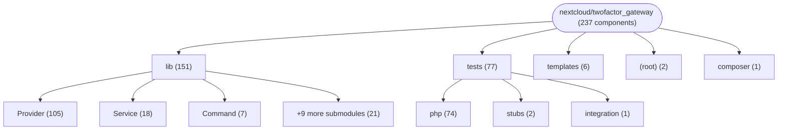
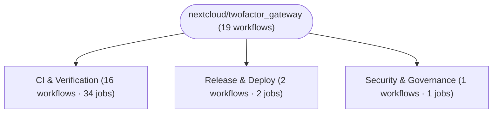

# Repository Architecture Analysis: nextcloud/twofactor_gateway

## Metadata
- **SHA**: `6bf9a06d3beb68ef7f0d52e7a1eb447d17c2a215`
- **Primary Ecosystem**: PHP

## Quality Metrics
- **ast_engine**: fallback
- **avg_cognitive_complexity**: 0.0
- **avg_cyclomatic_complexity**: 0.0
- **component_count**: 237
- **dead_code_count**: 0
- **dead_code_symbols**: 0 entry(ies)
- **duplication_pct**: 0.0
- **file_complexities**: 0 entry(ies)
- **files_analyzed**: 237
- **fitness_passed**: True
- **fitness_violation_count**: 0
- **framework**: Symfony
- **import_edges**: 0 entry(ies)
- **loc**: 28155
- **max_cognitive_complexity**: 0
- **max_cyclomatic_complexity**: 0
- **sloc**: 20697
- **test_file_count**: 96

# Architecture: nextcloud/twofactor_gateway

## Context
- **Repository**: `nextcloud/twofactor_gateway`
- **SHA**: `6bf9a06d3beb68ef7f0d52e7a1eb447d17c2a215`
- **Ecosystem**: PHP
- **Framework**: Symfony

## Building Block View

## Component Details

Showing top 60 representative components out of 237 across 5 module group(s):

- **Module `lib`** (151 components — module: 151)
- **Module `tests`** (77 components — module: 77)
- **Module `templates`** (6 components — module: 6)
- **Module `(root)`** (2 components — module: 2)
- **Module `composer`** (1 components — module: 1)

- **.php-cs-fixer.dist** (`.php-cs-fixer.dist.php`): module
- **AFactory** (`lib/Provider/AFactory.php`): module
- **AGateway** (`lib/Provider/Gateway/AGateway.php`): module
- **AGatewayTest** (`tests/php/Unit/Provider/Gateway/AGatewayTest.php`): module
- **AProvider** (`lib/Provider/AProvider.php`): module
- **AProvider** (`lib/Provider/Channel/SMS/Provider/AProvider.php`): module
- **AProvider** (`lib/Provider/Channel/Telegram/Provider/AProvider.php`): module
- **AProviderTest** (`tests/php/Unit/Provider/Channel/Telegram/Provider/AProviderTest.php`): module
- **AbstractCatalogFactory** (`lib/Provider/Channel/AbstractCatalogFactory.php`): module
- **AbstractChannelAProvider** (`lib/Provider/Channel/AbstractChannelAProvider.php`): module
- **AbstractInteractiveSetupStateStore** (`lib/Provider/AbstractInteractiveSetupStateStore.php`): module
- **AbstractMadelineCommand** (`lib/Provider/Channel/Telegram/Provider/Drivers/ClientCli/AbstractMadelineCommand.php`): module
- **AdminGatewayController** (`lib/Controller/AdminGatewayController.php`): module
- **AdminGatewayControllerTest** (`tests/php/Unit/Controller/AdminGatewayControllerTest.php`): module
- **AdminNotifiableEvent** (`lib/Events/AdminNotifiableEvent.php`): module
- **AdminNotificationFormatter** (`lib/Notification/AdminNotificationFormatter.php`): module
- **AdminNotificationFormatterRegistry** (`lib/Notification/AdminNotificationFormatterRegistry.php`): module
- **AdminSettings** (`lib/Settings/AdminSettings.php`): module
- **AdminSettingsTest** (`tests/php/Unit/Settings/AdminSettingsTest.php`): module
- **AppTestCase** (`tests/php/Unit/AppTestCase.php`): module
- **Application** (`lib/AppInfo/Application.php`): module
- **ApplicationTest** (`tests/php/Unit/AppInfo/ApplicationTest.php`): module
- **AtLoginProvider** (`lib/Provider/AtLoginProvider.php`): module
- **Bootstrap** (`lib/Provider/Channel/Telegram/Bootstrap.php`): module
- **Bootstrap** (`lib/Provider/Channel/WhatsApp/Bootstrap.php`): module
- **BootstrapFactory** (`lib/Provider/Gateway/BootstrapFactory.php`): module
- **Bot** (`lib/Provider/Channel/Telegram/Provider/Drivers/Bot.php`): module
- **BotTest** (`tests/php/Unit/Provider/Channel/Telegram/Provider/Drivers/BotTest.php`): module
- **CegedimVortext** (`lib/Provider/Channel/SMS/Provider/Drivers/CegedimVortext.php`): module
- **Cli** (`lib/Provider/Channel/Telegram/Provider/Drivers/ClientCli/Cli.php`): module
- **ClickSend** (`lib/Provider/Channel/SMS/Provider/Drivers/ClickSend.php`): module
- **ClickatellCentral** (`lib/Provider/Channel/SMS/Provider/Drivers/ClickatellCentral.php`): module
- **ClickatellPortal** (`lib/Provider/Channel/SMS/Provider/Drivers/ClickatellPortal.php`): module
- **Client** (`lib/Provider/Channel/Telegram/Provider/Drivers/Client.php`): module
- **ClientSessionHealthService** (`lib/Provider/Channel/Telegram/Provider/Drivers/ClientSessionHealthService.php`): module
- **ClientSessionHealthServiceTest** (`tests/php/Unit/Provider/Channel/Telegram/ClientSessionHealthServiceTest.php`): module
- **ClientTest** (`tests/php/Unit/Provider/Channel/Telegram/Provider/Drivers/ClientTest.php`): module
- **ClockworkSMS** (`lib/Provider/Channel/SMS/Provider/Drivers/ClockworkSMS.php`): module
- **Complete2faLogin** (`lib/Provider/Channel/Telegram/Provider/Drivers/ClientCli/Complete2faLogin.php`): module
- **ConfigurationException** (`lib/Exception/ConfigurationException.php`): module
- **Configure** (`lib/Command/Configure.php`): module
- **ConfigureTest** (`tests/php/Unit/Command/ConfigureTest.php`): module
- **ConsoleCommandTestCase** (`tests/php/Unit/Command/ConsoleCommandTestCase.php`): module
- **ConsoleOutputSpy** (`tests/php/Unit/Command/ConsoleOutputSpy.php`): module
- **CurlFunctionStubs** (`tests/php/Unit/Provider/Channel/XMPP/CurlFunctionStubs.php`): module
- **DeviceStateFetcher** (`lib/Provider/Channel/WhatsApp/Provider/Drivers/GoWhatsApp/DeviceStateFetcher.php`): module
- **DeviceStateFetcherTest** (`tests/php/Unit/Provider/Channel/GoWhatsApp/DeviceStateFetcherTest.php`): module
- **EcallSMS** (`lib/Provider/Channel/SMS/Provider/Drivers/EcallSMS.php`): module
- **Factory** (`lib/Provider/Channel/SMS/Factory.php`): module
- **Factory** (`lib/Provider/Channel/Telegram/Factory.php`): module
- **Factory** (`lib/Provider/Channel/WhatsApp/Factory.php`): module
- **Factory** (`lib/Provider/Factory.php`): module
- **Factory** (`lib/Provider/Gateway/Factory.php`): module
- **FactoryTest** (`tests/php/Unit/Provider/Channel/SMS/Provider/FactoryTest.php`): module
- **FactoryTest** (`tests/php/Unit/Provider/Channel/WhatsApp/FactoryTest.php`): module
- **FactoryTest** (`tests/php/Unit/Provider/Gateway/FactoryTest.php`): module
- **FeatureContext** (`tests/integration/features/bootstrap/FeatureContext.php`): module
- **FieldDefinition** (`lib/Provider/FieldDefinition.php`): module
- **FieldDefinitionTest** (`tests/php/Unit/Provider/FieldDefinitionTest.php`): module
- **FieldExposure** (`lib/Provider/FieldExposure.php`): module

## 6-Dimension Repository Scorecard

- **Overall Grade**: `D` (60.50/100)
- **Technical Debt Score**: 39.50
- **Estimated Remediation Effort**: 49.88h

| Dimension | Grade | Score | Weight | Details |
| :--- | :---: | :---: | :---: | :--- |
| Code Quality | `A` | 100.00 | 0.20 | avg_cc=0.00, max_cc=0, duplication=0.00%, dead_code=0 |
| Dependency Health | `A` | 100.00 | 0.15 | dependencies=1964, outdated=0, vulnerable=0, has_lockfile=True |
| Maintainability | `A` | 100.00 | 0.15 | avg_cognitive=0.00, max_cognitive=0, fitness_violations=0, oversized_files=0 |
| Pipeline Health | `F` | 0.00 | 0.15 | workflows=19, operational_antipatterns=45, parallel_branches=True |
| Security | `F` | 0.00 | 0.20 | vulnerabilities=0, secrets=0, pipeline_security_findings=6 |
| Test Coverage | `C` | 70.00 | 0.15 | coverage=unavailable, ci_test_job=True, test_files_detected=True |

## Supply Chain Dependencies, Vulnerabilities & Secrets

- **Dependencies Parsed**: 1964 | **Vulnerabilities**: 0 | **Secrets**: 0

### Inventory Sample
- `mkdocs` `1.6.1` (PyPI, `requirements-docs.txt`)
- `bacon/bacon-qr-code` `3.0` (composer, `composer.json`)
- `bamarni/composer-bin-plugin` `1.8` (composer, `composer.json`)
- `behat/behat` `3.13` (composer, `tests/integration/composer.json`)
- `danog/madelineproto` `8.5` (composer, `vendor-bin/telegram-client/composer.json`)
- `guzzlehttp/guzzle` `7.10` (composer, `tests/integration/composer.json`)
- `humbug/php-scoper` `0.18.20` (composer, `vendor-bin/php-scoper/composer.json`)
- `jarnaiz/behat-junit-formatter` `1.3` (composer, `tests/integration/composer.json`)
- `libresign/mailpit-behat-extension` `0.1.1` (composer, `tests/integration/composer.json`)
- `libresign/nextcloud-behat` `1.4` (composer, `tests/integration/composer.json`)
- `php-http/guzzle7-adapter` `1.1` (composer, `tests/integration/composer.json`)
- `php-http/message` `1.16` (composer, `tests/integration/composer.json`)
- `symfony/console` `7.3` (composer, `vendor-bin/telegram-client/composer.json`)
- `@nextcloud/axios` `2.6.0` (npm, `package-lock.json`)
- `@nextcloud/axios` `2.6.0` (npm, `package.json`)
- `@nextcloud/browserslist-config` `3.1.2` (npm, `package-lock.json`)
- `@nextcloud/browserslist-config` `3.1.2` (npm, `package.json`)
- `@nextcloud/eslint-config` `9.0.1` (npm, `package-lock.json`)
- `@nextcloud/eslint-config` `9.0.1` (npm, `package.json`)
- `@nextcloud/initial-state` `3.0.0` (npm, `package-lock.json`)
- `@nextcloud/initial-state` `3.0.0` (npm, `package.json`)
- `@nextcloud/l10n` `3.4.1` (npm, `package-lock.json`)
- `@nextcloud/l10n` `3.4.1` (npm, `package.json`)
- `@nextcloud/router` `3.1.0` (npm, `package.json`)
- `@nextcloud/router` `3.2.0` (npm, `package-lock.json`)
- `@nextcloud/stylelint-config` `3.2.2` (npm, `package-lock.json`)
- `@nextcloud/stylelint-config` `3.2.2` (npm, `package.json`)
- `@nextcloud/vite-config` `2.5.4` (npm, `package-lock.json`)
- `@nextcloud/vite-config` `2.5.4` (npm, `package.json`)
- `@nextcloud/vue` `9.14.1` (npm, `package-lock.json`)
- ... (+1934 more dependencies)

## CI/CD Pipeline Topology

