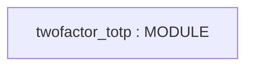
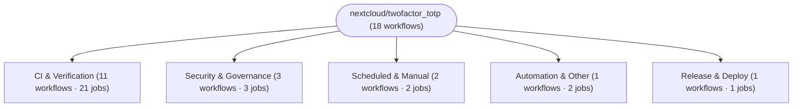

# Repository Architecture Analysis: nextcloud/twofactor_totp

## Metadata
- **SHA**: `5db86a77b183884835a7d4a66e74dabae9438074`
- **Primary Ecosystem**: JavaScript/TypeScript

## Quality Metrics
- **ast_engine**: tree-sitter
- **avg_cognitive_complexity**: 9.83
- **avg_cyclomatic_complexity**: 6.22
- **component_count**: 1
- **dead_code_count**: 150
- **dead_code_symbols**: 50 entry(ies)
- **duplication_pct**: 87.02
- **file_complexities**: 25 entry(ies)
- **files_analyzed**: 111
- **fitness_passed**: False
- **fitness_violation_count**: 3
- **framework**: Unknown
- **import_edges**: 100 entry(ies)
- **loc**: 2696
- **max_cognitive_complexity**: 771
- **max_cyclomatic_complexity**: 391
- **sloc**: 2282
- **test_file_count**: 23

# Architecture: nextcloud/twofactor_totp

## Context
- **Repository**: `nextcloud/twofactor_totp`
- **SHA**: `5db86a77b183884835a7d4a66e74dabae9438074`
- **Ecosystem**: JavaScript/TypeScript
- **Framework**: Unknown

## Building Block View

## Component Details
- **twofactor_totp** (`package.json`): MODULE

## 6-Dimension Repository Scorecard

- **Overall Grade**: `F` (51.30/100)
- **Technical Debt Score**: 48.70
- **Estimated Remediation Effort**: 95.58h

| Dimension | Grade | Score | Weight | Details |
| :--- | :---: | :---: | :---: | :--- |
| Code Quality | `F` | 17.12 | 0.20 | avg_cc=6.22, max_cc=391, duplication=87.02%, dead_code=150 |
| Dependency Health | `A` | 100.00 | 0.15 | dependencies=1614, outdated=0, vulnerable=0, has_lockfile=True |
| Maintainability | `F` | 42.51 | 0.15 | avg_cognitive=9.83, max_cognitive=771, fitness_violations=3, oversized_files=0 |
| Pipeline Health | `F` | 0.00 | 0.15 | workflows=18, operational_antipatterns=36, parallel_branches=True |
| Security | `B` | 80.00 | 0.20 | vulnerabilities=0, secrets=0, pipeline_security_findings=1 |
| Test Coverage | `C` | 70.00 | 0.15 | coverage=unavailable, ci_test_job=True, test_files_detected=True |

## Architecture Fitness & Workspace Boundaries

- **[MEDIUM] `ATRUSS-ARCH-005` (COMPLEXITY_THRESHOLD)**: Repository duplication_pct (87.02) exceeds policy threshold (15.0).
- **[MEDIUM] `ATRUSS-ARCH-005` (COMPLEXITY_THRESHOLD)**: Repository max_cognitive_complexity (771.0) exceeds policy threshold (25.0).
- **[MEDIUM] `ATRUSS-ARCH-005` (COMPLEXITY_THRESHOLD)**: Repository max_cyclomatic_complexity (391.0) exceeds policy threshold (20.0).

## Supply Chain Dependencies, Vulnerabilities & Secrets

- **Dependencies Parsed**: 1614 | **Vulnerabilities**: 0 | **Secrets**: 0

### Inventory Sample
- `christian-riesen/base32` `1.6.0` (composer, `composer.json`)
- `rullzer/easytotp` `0.1.4` (composer, `composer.json`)
- `@chenfengyuan/vue-qrcode` `2.0.0` (npm, `package-lock.json`)
- `@chenfengyuan/vue-qrcode` `2.0.0` (npm, `package.json`)
- `@nextcloud/auth` `2.6.0` (npm, `package-lock.json`)
- `@nextcloud/auth` `2.6.0` (npm, `package.json`)
- `@nextcloud/axios` `2.6.0` (npm, `package-lock.json`)
- `@nextcloud/axios` `2.6.0` (npm, `package.json`)
- `@nextcloud/babel-config` `1.3.0` (npm, `package-lock.json`)
- `@nextcloud/babel-config` `1.3.0` (npm, `package.json`)
- `@nextcloud/browserslist-config` `3.1.2` (npm, `package-lock.json`)
- `@nextcloud/browserslist-config` `3.1.2` (npm, `package.json`)
- `@nextcloud/eslint-config` `8.4.2` (npm, `package-lock.json`)
- `@nextcloud/eslint-config` `8.4.2` (npm, `package.json`)
- `@nextcloud/initial-state` `3.0.0` (npm, `package-lock.json`)
- `@nextcloud/initial-state` `3.0.0` (npm, `package.json`)
- `@nextcloud/logger` `3.0.3` (npm, `package-lock.json`)
- `@nextcloud/logger` `3.0.3` (npm, `package.json`)
- `@nextcloud/password-confirmation` `6.1.0` (npm, `package-lock.json`)
- `@nextcloud/password-confirmation` `6.1.0` (npm, `package.json`)
- `@nextcloud/router` `3.1.0` (npm, `package-lock.json`)
- `@nextcloud/router` `3.1.0` (npm, `package.json`)
- `@nextcloud/stylelint-config` `3.2.2` (npm, `package-lock.json`)
- `@nextcloud/stylelint-config` `3.2.2` (npm, `package.json`)
- `@nextcloud/webpack-vue-config` `7.0.2` (npm, `package.json`)
- `@nextcloud/webpack-vue-config` `7.0.4` (npm, `package-lock.json`)
- `@playwright/test` `1.61.1` (npm, `package-lock.json`)
- `@playwright/test` `1.61.1` (npm, `package.json`)
- `@vue/test-utils` `2.4.11` (npm, `package-lock.json`)
- `@vue/test-utils` `2.4.11` (npm, `package.json`)
- ... (+1584 more dependencies)

## CI/CD Pipeline Topology

