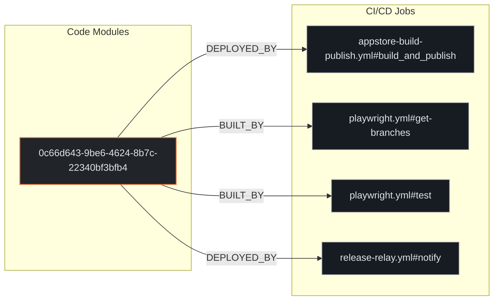
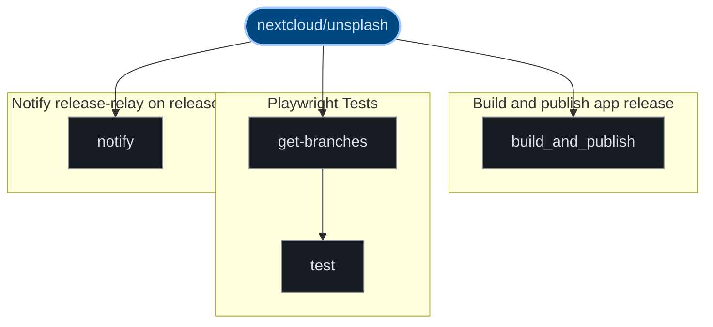

# Repository Architecture Analysis: nextcloud/unsplash

## Metadata
- **SHA**: `97299a47805949d9bd0956ed0abf6e2ff87902f7`
- **Primary Ecosystem**: JavaScript/TypeScript

## Quality Metrics
- **ast_engine**: tree-sitter
- **avg_cognitive_complexity**: 0.67
- **avg_cyclomatic_complexity**: 1.33
- **component_count**: 1
- **dead_code_count**: 0
- **dead_code_symbols**: 0 entry(ies)
- **duplication_pct**: 84.85
- **file_complexities**: 25 entry(ies)
- **files_analyzed**: 67
- **fitness_passed**: False
- **fitness_violation_count**: 1
- **framework**: Unknown
- **import_edges**: 11 entry(ies)
- **loc**: 1903
- **max_cognitive_complexity**: 21
- **max_cyclomatic_complexity**: 8
- **sloc**: 1754
- **test_file_count**: 1

# Architecture: nextcloud/unsplash

## Context
- **Repository**: `nextcloud/unsplash`
- **SHA**: `97299a47805949d9bd0956ed0abf6e2ff87902f7`
- **Ecosystem**: JavaScript/TypeScript
- **Framework**: Unknown

## Building Block View

## Component Details
- **unsplash** (`package.json`): MODULE

## 6-Dimension Repository Scorecard

- **Overall Grade**: `C` (76.22/100)
- **Technical Debt Score**: 23.78
- **Estimated Remediation Effort**: 33.91h

| Dimension | Grade | Score | Weight | Details |
| :--- | :---: | :---: | :---: | :--- |
| Code Quality | `C` | 75.00 | 0.20 | avg_cc=1.33, max_cc=8, duplication=84.85%, dead_code=0 |
| Dependency Health | `A` | 100.00 | 0.15 | dependencies=117, outdated=0, vulnerable=0, has_lockfile=True |
| Maintainability | `A` | 92.50 | 0.15 | avg_cognitive=0.67, max_cognitive=21, fitness_violations=1, oversized_files=0 |
| Pipeline Health | `F` | 39.00 | 0.15 | workflows=3, operational_antipatterns=7, parallel_branches=False |
| Security | `B` | 80.00 | 0.20 | vulnerabilities=0, secrets=0, pipeline_security_findings=1 |
| Test Coverage | `C` | 70.00 | 0.15 | coverage=unavailable, ci_test_job=True, test_files_detected=True |

## Architecture Fitness & Workspace Boundaries

- **[MEDIUM] `ATRUSS-ARCH-005` (COMPLEXITY_THRESHOLD)**: Repository duplication_pct (84.85) exceeds policy threshold (15.0).

## Supply Chain Dependencies, Vulnerabilities & Secrets

- **Dependencies Parsed**: 117 | **Vulnerabilities**: 0 | **Secrets**: 0

### Inventory Sample
- `@nextcloud/e2e-test-server` `0.4.0` (npm, `package-lock.json`)
- `@nextcloud/e2e-test-server` `0.4.0` (npm, `package.json`)
- `@playwright/test` `1.52.0` (npm, `package.json`)
- `@playwright/test` `1.59.1` (npm, `package-lock.json`)
- `@balena/dockerignore` `1.0.2` (npm, `package-lock.json`)
- `@grpc/grpc-js` `1.14.3` (npm, `package-lock.json`)
- `@grpc/proto-loader` `0.7.15` (npm, `package-lock.json`)
- `@grpc/proto-loader` `0.8.0` (npm, `package-lock.json`)
- `@hapi/address` `5.1.1` (npm, `package-lock.json`)
- `@hapi/formula` `3.0.2` (npm, `package-lock.json`)
- `@hapi/hoek` `11.0.7` (npm, `package-lock.json`)
- `@hapi/pinpoint` `2.0.1` (npm, `package-lock.json`)
- `@hapi/tlds` `1.1.6` (npm, `package-lock.json`)
- `@hapi/topo` `6.0.2` (npm, `package-lock.json`)
- `@js-sdsl/ordered-map` `4.4.2` (npm, `package-lock.json`)
- `@nextcloud/paths` `2.4.0` (npm, `package-lock.json`)
- `@nodable/entities` `2.1.0` (npm, `package-lock.json`)
- `@protobufjs/aspromise` `1.1.2` (npm, `package-lock.json`)
- `@protobufjs/base64` `1.1.2` (npm, `package-lock.json`)
- `@protobufjs/codegen` `2.0.4` (npm, `package-lock.json`)
- `@protobufjs/eventemitter` `1.1.0` (npm, `package-lock.json`)
- `@protobufjs/fetch` `1.1.0` (npm, `package-lock.json`)
- `@protobufjs/float` `1.0.2` (npm, `package-lock.json`)
- `@protobufjs/inquire` `1.1.0` (npm, `package-lock.json`)
- `@protobufjs/path` `1.1.2` (npm, `package-lock.json`)
- `@protobufjs/pool` `1.1.0` (npm, `package-lock.json`)
- `@protobufjs/utf8` `1.1.0` (npm, `package-lock.json`)
- `@standard-schema/spec` `1.1.0` (npm, `package-lock.json`)
- `@types/node` `25.6.0` (npm, `package-lock.json`)
- `ansi-regex` `5.0.1` (npm, `package-lock.json`)
- ... (+87 more dependencies)

## Section 7: Code-to-Cloud Deployment Traceability

- `0c66d643-9be6-4624-8b7c-22340bf3bfb4` (code_module) --[BUILT_BY]--> `playwright.yml#get-branches` (ci_job)
- `0c66d643-9be6-4624-8b7c-22340bf3bfb4` (code_module) --[BUILT_BY]--> `playwright.yml#test` (ci_job)
- `0c66d643-9be6-4624-8b7c-22340bf3bfb4` (code_module) --[DEPLOYED_BY]--> `appstore-build-publish.yml#build_and_publish` (ci_job)
- `0c66d643-9be6-4624-8b7c-22340bf3bfb4` (code_module) --[DEPLOYED_BY]--> `release-relay.yml#notify` (ci_job)

## CI/CD Pipeline Topology

