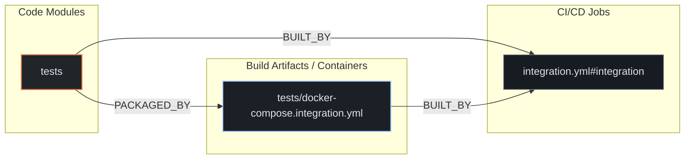

# Repository Architecture Analysis: nextcloud/user_oidc

## Metadata
- **SHA**: `49b5830c27d636dd2f8ed8bd75c507ba50be1501`
- **Primary Ecosystem**: PHP

## Quality Metrics
- **ast_engine**: fallback
- **avg_cognitive_complexity**: 0.0
- **avg_cyclomatic_complexity**: 0.0
- **component_count**: 111
- **dead_code_count**: 0
- **dead_code_symbols**: 0 entry(ies)
- **duplication_pct**: 0.0
- **file_complexities**: 0 entry(ies)
- **files_analyzed**: 111
- **fitness_passed**: True
- **fitness_violation_count**: 0
- **framework**: Symfony
- **import_edges**: 0 entry(ies)
- **loc**: 12845
- **max_cognitive_complexity**: 0
- **max_cyclomatic_complexity**: 0
- **sloc**: 9043
- **test_file_count**: 32

# Architecture: nextcloud/user_oidc

## Context
- **Repository**: `nextcloud/user_oidc`
- **SHA**: `49b5830c27d636dd2f8ed8bd75c507ba50be1501`
- **Ecosystem**: PHP
- **Framework**: Symfony

## Building Block View

```mermaid
graph TD;
  classDef atlasRoot fill:#004882,stroke:#a3c9ff,stroke-width:2px,color:#d3e4ff
  classDef atlasCategory fill:#212428,stroke:#E87A48,stroke-width:1.5px,color:#dfe3eb
  classDef atlasWorkflow fill:#1b2026,stroke:#a3c9ff,stroke-width:1.5px,color:#dfe3eb
  classDef atlasJob fill:#171c22,stroke:#8d9199,stroke-width:1px,color:#dfe3eb
  classDef atlasTarget fill:#005227,stroke:#8bd99b,stroke-width:1.5px,color:#a7f6b6
  classDef atlasAlert fill:#93000a,stroke:#ffb4ab,stroke-width:1.5px,color:#ffdad6
  classDef atlasMore fill:#252a31,stroke:#8d9199,stroke-dasharray:4 4,color:#c3c6cf
    repo_root(["nextcloud/user_oidc (111 components)"]):::atlasRoot
    dir_0_lib["lib (78)"]:::atlasCategory
    repo_root --> dir_0_lib
    sub_0_0_Migration["Migration (16)"]:::atlasWorkflow
    dir_0_lib --> sub_0_0_Migration
    sub_0_1_Service["Service (12)"]:::atlasWorkflow
    dir_0_lib --> sub_0_1_Service
    sub_0_2_Db["Db (8)"]:::atlasWorkflow
    dir_0_lib --> sub_0_2_Db
    sub_0_more["+14 more submodules (42)"]:::atlasMore
    dir_0_lib --> sub_0_more
    dir_1_tests["tests (27)"]:::atlasCategory
    repo_root --> dir_1_tests
    sub_1_0_unit["unit (13)"]:::atlasWorkflow
    dir_1_tests --> sub_1_0_unit
    sub_1_1_stubs["stubs (12)"]:::atlasWorkflow
    dir_1_tests --> sub_1_1_stubs
    sub_1_2__module_root_["(module root) (1)"]:::atlasWorkflow
    dir_1_tests --> sub_1_2__module_root_
    sub_1_more["+1 more submodules (1)"]:::atlasMore
    dir_1_tests --> sub_1_more
    dir_2_templates["templates (3)"]:::atlasCategory
    repo_root --> dir_2_templates
    dir_3__root_["(root) (1)"]:::atlasCategory
    repo_root --> dir_3__root_
    dir_4_appinfo["appinfo (1)"]:::atlasCategory
    repo_root --> dir_4_appinfo
    dir_other_modules["+1 more modules (1)"]:::atlasMore
    repo_root --> dir_other_modules
```

## Component Details

Showing top 60 representative components out of 111 across 6 module group(s):

- **Module `lib`** (78 components — module: 78)
- **Module `tests`** (27 components — module: 27)
- **Module `templates`** (3 components — module: 3)
- **Module `(root)`** (1 components — module: 1)
- **Module `appinfo`** (1 components — module: 1)
- **Module `scripts`** (1 components — module: 1)

- **.php-cs-fixer.dist** (`.php-cs-fixer.dist.php`): module
- **AdminSettings** (`lib/Settings/AdminSettings.php`): module
- **AlternativeLogin** (`lib/AlternativeLogin/AlternativeLogin.php`): module
- **AlternativeLoginProvider** (`lib/AlternativeLogin/AlternativeLoginProvider.php`): module
- **ApiController** (`lib/Controller/ApiController.php`): module
- **Application** (`lib/AppInfo/Application.php`): module
- **AttributeMappedEvent** (`lib/Event/AttributeMappedEvent.php`): module
- **AuditLogger** (`lib/AuditLog/AuditLogger.php`): module
- **Backend** (`lib/User/Backend.php`): module
- **BackendTest** (`tests/unit/User/BackendTest.php`): module
- **BaseOidcController** (`lib/Controller/BaseOidcController.php`): module
- **CleanupSessions** (`lib/Cron/CleanupSessions.php`): module
- **DeleteProvider** (`lib/Command/DeleteProvider.php`): module
- **DiscoveryService** (`lib/Service/DiscoveryService.php`): module
- **DiscoveryServiceTest** (`tests/unit/Service/DiscoveryServiceTest.php`): module
- **ExchangedTokenRequestedEvent** (`lib/Event/ExchangedTokenRequestedEvent.php`): module
- **ExchangedTokenRequestedListener** (`lib/Listener/ExchangedTokenRequestedListener.php`): module
- **ExternalTokenRequestedEvent** (`lib/Event/ExternalTokenRequestedEvent.php`): module
- **ExternalTokenRequestedListener** (`lib/Listener/ExternalTokenRequestedListener.php`): module
- **GetExternalTokenFailedException** (`lib/Exception/GetExternalTokenFailedException.php`): module
- **HttpClientHelper** (`lib/Helper/HttpClientHelper.php`): module
- **IBearerTokenValidator** (`lib/User/Validator/IBearerTokenValidator.php`): module
- **ID4MeService** (`lib/Service/ID4MeService.php`): module
- **IProvisioningStrategy** (`lib/User/Provisioning/IProvisioningStrategy.php`): module
- **Id4Me** (`lib/Db/Id4Me.php`): module
- **Id4MeMapper** (`lib/Db/Id4MeMapper.php`): module
- **Id4meController** (`lib/Controller/Id4meController.php`): module
- **IdServiceTest** (`tests/unit/Service/IdServiceTest.php`): module
- **InternalTokenRequestedEvent** (`lib/Event/InternalTokenRequestedEvent.php`): module
- **InternalTokenRequestedListener** (`lib/Listener/InternalTokenRequestedListener.php`): module
- **JweService** (`lib/Service/JweService.php`): module
- **JweServiceTest** (`tests/unit/Service/JweServiceTest.php`): module
- **JwkService** (`lib/Service/JwkService.php`): module
- **JwkServiceTest** (`tests/unit/Service/JwkServiceTest.php`): module
- **LdapService** (`lib/Service/LdapService.php`): module
- **ListProviders** (`lib/Command/ListProviders.php`): module
- **LocalIdService** (`lib/Service/LocalIdService.php`): module
- **LoginController** (`lib/Controller/LoginController.php`): module
- **OIDCService** (`lib/Service/OIDCService.php`): module
- **OIDCServiceTest** (`tests/unit/Service/OIDCServiceTest.php`): module
- **OcsApiController** (`lib/Controller/OcsApiController.php`): module
- **Operation** (`lib/AuditLog/Operation.php`): module
- **Provider** (`lib/Db/Provider.php`): module
- **ProviderMapper** (`lib/Db/ProviderMapper.php`): module
- **ProviderService** (`lib/Service/ProviderService.php`): module
- **ProviderServiceTest** (`tests/unit/Service/ProviderServiceTest.php`): module
- **ProvisioningService** (`lib/Service/ProvisioningService.php`): module
- **ProvisioningServiceTest** (`tests/unit/Service/ProvisioningServiceTest.php`): module
- **RequestClassificationService** (`lib/Service/RequestClassificationService.php`): module
- **RequestClassificationServiceTest** (`tests/unit/Service/RequestClassificationServiceTest.php`): module
- **ResponseDefinitions** (`lib/ResponseDefinitions.php`): module
- **Section** (`lib/Settings/Section.php`): module
- **SelfEncodedTokenProvisioning** (`lib/User/Provisioning/SelfEncodedTokenProvisioning.php`): module
- **SelfEncodedValidator** (`lib/User/Validator/SelfEncodedValidator.php`): module
- **Session** (`lib/Db/Session.php`): module
- **SessionMapper** (`lib/Db/SessionMapper.php`): module
- **SettingsController** (`lib/Controller/SettingsController.php`): module
- **SettingsService** (`lib/Service/SettingsService.php`): module
- **SettingsServiceTest** (`tests/unit/Service/SettingsServiceTest.php`): module
- **Test** (`tests/integration/Test.php`): module

## 6-Dimension Repository Scorecard

- **Overall Grade**: `D` (60.50/100)
- **Technical Debt Score**: 39.50
- **Estimated Remediation Effort**: 47.88h

| Dimension | Grade | Score | Weight | Details |
| :--- | :---: | :---: | :---: | :--- |
| Code Quality | `A` | 100.00 | 0.20 | avg_cc=0.00, max_cc=0, duplication=0.00%, dead_code=0 |
| Dependency Health | `A` | 100.00 | 0.15 | dependencies=1245, outdated=0, vulnerable=0, has_lockfile=True |
| Maintainability | `A` | 100.00 | 0.15 | avg_cognitive=0.00, max_cognitive=0, fitness_violations=0, oversized_files=0 |
| Pipeline Health | `F` | 0.00 | 0.15 | workflows=16, operational_antipatterns=33, parallel_branches=True |
| Security | `F` | 0.00 | 0.20 | vulnerabilities=0, secrets=3, pipeline_security_findings=6 |
| Test Coverage | `C` | 70.00 | 0.15 | coverage=unavailable, ci_test_job=True, test_files_detected=True |

## Supply Chain Dependencies, Vulnerabilities & Secrets

- **Dependencies Parsed**: 1245 | **Vulnerabilities**: 0 | **Secrets**: 3

### Secret Findings (Redacted)
- **[HIGH] `ATRUSS-SEC-005`** at `l10n/ja.js:13` (`"Failed to decrypt the ID4ME provider client secret" : "ID4M***REDACTED***",`)
- **[HIGH] `ATRUSS-SEC-005`** at `l10n/ja.json:11` (`"Failed to decrypt the ID4ME provider client secret" : "ID4M***REDACTED***",`)
- **[CRITICAL] `ATRUSS-SEC-004`** at `tests/unit/Service/JwkServiceTest.php:62` (`-----BEGIN ... PRIVATE KEY----- [REDACTED]`)

### Inventory Sample
- `bamarni/composer-bin-plugin` `1.4` (composer, `composer.json`)
- `coenjacobs/mozart` `1.2` (composer, `vendor-bin/mozart/composer.json`)
- `firebase/php-jwt` `7` (composer, `composer.json`)
- `id4me/id4me-rp` `1.2` (composer, `composer.json`)
- `spomky-labs/aes-key-wrap` `7.0` (composer, `composer.json`)
- `web-token/jwt-library` `4.1` (composer, `composer.json`)
- `@nextcloud/axios` `2.6.0` (npm, `package-lock.json`)
- `@nextcloud/axios` `2.6.0` (npm, `package.json`)
- `@nextcloud/babel-config` `1.3.0` (npm, `package-lock.json`)
- `@nextcloud/babel-config` `1.3.0` (npm, `package.json`)
- `@nextcloud/browserslist-config` `3.1.1` (npm, `package.json`)
- `@nextcloud/browserslist-config` `3.1.2` (npm, `package-lock.json`)
- `@nextcloud/dialogs` `7.5.0` (npm, `package-lock.json`)
- `@nextcloud/dialogs` `7.5.0` (npm, `package.json`)
- `@nextcloud/eslint-config` `8.4.2` (npm, `package-lock.json`)
- `@nextcloud/eslint-config` `8.4.2` (npm, `package.json`)
- `@nextcloud/initial-state` `3.0.0` (npm, `package-lock.json`)
- `@nextcloud/initial-state` `3.0.0` (npm, `package.json`)
- `@nextcloud/logger` `3.0.2` (npm, `package.json`)
- `@nextcloud/logger` `3.0.3` (npm, `package-lock.json`)
- `@nextcloud/password-confirmation` `6.2.1` (npm, `package-lock.json`)
- `@nextcloud/password-confirmation` `6.2.1` (npm, `package.json`)
- `@nextcloud/router` `3.0.1` (npm, `package.json`)
- `@nextcloud/router` `3.2.0` (npm, `package-lock.json`)
- `@nextcloud/stylelint-config` `3.2.2` (npm, `package-lock.json`)
- `@nextcloud/stylelint-config` `3.2.2` (npm, `package.json`)
- `@nextcloud/vue` `9.14.1` (npm, `package-lock.json`)
- `@nextcloud/vue` `9.14.1` (npm, `package.json`)
- `@nextcloud/webpack-vue-config` `7.1.0` (npm, `package-lock.json`)
- `@nextcloud/webpack-vue-config` `7.1.0` (npm, `package.json`)
- ... (+1215 more dependencies)

## Section 7: Code-to-Cloud Deployment Traceability

- `tests` (code_module) --[BUILT_BY]--> `integration.yml#integration` (ci_job)
- `tests` (code_module) --[PACKAGED_BY]--> `tests/docker-compose.integration.yml` (container)
- `tests/docker-compose.integration.yml` (container) --[BUILT_BY]--> `integration.yml#integration` (ci_job)

## CI/CD Pipeline Topology

```mermaid
graph TD;
  classDef atlasRoot fill:#004882,stroke:#a3c9ff,stroke-width:2px,color:#d3e4ff
  classDef atlasCategory fill:#212428,stroke:#E87A48,stroke-width:1.5px,color:#dfe3eb
  classDef atlasWorkflow fill:#1b2026,stroke:#a3c9ff,stroke-width:1.5px,color:#dfe3eb
  classDef atlasJob fill:#171c22,stroke:#8d9199,stroke-width:1px,color:#dfe3eb
  classDef atlasTarget fill:#005227,stroke:#8bd99b,stroke-width:1.5px,color:#a7f6b6
  classDef atlasAlert fill:#93000a,stroke:#ffb4ab,stroke-width:1.5px,color:#ffdad6
  classDef atlasMore fill:#252a31,stroke:#8d9199,stroke-dasharray:4 4,color:#c3c6cf
  pipeline_root(["nextcloud/user_oidc (16 workflows)"]):::atlasRoot
  grp_0_CI___Verification["CI & Verification (9 workflows · 18 jobs)"]:::atlasCategory
  pipeline_root --> grp_0_CI___Verification
  wf_4_Lint_eslint["Lint eslint (3 jobs)"]:::atlasWorkflow
  grp_0_CI___Verification --> wf_4_Lint_eslint
  job_4_changes["changes"]:::atlasJob
  job_4_lint["lint"]:::atlasJob
  job_4_summary["summary"]:::atlasJob
  wf_4_Lint_eslint --> job_4_changes
  job_4_changes --> job_4_lint
  job_4_changes --> job_4_summary
  job_4_lint --> job_4_summary
  wf_5_Lint["Lint (4 jobs)"]:::atlasWorkflow
  grp_0_CI___Verification --> wf_5_Lint
  job_5_php["php"]:::atlasJob
  job_5_php_cs_fixer["php-cs-fixer"]:::atlasJob
  job_5_node["node"]:::atlasJob
  wf_5_Lint --> job_5_php
  wf_5_Lint --> job_5_php_cs_fixer
  wf_5_Lint --> job_5_node
  wf_6_Node["Node (3 jobs)"]:::atlasWorkflow
  grp_0_CI___Verification --> wf_6_Node
  job_6_changes["changes"]:::atlasJob
  job_6_build["build"]:::atlasJob
  job_6_summary["summary"]:::atlasJob
  wf_6_Node --> job_6_changes
  job_6_changes --> job_6_build
  job_6_changes --> job_6_summary
  job_6_build --> job_6_summary
  grp_1_Scheduled___Manual["Scheduled & Manual (3 workflows · 3 jobs)"]:::atlasCategory
  pipeline_root --> grp_1_Scheduled___Manual
  wf_9_Ask_for_feedback_on_PRs["Ask for feedback on PRs (1 jobs)"]:::atlasWorkflow
  grp_1_Scheduled___Manual --> wf_9_Ask_for_feedback_on_PRs
  job_9_pr_feedback["pr-feedback"]:::atlasJob
  wf_9_Ask_for_feedback_on_PRs --> job_9_pr_feedback
  wf_13_Update_workflows["Update workflows (1 jobs)"]:::atlasWorkflow
  grp_1_Scheduled___Manual --> wf_13_Update_workflows
  job_13_dispatch["dispatch"]:::atlasJob
  wf_13_Update_workflows --> job_13_dispatch
  wf_15_Update_nextcloud_ocp["Update nextcloud/ocp (1 jobs)"]:::atlasWorkflow
  grp_1_Scheduled___Manual --> wf_15_Update_nextcloud_ocp
  job_15_update_nextcloud_ocp["update-nextcloud-ocp"]:::atlasJob
  wf_15_Update_nextcloud_ocp --> job_15_update_nextcloud_ocp
  grp_2_Release___Deploy["Release & Deploy (2 workflows · 2 jobs)"]:::atlasCategory
  pipeline_root --> grp_2_Release___Deploy
  wf_0_Build_and_publish_app_release["Build and publish app release (1 jobs)"]:::atlasWorkflow
  grp_2_Release___Deploy --> wf_0_Build_and_publish_app_release
  job_0_build_and_publish["build_and_publish"]:::atlasJob
  wf_0_Build_and_publish_app_release --> job_0_build_and_publish
  wf_11_Notify_release_relay_on_release["Notify release-relay on release (1 jobs)"]:::atlasWorkflow
  grp_2_Release___Deploy --> wf_11_Notify_release_relay_on_release
  job_11_notify["notify"]:::atlasJob
  wf_11_Notify_release_relay_on_release --> job_11_notify
  grp_3_Security___Governance["Security & Governance (2 workflows · 2 jobs)"]:::atlasCategory
  pipeline_root --> grp_3_Security___Governance
  wf_1_Auto_approve_Dependabot_PRs["Auto approve Dependabot PRs (1 jobs)"]:::atlasWorkflow
  grp_3_Security___Governance --> wf_1_Auto_approve_Dependabot_PRs
  job_1_auto_approve_merge["auto-approve-merge"]:::atlasJob
  wf_1_Auto_approve_Dependabot_PRs --> job_1_auto_approve_merge
  wf_2_Block_fixup_and_squash_commits["Block fixup and squash commits (1 jobs)"]:::atlasWorkflow
  grp_3_Security___Governance --> wf_2_Block_fixup_and_squash_commits
  job_2_commit_message_check["commit-message-check"]:::atlasJob
  wf_2_Block_fixup_and_squash_commits --> job_2_commit_message_check
  wf_more["+6 more workflows"]:::atlasMore
  pipeline_root --> wf_more
```

