# Repository Architecture Analysis: nextcloud/user_saml

## Metadata
- **SHA**: `b4f465eeaddcd4efc39015273cec97937a11dadb`
- **Primary Ecosystem**: PHP

## Quality Metrics
- **ast_engine**: fallback
- **avg_cognitive_complexity**: 0.0
- **avg_cyclomatic_complexity**: 0.0
- **component_count**: 93
- **dead_code_count**: 0
- **dead_code_symbols**: 0 entry(ies)
- **duplication_pct**: 0.0
- **file_complexities**: 0 entry(ies)
- **files_analyzed**: 93
- **fitness_passed**: True
- **fitness_violation_count**: 0
- **framework**: PHP Composer
- **import_edges**: 0 entry(ies)
- **loc**: 12301
- **max_cognitive_complexity**: 0
- **max_cyclomatic_complexity**: 0
- **sloc**: 8592
- **test_file_count**: 38

# Architecture: nextcloud/user_saml

## Context
- **Repository**: `nextcloud/user_saml`
- **SHA**: `b4f465eeaddcd4efc39015273cec97937a11dadb`
- **Ecosystem**: PHP
- **Framework**: PHP Composer

## Building Block View

```mermaid
graph TD;
  classDef atlasRoot fill:#004882,stroke:#a3c9ff,stroke-width:2px,color:#d3e4ff
  classDef atlasCategory fill:#212428,stroke:#E87A48,stroke-width:1.5px,color:#dfe3eb
  classDef atlasWorkflow fill:#1b2026,stroke:#a3c9ff,stroke-width:1.5px,color:#dfe3eb
  classDef atlasJob fill:#171c22,stroke:#8d9199,stroke-width:1px,color:#dfe3eb
  classDef atlasTarget fill:#005227,stroke:#8bd99b,stroke-width:1.5px,color:#a7f6b6
  classDef atlasAlert fill:#93000a,stroke:#ffb4ab,stroke-width:1.5px,color:#ffdad6
  classDef atlasMore fill:#252a31,stroke:#8d9199,stroke-dasharray:4 4,color:#c3c6cf
    repo_root(["nextcloud/user_saml (93 components)"]):::atlasRoot
    dir_0_lib["lib (54)"]:::atlasCategory
    repo_root --> dir_0_lib
    sub_0_0_Command["Command (9)"]:::atlasWorkflow
    dir_0_lib --> sub_0_0_Command
    sub_0_1_Migration["Migration (8)"]:::atlasWorkflow
    dir_0_lib --> sub_0_1_Migration
    sub_0_2__module_root_["(module root) (7)"]:::atlasWorkflow
    dir_0_lib --> sub_0_2__module_root_
    sub_0_more["+14 more submodules (30)"]:::atlasMore
    dir_0_lib --> sub_0_more
    dir_1_tests["tests (30)"]:::atlasCategory
    repo_root --> dir_1_tests
    sub_1_0_unit["unit (18)"]:::atlasWorkflow
    dir_1_tests --> sub_1_0_unit
    sub_1_1_stubs["stubs (11)"]:::atlasWorkflow
    dir_1_tests --> sub_1_1_stubs
    sub_1_2_integration["integration (1)"]:::atlasWorkflow
    dir_1_tests --> sub_1_2_integration
    dir_2_templates["templates (6)"]:::atlasCategory
    repo_root --> dir_2_templates
    dir_3__root_["(root) (2)"]:::atlasCategory
    repo_root --> dir_3__root_
    dir_4_appinfo["appinfo (1)"]:::atlasCategory
    repo_root --> dir_4_appinfo
```

## Component Details

Showing top 60 representative components out of 93 across 5 module group(s):

- **Module `lib`** (54 components — module: 54)
- **Module `tests`** (30 components — module: 30)
- **Module `templates`** (6 components — module: 6)
- **Module `(root)`** (2 components — module: 2)
- **Module `appinfo`** (1 components — module: 1)

- **.php-cs-fixer.dist** (`.php-cs-fixer.dist.php`): module
- **Admin** (`lib/Settings/Admin.php`): module
- **AdminTest** (`tests/unit/Settings/AdminTest.php`): module
- **AlternativeLogin** (`lib/AlternativeLogin/AlternativeLogin.php`): module
- **AlternativeLoginProvider** (`lib/AlternativeLogin/AlternativeLoginProvider.php`): module
- **Application** (`lib/AppInfo/Application.php`): module
- **ApplicationTest** (`tests/unit/AppInfo/ApplicationTest.php`): module
- **CleanSessionData** (`lib/Jobs/CleanSessionData.php`): module
- **CleanupRemovedConfig** (`lib/Migration/CleanupRemovedConfig.php`): module
- **ConfigCreate** (`lib/Command/ConfigCreate.php`): module
- **ConfigDelete** (`lib/Command/ConfigDelete.php`): module
- **ConfigGet** (`lib/Command/ConfigGet.php`): module
- **ConfigSet** (`lib/Command/ConfigSet.php`): module
- **ConfigValidate** (`lib/Command/ConfigValidate.php`): module
- **ConfigValidateTest** (`tests/unit/Command/ConfigValidateTest.php`): module
- **ConfigurationsEntity** (`lib/Db/ConfigurationsEntity.php`): module
- **ConfigurationsMapper** (`lib/Db/ConfigurationsMapper.php`): module
- **CookieLoginEventListener** (`lib/Listener/CookieLoginEventListener.php`): module
- **DavPlugin** (`lib/DavPlugin.php`): module
- **DavPluginTest** (`tests/unit/DavPluginTest.php`): module
- **FeatureContext** (`tests/integration/features/bootstrap/FeatureContext.php`): module
- **GetMetadata** (`lib/Command/GetMetadata.php`): module
- **GetMetadataTest** (`tests/unit/Command/GetMetadataTest.php`): module
- **GroupBackend** (`lib/GroupBackend.php`): module
- **GroupBackendTest** (`tests/unit/GroupBackendTest.php`): module
- **GroupManager** (`lib/GroupManager.php`): module
- **GroupManagerTest** (`tests/unit/GroupManagerTest.php`): module
- **GroupMigration** (`lib/Service/GroupMigration.php`): module
- **GroupMigrationCopyIncomplete** (`lib/Command/GroupMigrationCopyIncomplete.php`): module
- **GroupMigrationManual** (`lib/Command/GroupMigrationManual.php`): module
- **GroupNotFoundException** (`lib/Exceptions/GroupNotFoundException.php`): module
- **LoadAdditionalScriptsListener** (`lib/Listener/LoadAdditionalScriptsListener.php`): module
- **LoginEventListener** (`lib/Listener/LoginEventListener.php`): module
- **LoginPostTemplateTest** (`tests/unit/Template/LoginPostTemplateTest.php`): module
- **MigrateGroups** (`lib/Jobs/MigrateGroups.php`): module
- **NoUserFoundException** (`lib/Exceptions/NoUserFoundException.php`): module
- **NonMigratableGroupException** (`lib/Exceptions/NonMigratableGroupException.php`): module
- **OnlyLoggedInMiddleware** (`lib/Middleware/OnlyLoggedInMiddleware.php`): module
- **OnlyLoggedInMiddlewareTest** (`tests/unit/Middleware/OnlyLoggedInMiddlewareTest.php`): module
- **OnlyUnauthenticatedUsers** (`lib/Attributes/OnlyUnauthenticatedUsers.php`): module
- **ProviderListingService** (`lib/Service/ProviderListingService.php`): module
- **ProviderListingServiceTest** (`tests/unit/Service/ProviderListingServiceTest.php`): module
- **RememberLocalGroupsForPotentialMigrations** (`lib/Migration/RememberLocalGroupsForPotentialMigrations.php`): module
- **SAMLController** (`lib/Controller/SAMLController.php`): module
- **SAMLControllerTest** (`tests/unit/Controller/SAMLControllerTest.php`): module
- **SAMLSettings** (`lib/SAMLSettings.php`): module
- **SAMLSettingsTest** (`tests/unit/SAMLSettingsTest.php`): module
- **SabrePluginEventListener** (`lib/Listener/SabrePluginEventListener.php`): module
- **Section** (`lib/Settings/Section.php`): module
- **SectionTest** (`tests/unit/Settings/SectionTest.php`): module
- **SessionData** (`lib/Db/SessionData.php`): module
- **SessionData** (`lib/Model/SessionData.php`): module
- **SessionDataMapper** (`lib/Db/SessionDataMapper.php`): module
- **SessionService** (`lib/Service/SessionService.php`): module
- **SettingsController** (`lib/Controller/SettingsController.php`): module
- **SystemReportSection** (`lib/Support/SystemReportSection.php`): module
- **SystemReportSectionTest** (`tests/unit/Support/SystemReportSectionTest.php`): module
- **TXmlHelper** (`lib/Helper/TXmlHelper.php`): module
- **TimezoneController** (`lib/Controller/TimezoneController.php`): module
- **TransferGroupMembers** (`lib/Migration/TransferGroupMembers.php`): module

## 6-Dimension Repository Scorecard

- **Overall Grade**: `D` (60.50/100)
- **Technical Debt Score**: 39.50
- **Estimated Remediation Effort**: 67.38h

| Dimension | Grade | Score | Weight | Details |
| :--- | :---: | :---: | :---: | :--- |
| Code Quality | `A` | 100.00 | 0.20 | avg_cc=0.00, max_cc=0, duplication=0.00%, dead_code=0 |
| Dependency Health | `A` | 100.00 | 0.15 | dependencies=906, outdated=0, vulnerable=0, has_lockfile=True |
| Maintainability | `A` | 100.00 | 0.15 | avg_cognitive=0.00, max_cognitive=0, fitness_violations=0, oversized_files=0 |
| Pipeline Health | `F` | 0.00 | 0.15 | workflows=15, operational_antipatterns=43, parallel_branches=True |
| Security | `F` | 0.00 | 0.20 | vulnerabilities=0, secrets=9, pipeline_security_findings=7 |
| Test Coverage | `C` | 70.00 | 0.15 | coverage=unavailable, ci_test_job=True, test_files_detected=True |

## Supply Chain Dependencies, Vulnerabilities & Secrets

- **Dependencies Parsed**: 906 | **Vulnerabilities**: 0 | **Secrets**: 9

### Secret Findings (Redacted)
- **[CRITICAL] `ATRUSS-SEC-004`** at `tests/integration/features/Shibboleth.feature:13` (`-----BEGIN ... PRIVATE KEY----- [REDACTED]`)
- **[CRITICAL] `ATRUSS-SEC-004`** at `tests/integration/features/Shibboleth.feature:53` (`-----BEGIN ... PRIVATE KEY----- [REDACTED]`)
- **[CRITICAL] `ATRUSS-SEC-004`** at `tests/integration/features/Shibboleth.feature:91` (`-----BEGIN ... PRIVATE KEY----- [REDACTED]`)
- **[CRITICAL] `ATRUSS-SEC-004`** at `tests/integration/features/Shibboleth.feature:145` (`-----BEGIN ... PRIVATE KEY----- [REDACTED]`)
- **[CRITICAL] `ATRUSS-SEC-004`** at `tests/integration/features/Shibboleth.feature:213` (`-----BEGIN ... PRIVATE KEY----- [REDACTED]`)
- **[CRITICAL] `ATRUSS-SEC-004`** at `tests/integration/features/Shibboleth.feature:346` (`-----BEGIN ... PRIVATE KEY----- [REDACTED]`)
- **[CRITICAL] `ATRUSS-SEC-004`** at `tests/integration/features/Shibboleth.feature:426` (`-----BEGIN ... PRIVATE KEY----- [REDACTED]`)
- **[CRITICAL] `ATRUSS-SEC-004`** at `tests/integration/features/Shibboleth.feature:511` (`-----BEGIN ... PRIVATE KEY----- [REDACTED]`)
- **[CRITICAL] `ATRUSS-SEC-004`** at `tests/integration/features/Shibboleth.feature:598` (`-----BEGIN ... PRIVATE KEY----- [REDACTED]`)

### Inventory Sample
- `firebase/php-jwt` `7.0` (composer, `composer.json`)
- `onelogin/php-saml` `4.2` (composer, `composer.json`)
- `@nextcloud/axios` `2.5.2` (npm, `package-lock.json`)
- `@nextcloud/axios` `2.5.2` (npm, `package.json`)
- `@nextcloud/browserslist-config` `3.1.2` (npm, `package-lock.json`)
- `@nextcloud/browserslist-config` `3.1.2` (npm, `package.json`)
- `@nextcloud/dialogs` `7.3.0` (npm, `package-lock.json`)
- `@nextcloud/dialogs` `7.3.0` (npm, `package.json`)
- `@nextcloud/eslint-config` `9.0.0-rc.5` (npm, `package.json`)
- `@nextcloud/eslint-config` `9.0.0-rc.8` (npm, `package-lock.json`)
- `@nextcloud/initial-state` `3.0.0` (npm, `package-lock.json`)
- `@nextcloud/initial-state` `3.0.0` (npm, `package.json`)
- `@nextcloud/l10n` `3.4.1` (npm, `package-lock.json`)
- `@nextcloud/l10n` `3.4.1` (npm, `package.json`)
- `@nextcloud/password-confirmation` `6.0.3` (npm, `package-lock.json`)
- `@nextcloud/password-confirmation` `6.0.3` (npm, `package.json`)
- `@nextcloud/router` `3.1.0` (npm, `package-lock.json`)
- `@nextcloud/router` `3.1.0` (npm, `package.json`)
- `@nextcloud/stylelint-config` `3.2.1` (npm, `package-lock.json`)
- `@nextcloud/stylelint-config` `3.2.1` (npm, `package.json`)
- `@nextcloud/vite-config` `2.5.2` (npm, `package.json`)
- `@nextcloud/vite-config` `2.5.4` (npm, `package-lock.json`)
- `@nextcloud/vue` `9.4.0` (npm, `package.json`)
- `@nextcloud/vue` `9.5.0` (npm, `package-lock.json`)
- `@vue/compiler-sfc` `3.5.25` (npm, `package.json`)
- `@vue/compiler-sfc` `3.5.44` (npm, `package-lock.json`)
- `@vue/tsconfig` `0.8.1` (npm, `package-lock.json`)
- `@vue/tsconfig` `0.8.1` (npm, `package.json`)
- `ts-node` `10.9.2` (npm, `package-lock.json`)
- `ts-node` `10.9.2` (npm, `package.json`)
- ... (+876 more dependencies)

## CI/CD Pipeline Topology

```mermaid
graph TD;
  classDef atlasRoot fill:#004882,stroke:#a3c9ff,stroke-width:2px,color:#d3e4ff
  classDef atlasCategory fill:#212428,stroke:#E87A48,stroke-width:1.5px,color:#dfe3eb
  classDef atlasWorkflow fill:#1b2026,stroke:#a3c9ff,stroke-width:1.5px,color:#dfe3eb
  classDef atlasJob fill:#171c22,stroke:#8d9199,stroke-width:1px,color:#dfe3eb
  classDef atlasTarget fill:#005227,stroke:#8bd99b,stroke-width:1.5px,color:#a7f6b6
  classDef atlasAlert fill:#93000a,stroke:#ffb4ab,stroke-width:1.5px,color:#ffdad6
  classDef atlasMore fill:#252a31,stroke:#8d9199,stroke-dasharray:4 4,color:#c3c6cf
  pipeline_root(["nextcloud/user_saml (15 workflows)"]):::atlasRoot
  grp_0_CI___Verification["CI & Verification (11 workflows · 31 jobs)"]:::atlasCategory
  pipeline_root --> grp_0_CI___Verification
  wf_2_Integration_tests["Integration tests (3 jobs)"]:::atlasWorkflow
  grp_0_CI___Verification --> wf_2_Integration_tests
  job_2_changes["changes"]:::atlasJob
  job_2_integration["integration"]:::atlasJob
  job_2_summary["summary"]:::atlasJob
  wf_2_Integration_tests --> job_2_changes
  wf_2_Integration_tests --> job_2_integration
  job_2_changes --> job_2_summary
  job_2_integration --> job_2_summary
  wf_5_Lint_php["Lint php (3 jobs)"]:::atlasWorkflow
  grp_0_CI___Verification --> wf_5_Lint_php
  job_5_matrix["matrix"]:::atlasJob
  job_5_php_lint["php-lint"]:::atlasJob
  job_5_summary["summary"]:::atlasJob
  wf_5_Lint_php --> job_5_matrix
  job_5_matrix --> job_5_php_lint
  job_5_php_lint --> job_5_summary
  wf_7_PHPUnit_MySQL["PHPUnit MySQL (4 jobs)"]:::atlasWorkflow
  grp_0_CI___Verification --> wf_7_PHPUnit_MySQL
  job_7_matrix["matrix"]:::atlasJob
  job_7_changes["changes"]:::atlasJob
  job_7_phpunit_mysql["phpunit-mysql"]:::atlasJob
  wf_7_PHPUnit_MySQL --> job_7_matrix
  wf_7_PHPUnit_MySQL --> job_7_changes
  job_7_changes --> job_7_phpunit_mysql
  job_7_matrix --> job_7_phpunit_mysql
  wf_8_PHPUnit_OCI["PHPUnit OCI (4 jobs)"]:::atlasWorkflow
  grp_0_CI___Verification --> wf_8_PHPUnit_OCI
  job_8_matrix["matrix"]:::atlasJob
  job_8_changes["changes"]:::atlasJob
  job_8_phpunit_oci["phpunit-oci"]:::atlasJob
  wf_8_PHPUnit_OCI --> job_8_matrix
  wf_8_PHPUnit_OCI --> job_8_changes
  job_8_changes --> job_8_phpunit_oci
  job_8_matrix --> job_8_phpunit_oci
  wf_9_PHPUnit_PostgreSQL["PHPUnit PostgreSQL (4 jobs)"]:::atlasWorkflow
  grp_0_CI___Verification --> wf_9_PHPUnit_PostgreSQL
  job_9_matrix["matrix"]:::atlasJob
  job_9_changes["changes"]:::atlasJob
  job_9_phpunit_pgsql["phpunit-pgsql"]:::atlasJob
  wf_9_PHPUnit_PostgreSQL --> job_9_matrix
  wf_9_PHPUnit_PostgreSQL --> job_9_changes
  job_9_changes --> job_9_phpunit_pgsql
  job_9_matrix --> job_9_phpunit_pgsql
  wf_10_PHPUnit_SQLite["PHPUnit SQLite (4 jobs)"]:::atlasWorkflow
  grp_0_CI___Verification --> wf_10_PHPUnit_SQLite
  job_10_matrix["matrix"]:::atlasJob
  wf_10_PHPUnit_SQLite --> job_10_matrix
  grp_1_Release___Deploy["Release & Deploy (2 workflows · 2 jobs)"]:::atlasCategory
  pipeline_root --> grp_1_Release___Deploy
  wf_0_Build_and_publish_app_release["Build and publish app release (1 jobs)"]:::atlasWorkflow
  grp_1_Release___Deploy --> wf_0_Build_and_publish_app_release
  wf_13_Notify_release_relay_on_release["Notify release-relay on release (1 jobs)"]:::atlasWorkflow
  grp_1_Release___Deploy --> wf_13_Notify_release_relay_on_release
  grp_2_Scheduled___Manual["Scheduled & Manual (2 workflows · 4 jobs)"]:::atlasCategory
  pipeline_root --> grp_2_Scheduled___Manual
  wf_1_Samba_Kerberos_SSO["Samba Kerberos SSO (3 jobs)"]:::atlasWorkflow
  grp_2_Scheduled___Manual --> wf_1_Samba_Kerberos_SSO
  wf_11_Ask_for_feedback_on_PRs["Ask for feedback on PRs (1 jobs)"]:::atlasWorkflow
  grp_2_Scheduled___Manual --> wf_11_Ask_for_feedback_on_PRs
  wf_more["+5 more workflows"]:::atlasMore
  pipeline_root --> wf_more
```

