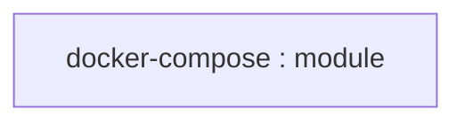
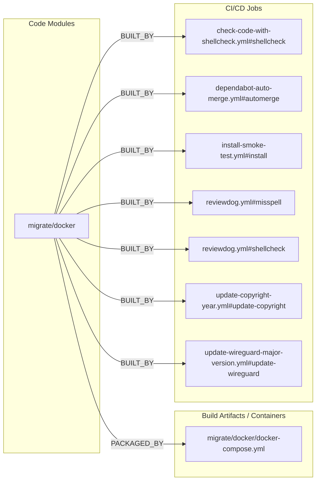
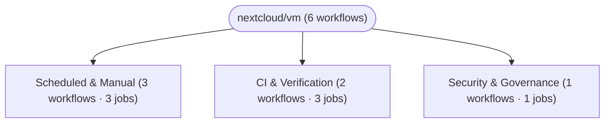

# Repository Architecture Analysis: nextcloud/vm

## Metadata
- **SHA**: `775ae1418ad212bbc7729874453d5c4a34f1210b`
- **Primary Ecosystem**: PHP

## Quality Metrics
- **ast_engine**: fallback
- **avg_cognitive_complexity**: 0.0
- **avg_cyclomatic_complexity**: 0.0
- **component_count**: 1
- **dead_code_count**: 0
- **dead_code_symbols**: 0 entry(ies)
- **duplication_pct**: 0.0
- **file_complexities**: 0 entry(ies)
- **files_analyzed**: 1
- **fitness_passed**: True
- **fitness_violation_count**: 0
- **framework**: Unknown
- **import_edges**: 0 entry(ies)
- **loc**: 39
- **max_cognitive_complexity**: 0
- **max_cyclomatic_complexity**: 0
- **sloc**: 37
- **test_file_count**: 2

# Architecture: nextcloud/vm

## Context
- **Repository**: `nextcloud/vm`
- **SHA**: `775ae1418ad212bbc7729874453d5c4a34f1210b`
- **Ecosystem**: PHP
- **Framework**: Unknown

## Building Block View

## Component Details
- **docker-compose** (`migrate/docker/docker-compose.yml`): module

## 6-Dimension Repository Scorecard

- **Overall Grade**: `C` (72.85/100)
- **Technical Debt Score**: 27.15
- **Estimated Remediation Effort**: 21.79h

| Dimension | Grade | Score | Weight | Details |
| :--- | :---: | :---: | :---: | :--- |
| Code Quality | `A` | 100.00 | 0.20 | avg_cc=0.00, max_cc=0, duplication=0.00%, dead_code=0 |
| Dependency Health | `A` | 90.00 | 0.15 | dependencies=0 (no manifests parsed) |
| Maintainability | `A` | 100.00 | 0.15 | avg_cognitive=0.00, max_cognitive=0, fitness_violations=0, oversized_files=0 |
| Pipeline Health | `B` | 87.00 | 0.15 | workflows=6, operational_antipatterns=6, parallel_branches=True |
| Security | `F` | 4.00 | 0.20 | vulnerabilities=0, secrets=0, pipeline_security_findings=8 |
| Test Coverage | `C` | 70.00 | 0.15 | coverage=unavailable, ci_test_job=True, test_files_detected=True |

## Section 7: Code-to-Cloud Deployment Traceability

- `migrate/docker` (code_module) --[BUILT_BY]--> `check-code-with-shellcheck.yml#shellcheck` (ci_job)
- `migrate/docker` (code_module) --[BUILT_BY]--> `dependabot-auto-merge.yml#automerge` (ci_job)
- `migrate/docker` (code_module) --[BUILT_BY]--> `install-smoke-test.yml#install` (ci_job)
- `migrate/docker` (code_module) --[BUILT_BY]--> `reviewdog.yml#misspell` (ci_job)
- `migrate/docker` (code_module) --[BUILT_BY]--> `reviewdog.yml#shellcheck` (ci_job)
- `migrate/docker` (code_module) --[BUILT_BY]--> `update-copyright-year.yml#update-copyright` (ci_job)
- `migrate/docker` (code_module) --[BUILT_BY]--> `update-wireguard-major-version.yml#update-wireguard` (ci_job)
- `migrate/docker` (code_module) --[PACKAGED_BY]--> `migrate/docker/docker-compose.yml` (container)

## CI/CD Pipeline Topology

